# お題画像の種別判定をローカル環境で行う方法の調査と比較

## 1. 概要

BoketeDBv4 の約682万枚のお題画像に対し，現実画像，アニメ，漫画，文章のお題，穴埋め，カルタの種別を有料APIを用いずに付与する方法を調査し，単一GPU（NVIDIA RTX PRO 6000 Blackwell，VRAM 96GB）上で6系統・25条件を比較した．評価には，目視でラベルを付与した440枚の評価用データを用いた．主な結論は以下のとおりである．

- 最も精度が高かったのは，視覚言語モデル（Vision Language Model，VLM）である Qwen3-VL-8B に約1万枚へラベルを付けさせ，そのラベルで画像埋め込みモデル SigLIP 2（so400m）の線形分類器を学習する「蒸留」であった．7クラスの正解率は 0.913，マクロF1は 0.893 であり，教師の Qwen3-VL-8B（正解率 0.905）と同等以上の精度を，約6.5倍の速度（177枚/秒，全件で約10.7時間）で得た．
- Qwen3-VL-8B を全件に直接適用した場合の精度は 0.905 であるが，速度は約25〜27枚/秒であり，全件の処理に約70〜75時間を要する．
- CLIP や SigLIP 2 のゼロショット分類（文章のプロンプトとの類似度のみによる分類）は正解率 0.40〜0.50 にとどまり，穴埋めをほとんど検出できなかった．
- データベースのメタデータ（2022年以降の `type` 列，お題タグ）を弱ラベルとした学習は正解率約0.70にとどまった．メタデータのラベルの雑音が大きいためである．
- VLM のプロンプトで「文章のお題」の定義を厳密にすると，Qwen3-VL-8B の正解率は 0.718 から 0.905 に向上した．プロンプトの設計が VLM の精度を大きく左右する．
- Qwen3-VL-8B は，穴埋めの空欄の位置とカルタのひらがなの読みも出力でき，試行した8枚のカルタではひらがなの読みがすべて正しかった．種別の判定の後段の処理にも同じ VLM を利用できる見込みである．

## 2. 背景と課題

ボケてのお題画像には，通常の写真に加えて，事前知識を要するアニメや漫画の画像，文字を読む必要がある文章のお題，空欄を埋める穴埋め，ひらがなから始まる文を作るカルタがある．ボケを生成するモデルを学習する際には，これらの種別ごとに必要な処理（文字の検出，記号の位置の検出など）が異なるため，全画像に種別を付与する必要がある．画像は約682万枚あり，有料のAPIで処理すると費用が大きいため，ローカルのGPUで処理する方法を検討する．

## 3. ローカルで実行できる手法の調査

### 3.1 画像とテキストの埋め込みモデル

CLIP（Contrastive Language-Image Pre-training）や SigLIP 2 は，画像と文章を同じ空間のベクトル（埋め込み）に変換するモデルである．各クラスを表す文章（プロンプト）の埋め込みと画像の埋め込みのコサイン類似度で分類するゼロショット分類と，画像の埋め込みを入力とするロジスティック回帰（線形プローブ）の2通りの使い方がある．画像1枚あたりの計算量が小さく，数百〜千枚/秒で処理できる．得られた埋め込みは種別の判定以外の分析（類似画像の検索，クラスタリング）にも再利用できる．本実験では，BoketeDBv3.2 の注釈で用いた `openai/clip-vit-base-patch32`（CLIP-B/32）と，多言語に対応した `google/siglip2-base-patch16-224`（SigLIP2-B），`google/siglip2-so400m-patch14-384`（SigLIP2-so400m）を比較した．

### 3.2 視覚言語モデル（VLM）

VLM は画像と指示文を入力として文章を生成するモデルである．クラスの定義を自然言語で与えるだけで分類でき，学習データが不要である．本実験では，日本語の文字の読み取りと物体の位置の出力（グラウンディング）に対応する Qwen3-VL-Instruct の 2B，4B，8B を，推論の高速化ライブラリ vLLM で実行した．vLLM の構造化出力により，出力を `{"format": "...", "domain": "..."}` の形式とラベルの候補に制約した．このため，出力を解釈できない事例は全条件で0件であった．

### 3.3 文字認識（OCR）

日本語に特化した OCR である YomiToku で文字を検出し，文字の量で文章のお題かを判定する規則も比較した．BoketeDBv3.2 で YomiToku による OCR 結果が全画像に付与されているが，`type` 列が「文字」のお題200件を確認したところ，171件の結果が空であった．既存の OCR 結果はそのままでは信頼できないため，本実験では評価用データに対して OCR を再実行した．

### 3.4 ラベルの入手方法

線形プローブの学習には教師ラベルが必要である．本実験では以下の3通りを比較した．

- メタデータの弱ラベル：BoketeDBv4 の `odai.type` 列は，2022年以降のお題で「写真」「イラスト」「穴埋め」「文字」「その他」の値を持ち，投稿者が選んだ種別とみられる．また，お題タグに「穴埋め」（86,739件），「かるた」「カルタ」（計約4,000件），「漫画」（19,192件），「アニメ」「ドラえもん」などがある．これらからクラスごとに1,500枚，計10,500枚を抽出した．
- 目視のラベル：評価用の440枚に付与したラベルを5分割交差検証で用いた．少数の正確なラベルで学習した場合の参考値である．
- VLM のラベル（蒸留）：上記の10,500枚に Qwen3-VL が付けたラベルで学習した．VLM の判断を高速な埋め込みモデルに移す方法であり，知識蒸留の一種である．

## 4. 実験方法

### 4.1 ラベルの定義

種別は，ボケの生成に必要な処理を決める「形式」と，事前知識の要否を決める「画風」の2軸で定義した．穴埋めの漫画のように，両方の軸の情報を持つ画像が多いためである．

| 軸 | ラベル | 定義 |
| :----: | :--------: | :------------------------------------------------------------------ |
| 形式 | normal | 以下のいずれでもない（字幕，看板，吹き出しの文字を含む画像も normal とする） |
| 形式 | text | 画像の大部分が文章のお題であり，主となる写真や絵がない |
| 形式 | anaume | 空欄の矩形，空の吹き出し，○○，□，？など，埋めるべき記号がある |
| 形式 | karuta | 円や四角の中にひらがな1文字があり，カルタの札の形式である |
| 画風 | photo | 実写の写真，実写の映像の画面（テレビ，映画，撮影した玩具を含む） |
| 画風 | anime | アニメの画面 |
| 画風 | manga | 漫画のコマ（線画，スクリーントーン，吹き出し） |
| 画風 | illust | その他のイラスト，CG，ゲームの画面，絵画，文字のみの画像 |

比較には，2軸を7クラスに統合したラベル（形式が normal 以外なら形式，normal なら画風）を主に用いた．7クラスは photo，anime，manga，text，anaume，karuta，illust である．

### 4.2 評価用データ

評価用データは，全お題からの無作為抽出（random，240枚）と，希少なクラスを補うためにメタデータで絞り込んだ抽出（`type` が穴埋め40枚，文字40枚，イラスト20枚，カルタのタグ40枚，漫画のタグ30枚，アニメのタグ30枚）の計440枚である．画像を20枚ずつ並べた一覧画像（図1）を目視で確認し，2軸のラベルを付与した．評価用ラベルは本作業において Claude Code が画像を目視確認して付与したものであり，1名の判断によるため，判断の分かれる画像（例えばカルタの札に空欄もある画像）を含む．

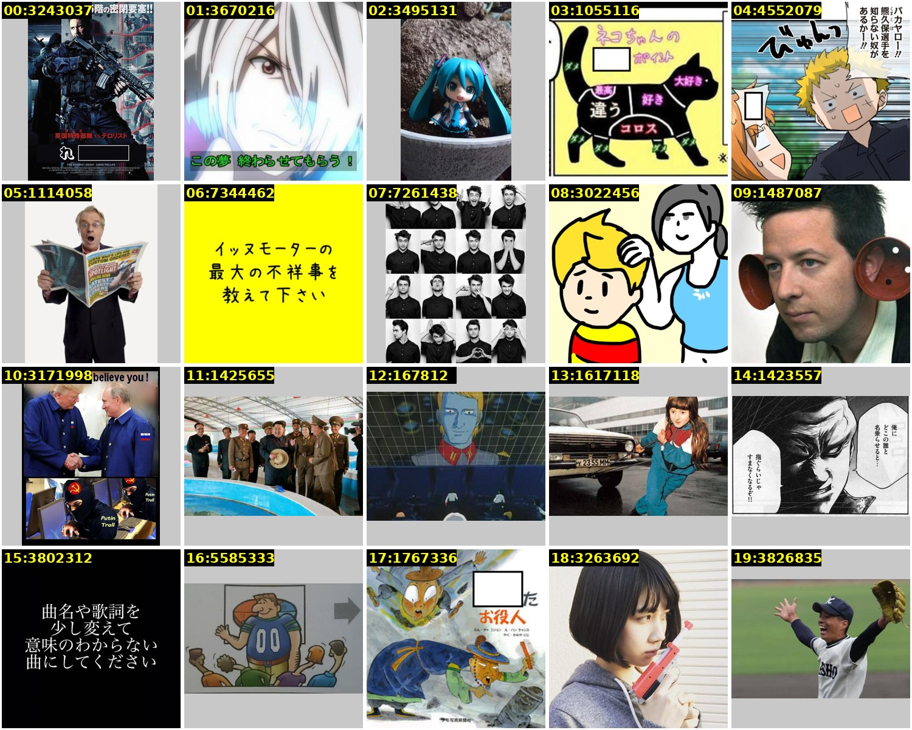

図1 目視のラベル付与に用いた一覧画像の例（無作為抽出の20枚）．

7クラスの内訳は，photo 113枚，anime 41枚，manga 38枚，text 58枚，anaume 120枚，karuta 43枚，illust 27枚であり，プールごとの内訳を表2に示す．無作為抽出の240枚では，photo が 43.8%，anaume が 22.9%，text が 9.6%，illust が 9.2%，anime が 6.7%，manga が 6.3%，karuta が 1.7% であった．穴埋めは全お題の約4分の1を占めると見込まれる．ただし240枚に基づく割合であり，95%信頼区間は ±5ポイント程度の幅を持つ．

表2 評価用データのプールごとの7クラスの内訳．

| プール | photo | anime | manga | text | anaume | karuta | illust |
| :---: | :---: | :---: | :---: | :---: | :---: | :---: | :---: |
| random | 105 | 16 | 15 | 23 | 55 | 4 | 22 |
| type_anaume | 0 | 0 | 0 | 0 | 40 | 0 | 0 |
| type_text | 2 | 1 | 0 | 34 | 3 | 0 | 0 |
| tag_karuta | 1 | 0 | 0 | 0 | 0 | 39 | 0 |
| tag_manga | 2 | 1 | 11 | 0 | 16 | 0 | 0 |
| tag_anime | 3 | 19 | 3 | 0 | 4 | 0 | 1 |
| type_illust | 0 | 4 | 9 | 1 | 2 | 0 | 4 |

メタデータで絞り込んだプールでも，目的のクラスと一致しない画像が多い．漫画のタグの30枚のうち16枚は穴埋めであり，`type` がイラストの20枚のうち illust は4枚であった．弱ラベルの雑音の大きさを示している．

### 4.3 比較した手法

| 系統 | 手法 | 学習データ | 設定 |
| :---------: | :------------------------- | :-------------------------- | :------------------------------------ |
| zeroshot | 埋め込みとプロンプトの類似度 | なし | 各クラス3〜4個の英語のプロンプトの平均 |
| probe(meta) | 線形プローブ | メタデータの弱ラベル 9,450枚 | 10,500枚から seed ごとに90%を抽出 |
| probe(hand) | 線形プローブ | 目視のラベル（5分割交差検証） | 形式と画風に別の分類器 |
| probe(VLM) | 線形プローブ | VLM のラベル 9,450枚 | 教師は Qwen3-VL の 2B，4B，8B |
| vlm | Qwen3-VL に多肢選択で質問 | なし | プロンプト v1，v2，入力の最大画素数 $` 448^2 `$，$` 256^2 `$ |
| ocr | YomiToku の文字量による規則 | なし | 文字領域の面積比 0.08 以上かつ8文字以上で text |

線形プローブは，標準化した埋め込みに対する L2 正則化付きのロジスティック回帰であり，正則化の強さの逆数 $` C \in \{0.01, 0.1, 1\} `$ と seed $` \in \{0, 1, 2\} `$ の全組み合わせを実行した．表では各手法で seed 間の平均のマクロF1が最大となる $` C `$ の結果を示す．$` C `$ は評価用データで選んでいるため，線形プローブの値はわずかに楽観的である．ただし図8に示すとおり，$` C `$ による差は最大でも 0.04 程度である．VLM のプロンプト v1 は各ラベルの定義を与えたものであり，v2 は v1 の誤りの分析に基づき，text を「画像の大部分が文章で，主となる写真や絵がない」に限定し，字幕などを含む画像は normal とする記述を加えたものである．

### 4.4 評価指標と処理速度の測定

精度の指標は，7クラスの正解率とマクロF1，形式の4クラスの正解率，画風の4クラスの正解率である．マクロF1は次式で定義する．

$$
\mathrm{F1}_{\mathrm{macro}} = \frac{1}{K} \sum_{k=1}^{K} \frac{2 P_k R_k}{P_k + R_k}
$$

ここで $` K = 7 `$ がクラス数，$` P_k `$ と $` R_k `$ がクラス $` k `$ の適合率と再現率である．件数の少ないカルタなどのクラスの性能も等しく反映するため，主な指標とした．画風の正解率は，手法が画風を出力した画像のみで求めた（probe(meta) は形式が normal の場合のみ画風を出力し，ocr は画風を出力しない）．

処理速度は1秒あたりの処理枚数で表し，全画像（6,823,270枚）の処理に要する時間に換算した．埋め込みモデルは，DataLoader の16個のワーカーで画像の読み込みと前処理を並列化し，バッチサイズ128，半精度で10,000枚を処理した速度である．VLM は vLLM で評価用の440枚を一括で処理した速度であり，8B，4B，2B は弱ラベル用の10,500枚でも測定した．速度にはモデルの読み込みの時間を含まない．なお，画像の読み込みと JPEG の展開のみの速度は，32スレッドで約1,100〜1,400枚/秒であった．

## 5. 結果

### 5.1 精度の比較

表3に主な条件の結果を示す．±は3つの seed の標準偏差である．random 列は無作為抽出の240枚のみで求めた7クラスの正解率であり，全お題の分布での精度に近い．

表3 各手法の精度と処理速度（評価用データ440枚）．

| 手法 | 7クラス正解率 | マクロF1 | 形式正解率 | 画風正解率 | random の正解率 | 枚/秒 | 全件の時間 |
| :-------------------------------- | :-------------: | :-------------: | :--------: | :--------: | :--------: | :------: | :-------: |
| **SigLIP2-so400m + probe(VLM-8B)** | **0.913 ± 0.009** | **0.893 ± 0.010** | **0.934** | 0.926 | **0.938** | 178 | 10.7 h |
| Qwen3-VL-8B（v2，448px） | 0.905 | 0.887 | 0.923 | **0.939** | 0.917 | 27 | 70 h |
| SigLIP2-so400m + probe(VLM-4B) | 0.903 ± 0.009 | 0.886 ± 0.008 | 0.921 | 0.932 | 0.926 | 178 | 10.7 h |
| Qwen3-VL-4B（v2，448px） | 0.884 | 0.870 | 0.902 | 0.925 | 0.900 | 45 | 42 h |
| SigLIP2-so400m + probe(hand) | 0.882 ± 0.002 | 0.854 ± 0.003 | 0.914 | 0.935 | 0.903 | 178 | 10.7 h |
| Qwen3-VL-8B（v2，256px） | 0.880 | 0.862 | 0.895 | 0.927 | 0.879 | 39 | 49 h |
| Qwen3-VL-4B（v2，256px） | 0.855 | 0.837 | 0.877 | 0.918 | 0.879 | 64 | 29 h |
| SigLIP2-B + probe(VLM-8B) | 0.855 ± 0.004 | 0.825 ± 0.005 | 0.878 | 0.920 | 0.869 | 882 | 2.2 h |
| CLIP-B/32 + probe(VLM-8B) | 0.814 ± 0.005 | 0.791 ± 0.006 | 0.832 | 0.926 | 0.836 | 1,087 | 1.7 h |
| SigLIP2-B + probe(hand) | 0.820 ± 0.013 | 0.791 ± 0.014 | 0.849 | 0.927 | 0.840 | 882 | 2.2 h |
| CLIP-B/32 + probe(hand) | 0.803 ± 0.003 | 0.780 ± 0.010 | 0.824 | 0.937 | 0.849 | 1,087 | 1.7 h |
| Qwen3-VL-8B（v1，448px） | 0.718 | 0.660 | 0.730 | 0.907 | 0.683 | 28 | 69 h |
| SigLIP2-so400m + probe(VLM-2B) | 0.726 ± 0.001 | 0.640 ± 0.004 | 0.751 | 0.822 | 0.732 | 178 | 10.7 h |
| Qwen3-VL-2B（v2，448px） | 0.707 | 0.637 | 0.730 | 0.818 | 0.721 | 72 | 26 h |
| CLIP-B/32 + probe(meta) | 0.703 ± 0.003 | 0.664 ± 0.006 | 0.786 | 0.778 | 0.754 | 1,087 | 1.7 h |
| SigLIP2-so400m + probe(meta) | 0.703 ± 0.003 | 0.656 ± 0.006 | 0.824 | 0.713 | 0.736 | 178 | 10.7 h |
| SigLIP2-B zero-shot | 0.502 | 0.464 | 0.591 | 0.582 | 0.504 | 882 | 2.2 h |
| SigLIP2-so400m zero-shot | 0.489 | 0.441 | 0.591 | 0.580 | 0.508 | 178 | 10.7 h |
| CLIP-B/32 zero-shot | 0.398 | 0.349 | 0.416 | 0.609 | 0.442 | 1,087 | 1.7 h |
| YomiToku OCR の規則 | - | - | 0.568 | - | - | 6.4 | 294 h |

図2は全条件の7クラスの正解率（青）とマクロF1（橙）を，マクロF1の順に並べたものである．横軸がスコア，誤差棒が seed 間の標準偏差である．

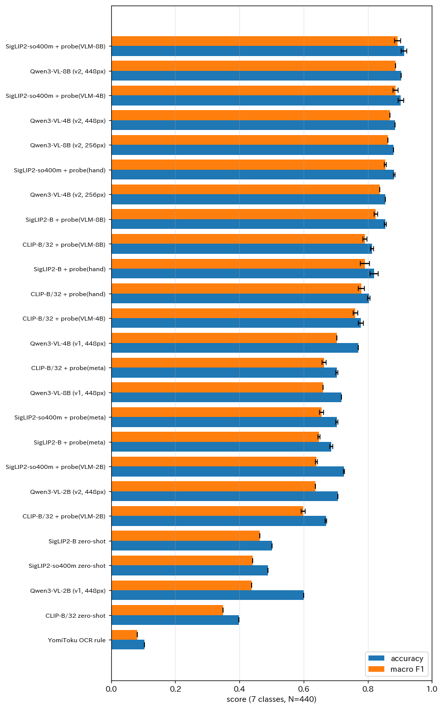

図2 全条件の7クラスの正解率とマクロF1．

VLM のラベルで学習した SigLIP2-so400m の線形プローブが，正解率，マクロF1，形式の正解率，random での正解率のすべてで最高であった．ただし教師の Qwen3-VL-8B との差は440枚中4枚程度であり，評価用データの規模では両者は同等とみるのが妥当である．生徒が教師に劣らなかった理由として，線形分類器が約9,500枚のラベルから決定境界を学習するため，VLM の個々の画像での不安定な誤りが平均化された可能性がある．目視のラベル440枚で学習した線形プローブ（probe(hand)）は 0.882 であり，ラベルの数が少ない分，VLM のラベル約9,500枚による学習に及ばなかった．教師の VLM の精度は生徒の精度の上限を強く規定しており，2B を教師とした場合は 0.726 にとどまった．

### 5.2 処理速度と精度の関係

図3は，横軸に1秒あたりの処理枚数（対数軸，上側の軸は全画像の処理に要する時間），縦軸に7クラスのマクロF1をとった散布図である．色は手法の系統を表す．

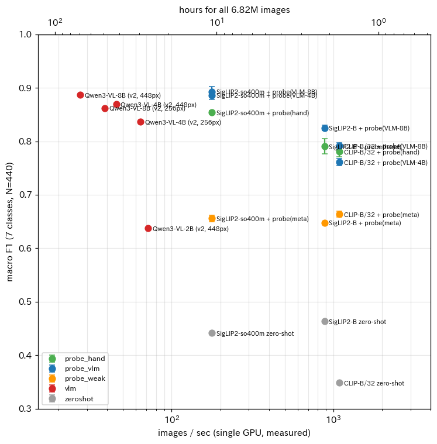

図3 処理速度とマクロF1の関係．

VLM（赤）は精度が高いが，全件の処理に26〜75時間を要する．蒸留した線形プローブ（青）は，VLM と同等の精度を約1桁速い速度で実現し，図の右上の領域を占める．SigLIP2-so400m は約10.7時間，SigLIP2-B は約2.2時間，CLIP-B/32 は約1.7時間で全件を処理できる．CLIP-B/32 の速度は画像の読み込みの速度（約1,100枚/秒）とほぼ等しく，画像の読み込みが律速となっている．

### 5.3 クラスごとの性能と混同

図4は，各条件（行）とクラス（列）の F1 である．

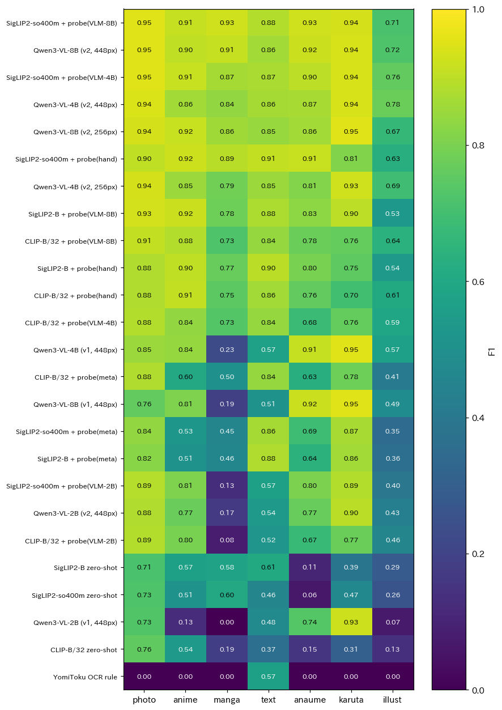

図4 クラスごとのF1．

図5は，主な手法の形式（左）と画風（右）の混同行列であり，行が正解，列が予測である．

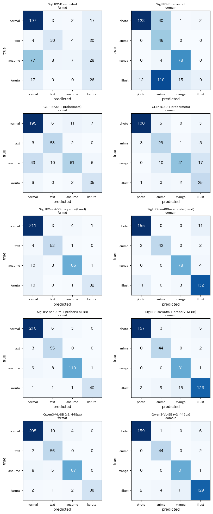

図5 形式と画風の混同行列．

ゼロショット分類では，穴埋めの120枚のうち77枚を normal と予測し，イラストの146枚のうち110枚を anime と予測した．「空欄がある」という画像の部分的な特徴や，画風の細かな区別は，プロンプトとの類似度のみでは捉えにくい．最良の SigLIP2-so400m + probe(VLM-8B) では，形式の誤りは穴埋めを normal とする6枚，text とする3枚などに限られる．画風の主な誤りは，illust を manga とする13枚である．illust はゲームの画面，絵本，絵画，キャラクターのイラストなどを含む雑多なクラスであり，全手法で F1 が最も低い（最良でも 0.75 前後）．アニメの F1 は最良の条件で約0.9であり，漫画と区別できている．

### 5.4 プロンプトと入力解像度の影響

プロンプト v1 では，Qwen3-VL-8B は normal の219枚のうち98枚を text と予測した．字幕，看板，吹き出しの文字を含む画像を「文章のお題」と判断したためである．text の定義を限定した v2 では，この誤りが10枚に減り，7クラスの正解率は 0.718 から 0.905 に，4B では 0.770 から 0.884 に，2B では 0.600 から 0.707 に向上した．入力の最大画素数を $` 448^2 `$ から $` 256^2 `$ に下げると，8B の速度は 27 から 39 枚/秒に向上し，正解率は 0.905 から 0.880 に低下した．小さな空欄や文字の判読に解像度が必要なためと考えられる．

### 5.5 実際の画像による予測例

図6は，クラスごとに無作為に選んだ4枚の画像と，正解（形式/画風）および3つの手法の予測である．予測が正解と異なる場合は赤字で示す．表示した手法は SigLIP2-so400m + probe(hand)，SigLIP2-so400m + probe(VLM-8B)，Qwen3-VL-8B（v2，448px）である．

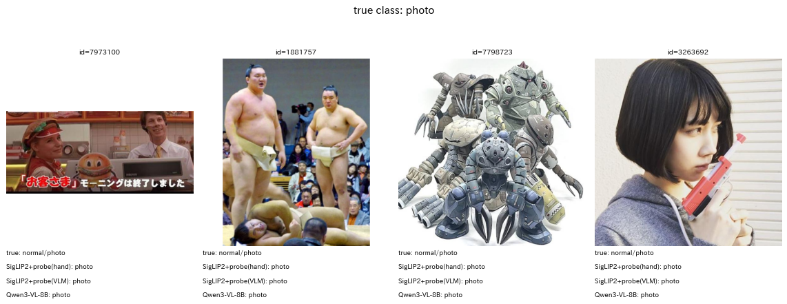

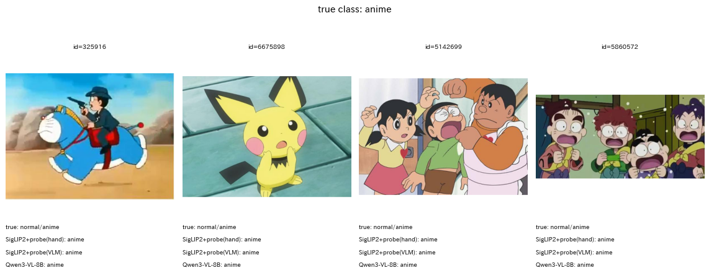

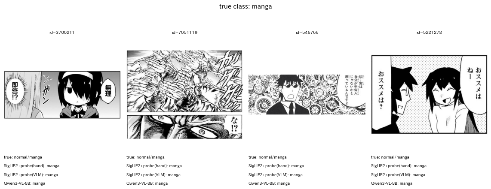

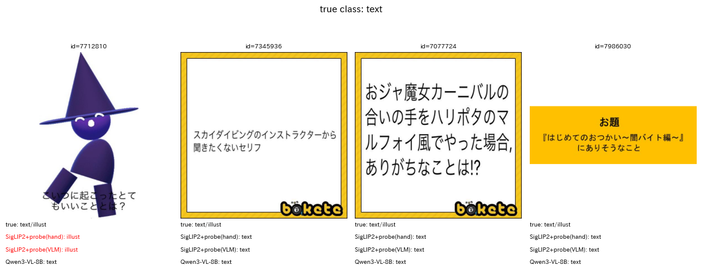

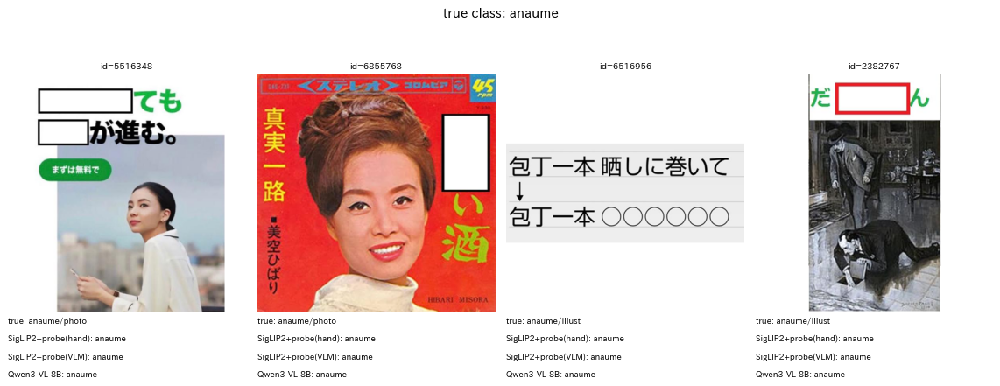

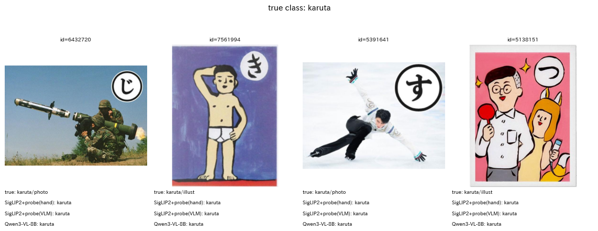

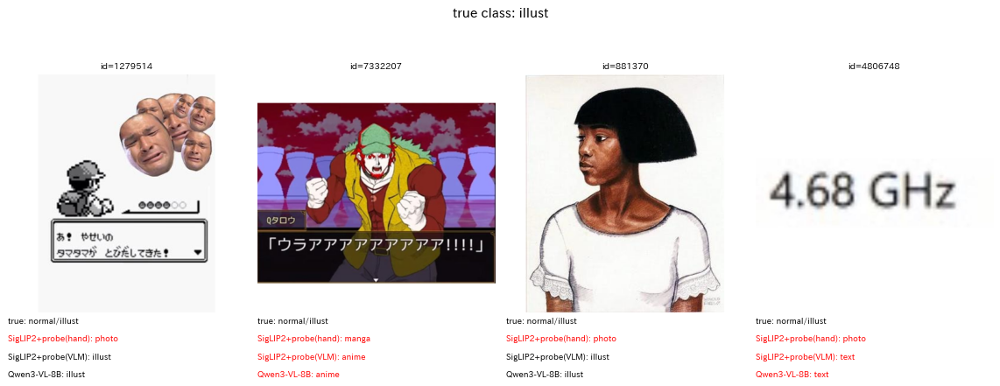

図6 クラスごとの予測例（上から photo，anime，manga，text，anaume，karuta，illust）．

図6-8は，3つの手法のうち2つ以上が誤った画像である．

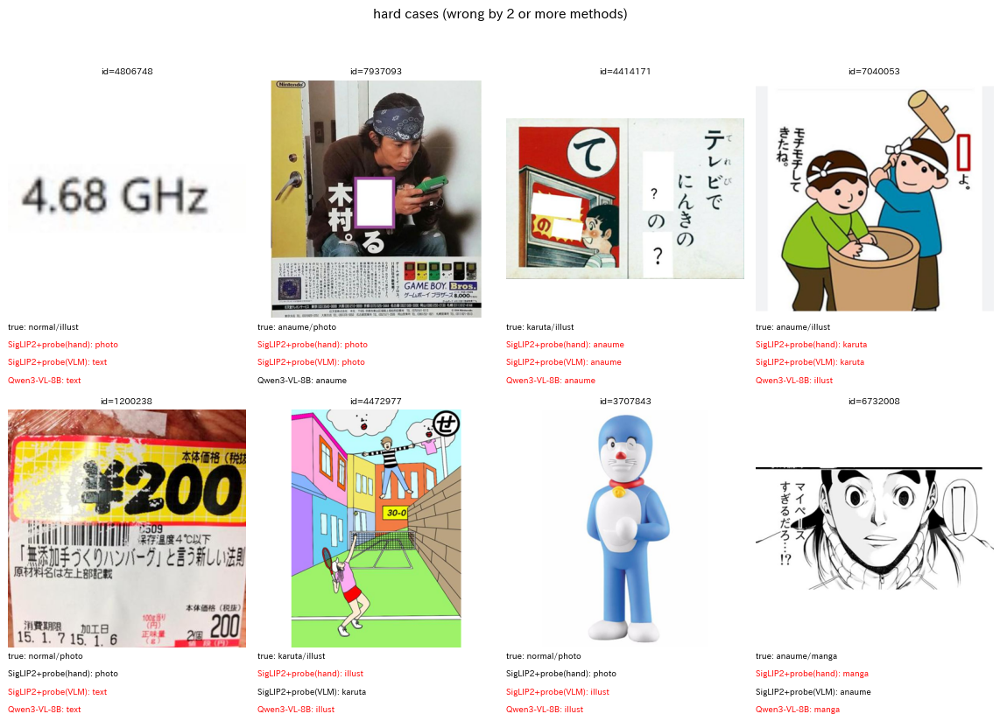

図6-8 2つ以上の手法が誤った画像．

誤りの多い画像には，ラベル自体の判断が分かれるものが含まれる．例えば，ID 4414171 はカルタの札（「て」）でありながら空欄と「？」を含み，カルタと穴埋めの両方の性質を持つ．ID 7040053 は空欄（赤枠）が細長く，カルタの記号と誤認されやすい．ID 4806748（「4.68 GHz」の文字のみの画像）は，文字のみであるがお題の文章ではないため normal としたが，3手法とも text または photo と予測した．

### 5.6 記号の位置とひらがなの検出

種別の判定の後段の処理として，Qwen3-VL-8B に穴埋めの空欄の位置と，カルタのひらがなの位置および読みを出力させた（入力の最大画素数 $` 1024^2 `$）．図7は，穴埋め8枚とカルタ8枚に対する出力の矩形を赤枠で描いたものである．

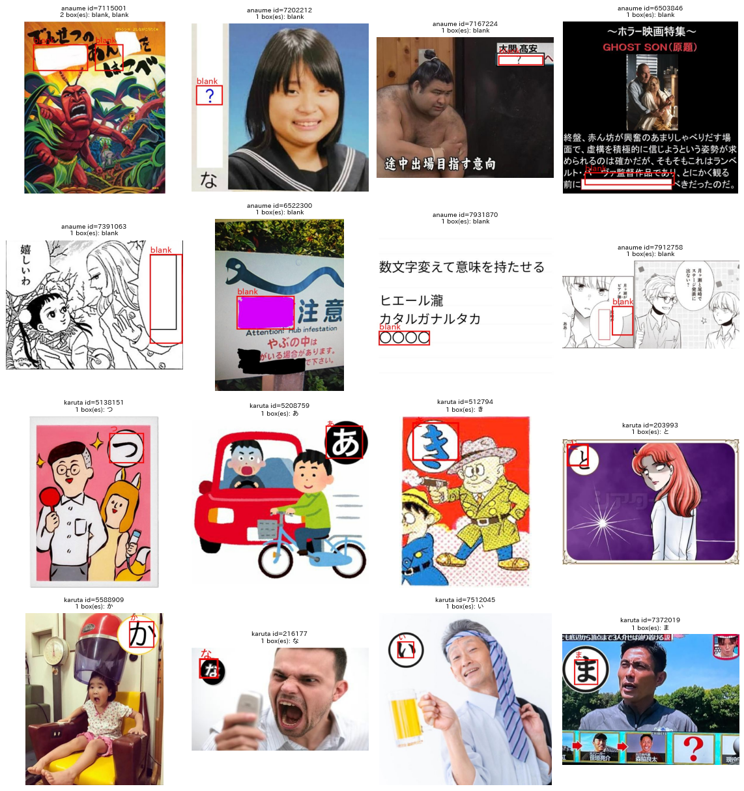

図7 Qwen3-VL-8B による空欄とカルタのひらがなの検出．

カルタ8枚では，ひらがなの読み（つ，あ，き，と，か，な，い，ま）がすべて正しく，矩形もひらがなの記号を囲んでいた．穴埋め8枚では全画像で1個以上の空欄を検出したが，看板の画像（ID 6522300）では黒塗りの空欄を見落とし，絵本の表紙（ID 7115001）では空欄の一部の位置がずれた．定量的な評価は行っていない．

### 5.7 線形プローブの正則化の強さ

図8は，線形プローブの各条件について，横軸に正則化の強さの逆数 $` C `$（対数軸），縦軸に7クラスのマクロF1の seed 間の平均と標準偏差をとったものである．

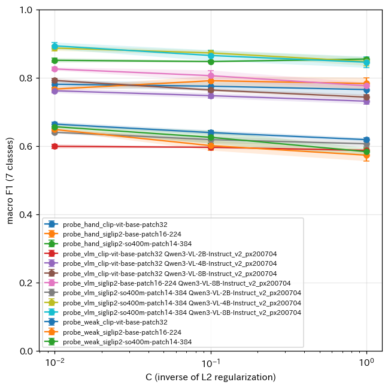

図8 線形プローブの正則化の強さとマクロF1．

弱ラベルや VLM のラベルで学習した条件では，正則化の強い $` C = 0.01 `$ が最良であった．ラベルの雑音への過学習を正則化が抑えたと考えられる．

## 6. 考察

ゼロショット分類と弱ラベルの学習が低い精度にとどまった一方で，VLM のラベルによる蒸留が最高の精度を示したことから，精度を決めるのはモデルの大きさよりも「ラベルの質」であるといえる．SigLIP2-so400m の埋め込みは，目視のラベルや VLM のラベルを与えれば 0.88〜0.91 の精度で種別を区別できる情報を持っており，ゼロショット分類の低さはプロンプトとの照合という使い方の限界である．

VLM を直接全件に適用する方法は，追加の学習が不要で，プロンプトを変えるだけで定義を修正できる利点がある．しかし全件の処理に約70時間を要し，定義を見直すたびに全件を再処理する必要がある．蒸留の方法では，埋め込みを一度計算して保存すれば（SigLIP2-so400m の1,152次元の半精度で約16GB），定義を見直した際は VLM で約1万枚のラベルを付け直して線形分類器を再学習するのみであり，再処理の費用は VLM の約1万枚分（約7分）と線形分類器の推論のみとなる．

メタデータの `type` 列は，2022年以降の約80万件にしか値がなく，投稿者の選択には誤りや揺れがある．また，漫画のタグの付いたお題の約半数が穴埋めであるように，タグは種別と1対1に対応しない．メタデータは評価用データの希少なクラスを集める手がかりとしては有用であったが，教師ラベルとしては不十分である．

穴埋めは無作為抽出で約23%を占め，最も多い特殊な形式である．穴埋めとカルタ，穴埋めと文章のお題は1枚の画像に同時に現れることがあり，排他的なクラスではなく，形式ごとの有無（多ラベル）として付与する方が後段の処理に適している可能性がある．

## 7. BoketeDBv5 に向けた推奨の処理手順

以上の結果から，以下の手順を推奨する．時間は本実験の環境（単一GPU）での見積もりである．

| 段階 | 処理 | 対象 | 時間の見積もり |
| :---: | :--- | :--- | :---: |
| 1 | Qwen3-VL-8B（プロンプト v2）で学習用のラベルを付与する | 層化抽出した3万〜10万枚 | 0.3〜1.1 h |
| 2 | 形式と画風の線形分類器を学習する | 段階1のラベル | 数分 |
| 3 | SigLIP2-so400m の埋め込みを計算して保存する | 全6,823,270枚 | 約10.7 h |
| 4 | 線形分類器で全件の種別と確信度を求める | 全件 | 数分 |
| 5 | 確信度の低い画像を Qwen3-VL-8B で再判定する | 全件の約10%（約68万枚） | 約7.5 h |
| 6 | 穴埋めとカルタの記号の位置とひらがなを Qwen3-VL-8B で検出する | 約25%（約170万枚） | 未測定 |

段階1から5までで約20時間であり，Qwen3-VL-8B を全件に適用する場合（約70時間）の3分の1以下である．速度を優先する場合は，段階3を SigLIP2-B（約2.2時間，正解率 0.855）に置き換えられる．段階5の効果と段階6の速度は本実験では測定していない．段階6を分類と同じ速度（約25枚/秒）と仮定すると約19時間となるが，位置の検出では入力の解像度を上げ，出力も長くなるため，実際にはこれより長くなる．

## 8. 未解決の論点と次に検討すべき候補

- 評価用ラベルは1名が付与した440枚であり，判断の分かれる画像を含む．人手による確認や複数人のラベル付与で，評価用データの信頼性を確かめる必要がある．
- 線形プローブの正則化の強さを評価用データで選んでいるため，精度はわずかに楽観的である．独立した検証用データを用意するとよい．
- 蒸留に用いた VLM のラベルは弱ラベル用の10,500枚（メタデータで偏りのある抽出）であった．全お題から層化抽出した画像や，ラベルの枚数を増やした場合の精度の向上を確かめる必要がある．
- 線形プローブの確信度が低い画像のみを VLM で再判定する段階的な処理（段階5）の精度と速度は未測定である．
- 形式を排他的なクラスではなく多ラベルとする定義の検討と，illust クラスの細分化（ゲーム画面，絵本，絵画，キャラクターのイラスト）の要否の検討が残っている．
- 記号の位置の検出は16枚の定性的な確認のみである．穴埋めの空欄の位置とカルタのひらがなの読みについて，正解の矩形を用意した定量評価と処理速度の測定が必要である．
- 文章のお題の文字の読み取りは，YomiToku（6.4枚/秒）と Qwen3-VL による読み取りの精度と速度の比較が未実施である．
- BoketeDBv3.2 の既存の OCR 結果の多くが空である原因は調べていない．
- Hugging Face のトークン（`tokens.json`）で認証した要求が失敗した．公開モデルのみを用いたため本実験には影響しないが，トークンの有効性を確認する必要がある．
