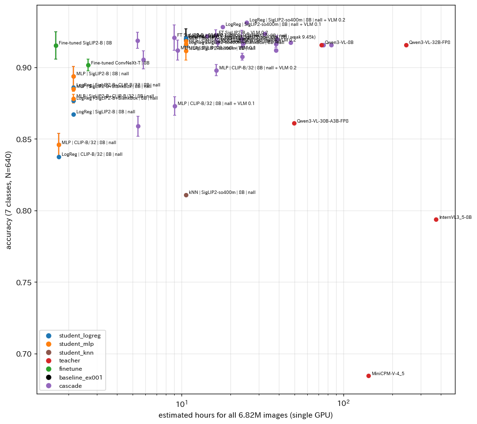
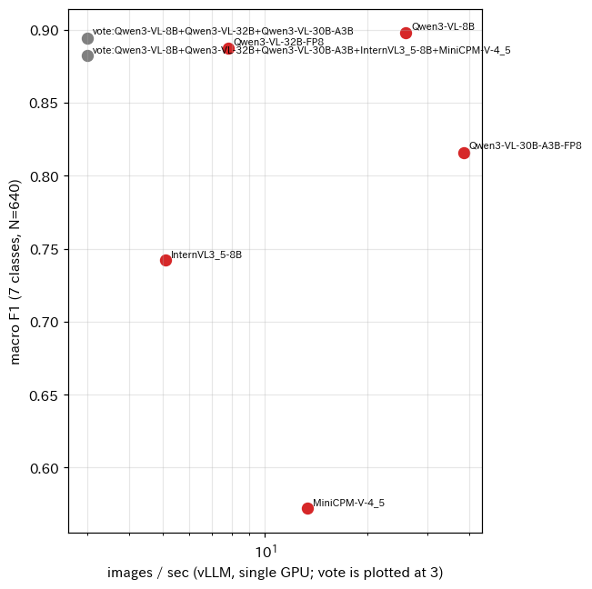
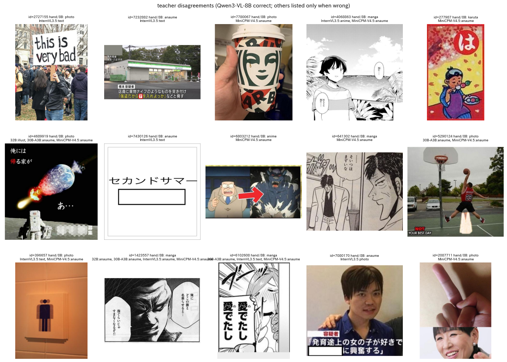
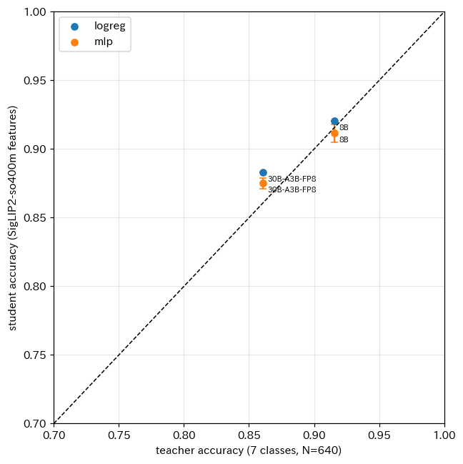
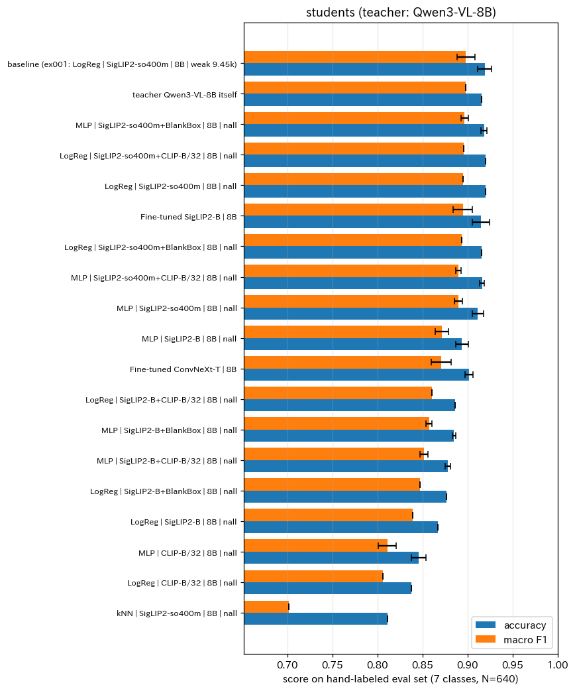
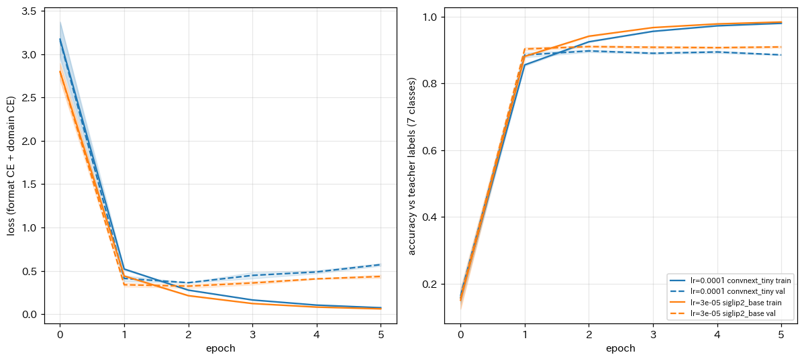
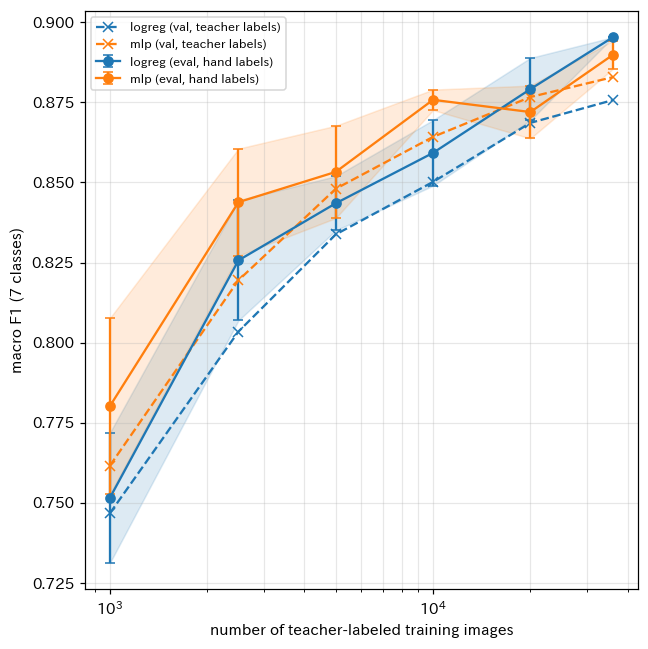
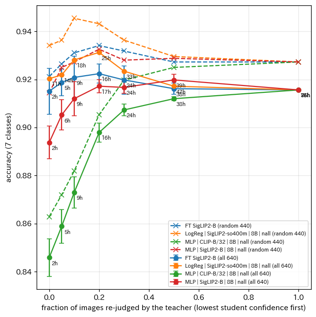
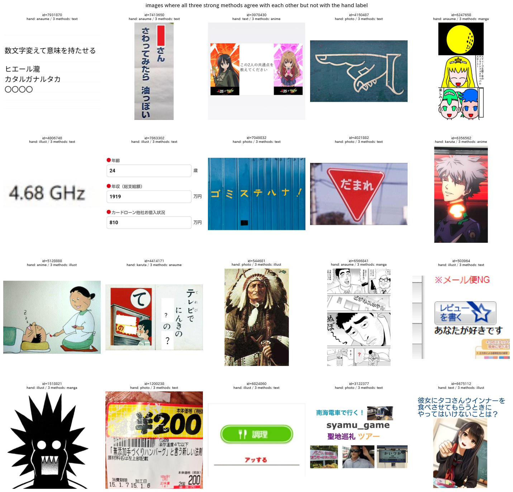

# お題画像の種別判定における代替手法の多角的な比較

## 1. 概要

report_001 で最良であった方法（Qwen3-VL-8B が付けたラベルで SigLIP2-so400m の埋め込みに対するロジスティック回帰を学習する蒸留）を基準として，処理の流れを構成する4つの要素，すなわち教師となる視覚言語モデル（Vision Language Model，VLM），教師ラベルを付ける画像の選び方と枚数，生徒となる高速な分類器，処理の構成（カスケード）を個別に入れ替えて比較した．評価用データは目視ラベルを200枚追加して640枚とし，ハイパーパラメータは教師ラベルの検証用分割で選ぶことで，評価用データを最終評価のみに用いるようにした．主な結論は以下のとおりである．

- 教師ラベルで画像エンコーダ SigLIP2-B を微調整した分類器は，7クラスの正解率 0.915 ± 0.010 で基準の方法（0.919 ± 0.008）と同等であり，処理速度は約1,131枚/秒（全件で約1.7時間）と基準の約6.4倍であった．速度と精度の両立という点で，今回比較した中で最も実用的な方法である．
- 教師の VLM は Qwen3-VL-8B が最良であった．Qwen3-VL-32B（FP8）は同じ正解率 0.916 だが約3.3倍遅く，Qwen3-VL-30B-A3B（FP8）は約1.5倍速いが正解率 0.861 に下がった．InternVL3.5-8B（0.794）と MiniCPM-V 4.5（0.684）は Qwen3-VL 向けに調整したプロンプトでは大きく劣った．Qwen3-VL の3モデルの多数決は 0.922 であり，8B 単体からの改善は 0.6 ポイントにとどまった．
- 生徒の分類器では，ロジスティック回帰と2層の MLP が同等（0.920 と 0.911）であり，k 近傍法は 0.811 と大きく劣った．埋め込みの連結（SigLIP2-so400m と CLIP-B/32）や，OpenCV で検出した空欄の矩形の特徴の追加による改善は 0.005 未満であった．
- 教師ラベルの枚数を増やすと精度は単調に向上した（1,000枚で 0.841，36,000枚で 0.920）．一方，クラスの偏りを補ったメタデータによる抽出の9,450枚で学習した基準の方法は，無作為抽出の36,000枚と同等の精度であり，無作為抽出の10,000枚（0.891）を上回った．希少なクラスを多めに含む抽出は，教師ラベルの枚数に対する効率が高い．
- 生徒の確信度が低い画像を VLM で再判定するカスケードは，再判定の割合が10〜20%のとき正解率を約1ポイント改善した（0.920 から 0.931，全件で約25時間）．ただし改善の幅は，評価用ラベルの判断の揺れと同程度である．
- 強い3手法（Qwen3-VL-8B，基準の方法，微調整した SigLIP2-B）がそろって目視ラベルと異なる同じ予測をした画像は640枚中23枚であり，その多くは「文字が主体だが文章のお題ではない画像」など，ラベルの定義の境界にある画像であった．現在の精度（約92%）は，手法の差よりもラベルの定義の曖昧さに制約されている．

## 2. 背景と比較の観点

report_001 では，VLM の判断を高速な分類器に移す蒸留が，精度と処理時間の両面で最良であった．この方法は「教師の VLM」「教師ラベルを付ける画像」「生徒の分類器」の3要素からなり，さらに生徒と教師を組み合わせる「処理の構成」の選択肢がある．本作業では，これらを1つずつ入れ替えて比較し，各要素が精度と処理時間に与える影響を調べた．加えて，report_001 で指摘した2つの課題，すなわち評価用データが440枚で1名の判断によること，線形分類器の正則化の強さを評価用データで選んでいたことに対処した．

表1に比較した要素と選択肢を示す．

表1 比較した要素と選択肢．

| 要素 | 基準（report_001） | 比較した選択肢 |
| :---: | :--- | :--- |
| 教師の VLM | Qwen3-VL-8B | Qwen3-VL-32B（FP8），Qwen3-VL-30B-A3B（FP8，Mixture of Experts），InternVL3.5-8B，MiniCPM-V 4.5，教師の多数決 |
| 教師ラベルを付ける画像 | メタデータで偏らせた10,500枚 | 全お題から無作為に抽出した40,000枚（学習用36,000，検証用4,000），学習枚数 1,000〜36,000 |
| 生徒の分類器 | ロジスティック回帰 | 2層の MLP，k 近傍法，画像エンコーダの微調整（ConvNeXt-Tiny，SigLIP2-B） |
| 生徒の特徴 | SigLIP2-so400m | CLIP-B/32，SigLIP2-B，埋め込みの連結，空欄の矩形の特徴（OpenCV） |
| 処理の構成 | 生徒のみ | 確信度の低い画像を教師で再判定するカスケード |

## 3. 実験方法

### 3.1 評価用データ

report_001 の440枚に，全お題から無作為に抽出した200枚を加え，同じ定義で目視のラベルを付与した（図1）．追加の200枚も Claude Code が画像を目視で確認して付与したものである．評価用データは計640枚，うち無作為抽出の画像は440枚である．無作為抽出の440枚における7クラスの割合は，photo 44.5%，anaume 22.3%，illust 9.3%，text 8.6%，manga 7.0%，anime 6.6%，karuta 1.6% であり，report_001 の240枚による推定（穴埋め約23%）とほぼ一致した．

図1 追加した評価用画像の一覧の例（20枚）．

指標は report_001 と同じく，7クラス（photo，anime，manga，text，anaume，karuta，illust）の正解率とマクロF1，形式と画風の正解率である．無作為抽出の440枚のみの正解率（表中の random 列）も併せて示す．

### 3.2 教師ラベル用の画像と分割

評価用画像と report_001 の弱ラベル用画像を除いた全お題から，無作為に40,000枚を抽出した．scikit-learn の train_test_split で学習用36,000枚と検証用4,000枚に分けた（9:1）．教師の VLM がこれらの画像に付けたラベルを生徒の学習に用い，ハイパーパラメータ（ロジスティック回帰の正則化の強さ，MLP の学習率と重み減衰，k 近傍法の $` k `$，微調整の最良のエポック）は検証用分割に対する7クラスのマクロF1または正解率で選んだ．このため，評価用データの結果は選択に用いておらず，report_001 よりも公平な推定である．Qwen3-VL-8B のラベルの7クラスの割合は，photo 43.2%，anaume 19.2%，text 11.7%，manga 8.7%，illust 8.5%，anime 7.3%，karuta 1.3% であった．

### 3.3 教師の VLM

いずれも vLLM 0.23 の chat API で，report_001 のプロンプト v2 をそのまま与え，入力画像の最大画素数を $` 448^2 `$ とし，出力を正規表現による構造化出力で `{"format": ..., "domain": ...}` に制約した．Qwen3-VL-32B は FP8 量子化版を用いた．Qwen3-VL-30B-A3B は総パラメータ約300億のうち1トークンあたり約30億のみを用いる Mixture of Experts（MoE）のモデルであり，FP8 量子化版を用いた．多数決は形式と画風の軸ごとに行い，同数の場合は先に挙げた教師（8B）に従った．教師ラベル用の40,000枚には 8B と 30B-A3B のラベルを付けた．32B は評価用データでの速度（7.8枚/秒）から40,000枚に約1.4時間を要するため，評価用データのみで評価した．

### 3.4 生徒の分類器

埋め込みに対する分類器として，ロジスティック回帰（標準化した特徴，$` C \in \{0.003, 0.01, 0.03, 0.1\} `$），2層の MLP（LayerNorm，隠れ層1,024，GELU，Dropout 0.3，形式と画風の2つの出力層，AdamW で40エポック，学習率 $` \{10^{-3}, 3 \times 10^{-4}\} `$，重み減衰 $` \{10^{-4}, 10^{-2}\} `$），コサイン類似度による k 近傍法（$` k \in \{5, 15, 45\} `$）を比較した．MLP の誤差は形式と画風の交差エントロピーの和である．

空欄の矩形の特徴（BlankBox）は，OpenCV で Canny のエッジから輪郭を抽出し，4頂点の凸な多角形で，面積が画像の0.1〜40%，内部の画素の標準偏差が12以下のものを空欄の候補とした．候補の数，白い候補の数，面積比の最大値と合計，縦長の候補の数，輪郭の総数の8次元を $` \log(1 + 100x) `$ で変換して埋め込みに連結した．計算速度は48プロセスで約800枚/秒であった．

画像エンコーダの微調整では，ConvNeXt-Tiny（timm の `convnext_tiny.in12k_ft_in1k`）と SigLIP2-B の画像エンコーダに，形式と画風の2つの線形の出力層を付け，教師ラベルの学習用36,000枚で5エポック学習した．入力は 224×224 に縮小し，文字の向きを保つため左右反転は用いず，色の揺らぎのみを拡張とした．最適化手法は AdamW（重み減衰 0.05），バッチサイズ128，学習率は ConvNeXt-Tiny が $` 10^{-4} `$，SigLIP2-B が $` 3 \times 10^{-5} `$ であり，bfloat16 の自動混合精度で学習した．1条件あたり約20分を要するため，学習率は各モデルに一般的な値を1つずつ用い，探索は行っていない．各エポックの後に検証用分割の7クラスの正解率を求め，最良のエポックの重みで評価した．

seed は全ての生徒で 0，1，2 の3つとした．ロジスティック回帰と k 近傍法は学習用データが固定の場合に決定的であるため，学習枚数を全て用いる条件では seed 間の標準偏差は0となる．

### 3.5 処理速度

埋め込みに基づく生徒の速度は，report_001 の `benchmark.py` で測った埋め込みの計算速度（SigLIP2-so400m 177.5枚/秒，SigLIP2-B 881.5枚/秒，CLIP-B/32 1,087.4枚/秒）とした．分類器自体の計算時間は埋め込みの計算に比べて無視できる．微調整したモデルは，16個のワーカーで画像の読み込みと前処理を並列化し，バッチサイズ256，bfloat16 で10,000枚を処理した速度を，他の処理を止めた状態で測った．教師の VLM は，40,000枚のラベル付けの速度（8B と 30B-A3B），または評価用640枚での速度（その他）である．カスケードの処理時間は，生徒で全件を処理する時間と，再判定する割合の画像を 8B で処理する時間（25.9枚/秒）の和とした．

## 4. 結果

### 4.1 全体の比較

表2に主な条件の結果を示す．± は3つの seed の標準偏差である．

表2 主な条件の精度と処理時間（評価用データ640枚）．

| 手法 | 7クラス正解率 | マクロF1 | random の正解率 | 形式正解率 | 画風正解率 | 枚/秒 | 全件の時間 |
| :-------------------------------------- | :-------------: | :-------------: | :------: | :------: | :------: | :------: | :------: |
| 基準：LogReg，SigLIP2-so400m，8B，偏った9,450枚 | 0.919 ± 0.008 | 0.898 ± 0.010 | 0.936 | 0.940 | 0.928 | 178 | 10.7 h |
| 教師 Qwen3-VL-8B | 0.916 | 0.898 | 0.927 | 0.930 | 0.942 | 26 | 73 h |
| LogReg，SigLIP2-so400m，8B，無作為36,000枚 | 0.920 ± 0.000 | 0.895 ± 0.000 | 0.934 | 0.938 | 0.936 | 178 | 10.7 h |
| MLP，SigLIP2-so400m + BlankBox，8B | 0.918 ± 0.003 | 0.897 ± 0.004 | 0.924 | 0.940 | 0.928 | 178 | 10.7 h |
| LogReg，SigLIP2-so400m + CLIP-B/32，8B | 0.920 ± 0.000 | 0.896 ± 0.000 | 0.936 | 0.939 | 0.933 | 178 | 10.7 h |
| **微調整 SigLIP2-B，8B** | **0.915 ± 0.010** | **0.895 ± 0.011** | 0.921 | 0.941 | 0.919 | **1,131** | **1.7 h** |
| 教師の多数決（Qwen3-VL 8B，32B，30B-A3B） | 0.922 | 0.894 | 0.920 | 0.944 | 0.931 | - | - |
| MLP，SigLIP2-so400m，8B | 0.911 ± 0.006 | 0.890 ± 0.004 | 0.919 | 0.931 | 0.927 | 178 | 10.7 h |
| 教師 Qwen3-VL-32B（FP8） | 0.916 | 0.887 | 0.909 | 0.941 | 0.933 | 7.8 | 243 h |
| 教師の多数決（5モデル） | 0.911 | 0.882 | 0.911 | 0.930 | 0.936 | - | - |
| MLP，SigLIP2-B，8B | 0.894 ± 0.007 | 0.872 ± 0.007 | 0.914 | 0.909 | 0.932 | 882 | 2.2 h |
| 微調整 ConvNeXt-Tiny，8B | 0.902 ± 0.004 | 0.871 ± 0.011 | 0.904 | 0.932 | 0.908 | 714 | 2.7 h |
| LogReg，SigLIP2-so400m，30B-A3B | 0.883 ± 0.000 | 0.841 ± 0.000 | 0.891 | 0.911 | 0.897 | 178 | 10.7 h |
| LogReg，SigLIP2-B，8B | 0.867 ± 0.000 | 0.839 ± 0.000 | 0.898 | 0.883 | 0.938 | 882 | 2.2 h |
| 教師 Qwen3-VL-30B-A3B（FP8） | 0.861 | 0.816 | 0.873 | 0.892 | 0.894 | 38 | 49 h |
| MLP，CLIP-B/32，8B | 0.846 ± 0.008 | 0.811 ± 0.010 | 0.863 | 0.868 | 0.924 | 1,087 | 1.7 h |
| k 近傍法，SigLIP2-so400m，8B | 0.811 ± 0.000 | 0.702 ± 0.000 | 0.850 | 0.861 | 0.878 | 178 | 10.7 h |
| 教師 InternVL3.5-8B | 0.794 | 0.742 | 0.791 | 0.834 | 0.859 | 5.1 | 372 h |
| 教師 MiniCPM-V 4.5 | 0.684 | 0.572 | 0.714 | 0.692 | 0.928 | 13 | 143 h |
| 規則：白い一様な矩形があれば anaume | 0.473 | 0.176 | 0.566 | 0.648 | - | 800 | 2.4 h |

図2は，横軸に全件の処理時間の見積もり（対数軸），縦軸に7クラスの正解率をとった散布図である．色は手法の系統を表し，誤差棒は seed 間の標準偏差である．

図2 全手法の処理時間と7クラスの正解率．

正解率 0.91〜0.92 の手法が多数あり，その中で処理時間が最も短いのは微調整した SigLIP2-B（約1.7時間）である．埋め込みに基づく生徒では SigLIP2-so400m を用いる限り約10.7時間を要し，SigLIP2-B や CLIP-B/32 の埋め込みに切り替えると約2時間に短縮できるが，正解率は 0.85〜0.89 に下がる．微調整は，速い画像エンコーダの精度の不足を補う効果があった．

### 4.2 教師の VLM の比較

図3は教師の VLM の処理速度（横軸，対数軸）と7クラスのマクロF1（縦軸）である．多数決は速度を定義できないため，横軸の3の位置に置いた．

図3 教師の VLM の処理速度とマクロF1．

Qwen3-VL-32B の正解率は 8B と同じ 0.916 であり，モデルを大きくしても精度は向上しなかった．30B-A3B は，normal の358枚のうち39枚を anaume，karuta の46枚のうち7枚を anaume と予測するなど，穴埋めを過剰に検出した．40,000枚における 8B と 30B-A3B のラベルの一致率は 0.882 であった．InternVL3.5-8B は，速度が5.1枚/秒と遅いうえ（既定の設定では画像を複数のタイルに分割して入力するためと考えられる），穴埋めの163枚のうち26枚を text，22枚を normal と予測するなど穴埋めの見落としが多く，カルタの46枚のうち15枚を normal と予測した．MiniCPM-V 4.5 は，normal の358枚のうち146枚を anaume と予測した．プロンプト v2 は Qwen3-VL-8B の誤りを分析して調整したものであるため，他系統のモデルに不利な比較である可能性がある．

図4は，Qwen3-VL-8B の予測が目視ラベルと一致し，他の教師の少なくとも1つが誤った画像の例である．各画像の上に，目視ラベルと，誤った教師とその予測を示す．

図4 教師の予測が分かれた画像の例．

このような画像は640枚中219枚あった．4つの教師の誤りの予測を合計すると，anaume が200件と最も多く，text が35件，anime が34件であった．空欄のない画像を穴埋めとする誤りが，他の教師に共通する主な弱点である．ID 1423557 では8B以外の4つの教師がそろって anaume と予測しており，左の吹き出しが空欄とも読めるため，目視ラベルの側が判断の分かれる画像である．

Qwen3-VL の3モデルの多数決は正解率 0.922 で 8B 単体を 0.6 ポイント上回ったが，マクロF1は 0.894 と 8B（0.898）をわずかに下回った．5モデルの多数決は，性能の低い2モデルの影響で 0.911 に下がった．3モデルの推論を全件に行うと 8B 単体の4倍以上の時間を要するため，教師ラベルを付ける用途でも費用に見合わない．

### 4.3 教師の精度と生徒の精度の関係

図5は，横軸に教師自身の正解率，縦軸にその教師のラベルで学習した生徒（SigLIP2-so400m の特徴）の正解率をとったものである．破線は $` y = x `$ である．

図5 教師の正解率と生徒の正解率．

8B と 30B-A3B のいずれでも，ロジスティック回帰の生徒は教師と同等以上の正解率を示した（8B：0.916 に対し 0.920，30B-A3B：0.861 に対し 0.883）．report_001 と同じく，生徒は教師の個々の誤りを平均化する一方で，教師の精度が生徒の精度の上限をおおむね決めている．30B-A3B のように教師に系統的な誤り（穴埋めの過剰な検出）がある場合，生徒もその誤りを引き継ぐ．

### 4.4 生徒の分類器と特徴の比較

図6は，教師を Qwen3-VL-8B とした生徒の各条件の7クラスの正解率（青）とマクロF1（橙）である．誤差棒は seed 間の標準偏差であり，基準の方法と教師自身も併せて示す．

図6 生徒の分類器と特徴の比較．

SigLIP2-so400m の特徴では，ロジスティック回帰（0.920）と MLP（0.911）がほぼ同等であり，非線形の分類器による改善はなかった．k 近傍法は 0.811 と大きく劣り，特に件数の少ない karuta（F1 0.26）と，雑多な画像からなる illust（F1 0.46）が低かった（マクロF1 0.702）．特徴の追加の効果は，SigLIP2-B では BlankBox の追加でロジスティック回帰が 0.867 から 0.877 に，CLIP-B/32 の連結で 0.886 に向上したが，SigLIP2-so400m では変化が 0.005 未満であった．BlankBox 単体による規則は，白い矩形がある画像の60%しか穴埋めではなく（適合率 0.60，再現率 0.79），単独では使えない．強い埋め込みは空欄の情報を既に含んでいる．

### 4.5 画像エンコーダの微調整

図7は微調整の学習曲線である．横軸はエポック（0は学習前），左図の縦軸は誤差（形式と画風の交差エントロピーの和），右図の縦軸は教師ラベルに対する7クラスの正解率であり，実線が学習用，破線が検証用である．塗りつぶしは3つの seed の標準偏差である．

図7 画像エンコーダの微調整の学習曲線．

両モデルとも1〜2エポックで検証用の正解率がほぼ最大に達し（ConvNeXt-Tiny 約0.89〜0.90，SigLIP2-B 約0.91），それ以降は学習用の誤差が下がり続ける一方で検証用の誤差が上がる過学習を示した．最良のエポックは seed により2〜5であった．SigLIP2-B は ConvNeXt-Tiny より正解率が1ポイント以上高く，文字を含む画像の判定で言語と画像の対照学習による事前学習が有利に働いたと考えられる．微調整した SigLIP2-B の評価用データの正解率は seed 0，1，2 でそれぞれ 0.923，0.917，0.905 であり，seed 間のばらつきが埋め込みに基づく生徒より大きい．

微調整した SigLIP2-B は，SigLIP2-B の埋め込みにロジスティック回帰を適用する場合（0.867）より約5ポイント高く，速度はほぼ同じ（埋め込みの881枚/秒に対し1,131枚/秒）であった．後者が速いのは，bfloat16 とバッチサイズ256で測ったためであり，計算量は同じである．

### 4.6 教師ラベルの枚数と抽出の方法

図8は，横軸に教師ラベルの学習枚数（対数軸），縦軸に7クラスのマクロF1をとった学習曲線である．実線が評価用データ（目視ラベル），破線が検証用分割（教師ラベル）であり，塗りつぶしは seed 間の標準偏差である．

図8 教師ラベルの学習枚数とマクロF1．

マクロF1は学習枚数とともに単調に向上し，36,000枚でも飽和していない．ロジスティック回帰の正解率は，1,000枚で 0.841，5,000枚で 0.880，10,000枚で 0.891，20,000枚で 0.906，36,000枚で 0.920 であった．一方，report_001 の基準の方法（メタデータで穴埋め，文字，カルタ，漫画，アニメを多めに抽出した9,450枚）は，640枚の評価用データで正解率 0.919 であり，無作為抽出の36,000枚と同等であった．無作為抽出ではカルタが約1.3%しか含まれないため，少ない枚数では希少なクラスの学習が不十分になる．教師ラベルを付ける画像は，メタデータや生徒の予測を用いてクラスの偏りを補って選ぶ方が，同じ VLM の計算量で高い精度を得られる．

### 4.7 カスケード

図9は，生徒の確信度（形式と画風の最大確率の積）が低い順に一定の割合の画像を Qwen3-VL-8B の予測に置き換えた場合の正解率である．横軸は置き換える割合，縦軸は7クラスの正解率であり，実線が評価用データ全体（640枚），破線が無作為抽出の画像（440枚）である．点の横の数字は全件の処理時間の見積もりである．

図9 カスケードにおける再判定の割合と正解率．

SigLIP2-so400m のロジスティック回帰では，10%の再判定で 0.920 から 0.928（18時間），20%で 0.931（25時間）に向上し，それ以上では教師単体の 0.916 に近づいて低下した．生徒が教師より正しく判定する画像もあるため，再判定の割合を増やしすぎると精度が下がる．微調整した SigLIP2-B では，10%の再判定で 0.915 から 0.921（約9時間）であった．弱い生徒（CLIP-B/32 の MLP）ほどカスケードの改善幅は大きく，20%の再判定で 0.846 から 0.898 に向上した．ただし最良の再判定の割合は評価用データで選んでおり，約1ポイントの改善は次節で述べる評価用ラベルの判断の揺れと同程度の大きさである．

### 4.8 強い手法に共通する誤り

Qwen3-VL-8B，SigLIP2-so400m のロジスティック回帰，微調整した SigLIP2-B（いずれも seed 0）のいずれかが誤った画像は640枚中85枚，3手法がすべて誤った画像は25枚，3手法が互いに同じ予測をしたうえで目視ラベルと異なった画像は23枚であった．後者の内訳は，目視ラベルが photo で予測が text の画像が7枚，illust で text が4枚と，文字を含む画像の扱いに集中していた．図10にその例を示す．

図10 強い3手法がそろって目視ラベルと異なる予測をした画像の例．

例えば，「だまれ」の標識（ID 4021882），「ゴミステハナ！」の壁（ID 7049832），入力フォームの画面（ID 7863302）は，目視では「写真やイラストであり文章のお題ではない」として photo または illust としたが，3手法とも text と予測した．ID 7931870（「○○○○」を含む文章）や ID 7413650（赤い空欄を含む縦書きの文）は，目視では空欄を重視して anaume としたが，3手法は文章を重視して text と予測した．これらは「文章のお題」と「文字を含む画像」，「文章のお題」と「穴埋め」の境界の定義が曖昧であることを示しており，手法を改良しても解消しにくい．現在の正解率（約92%）の上限は，ラベルの定義の明確さに強く依存している．

## 5. 考察

速度と精度の関係から，手法は3つの水準に分かれた．第1に，VLM を全件に適用する方法（約73時間）であり，追加の学習が不要で精度も最上位だが，最も遅い．第2に，SigLIP2-so400m の埋め込みに基づく蒸留（約10.7時間）であり，教師と同等の精度を約7倍の速度で得られる．第3に，教師ラベルで微調整した SigLIP2-B（約1.7時間）であり，第2の方法とほぼ同じ精度をさらに約6倍の速度で得られる．微調整には GPU で約20分の学習が必要だが，全件の処理時間の短縮（約9時間）に比べて小さい．一方，埋め込みを保存しておけば定義を変えた際に線形分類器の再学習のみで済むという第2の方法の利点は，微調整では失われる．定義の見直しが頻繁に起こる段階では第2の方法，定義が固まった後の大量処理では第3の方法が適している．

教師の選択では，モデルを大きくするよりも，プロンプトと定義を明確にする方が効果が大きかった．report_001 でプロンプトの改訂により正解率が約19ポイント向上したのに対し，8B から 32B への変更による向上はなかった．また強い手法の共通の誤りの多くが定義の境界にあることから，次に精度を上げるには，「文章のお題」「穴埋め」の境界の定義を明文化し，評価用ラベルとプロンプトの両方に反映させることが最も有効と考えられる．

蒸留の学習データについては，教師ラベルの枚数を増やすほど精度が上がったが，クラスの偏りを補った抽出の方が効率が良かった．全件の処理では，第2または第3の方法の予測を用いて希少なクラス（カルタ，文章，穴埋め）を多めに抽出し，VLM でラベルを付け直して再学習する能動学習的な手順が有望である．

## 6. 推奨の処理手順（report_001 からの更新）

| 段階 | 処理 | 対象 | 時間の見積もり |
| :---: | :--- | :--- | :---: |
| 1 | 「文章のお題」と「穴埋め」の境界を含めて定義を明文化し，プロンプトと評価用ラベルに反映する | - | - |
| 2 | Qwen3-VL-8B で教師ラベルを付ける（クラスの偏りを補って抽出） | 4万〜10万枚 | 0.4〜1.1 h |
| 3 | SigLIP2-B を教師ラベルで微調整する（2エポック程度） | 段階2のラベル | 約0.3 h |
| 4 | 微調整したモデルで全件の種別と確信度を求める | 全6,823,270枚 | 約1.7 h |
| 5 | 確信度の低い画像を Qwen3-VL-8B で再判定する（任意） | 全件の約10% | 約7.3 h |

段階4までで約2.5時間，段階5を含めても約10時間であり，report_001 の推奨（約20時間）の半分以下である．段階5の改善は約0.6ポイントと小さいため，時間を優先する場合は省略してよい．定義を試行錯誤する段階では，段階3と4の代わりに SigLIP2-so400m の埋め込みを保存してロジスティック回帰を用いる方法（約10.7時間，再学習は数分）が扱いやすい．

## 7. 未解決の論点と次に検討すべき候補

- 「文章のお題」と「文字を含む画像」，「文章のお題」と「穴埋め」，「カルタ」と「穴埋め」の境界の定義が曖昧であり，評価用ラベルと強い手法の判断が分かれる画像が640枚中23枚あった．定義の明文化と，それに基づく評価用ラベルの見直しが必要である．
- 評価用ラベルは640枚とも Claude Code が付与したものであり，人手による確認や複数人のラベル付与による信頼性の確認は行っていない．
- 微調整は学習率を各モデルに1つずつしか試しておらず，エポック数，入力解像度（224 より大きい場合），より大きなモデル（SigLIP2-so400m の微調整）は未検討である．過学習が2エポック目以降に始まるため，エポック数を減らす，または正則化を強める余地がある．
- クラスの偏りを補った抽出による能動学習（生徒の予測で希少なクラスを多めに抽出して VLM でラベルを付け直す）の効果は，report_001 の偏った抽出との比較から示唆されたのみで，直接は検証していない．
- 他系統の VLM（InternVL3.5，MiniCPM-V 4.5）は Qwen3-VL 向けのプロンプトで評価したため，各モデルに合わせたプロンプトでの性能は未確認である．
- カスケードの最良の再判定の割合は評価用データで選んでおり，改善の幅（約1ポイント）は楽観的である可能性がある．
- 穴埋めの空欄の位置とカルタのひらがなの検出（report_001 の段階6）の定量評価と処理速度の測定は，引き続き未実施である．
- Qwen3-VL-32B による教師ラベル用の40,000枚へのラベル付けは，処理時間（約1.4時間）を理由に中止した．8B と同じ正解率であるため，生徒の精度への影響は小さいと見込まれるが，確認はしていない．
