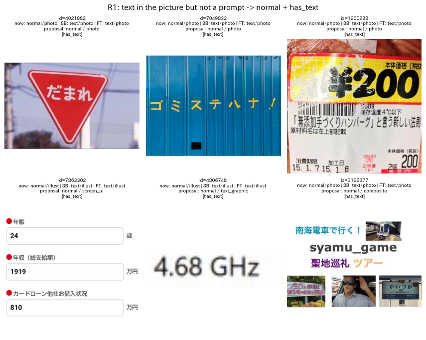
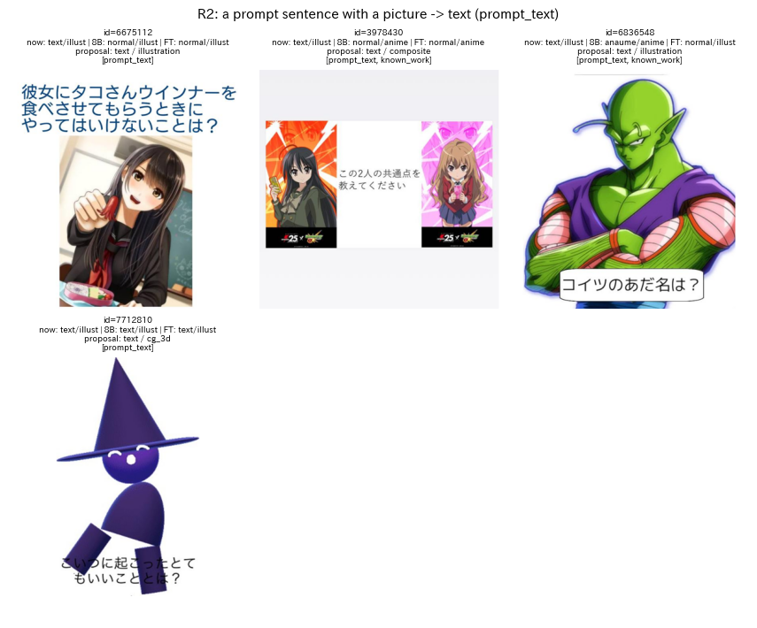
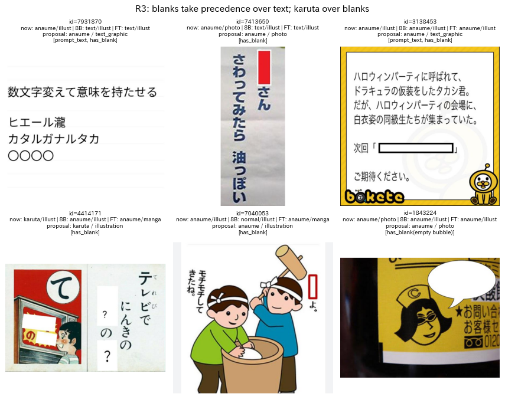
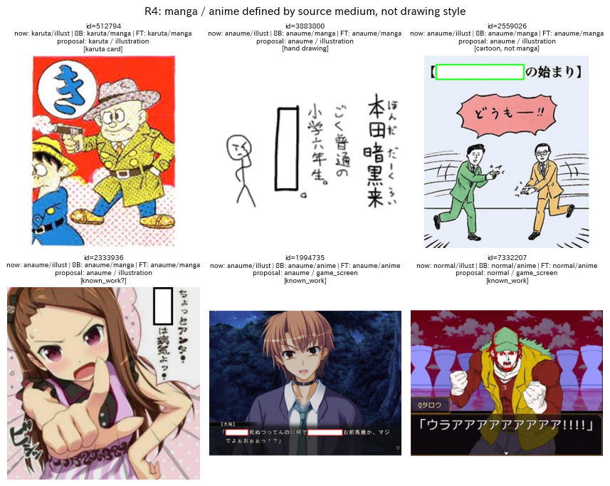
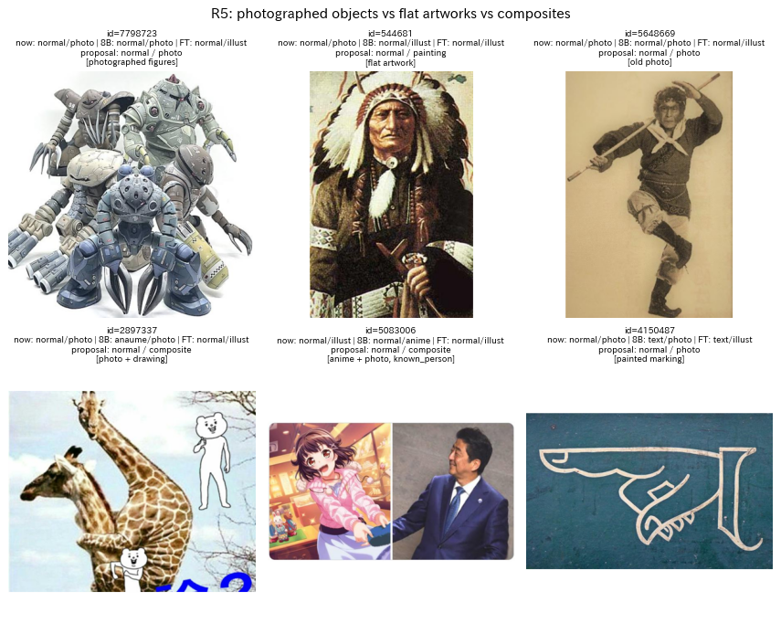

# お題画像の種別ラベルの厳密化に関する改訂案

## 1. 概要

report_002 では，強い手法（Qwen3-VL-8B，蒸留した線形分類器，微調整した SigLIP2-B）と目視ラベルが食い違う画像の多くが，ラベルの定義の境界にあることが分かった．本稿では，評価用データ（640枚）で実際に判断が分かれた画像を論点ごとに整理し，その原因を分析したうえで，ラベルの定義の改訂案を3つ示して比較する．推奨する案は，ボケの生成に必要な処理から逆算して定義を決め，次の3種類のラベルに分けるものである．

- 主形式：大喜利の形式を表す排他的なラベルであり，優先順位付きの判定手順で決める．
- 属性：空欄，お題文，付随する文字などの有無を表す独立なラベルである．
- 媒体と事前知識：画風を表す媒体のラベルと，事前知識が必要かを表すラベルを，別々の軸として分ける．

あわせて，定義を評価用ラベルと VLM のプロンプトに同時に反映し，一致度で検証する手順を提案する．本稿は設計の提案であり，改訂案によるラベルの付け直しと精度の検証は行っていない．

## 2. 現行の定義で判断が分かれた画像

### 2.1 食い違いの内訳

評価用データ640枚のうち，Qwen3-VL-8B，SigLIP2-so400m のロジスティック回帰，微調整した SigLIP2-B（いずれも seed 0）の3つのうち2つ以上が目視ラベルと異なった画像を，形式と画風の軸ごとに集計した．形式では34枚，画風では40枚が該当した．表1に主な内訳を示す．

表1 2つ以上の手法が目視ラベルと異なった画像の内訳（Qwen3-VL-8B の予測で分類）．

| 軸 | 目視ラベル | 8B の予測 | 枚数 | 主な画像の例 |
| :---: | :---: | :---: | :---: | :--- |
| 形式 | normal | text | 14 | 標識，壁の文字，商品のラベル，入力フォームの画面，文字だけの画像 |
| 形式 | anaume | text | 4 | ○○○○ や赤い空欄を含む文章 |
| 形式 | anaume | normal | 4 | 小さな空欄，黒塗りの空欄の見落とし |
| 形式 | karuta | anaume | 2 | 空欄も含むカルタの札 |
| 形式 | text | normal | 2 | 文章と大きな絵を含む画像 |
| 画風 | illust | manga | 16 | 漫画風の絵のカルタの札，手描きの絵，吹き出し付きのカット |
| 画風 | illust | anime | 6 | ゲーム画面，アニメのキャラクターのイラスト |
| 画風 | photo | illust | 5 | 写真に撮った絵画やフィギュア，写真と絵の合成 |

形式の食い違いの約半分は「文字を含む画像」と「文章のお題」の境界にあった．画風の食い違いの半分以上は，漫画の定義（漫画風の絵か，漫画の作品から切り抜いたコマか）が曖昧なことによるものであった．

### 2.2 原因

食い違いの原因として，現行の定義には以下の4つの問題がある．

1. 定義が見た目に基づいており，ボケの生成に必要な処理と対応していない．例えば「画像の大部分が文章」という基準では，標識の写真や入力フォームの画面も text になりうる．しかしこれらに必要なのは「お題文を読んで答える」処理ではなく，写真に一言を付ける通常の処理である．
2. 画風の軸に，絵の種類と事前知識の要否という2つの観点が混ざっている．ドラゴンボールのピッコロのイラスト（ID 6836548）は，絵の種類はイラストだが，ボケを作るには作品の知識が要る．指示で区別が必要とされた理由は事前知識であるが，現行のラベルはそれを直接表していない．
3. 形式の優先順位が暗黙である．空欄を含む文章や，空欄を含むカルタの札は，複数の形式に当てはまる．評価用ラベルでは空欄を優先したが，その規則はプロンプトにも定義書にも書かれていない．
4. 「主となる写真や絵がない」「大部分が」などの程度の表現が，判断者によって異なる解釈を生む．

## 3. 改訂の方針

ラベルを使う下流の処理から逆算して定義を決める．表2に，ボケの生成で必要となる処理と，それを決めるために必要なラベルの対応を示す．

表2 下流の処理と必要なラベルの対応．

| 下流の処理 | 処理が必要になる条件 | 必要なラベル |
| :--- | :--- | :--- |
| お題文の読み取りと理解 | 回答者への問いや指示の文がある | お題文の有無 |
| 空欄の位置の検出と穴埋めの文の生成 | 埋めるべき空欄がある | 空欄の有無 |
| カルタの記号の検出とひらがなの読み取り | カルタの記号がある | カルタの記号の有無 |
| 画像中の文字の読み取り（補助的） | 字幕，吹き出し，看板などの文字がある | 付随する文字の有無 |
| 作品や人物の知識の参照 | 特定の作品のキャラクターや実在の著名人が主な被写体である | 事前知識の種類 |
| 画風に応じた生成や分析 | 常に | 媒体 |

この表に基づき，以下の原則を置く．

- 判定は，観測できる事実に基づく問いに分解する．例えば「文の宛先が回答者か」「語の代わりに置かれた記号か」のように問う．
- 互いに排他的な主形式と，同時に成り立ちうる属性を分ける．主形式は優先順位付きの判定手順で一意に決める．
- 画風の軸は「何に由来する画像か」（媒体）に限定し，事前知識の要否は別の軸とする．
- 判断できない場合のために「判定不能」の印を設け，無理に決めさせない．
- 旧来の7クラスへの写像を定義し，ex001 と ex002 の結果と比較できるようにする．

## 4. 改訂案の比較

表3に3つの改訂案を示す．

表3 改訂案の比較．

| 案 | 内容 | 扱える食い違い | ラベル付けの費用 | VLM の出力 |
| :---: | :--- | :--- | :---: | :---: |
| A：最小の改訂 | 7クラスを保ち，形式の優先順位と text の操作的な定義（第5章の判定手順）のみを加える | 形式の境界（表1の形式の行の大半） | 小 | 現行と同じ |
| B：多軸化（推奨） | 主形式，属性，媒体（9種），事前知識の4種類のラベルに分ける | 形式と画風の両方，事前知識 | 中（1枚あたりの判断が増える） | JSON の項目が約8個に増える |
| C：詳細化 | B に加え，作品名と人物名，空欄の座標，カルタのひらがなまで付与する | B のすべてと，後段の処理の入力 | 大 | 長い出力，位置の出力 |

案 A は費用が小さく，プロンプトの修正のみで適用できる．しかし，事前知識の要否と漫画の定義の問題は残る．案 C は後段の処理の入力まで一度に作れるが，作品名や人物名の正解をつけるには判断者の知識が必要であり，評価用ラベルの信頼性の確保が難しい．案 B は，指示で区別が求められた理由（文字の検出，記号の検出，事前知識）をそれぞれ1つのラベルで直接表せる．このため本稿では案 B を推奨し，案 C の項目は案 B の確定後に段階的に追加することを提案する．

## 5. 推奨案（案 B）の定義

### 5.1 主形式

主形式は，回答者に求められる大喜利の形式を表す排他的なラベルである．以下の問いを上から順に判定し，最初に「はい」となった形式を主形式とする．

1. カルタの記号があるか．円や四角などの枠の中にひらがな1文字があり，その文字から始まる文を作る札の形式であれば karuta とする．枠は画像の隅にあることが多い．枠のない装飾的な文字や，文章中のひらがなは該当しない．
2. 埋めるべき空欄があるか．文章や吹き出しの中で語の代わりに置かれた記号があれば anaume とする．記号には，白や色付きの矩形，○○，□，＿＿，語の代わりの「？」，黒塗りの矩形を含む．また，話者に付いた空の吹き出しも空欄とする．文末の疑問符や，句読点としての記号は該当しない．
3. 回答者への問いや指示の文（お題文）があるか．「〜とは？」「〜してください」「〜にありがちなこと」「お題：〜」のように，回答者に向けて大喜利の課題を示す文があれば text とする．文と同時に絵や写真があってもよい．
4. いずれでもなければ normal とする．字幕，看板，商品の表示，吹き出しの台詞，画面の文字などがあっても，回答者への問いでなければ normal であり，文字があることは属性 has_text で表す．

現行の定義からの主な変更は2点である．第1に，text の基準を「画像の大部分が文章」から「回答者への問いや指示の文がある」に変える．第2に，karuta，anaume，text の優先順位を明示する．

### 5.2 属性

属性は，主形式と独立に，該当するものをすべて付与する．

| 属性 | 定義 | 主な用途 |
| :--- | :--- | :--- |
| has_karuta_mark | カルタの記号がある | カルタの記号の検出 |
| has_blank | 5.1 の2に該当する空欄がある（主形式が karuta でも付与する） | 空欄の位置の検出 |
| has_prompt_text | 5.1 の3に該当するお題文がある（主形式が anaume でも付与する） | お題文の読み取り |
| has_text | お題文以外の文字（字幕，看板，吹き出しの台詞，画面の文字）が，ボケに関わりうる大きさで含まれる | 文字の読み取り |
| composite | 複数の画像の合成，または写真と絵の重ね合わせである | 分析，媒体の判定の補助 |
| unsure | 判断者が定義に照らしても決められない | 定義の見直しの対象の抽出 |

### 5.3 媒体

媒体は，画像の主な領域が何に由来するかを表す排他的なラベルである．主な領域とは，お題文の領域を除き，画像の面積の最も大きい部分である．

| 媒体 | 定義 | 旧ラベル |
| :--- | :--- | :---: |
| photo | カメラで撮影した現実の場面．実写の映像，フィギュアや人形，着ぐるみ，像を撮影したもの，古い写真を含む | photo |
| anime | テレビや映画のアニメーション作品の画面 | anime |
| manga | 出版された漫画作品のコマ．枠線，スクリーントーン，写植の台詞などの漫画の作品の特徴をもつ | manga |
| game | ゲームの画面（ノベルゲームの会話画面，格闘ゲームなど） | illust |
| illustration | 上記以外の描かれた絵．イラスト，漫画風の一枚絵，手描きの絵，カルタの札の絵，絵本 | illust |
| painting | 絵画や版画などの平面の美術作品（写真に撮ったものを含む） | illust |
| cg_3d | 3DCG で作られた画像 | illust |
| text_graphic | 文字や記号が主体で，絵や写真がほとんどない画像 | illust |
| screen_ui | ウェブページやアプリの画面，入力フォームの画面 | illust |

漫画は「漫画風の絵」ではなく「漫画の作品から切り抜いたコマ」と定義する．漫画風の絵のカルタの札や，吹き出しの付いた一枚絵は illustration とする．事前知識の要否は次節の軸で表すため，媒体は画像の由来のみで決めればよい．

### 5.4 事前知識

事前知識は，ボケを作るために特定の作品や人物の知識が必要かを表すラベルである．

| 値 | 定義 |
| :--- | :--- |
| none | 特定の作品や人物の知識がなくてもボケを作れる |
| known_work | 特定の作品（アニメ，漫画，ゲーム，映画，CM など）のキャラクターや場面が主な被写体である |
| known_person | 名前を特定できる実在の著名人（芸能人，政治家，スポーツ選手など）が主な被写体である |
| both | known_work と known_person の両方に該当する |

判断者が作品や人物を知らなくても，「特定の作品の画面やキャラクターらしい」と判断できれば known_work とし，名前の特定は求めない．アニメや漫画のコマは原則として known_work とするが，作品を特定できない画像が多い場合に備え，unsure を併用できるようにする．

### 5.5 旧ラベルへの写像

旧来の7クラスへは，主形式が normal なら媒体を旧ラベル（5.3 の表の右列）に変換したもの，それ以外なら主形式とする．この写像により，ex001 と ex002 の結果と比較できる．ただし text の定義が変わるため，旧ラベルの text と新しい定義から写像した text は同じ意味ではない．

## 6. 論点ごとの境界事例

以下の図では，各画像の上に，現行の目視ラベル（now），Qwen3-VL-8B の予測（8B），微調整した SigLIP2-B の予測（FT），改訂案でのラベル（proposal），改訂案での属性を示す．改訂案のラベルは，本稿の定義に従って筆者（Claude Code）が付けた案である．

### 6.1 R1：文字を含むが，お題文ではない画像

図1 文字を含むがお題文ではない画像．

標識（ID 4021882），壁の文字（ID 7049832），商品のラベル（ID 1200238），入力フォームの画面（ID 7863302）は，現行の目視ラベルでは normal であるが，両手法とも text と予測した．改訂案では，回答者への問いや指示の文がないため，主形式は normal とし，has_text を付ける．媒体はそれぞれ photo，screen_ui，text_graphic などに分けて付与する．「4.68 GHz」の文字だけの画像（ID 4806748）も，問いではないため normal と text_graphic である．

### 6.2 R2：お題文と絵がある画像

図2 お題文と絵を含む画像．

「彼女にタコさんウインナーを食べさせてもらうときにやってはいけないことは？」と少女のイラスト（ID 6675112）は，目視では text としたが，主となる絵があるため，8B と微調整したモデルはいずれも normal と予測した．改訂案ではお題文があるため text とし，絵の媒体と事前知識は別の軸で表す．ピッコロと「コイツのあだ名は？」（ID 6836548）は，text，illustration，known_work となり，お題文の読み取りと作品の知識の両方が必要であることを表せる．

### 6.3 R3：空欄とカルタの優先順位

図3 空欄とカルタの優先順位に関わる画像．

○○○○ を含む文章（ID 7931870）や赤い空欄を含む縦書きの文（ID 7413650）は，空欄を優先して anaume とし，文章が回答者への指示であれば has_prompt_text も付ける．空欄を含むカルタの札（ID 4414171）は，karuta を優先して has_blank を付ける．細長い赤枠の空欄（ID 7040053）は，語の代わりの位置にあるため anaume である．写真に撮ったラベルの上の空の吹き出し（ID 1843224）は，話者に付いた空の吹き出しであるため anaume とする．

### 6.4 R4：漫画とアニメの定義

図4 漫画とアニメの定義に関わる画像．

漫画風の絵のカルタの札（ID 512794），棒人間の手描きの絵（ID 3883800），吹き出しの付いた一枚の絵（ID 2559026）は，両手法とも manga と予測した．改訂案では，漫画の作品のコマではないため illustration とする．ノベルゲームの会話画面（ID 1994735）や格闘ゲームの画面（ID 7332207）は，現行では illust または anime と判断が分かれた．改訂案では game とし，作品の知識が要ることは known_work で表す．

### 6.5 R5：写真，美術作品，合成画像

図5 写真，美術作品，合成画像の境界に関わる画像．

ロボットのフィギュアの写真（ID 7798723）は，描かれた絵に見えるが撮影した現実の物体であるため photo とする．インディアンの首長を描いた絵（ID 544681）は，現行の目視ラベルでは photo としたが，改訂案では painting となり，旧ラベルは illust に変わる．現行の目視ラベルにも，このような誤りや揺れが含まれている．写真に描いた熊を重ねた画像（ID 2897337）や，アニメのイラストと政治家の写真を並べた画像（ID 5083006）には composite を付け，媒体は主な領域で決める．

## 7. 運用と検証の手順

定義を改訂するだけでなく，判断者と VLM の解釈が一致しているかを数値で確かめながら改訂を繰り返す．以下の手順を提案する．

1. 本稿の第5章を定義書の第1版とし，第6章の事例を「事例集」として添付する．
2. 評価用データ640枚を，定義書の第1版で付け直す．旧ラベルとの差分を記録し，変更の理由を事例集に追加する．
3. 判断者2名（例えば研究者1名と Claude Code）が，評価用データから層化して選んだ200枚に独立にラベルを付ける．軸ごとに一致度を Cohen の $` \kappa `$ で求める．$` \kappa = (p_o - p_e) / (1 - p_e) `$ であり，$` p_o `$ は観測された一致率，$` p_e `$ は各判断者のラベルの割合から求めた偶然の一致率である．
4. 不一致の画像を2名で協議して裁定し，定義書と事例集を改訂する．主形式で $` \kappa \geq 0.8 `$，媒体と事前知識で $` \kappa \geq 0.7 `$ を目安に，2〜3回繰り返す．
5. 定義書の判定手順を，そのまま VLM のプロンプト（v3）の質問の順序とする．出力の JSON を，主形式，属性，媒体，事前知識の項目に拡張し，構造化出力で値の候補を制約する．
6. Qwen3-VL-8B のプロンプト v3 の出力を，付け直した評価用ラベルと比較する．軸ごとに $` \kappa `$ と正解率を求め，判断者どうしの一致度と比べる．判断者どうしの一致度が VLM と判断者の一致度の上限の目安となる．
7. 生徒の分類器を多ラベルに対応させる．具体的には，主形式と媒体と事前知識には softmax，属性には sigmoid の出力層を用いる．そのうえで，ex002 と同じ手順で蒸留して評価する．

## 8. 改訂により予想される影響

以下は表1の内訳からの見込みであり，検証はしていない．R1 と R2 の規則は，形式の食い違いのうち normal と text の境界の16枚（normal を text とする14枚と，text を normal とする2枚）を対象とする．R3 の規則は，anaume と text，karuta と anaume の境界の約7枚を対象とする．R4 の規則は，画風の食い違いのうち illust と manga，illust と anime の境界の22枚を対象とする．ただし，定義を明確にしても VLM や生徒が新しい定義どおりに判断するとは限らない．特に「回答者への問いか」の判断は文の意味の理解を要するため，画像の埋め込みのみを用いる生徒には難しい可能性がある．

VLM の出力は約15トークンから約60トークンに増える．画像の入力の処理に比べて生成の計算は小さいため，処理速度の低下は限定的と見込まれるが，測定はしていない．媒体を4種から9種に増やすと，件数の少ない媒体（screen_ui，painting など）では評価用データが不足する．このため，評価用データの追加が必要になる．

## 9. 未解決の論点と次に検討すべき候補

- 本稿の改訂案と事例のラベルは Claude Code が作成したものであり，研究上の目的（どの区別がボケの生成モデルにとって重要か）に照らした妥当性を，研究者が確認する必要がある．特に，text を「お題文の有無」で定義し直す点，漫画を「作品のコマ」に限定する点，事前知識を別の軸にする点は，判断が必要な設計上の選択である．
- 事前知識（known_work，known_person）は判断者の知識に依存するため，判断者間の一致度が低くなる可能性がある．一致度が低い場合は，「キャラクターらしい絵か」のような観測しやすい基準に置き換えることを検討する．
- 「回答者への問いや指示の文」の判定には，文の意味の理解が必要である．VLM で判定できるか，また SigLIP 系の生徒で再現できるかは未検証である．
- 定義書の第1版による評価用データ640枚の付け直し，判断者2名による一致度の測定，プロンプト v3 の作成と評価は未実施である．
- 案 C の項目（作品名や人物名，空欄の座標，カルタのひらがな）を追加する時期と方法は，案 B の検証後に検討する．
