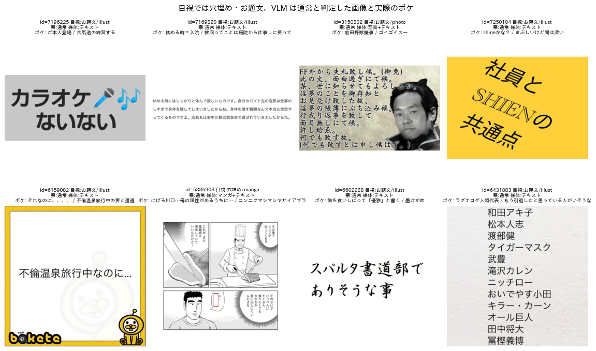
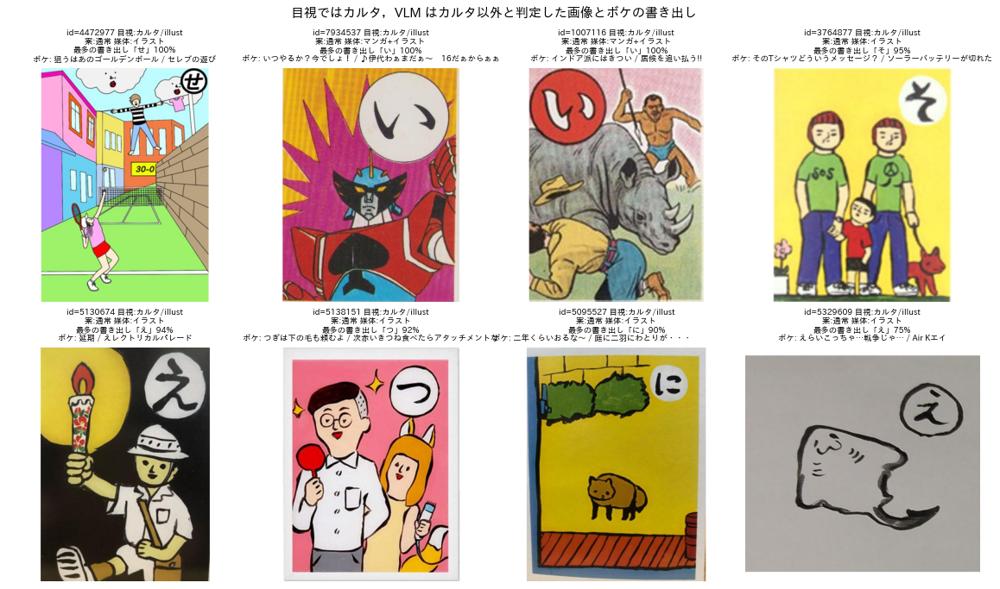
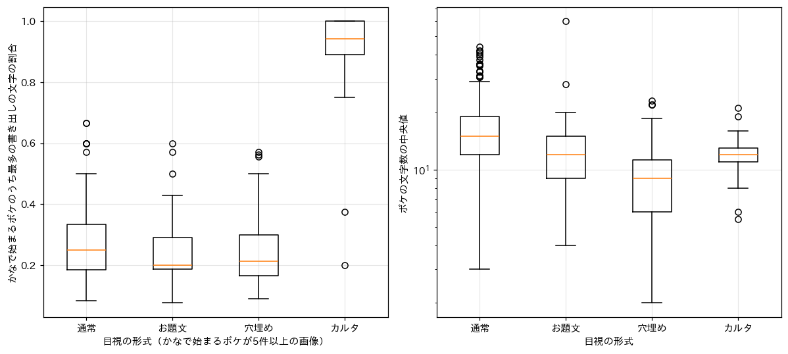
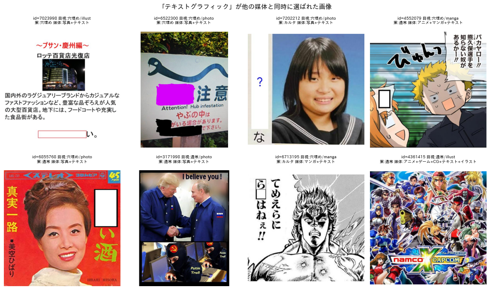
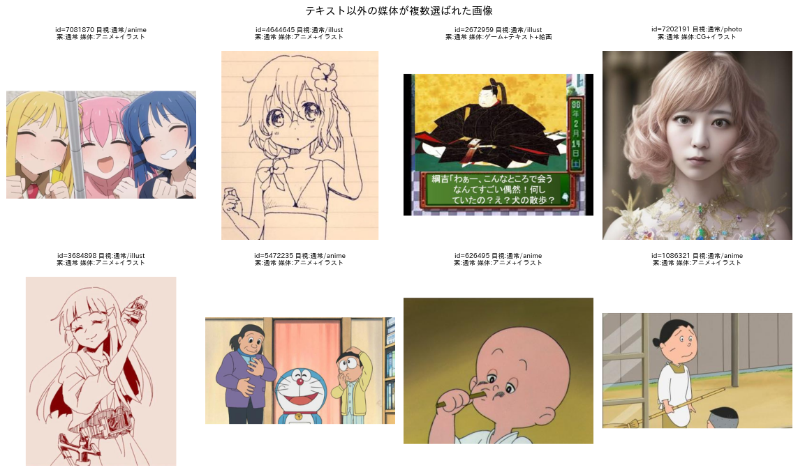
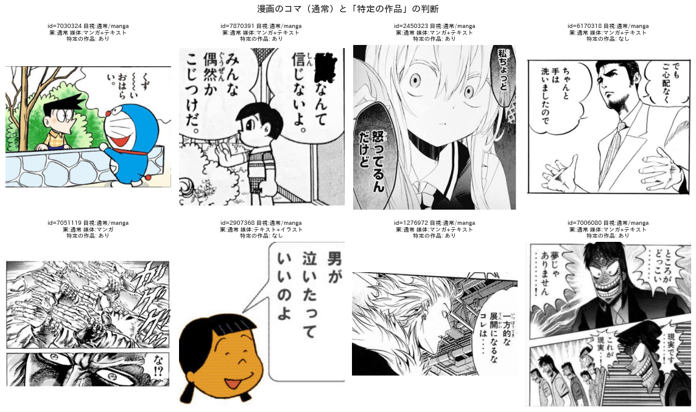
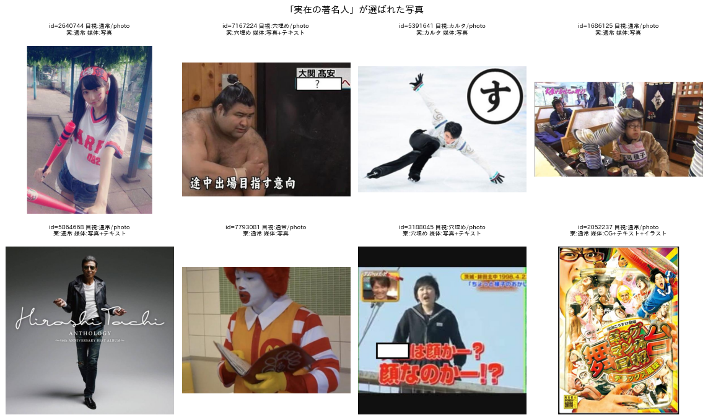

# ラベル定義の草案に対する検証と修正の提案

## 1. 概要

ラベル定義の草案（形式，属性，媒体，事前知識の4軸．以下，草案）の妥当性を，実データで検証した．検証は次の3つの方法による．

1. 草案の文言をそのまま Qwen3-VL-8B のプロンプトにし，評価用データ640枚に適用した（以下，パイロット）．
2. 「実際の大喜利とペアで決定する」という方針を，BoketeDBv4 のボケの本文で確かめた．
3. 「投稿者の意図」を，お題の `type` 列（2022年以降に投稿者が選んだ種別）で確かめた．

結論として，草案の4軸の構成と「形式＝回答を制限する画像」という原則は妥当であり，下流の処理（文字の読み取り，記号の検出，事前知識）と素直に対応している．また，ボケの本文と `type` 列は形式の判定を裏付ける強い手がかりになることが分かった．かなで始まるボケの書き出しの文字の集中度は，カルタを AUC 0.979 で判別できる．`type` が「穴埋め」のお題は52枚すべてが目視でも穴埋めであった．一方，パイロットでは次の問題が見つかった．

- テキストグラフィックの定義（「文字が記入された画像」）が広く，640枚中54%で選ばれた．字幕付きの写真や吹き出しのある漫画にも付き，属性の「文字あり」と重複する．
- 媒体を2つ以上選んだ画像が46%あり，「アニメ＋イラスト」のように同じ領域に複数の媒体が付いた．
- お題文の定義が問いと指示に限られている．このため「〜の共通点」「〜でありそうな事」のような題目の句や，状況を設定する文がお題文と判定されなかった．
- 形式の優先順位がなく，空欄とお題文の両方がある画像で判断が揺れた．
- 事前知識の「作品に由来するものを含む」は，作品を特定できない漫画のコマにも当てはまる．このため，判断が画像によって揺れた．

第6章に，これらを踏まえた修正版の定義を示す．

## 2. 草案の良い点

- 形式を「ユーザーの回答を制限する画像」と定義し，各形式に「どのような大喜利を投稿するか」を対応させている．このため，判断の基準が見た目ではなく大喜利の課題の性質に置かれており，report_003 の方針と一致する．
- 属性を複数選択として，形式とは独立に「空欄あり」「お題文あり」などを記録できる．主形式を1つに決めても，後段の処理に必要な情報が失われない．
- 媒体を複数選択とすることで，写真とイラストの合成などを表現できる．
- 事前知識を「実在の著名人」と「特定の作品」に分けて複数選択とし，媒体と独立にしている．アニメ以外の画像（イラスト，ぬいぐるみの写真など）の作品の知識も表せる．
- 形式を「実際の大喜利とペアで決定する」という観点は，第4.3節で示すとおりデータで裏付けられる．

## 3. 検証の方法

### 3.1 パイロット

草案の文言（形式，属性，媒体，事前知識の定義）を日本語のままプロンプトに書き，Qwen3-VL-8B（vLLM，入力の最大画素数 $` 448^2 `$）に評価用データ640枚を入力した．出力は JSON スキーマによる構造化出力で制約した．具体的には，形式は4値の列挙，属性・媒体・事前知識は各項目の真偽値とした．カルタの場合はひらがなを1文字出力させた．出力を解釈できなかった画像は0件であった．処理速度は12.3枚/秒であり，形式と画風のみを出力するプロンプト v2（約26枚/秒）の約半分であった．出力が約15トークンから約150トークンに増えたためである．

### 3.2 ボケの本文との照合

評価用画像に投稿されたボケを BoketeDBv4 から読み込み，お題ごとに次の2つの統計を求めた．

- かなの書き出しの集中度：ボケの最初の文字（括弧や記号を除き，カタカナはひらがなに変換）がかなであるボケのうち，最も多い書き出しの文字が占める割合．
- ボケの文字数の中央値．

漢字で始まるボケ（例：「つ」の札に対する「次…」）は，読みが分からないため集中度の計算から除いた．集中度は，かなで始まるボケが5件以上ある325枚で評価した．

### 3.3 `type` 列との照合

お題の `type` 列は，2022年以降に投稿者が「写真」「イラスト」「穴埋め」「文字」「その他」から選んだ値であり，投稿者の意図を直接表す．評価用画像のうち2022年以降の225枚で，現行の目視ラベルと比較した．

なお，第4章で比較に用いる「目視」のラベルは，report_001 と report_002 で作成した現行の定義によるものであり，草案の定義によるものではない．草案ではお題文の定義などが変わるため，一致率は定義の違いと判定の誤りの両方を含む．

## 4. 結果

### 4.1 パイロットの出力の分布

表1にパイロットの各項目が選ばれた割合を示す．

表1 パイロットで各項目が選ばれた割合（640枚）．

| 軸 | 項目 | 割合 |
| :---: | :--- | :---: |
| 形式 | 通常 / 穴埋め / お題文 / カルタ | 63.0% / 20.0% / 10.3% / 6.7% |
| 属性 | 空欄あり / お題文あり / カルタ記号あり / その他の文字あり | 20.8% / 18.1% / 7.3% / 53.0% |
| 媒体 | 写真 / テキストグラフィック / イラスト / マンガ / アニメ / CG / ゲーム / 絵画 | 39.5% / 53.6% / 21.7% / 19.5% / 13.1% / 3.8% / 2.5% / 1.4% |
| 事前知識 | 実在の著名人 / 特定の作品 | 19.4% / 30.6% |

媒体の選択数は，1つが344枚，2つが246枚，3つ以上が50枚であった．形式と属性の間に矛盾はなかった．例えば，形式が穴埋めで「空欄あり」が偽の画像は0件であった．現行の目視ラベルとの形式の一致率は 0.872 であった．形式別の一致数は，カルタが46枚中34枚，穴埋めが163枚中126枚，お題文（現行の text）が73枚中50枚，通常が358枚中348枚である．プロンプト v2 の 8B（カルタ41枚，穴埋め148枚）より見落としが多かった．

### 4.2 形式

#### 4.2.1 お題文の範囲

図1は，目視ではお題文または穴埋めとしたが，パイロットでは通常と判定された画像と，実際の評価の高いボケである．

図1 目視では穴埋め・お題文，パイロットでは通常と判定された画像と実際のボケ．

「カラオケないない」（ID 7196225），「社員と SHIEN の共通点」（ID 7250104），「スパルタ書道部でありそうな事」（ID 6602288）は，問いや指示の形をしていない．しかしボケは「ご本人登場」「歯を食いしばって『優雅』と書く」のように，題目に答えている．「不倫温泉旅行中なのに…」（ID 6159082）は状況の設定であり，ボケは続きを書いている．芸能人の名前の列挙（ID 6431883）には，「ラグナログ人類代表」のように共通点を答えるボケが付いている．草案の「問いや指示の文（〜とは？，〜してください）」はこれらを含むと読めるが，例示が問いと指示に限られるため，VLM は題目の句を含めなかった．お題文の定義に，題目の句（「〜あるある」「〜な事」「〜の共通点」），状況の設定，列挙を明示する必要がある．

#### 4.2.2 形式の優先順位

「空欄あり」と「お題文あり」の両方が真の画像は29枚あった．そのうちパイロットは25枚を穴埋め，4枚をお題文と判定しており，判断が一定しない．空欄とカルタ記号の両方がある画像も1枚あった．草案には複数の形式に当てはまる場合の規則がない．このため，カルタ，穴埋め，お題文の順に優先する（回答への制約が強い順）規則を明記することを提案する．

#### 4.2.3 カルタの記号

図2は，目視ではカルタだが，パイロットではカルタ以外と判定された画像である．各画像の下に，かなで始まるボケのうち最も多い書き出しの文字とその割合，評価の高いボケを示す．

図2 目視ではカルタ，パイロットではカルタ以外と判定された画像とボケの書き出し．

8枚とも，記号の中のひらがな（せ，い，い，そ，え，つ，に，え）とボケの最も多い書き出しが一致し，その割合は75〜100%であった．例えば「つ」の札（ID 5138151）には「つぎは下の毛も頼むよ」「ついでに下の毛もいっちゃいます？」が付いている．VLM の見落としを，ボケの書き出しで補える．

逆に，パイロットがカルタと誤った例もあった．空欄の横に置かれたひらがな（ID 7202212 の「な」，ID 6713195 の「ら□」）を，カルタ記号と判定している．定義の「ひらがな1文字が入った記号」に，「文の一部ではなく，独立した記号（枠）の中にある」ことを加える必要がある．

#### 4.2.4 ボケと投稿者の意図による裏付け

図3の左は，現行の目視の形式ごとの，かなの書き出しの集中度の分布である．右は，ボケの文字数の中央値の分布である．

図3 目視の形式ごとのボケの書き出しの集中度（左）とボケの文字数の中央値（右）．

カルタの集中度の中央値は約0.94であり，他の形式（0.2〜0.25）と明確に分かれた．集中度でカルタを判別した場合の AUC は 0.979 であった．しきい値0.6では，適合率 0.84，再現率 0.95（38枚中36枚）となる．一方，ボケの文字数は穴埋めでやや短い（中央値9文字，通常は15文字）が分布の重なりが大きく，形式の判別には弱い手がかりである．ボケの数が少ないお題（かなで始まるボケが5件未満）は640枚中315枚あり，この方法を使えるのはボケの多いお題に限られる．

`type` 列との照合では，`type` が「穴埋め」の52枚がすべて目視でも穴埋めであり，「文字」の43枚のうち37枚が目視でお題文であった．投稿者の選択は適合率が高い．ただし，2022年以降の目視の穴埋め70枚のうち18枚は「写真」「イラスト」「その他」が選ばれており，再現率は約74%であった．カルタには対応する選択肢がない．

これらから，「実際の大喜利とペアで決定し，投稿者の意図をくみ取る」という方針は，次のように運用できる．第1に，VLM が画像から形式を判定する．第2に，ボケの書き出しの集中度と `type` 列を独立の証拠として照合する．第3に，矛盾する画像を見直しの対象とする．

### 4.3 属性

「お題文，カルタ記号ではない文字あり」は53.0%の画像で真となった．字幕，看板，吹き出しの台詞に加え，透かし，ロゴ，番組名のような小さな文字も含まれていると考えられる．文字の読み取りが必要かを判断するという目的からは，「ボケに関わりうる文字」に限定し，透かし，著作権表示，ロゴ，判読できない小さな文字を除くと明記するのが望ましい．

### 4.4 媒体

#### 4.4.1 テキストグラフィック

図4は，テキストグラフィックが他の媒体と同時に選ばれた画像である．

図4 テキストグラフィックが他の媒体と同時に選ばれた画像．

テキストグラフィックが選ばれた343枚のうち，「マンガ＋テキスト」が90枚，「写真＋テキスト」が70枚あった．空欄を書き込んだ写真（ID 6855768，美空ひばりのレコードのジャケット）や，台詞のある漫画のコマ（ID 6713195）にも付いている．「文字が記入された画像」という定義では，文字の有無を表す属性と意味が重なり，媒体の情報が増えない．テキストグラフィックは「文字や記号が主体で，写真や絵がほとんどない画像」に限定し，文字の有無は属性で表すことを提案する．

#### 4.4.2 媒体の複数選択

図5は，テキストグラフィック以外の媒体が複数選ばれた画像である．

図5 テキストグラフィック以外の媒体が複数選ばれた画像．

アニメの画面（ID 7081870 のぼっち・ざ・ろっく！，ID 5472235 のドラえもん，ID 1086321 のサザエさん）に「アニメ＋イラスト」が付いている．草案のイラストは「上記に含まれない絵」と排他的に定義されているが，複数選択と組み合わさることで重複して選ばれた．このほか，判断の揺れる画像がある．アニメのキャラクターを鉛筆で描いた絵（ID 4644645）は「アニメ＋イラスト」，レトロゲームの画面（ID 2672959）は「ゲーム＋テキスト＋絵画」とされた．生成AIによるとみられる写実的な人物画像（ID 7202191）は「CG＋イラスト」とされた．

複数選択は「画像が異なる媒体の領域の合成である場合のみ」に限定し，1つの領域には1つの媒体を付ける規則を提案する．加えて，次の扱いを決めておく必要がある．

- アニメのキャラクターの描き下ろしや模写は，イラストとし，作品の知識は事前知識の軸で表す．
- ウェブページやアプリの画面（入力フォームなど）は，テキストグラフィック，または新たに設ける「スクリーンショット」とする．
- 写真に撮った絵画やポスターは，写っている作品の媒体とする．
- 生成AIによる写実的な画像は，写真とするか CG とするかを決める．判別が難しいため，「判定不能」も認める．
- 絵画の「古典的」の範囲として，浮世絵，近代の油彩画，現代美術を含むか決める．

### 4.5 事前知識

#### 4.5.1 特定の作品

図6は，現行の目視で通常・漫画とした画像に対するパイロットの「特定の作品」の判断である．

図6 漫画のコマと「特定の作品」の判断．

ドラえもん（ID 7030324）やカイジ（ID 7006080）は「あり」とされた．一方，作品を特定しにくいコマ（ID 2450323）も「あり」となり，ID 6170318 は「なし」となった．漫画として判定された画像のうち「特定の作品」が真の割合は52.8%であった．草案の「作品に由来するものを含む」は，作品を特定できるかに関わらず，すべての漫画のコマとアニメの画面に当てはまる．このため，判断が揺れる．ボケの生成に必要なのは作品の知識であるため，「作品名を特定できる（判断者が知っている，または画像中の文字から分かる）」ことを基準とすることを提案する．あわせて，作品に由来するが特定できない場合を区別できるようにする．

#### 4.5.2 実在の著名人

図7は，「実在の著名人」が選ばれた写真である．

図7 「実在の著名人」が選ばれた写真．

大関の高安（ID 7167224，テロップに名前がある），フィギュアスケートの選手（ID 5391641），アルバムのジャケット（ID 5864668）など，妥当な判断が多い．一方，マクドナルドのドナルド（ID 7793081）は実在の人物ではなく企業のキャラクターである．テレビのニュースに映った一般の人（ID 3188045）が含まれる可能性もある．著名人の判断は判断者の知識に依存するため，以下を明記することを提案する．

- 名前を特定できること（テロップなど画像中の文字から分かる場合を含む）．
- 企業のマスコットやキャラクターは「特定の作品」の側に含めること．
- 主な被写体であること（背景に小さく写るロゴやポスターは除く）．

## 5. 処理の費用への影響

パイロットの処理速度は12.3枚/秒であり，全件（約682万枚）に VLM を直接適用すると約154時間を要する．ただし report_002 の推奨手順では，VLM は教師ラベルの付与（4万〜10万枚，約1〜2.3時間）にのみ用い，全件の処理は微調整した画像エンコーダで行う．このため，項目を増やしても全体の費用への影響は小さい．生徒の分類器は，形式と媒体は排他的な出力（softmax），属性と事前知識は独立の出力（sigmoid）とする多ラベルの構成に変える必要がある．なお，形式の見落としがプロンプト v2 より増えたことから，VLM への質問は第6章の判定手順の順序で書き，形式の判定の説明を詳しくする必要がある．

## 6. 修正版の定義（提案）

草案に対する修正点を太字で示す．

**形式（1つ選択）**：ユーザーの回答を制限する画像．**以下の順に判定し，最初に当てはまったものとする．**

1. カルタ：ひらがな1文字が入った記号（○，□など）がある画像．ひらがなから始まる大喜利を投稿する．**ひらがなは文の一部ではなく，独立した記号（枠）の中にあるものに限る．空欄も含む場合もカルタとする．**
2. 穴埋め：語の代わりに置かれた空欄（矩形，○，吹き出しなど）がある画像．空欄に入る大喜利を投稿する．**○○，□，＿＿，語の代わりの「？」，黒塗り，話者に付いた空の吹き出しを含み，文末の疑問符は含まない．お題文も含む場合も穴埋めとする．**
3. お題文：問いや指示の文がある画像．問いや指示に対応した大喜利を投稿する．**問い（〜とは？），指示（〜してください）に加え，題目の句（〜あるある，〜な事，〜の共通点），状況の設定（〜なのに…），名前などの列挙を含む．字幕，看板，台詞のように画像に元からある文字は含まない．**
4. 通常：上記の形式以外の画像．

上記は実際の大喜利とペアで決定するものであるが，画像の投稿者の意図をくみ取り決定する．**判定の際は，ボケの書き出しの集中度（カルタ）と `type` 列（穴埋め，お題文）を補助の証拠として照合し，矛盾する画像は見直す．**

**属性（複数選択）**

- 空欄あり
- お題文あり
- カルタ記号あり
- お題文，カルタ記号ではない文字あり（**ボケに関わりうる文字に限り，透かし，著作権表示，ロゴ，判読できない小さな文字は除く**）
- **合成画像（複数の画像の貼り合わせ，写真と絵の重ね合わせ）**
- **判定不能（どの軸のどの項目で迷ったかを記録する）**

**媒体（原則として1つ選択．合成画像で異なる媒体の領域がある場合のみ複数選択）**：画像のスタイル

- 写真：現実の写真（**実写の映像，フィギュアや人形，着ぐるみ，像を撮影したものを含む**）
- アニメ：アニメのスクリーンショット
- ゲーム：ゲーム画面のキャプチャ
- CG：コンピュータグラフィック（**ゲームやアニメの画面ではない3DCG．生成AIによる画像の扱いは別途決める**）
- マンガ：漫画作品から切り抜いたコマ
- テキストグラフィック：**文字や記号が主体で，写真や絵がほとんどない画像（ウェブページやアプリの画面を含む）**
- 絵画：古典的絵画（**浮世絵などの版画を含み，写真に撮ったものも絵画とする**）
- イラスト：上記に含まれない絵（**アニメや漫画のキャラクターの描き下ろし，模写，漫画風の一枚絵，カルタの札の絵，手描きの絵を含む**）

**事前知識（複数選択）**

- 実在の著名人：芸能人などの有名人を含む画像（**名前を特定できる人物が主な被写体であるもの．テロップなどから分かる場合を含む**）
- 特定の作品：ドラゴンボールやドラえもんなどの作品に由来するものを含む画像（**作品名を特定できるキャラクターや場面が主な被写体であるもの．企業のマスコットを含む．作品に由来するが特定できない場合は「作品不明」とする**）

## 7. 未解決の論点と次に検討すべき候補

- 修正版の定義を確定する．特に，お題文の範囲（題目の句，状況の設定，列挙を含めるか）と，生成AIによる画像の媒体は，研究上の目的に照らして判断が必要である．
- 修正版の定義で評価用データ640枚を付け直す．判断者2名による一致度（Cohen の $` \kappa `$）も測る．
- VLM のプロンプトを修正版の判定手順の順序で書き直し（プロンプト v3），形式の見落としが v2 の水準まで戻るかを確かめる．
- ボケの書き出しの集中度は，ボケの多いお題（約半数）にしか使えない．漢字で始まるボケの読みを推定する（形態素解析で読みを付ける）と，対象を広げられる可能性がある．
- `type` 列は2022年以降のお題（約80万件）にしかない．それ以前のお題の投稿者の意図は，ボケの傾向から推定するほかない．
- 生徒の分類器を多ラベルの構成に変え，蒸留の精度と速度を測る．
