# 確定版のラベル定義（4軸）による蒸留の精度の再計測

## 1. 概要

確定版のラベル定義（形式，属性，媒体，事前知識の4軸．`programs/label_guideline/label_definition_v1.md`）で評価用データ640枚の目視ラベルを付け直し，VLM の教師から高速な生徒への蒸留の精度を計測し直した．教師は Qwen3-VL-8B であり，生徒は画像埋め込みに対するロジスティック回帰と MLP，および微調整した SigLIP2-B である．主な結果は以下のとおりである．

- 4軸を一度に問うプロンプトでは，形式の判定が2軸用の短いプロンプト v2 より悪化した（形式の正解率は v2 が 0.922，4軸の最良のプロンプト v5 が 0.866）．そこで，形式は v2 の判定を用い，他の3軸は v5 と定義書の規則で補った「組み合わせ教師」を作った．組み合わせ教師の4軸のマクロF1の平均は 0.771 で，教師の中で最良であった．
- 生徒の最良は，組み合わせ教師のラベルで学習した SigLIP2-so400m の埋め込みに対する MLP であった．4軸のマクロF1の平均は 0.778 ± 0.002（形式の正解率 0.918，属性 0.781，媒体 0.781，事前知識 0.652）で，教師と同等以上である．全件の処理時間は約10.7時間と見積もられる．
- 微調整した SigLIP2-B は，形式の正解率が 0.930 ± 0.005 で全手法の中で最も高く，処理時間も約2.1時間と短い．一方で，件数の少ない媒体（ゲーム）と事前知識の F1 が低く，4軸の平均は 0.743 にとどまった．
- 精度の上限を決めているのは，媒体と事前知識の判定である．特に「実在の著名人」「作品不明」「CG」「ゲーム」は，教師を含む全手法で F1 が 0.75 未満であった．また，「お題文あり」は全手法で F1 が約0.63であった．目視ラベルと手法の食い違いの多くは，穴埋め画像の空欄を含む文や，テレビのテロップをお題文とみなすかの判断にある．

## 2. 背景

report_002 までの7クラスのラベルでは，強い手法の誤りの多くがラベルの定義の境界にあった．report_003 から order_005 にかけて，ボケの生成に必要な処理から逆算した4軸の定義を作成し，確定版とした．本稿では，確定版の定義のもとで同じ蒸留の枠組みを実施し，定義の変更が精度にどう影響するかを計測した．

## 3. 方法

### 3.1 評価用データの付け直し

ex002 の評価用データ640枚（無作為抽出440枚，メタデータで絞り込んだ200枚）に，確定版の定義で4軸のラベルを付け直した（図1）．付与は Claude Code が画像を目視で確認して行った．以前のラベルは参考として表示し，VLM の予測は表示しなかった．

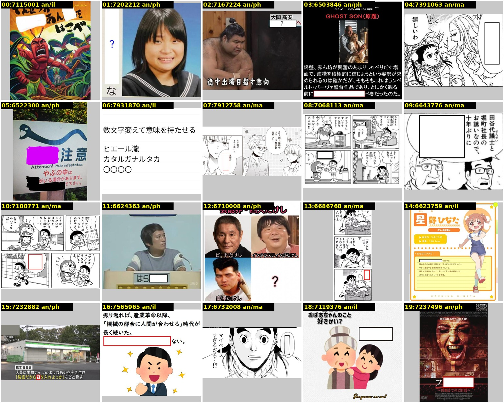

図1 目視のラベル付けに用いた一覧画像の例．各画像の左上に番号，お題ID，以前のラベル（形式/画風）を示す．

付け直した結果，形式は通常361枚，穴埋め163枚，お題文69枚，カルタ47枚となった．以前のラベルからの形式の変更は，お題文から通常への4枚などの7枚のみであった．属性・媒体・事前知識で正例の多い項目は，写真279枚，その他の文字あり256枚，特定の作品148枚，テキストグラフィック113枚，マンガ106枚である．少ない項目は，CG 4枚，絵画5枚，ゲーム11枚，合成画像33枚である．判定不能は7枚，媒体を複数付けた画像は26枚であった．

### 3.2 評価指標

形式は4クラスの正解率とマクロF1で評価した．属性（判定不能を除く5項目），媒体（8項目），事前知識（3項目）は，項目ごとに2値分類の F1 を求め，評価用データに正例がある項目の F1 を平均して各軸のマクロF1とした．総合の指標として，4軸のマクロF1の平均を用いた．

### 3.3 教師のプロンプト

教師は Qwen3-VL-8B（vLLM，入力の最大画素数 $` 448^2 `$）である．出力は JSON スキーマによる構造化出力で制約した．表1に比較したプロンプトを示す．

表1 比較した教師のプロンプト．

| 版 | 内容 |
| :---: | :--- |
| v3 | 定義書の判定手順の順に，形式，属性，媒体，事前知識を問う |
| v4 | 属性を先に答えさせてから形式を答えさせ，作品名と人物名を書かせる |
| v5 | v4 に「中身が空の枠はカルタ記号ではない」「字幕やテロップはお題文ではない」「迷ったら false」を加え，形式は回答させずに属性から定義の優先順位（カルタ記号 → 空欄 → お題文）で導く |
| 規則 | v5 の出力に，定義書に基づく2つの規則を適用する．(1) 媒体がアニメ・マンガ・ゲームで作品名を特定できない画像は「作品不明」とする．(2) カルタ記号ありの画像で，かなで始まるボケが5件以上あり，そのうち記号のひらがなで始まる割合が3割未満なら，カルタ記号なしとする |
| 組み合わせ | 形式は ex002 のプロンプト v2（2軸用）の判定を用い，属性・媒体・事前知識は v5 と規則の結果を用いる．属性は形式と矛盾しないように整える |

プロンプトの改訂（v3 → v4 → v5）は評価用データの誤りを見て行ったため，教師の評価用データでの精度はやや楽観的である．

### 3.4 教師ラベルと生徒

教師ラベル用の画像は ex002 と同じ40,000枚（学習用36,000枚，検証用4,000枚）である．v5 と規則によるラベルと，組み合わせ教師のラベルの2種類を作った．v2 のラベルは ex002 で付与済みのものを用いた．

生徒の構成は次のとおりである．

- 埋め込みに対する分類器：SigLIP2-so400m，SigLIP2-B，CLIP-B/32 の埋め込みに対するロジスティック回帰と2層の MLP．形式は多クラス，属性・媒体・事前知識は項目ごとの2値で学習した．予測では確率0.5以上を真とし，媒体が1つも真でない場合は最も確率の高い媒体を真とした．
- 微調整：SigLIP2-B の画像エンコーダに4つの出力層を付けたモデル．誤差は，形式の交差エントロピーと，他の3軸の2値交差エントロピーの和である．学習率 $` 3 \times 10^{-5} `$，AdamW（重み減衰 0.05），バッチサイズ128で4エポック学習した．

ハイパーパラメータ（ロジスティック回帰の正則化の強さ，MLP の学習率と重み減衰，微調整の最良のエポック）は，教師ラベルの検証用分割における4軸のマクロF1の平均で選んだ．seed は 0，1，2 の3つである．

## 4. 結果

### 4.1 教師の比較

表2に教師の結果を示す．

表2 教師の精度（評価用データ640枚）．

| 教師 | 形式正解率 | 形式マクロF1 | 属性 | 媒体 | 事前知識 | 4軸の平均 | 枚/秒 |
| :-------------------------------------- | :------: | :------: | :-----: | :-----: | :-----: | :------: | :--------: |
| v3 | 0.850 | 0.780 | 0.707 | 0.769 | 0.415 | 0.668 | 8.3 |
| v4 | 0.761 | 0.677 | 0.719 | 0.730 | 0.474 | 0.650 | 7.7 |
| v5 | 0.867 | 0.817 | 0.746 | 0.729 | 0.474 | 0.692 | 6.6 |
| v5 + 規則 | 0.878 | 0.849 | 0.766 | 0.729 | 0.671 | 0.754 | 6.6 |
| **組み合わせ（v2 の形式 + v5 + 規則）** | **0.922** | **0.904** | **0.781** | 0.729 | **0.671** | **0.771** | 約5（2回の推論） |
| 参考：v2（ex002，形式のみ） | 0.922 | 0.902 | - | - | - | - | 26 |

v3 は，穴埋め163枚のうち40枚をカルタと誤った．図2のように，空欄の枠や，空欄の前後のひらがな（「□い。」の「い」）をカルタ記号と取り違えている．v4 で属性を先に答えさせると空欄の検出は改善した（空欄ありの再現率 0.65 → 0.89）．しかし，モデルが自分で判定した属性と形式の優先順位を一致させず，形式の正解率は下がった．v5 で形式を属性から規則で導くと，正解率は 0.866 に戻った．さらにボケの書き出しによる照合で，カルタの誤検出が減った（カルタのF1 0.77 → 0.88）．

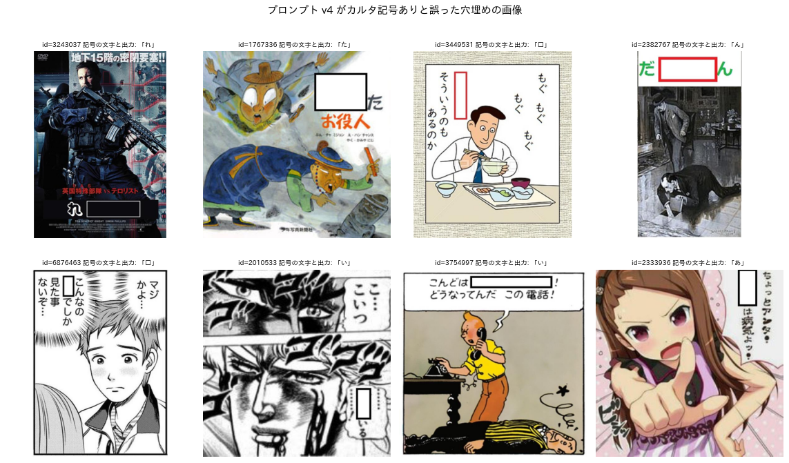

図2 プロンプト v4 がカルタ記号ありと誤った穴埋めの画像．各画像の上に，モデルが出力した記号のひらがなを示す．

事前知識の「作品不明」は，VLM がどの版でもほとんど選ばなかった（F1 0.00〜0.04）．規則（1）で補うことで，事前知識のマクロF1は 0.47 から 0.67 に上がった．

4軸を一度に問うと，形式の判定は2軸用の短いプロンプト v2 より悪化した（0.922 に対して最良でも 0.878）．質問が長くなり出力が約150トークンに増えると，個々の判断の精度が下がると考えられる．組み合わせ教師は，形式で v2 の精度を保ちつつ，他の3軸の情報を得られる．ただし，教師ラベルを付ける際の推論が2回になる．

### 4.2 生徒の比較

図3は，主な手法の4軸のマクロF1である．誤差棒は seed 間の標準偏差である．表3に主な条件の結果を示す．

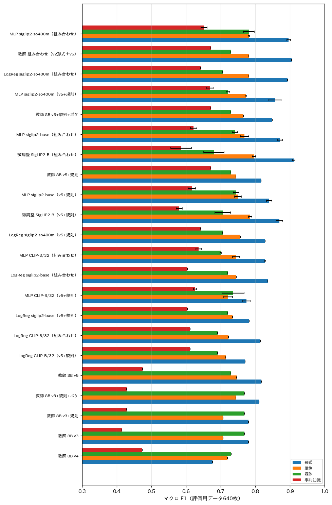

図3 手法ごとの4軸のマクロF1（評価用データ640枚）．

表3 主な生徒の精度（3 seed の平均 ± 標準偏差）．括弧内は学習に用いた教師ラベルである．

| 生徒 | 形式正解率 | 形式マクロF1 | 属性 | 媒体 | 事前知識 | 4軸の平均 | 全件の時間 |
| :-------------------------------------- | :--------: | :------: | :-----: | :-----: | :-----: | :--------: | :------: |
| **MLP，SigLIP2-so400m（組み合わせ）** | 0.918 ± 0.002 | 0.896 | 0.781 | **0.781** | 0.652 | **0.778 ± 0.002** | 10.7 h |
| LogReg，SigLIP2-so400m（組み合わせ） | 0.923 ± 0.000 | 0.893 | 0.782 | 0.705 | 0.642 | 0.755 ± 0.000 | 10.7 h |
| MLP，SigLIP2-B（組み合わせ） | 0.899 ± 0.004 | 0.871 | 0.769 | 0.741 | 0.622 | 0.751 ± 0.009 | 2.2 h |
| **微調整 SigLIP2-B（組み合わせ）** | **0.930 ± 0.005** | **0.910** | **0.796** | 0.680 | 0.586 | 0.743 ± 0.015 | **2.1 h** |
| MLP，SigLIP2-so400m（v5+規則） | 0.888 ± 0.011 | 0.857 | 0.773 | 0.721 | 0.669 | 0.755 ± 0.007 | 10.7 h |
| 微調整 SigLIP2-B（v5+規則） | 0.898 ± 0.009 | 0.869 | 0.785 | 0.706 | 0.581 | 0.735 ± 0.007 | 2.3 h |
| MLP，CLIP-B/32（組み合わせ） | 0.855 ± 0.001 | 0.829 | 0.745 | 0.700 | 0.636 | 0.727 ± 0.003 | 1.7 h |

組み合わせ教師のラベルで学習した生徒は，v5+規則のラベルで学習した生徒より，形式の正解率が約3ポイント高かった．同じ特徴と分類器で比べると，4軸の平均でも 0.01〜0.03 高い．教師の形式の精度が，そのまま生徒に引き継がれている．

最良の生徒（SigLIP2-so400m の MLP）の4軸の平均は 0.778 であり，教師（0.771）と同等以上であった．report_001 から report_002 と同じく，生徒は教師の個々の誤りを平均化している．MLP はロジスティック回帰より媒体で高く（0.781 と 0.705），項目間の関係を利用できる非線形の分類器が多ラベルの判定で有利であった．

微調整した SigLIP2-B は，形式と属性では最良であった．一方，媒体の「ゲーム」（F1 0.17〜0.35）や，事前知識の「実在の著名人」「作品不明」で埋め込みに基づく生徒に劣った．教師ラベルでゲームは約2.6%，作品不明は約7.4%しかない．このため，4エポックの微調整では，確率が0.5を超えにくいと考えられる．図4の学習曲線では，検証用の4軸のマクロF1は4エポック目でも上がり続けている．一方，検証用の誤差は2エポック目以降に増えている．項目ごとのしきい値の調整や，件数の少ない項目の重み付けで改善する余地がある．

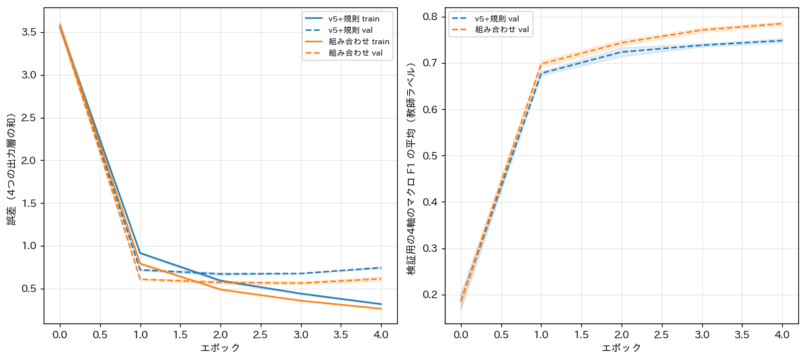

図4 SigLIP2-B の微調整の学習曲線．左は学習用（実線）と検証用（破線）の誤差，右は検証用の4軸のマクロF1の平均（教師ラベルに対する値）である．横軸はエポック（0は学習前），塗りつぶしは seed 間の標準偏差である．

### 4.3 処理速度と精度

図5は，横軸に全件（682万枚）の処理時間の見積もり（対数軸），縦軸に4軸のマクロF1の平均をとった散布図である．赤が教師，青が埋め込みに基づく生徒，緑が微調整した生徒である．

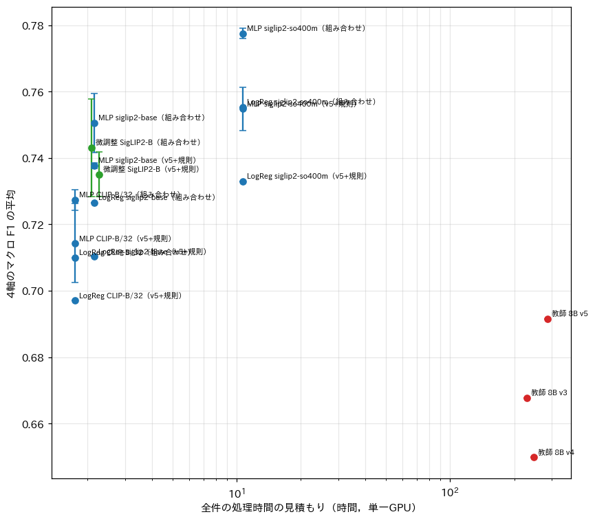

図5 処理時間と4軸のマクロF1の平均．

教師を全件に適用すると，約230〜290時間を要する（出力が長くなったため，ex002 の v2 の約70時間の3倍以上）．生徒は約2〜11時間で処理でき，精度は教師と同等以上である．精度を優先すれば SigLIP2-so400m の MLP（約10.7時間），速度と形式の精度を優先すれば微調整した SigLIP2-B（約2.1時間）が適している．

### 4.4 項目ごとの精度

図6は，各手法の項目ごとの F1（seed 0）である．

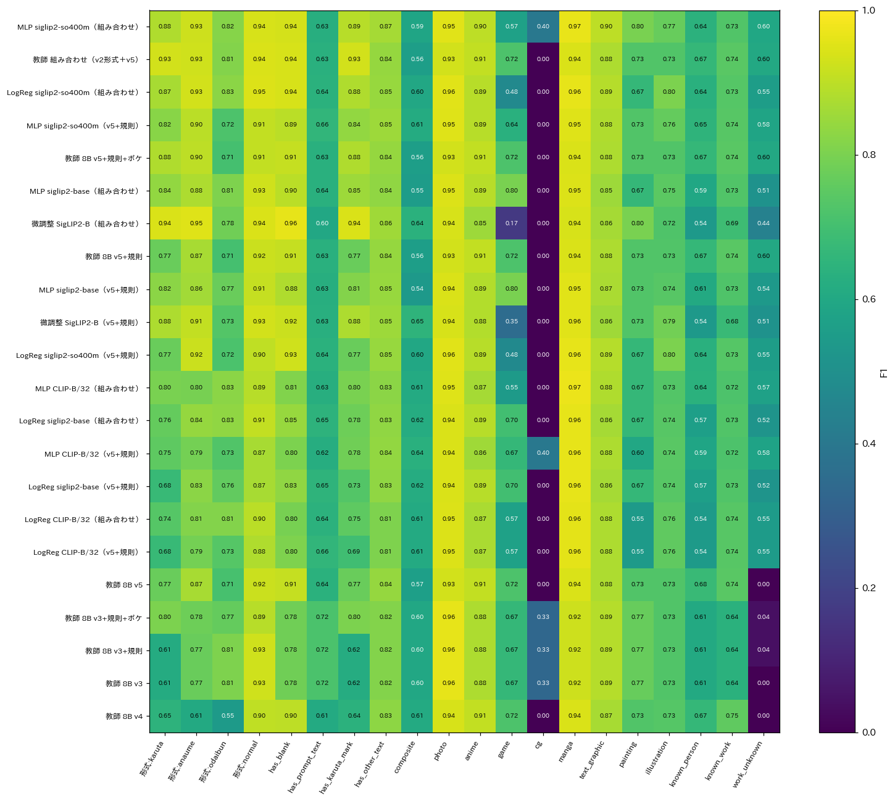

図6 手法（行）と項目（列）ごとの F1．左から形式のクラス，属性，媒体，事前知識である．

全手法で高いのは，形式の通常・穴埋め・カルタ，空欄あり，写真，マンガ，アニメ，テキストグラフィックであった（F1 0.85以上）．一方，全手法で低いのは以下の項目である．

- お題文あり（約0.63）
- 合成画像（約0.6）
- CG（評価用データで4枚）
- 実在の著名人（0.54〜0.68）
- 作品不明（0.44〜0.60）

### 4.5 実際の画像による予測例

図7は，形式ごとに無作為に選んだ8枚の画像と，目視ラベル，最良の生徒（MLP），微調整した SigLIP2-B（FT）の予測である．各行は「形式 [属性] 媒体 / 事前知識」の形式で示す．属性の記号は，空＝空欄あり，題＝お題文あり，札＝カルタ記号あり，字＝その他の文字あり，合＝合成画像である．目視ラベルと異なる予測には × を付けた．

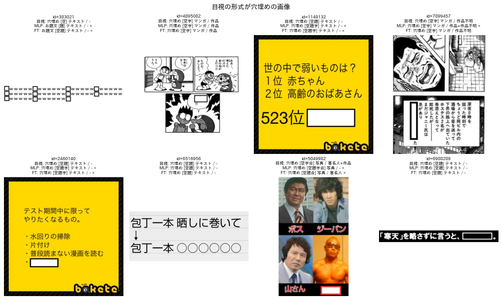

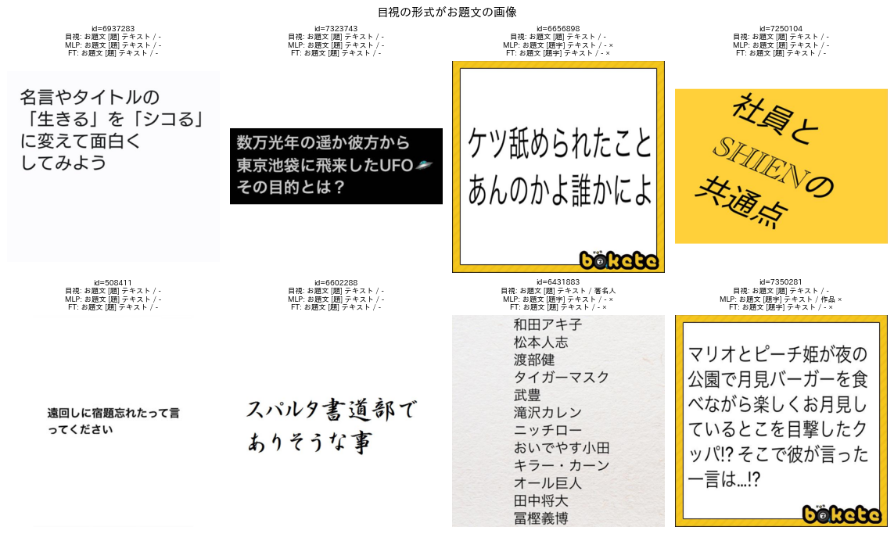

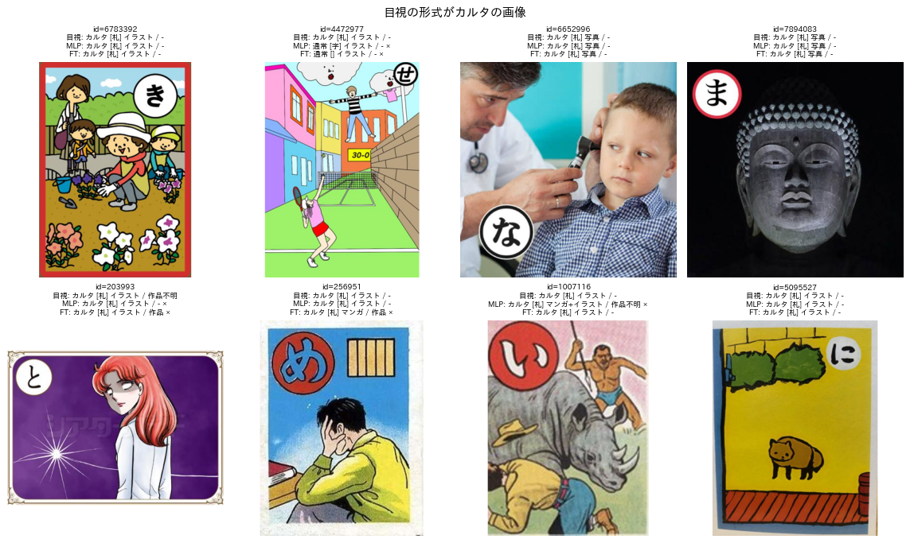

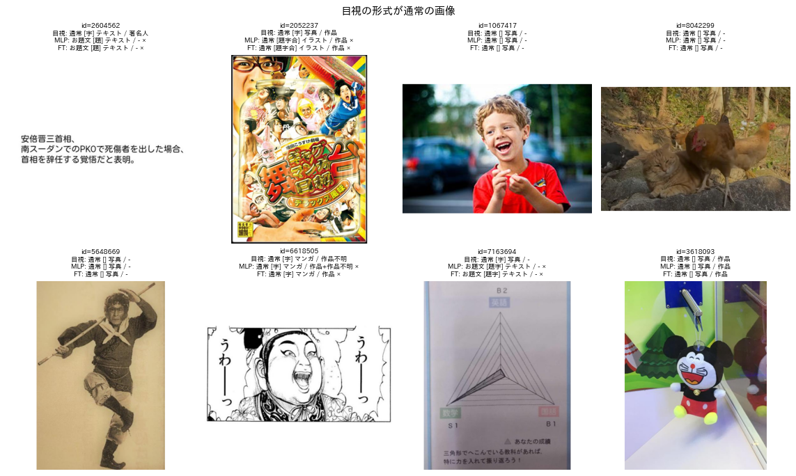

図7 形式ごとの予測例（上から穴埋め，お題文，カルタ，通常）．

穴埋めの例では，形式はほぼ正しい．食い違いの多くは，「世の中で弱いものは？」（ID 1149132）のように，空欄を含む文が問いの形をしている画像で生じた．このような画像で，生徒は「お題文あり」を付け，目視では付けていない．また，「ボス」「ジーパン」（ID 5049982）のような刑事ドラマの出演者の画像では，事前知識の判断が分かれた．

### 4.6 「お題文あり」の食い違い

図8は，「お題文あり」で目視ラベルと最良の生徒が食い違った画像である．

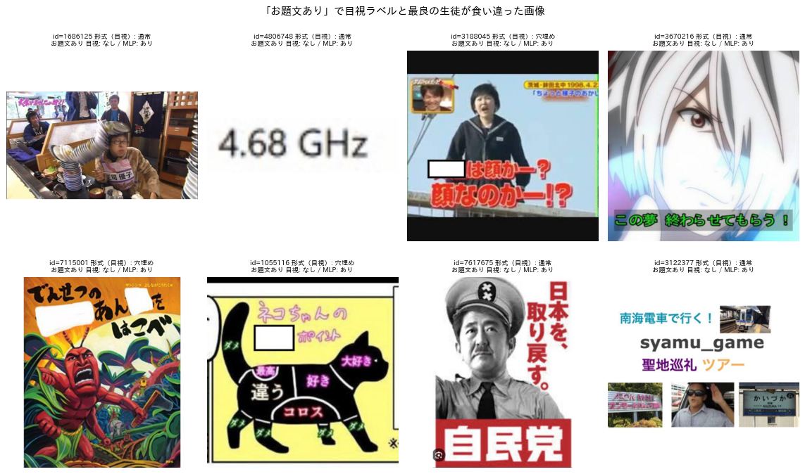

図8 「お題文あり」で目視ラベルと最良の生徒（MLP）が食い違った画像．

最良の生徒が「お題文あり」とし，目視では付けなかった画像は105枚あった．内訳は，穴埋め53枚，通常49枚，カルタ3枚である．目視ラベルで穴埋めかつお題文ありとした画像は，163枚中19枚にすぎない．食い違いの原因は次の2つである．

- 定義の曖昧さ：穴埋め画像の空欄を含む文（「でんせつの あん□を はこべ」など）を，お題文とみなすかが定まっていない．
- 判別の難しさ：テレビのテロップ（「□は顔か？顔なのか!?」，ID 3188045）やアニメの字幕（ID 3670216）が，投稿者の書き加えた文か元からある文字かは，画像だけでは判別しにくい．

## 5. 考察

確定版の定義のもとでも，蒸留の枠組みは有効であった．最良の生徒は教師と同等以上の精度を，全件で約2〜11時間の処理時間で達成した．形式の精度は，以前の7クラスの定義による ex002 の最良の生徒と同程度であった．ex002 の生徒を新しい目視ラベルで評価すると，形式の正解率は 0.927〜0.941 である．新しい定義でも形式の判定の難しさは大きく変わらなかったといえる．

新しく加えた属性・媒体・事前知識では，精度の差が項目によって大きい．空欄，写真，マンガ，アニメのように見た目で決まる項目は，F1 0.85以上で判定できる．一方，お題文（誰が書いた文か），著名人と作品（判断者の知識），合成画像（境界の判断）は，教師自身の精度が低く，生徒の精度もそれに制約されている．

VLM の教師の改善では，1つのプロンプトで全てを問うより，問いを分けて規則で組み合わせる方が有効であった．形式を短いプロンプトで問い，他の軸を別に問う組み合わせ教師は，最良の単一プロンプトより形式の正解率が約4ポイント高い．また，作品不明やカルタのように，定義書の規則やボケの証拠で補える項目は，VLM に判断させるより規則で決める方が正確であった．

## 6. 推奨の処理手順（report_002 からの更新）

| 段階 | 処理 | 対象 | 時間の見積もり |
| :---: | :--- | :--- | :---: |
| 1 | 形式を短いプロンプト v2 で，他の3軸をプロンプト v5 で，Qwen3-VL-8B により判定する | 4万〜10万枚 | 2.1〜5.3 h |
| 2 | 規則（作品不明，ボケによるカルタの照合）を適用し，属性を形式と整合させる | 段階1の画像 | 数分 |
| 3a | SigLIP2-so400m の埋め込みを計算し，4出力の MLP を学習して全件に適用する（精度優先） | 全6,823,270枚 | 約10.7 h |
| 3b | SigLIP2-B を4出力で微調整して全件に適用する（速度と形式の精度を優先） | 全件 | 約2.1 h（学習約0.5 h） |
| 4 | カルタの判定にボケの書き出しによる照合を適用する | カルタと判定された画像 | 数分 |

## 7. 未解決の論点と次に検討すべき候補

- 「お題文あり」の定義を補う必要がある．論点は次の2つである．(1) 穴埋め画像の空欄を含む文をお題文とみなすか．(2) テレビのテロップのように投稿者の書き加えた文か判別しにくい文字をどう扱うか．これらを決めて評価用ラベルに反映すると，属性の精度が上がる見込みである．
- 事前知識（著名人，作品，作品不明）は，判断者の知識に依存し，教師の精度も低い．画像中の文字（テロップ，作品名）を OCR で読み取って手がかりにする方法や，作品・人物の候補を検索して照合する方法が考えられる．
- CG（4枚），絵画（5枚），ゲーム（11枚）は評価用データの件数が少なく，F1 の推定が不安定である．これらの項目を多めに含む評価用画像の追加が必要である．
- 微調整は4エポックで検証用の F1 が伸び続けており，エポック数，項目ごとのしきい値，件数の少ない項目の重み付けの調整の余地がある．
- 評価用ラベルは640枚とも Claude Code が付与したものであり，判断者2名による一致度は測っていない．
- 教師のプロンプトは評価用データの誤りを見て改訂したため，教師の精度は楽観的である．生徒のハイパーパラメータは教師ラベルの検証用分割で選んでおり，評価用データは選択に用いていない．
- カルタの判定のボケによる照合は，かなで始まるボケが5件以上あるお題（教師ラベル用の画像の約43%）にしか適用できない．
