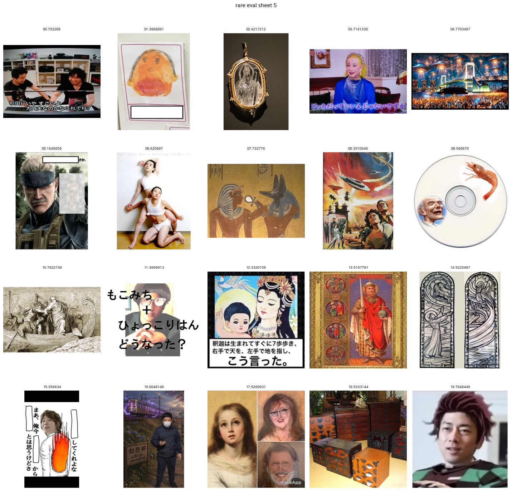
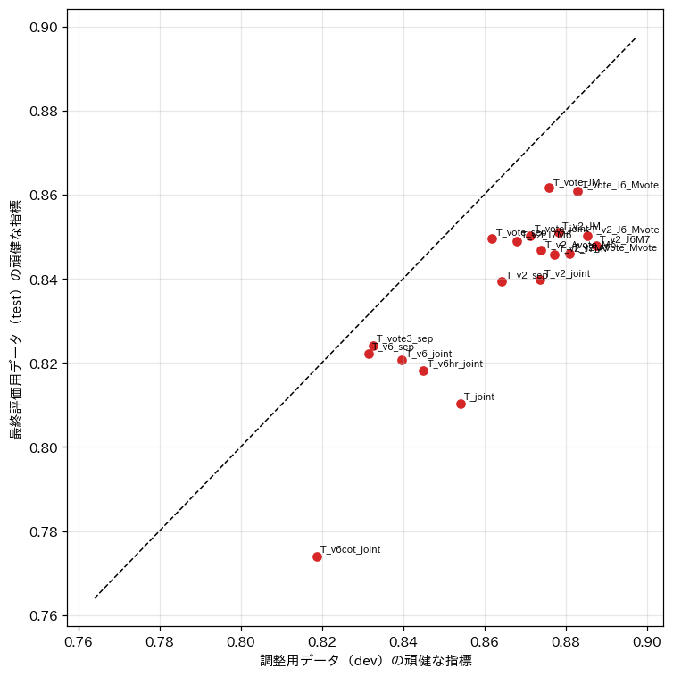
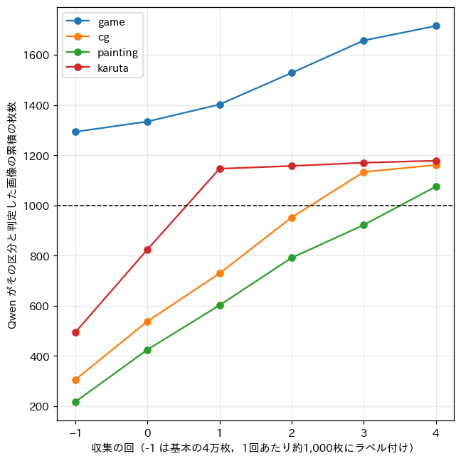
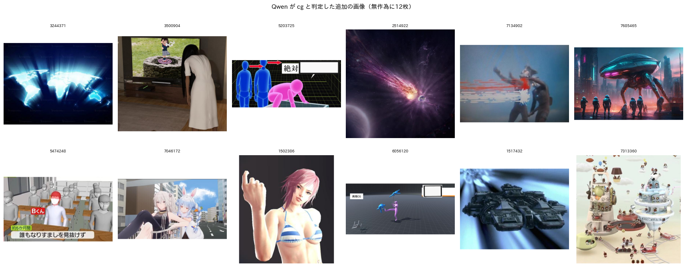
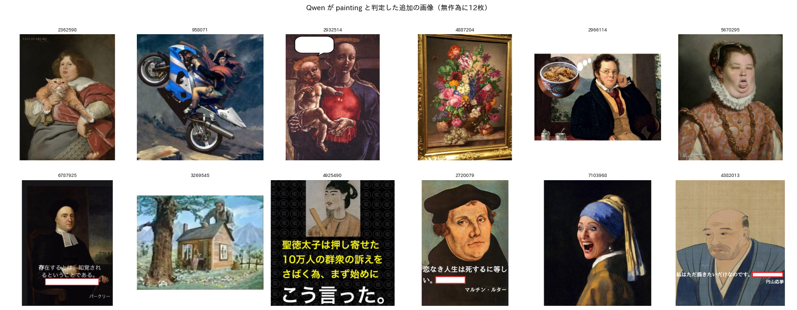
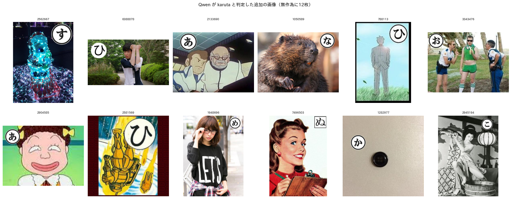
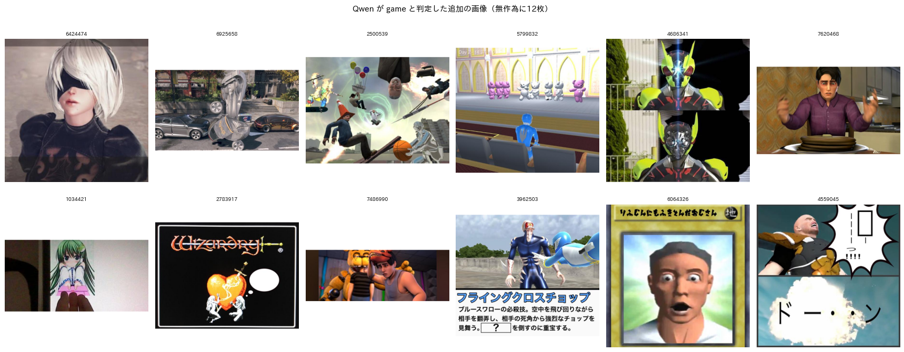
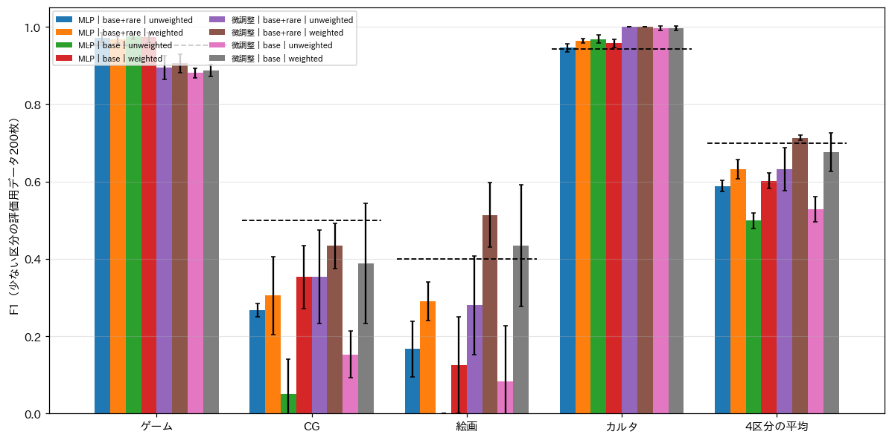
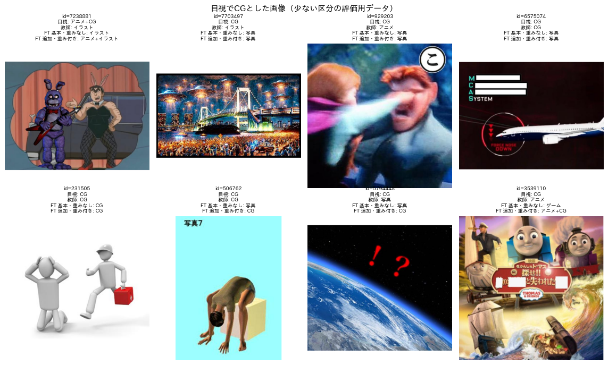
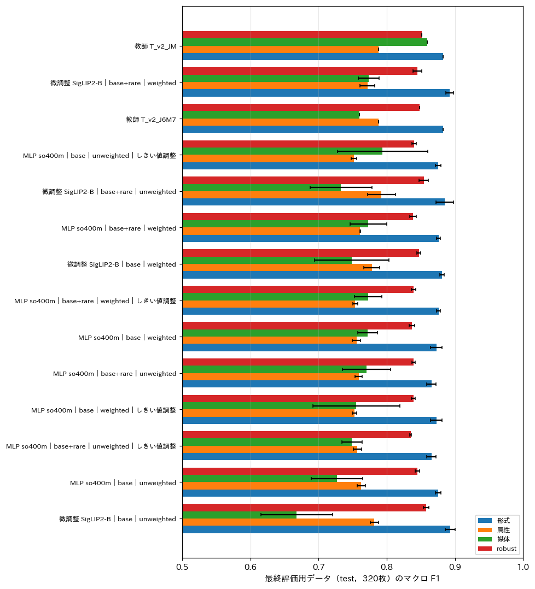

# 定義書 v2 による蒸留：プロンプトの比較，少ない区分の追加，重み付き損失

## 1. 概要

ラベルの定義を2点改訂した（定義書 v2，`programs/label_guideline/label_definition_v2.md`）．第1に，テロップや字幕などの投稿者が重畳したのではない文は「その他の文字あり」とし，その中に空欄がある場合は穴埋めとした．第2に，事前知識の軸を廃止し，形式・属性・媒体の3軸とした．そのうえで，以下の3つを行った．

- 教師となる Qwen3-VL-8B のプロンプトを9種類の部品として作り，それらを組み合わせた19通りの教師を比較した．
- 少ない区分（ゲーム，CG，絵画，カルタ）の画像を，Qwen がその区分と判定した枚数が1,000枚以上になるまで追加で収集した．
- 区分の出現率に応じた重み付きの損失で生徒を学習した．

主な結果は以下のとおりである．

- 定義の改訂で「お題文あり」の教師の F1 が 0.63（report_006）から 0.79 に上がった．テロップをお題文から外したことで，誤検出が大きく減った．
- 少ない区分の追加と重み付き損失を併用すると，少ない区分の評価用データ（200枚）で4区分の F1 の平均が上がった．微調整した SigLIP2-B では 0.528 から 0.713，SigLIP2-so400m の MLP では 0.499 から 0.632 である．微調整した生徒は教師（0.699）と同等に達した．通常の評価用データ（最終評価用320枚）でも，媒体のマクロ F1 は 0.668 から 0.774 に上がった．
- 一方，正例が10件以上ある項目のみの精度（頑健な指標）は 0.857 から 0.845 とわずかに下がった．重み付けは少ない区分の再現率を上げる代わりに，多い区分の適合率をわずかに下げる．
- プロンプトでは，形式を短いプロンプト（ex002 の v2）で，属性を一括のプロンプトで，媒体を媒体のみのプロンプトで問う組み合わせが最良であった．画像の中の文字を先に書き出させる方式（思考の連鎖）や高解像度の入力は，形式の精度を上げなかった．
- 調整用データでのプロンプトの選択は，最終評価用データでは必ずしも最良にならなかった．媒体の定義を具体化した版（M_v7）は，調整用データの媒体のマクロ F1 を 0.773 から 0.858 に上げたが，最終評価用データでは 0.859 から 0.760 に下げた．差の大部分は，各3枚以下の CG と絵画の正誤による．

## 2. 定義書 v2

定義書 v1 からの変更点は以下のとおりである．

- お題文：テロップ，字幕，看板など投稿者が重畳したのではない文は，問いの形をしていてもお題文ではなく「その他の文字あり」とする．テロップ等の中に空欄がある場合は穴埋めとする．
- 空欄を含む文：空欄を含む文そのものはお題文とせず，空欄とは別に問いや指示の文がある場合のみ「お題文あり」とする．report_006 で判断を保留していた点であり，評価用ラベル v1 の付け方と同じである．
- 事前知識：軸を廃止した．

評価用データは report_006 の640枚の目視ラベルから事前知識を除いたものを用いた．テロップの扱いは評価用ラベル v1 の付け方と一致しており，付け直しは不要であった．お題文ありと付けた画像を見直し，テロップを含むものがないことを確かめた．

## 3. 方法

### 3.1 評価用データの分割

プロンプトの調整による評価の楽観を避けるため，評価用データ640枚を形式で層化して2分割した．調整用（dev，320枚）はプロンプトの選択に，最終評価用（test，320枚）は最終的な評価に用いた．指標は3軸のマクロ F1 の平均（overall）である．あわせて，正例が10件以上ある項目のみで求めた頑健な指標（robust）も用いた．CG と絵画は各分割に1〜3枚しかなく，1枚の正誤で F1 が大きく変わるためである．

### 3.2 少ない区分の評価用データ

通常の評価用データには少ない区分の画像がほとんど含まれない．そこで，少ない区分の評価用データを別に作った．

- 抽出：収集（3.5節）でラベル付けしなかった候補の画像から，生徒の確率の上位2,000枚の中で区分ごとに無作為に50枚，計200枚を抽出した．
- ラベル付け：目視で媒体とカルタの有無のラベルを付けた（図1）．
- 内訳：目視でゲーム61枚，CG 12枚，絵画14枚，カルタ45枚であった．

図1 少ない区分の評価用データの一覧の例（絵画の候補）．

この評価用データは確率で絞り込んだ画像からなる．このため，区分の出現率は実際より高く，紛らわしい画像が多い．値は手法間の比較にのみ用いる．

### 3.3 プロンプトの部品と教師の構成

表1に部品を示す．すべて Qwen3-VL-8B（vLLM，構造化出力）で実行した．

表1 プロンプトの部品．

| 部品 | 内容 | 枚/秒 |
| :---: | :--- | :---: |
| F_v2 | ex002 の2軸用プロンプト（形式のみ用いる） | 25.3 |
| F_v6 | 定義書 v2 の形式のみを問う短いプロンプト | 27.3 |
| F_v6_hr | F_v6 を最大 672×672 画素で入力 | 12.6 |
| F_v6_cot | 画像中の文字とその出所（重畳か元からか）を書き出してから形式を答える | 12.9 |
| J_v6 | 属性・形式・媒体を一括で問う（形式は属性から導く） | 7.6 |
| J_v7 | J_v6 の属性の定義を具体化（合成画像，その他の文字） | 6.5 |
| A_v6 | 属性のみを問う | 19.1 |
| M_v6 | 媒体のみを問う | 24.6 |
| M_v7 | M_v6 の媒体の定義を具体化（テキストグラフィック，絵画，イラスト） | 16.0 |

J_v7 と M_v7 は，調整用データで J_v6・M_v6 の誤りを見て作った．主な誤りは，合成画像の過剰な検出（ポスターや番組の画面を合成とする），テキストグラフィックとイラストの重複，絵画の見落としであった．教師は，形式・属性・媒体をどの部品から取るかの組み合わせとして構成した．複数の部品を挙げた場合は，項目ごとの多数決とした．後処理として，属性を形式と整合させる処理と，ボケの書き出しによるカルタの照合（report_006 と同じ）を適用した．

### 3.4 教師ラベル

調整用データで選んだ教師 T_v2_J6M7（形式は F_v2，属性は J_v6，媒体は M_v7）で，ex002 と同じ4万枚にラベルを付けた．4万枚における少ない区分の枚数は，ゲーム1,293枚，CG 305枚，絵画217枚，カルタ494枚であった．

### 3.5 少ない区分の収集

以下の手順で収集した．

1. 評価用・教師ラベル用・ex001 の画像を除いた全お題から，無作為に30万枚の候補を抽出し，SigLIP2-so400m の埋め込みを計算した．
2. 基本の4万枚の教師ラベルで MLP を学習し，候補ごとに各区分の確率を求めた．
3. 目標に達していない区分について，確率の高い順に候補を選んだ（1回あたり計約1,000枚）．選んだ候補に教師（T_v2_J6M7 の3部品）でラベルを付けた．
4. Qwen がその区分と判定した画像が基本の4万枚との合計で N = 1,000 枚以上になるまで，2と3を繰り返した．

### 3.6 生徒

生徒は次の2つである．

- SigLIP2-so400m の埋め込みに対する3出力の MLP
- 3出力の線形層を付けて微調整した SigLIP2-B（学習率 $` 3 \times 10^{-5} `$，5エポック）

各生徒について，以下の条件の組み合わせを比較した．

- 学習データ：基本の4万枚のみ（base）か，少ない区分の追加分を加えるか（base+rare）．
- 損失：重みなし（unweighted）か，重み付き（weighted）か．
- しきい値の調整：MLP のみ，属性と媒体の項目ごとのしきい値を検証用データで調整する条件（__thr）も比較した．

重み付き損失は次のように定めた．形式の交差エントロピーには，クラス $` k `$ の重みとして $` w_k \propto (N / N_k)^{\alpha} `$（平均1に正規化）を与えた．属性と媒体の項目 $` j `$ の2値交差エントロピーには，正例の重みとして $` p_j = ((N - P_j) / P_j)^{\alpha} `$ を与えた．ここで，$` N `$ は学習データの枚数，$` N_k `$ はクラス $` k `$ の枚数，$` P_j `$ は項目 $` j `$ の正例の枚数，$` \alpha = 0.5 `$ である．ハイパーパラメータとエポックは，基本の4万枚の検証用分割（4,000枚）で選んだ．seed は3つとした．

## 4. 結果

### 4.1 プロンプトの比較

表2に主な教師の構成の結果を示す．

表2 教師の構成の比較（dev で選択，test は参考）．

| 構成（形式／属性／媒体） | dev 形式正解率 | dev 属性 | dev 媒体 | dev overall | dev robust | test overall | test robust |
| :--- | :---: | :---: | :---: | :---: | :---: | :---: | :---: |
| J_v6 のみ（一括） | 0.925 | 0.788 | 0.697 | 0.793 | 0.854 | 0.790 | 0.810 |
| F_v6／J_v6／J_v6 | 0.894 | 0.772 | 0.697 | 0.778 | 0.840 | 0.800 | 0.821 |
| F_v6_hr／J_v6／J_v6 | 0.900 | 0.777 | 0.697 | 0.783 | 0.845 | 0.798 | 0.818 |
| F_v6_cot／J_v6／J_v6 | 0.828 | 0.780 | 0.697 | 0.757 | 0.819 | 0.754 | 0.774 |
| F_v2／J_v6／J_v6 | 0.944 | 0.811 | 0.697 | 0.812 | 0.874 | 0.819 | 0.840 |
| F_v2／A_v6／M_v6 | 0.944 | 0.769 | 0.773 | 0.824 | 0.864 | 0.831 | 0.839 |
| F_v2／J_v6／M_v6 | 0.944 | 0.811 | 0.773 | 0.837 | 0.878 | 0.843 | 0.851 |
| 形式の多数決5種／J_v6／M_v6 | 0.953 | 0.804 | 0.773 | 0.835 | 0.876 | **0.854** | **0.862** |
| **F_v2／J_v6／M_v7（選択）** | 0.944 | 0.811 | **0.858** | **0.866** | **0.887** | 0.810 | 0.848 |
| F_v2／J_v7／M_v7 | 0.944 | 0.780 | 0.858 | 0.856 | 0.877 | 0.808 | 0.846 |
| F_v2／J_v6／媒体の多数決3種 | 0.944 | 0.811 | 0.791 | 0.844 | 0.885 | 0.843 | 0.850 |

図2は，横軸に dev，縦軸に test の頑健な指標をとった散布図である．破線は $` y = x `$ である．

図2 教師の構成の調整用（dev）と最終評価用（test）の頑健な指標．

形式は，ex002 の短いプロンプト F_v2 が最良であった．定義書 v2 の文言で書いた F_v6 は，形式の正解率が5ポイント低かった（0.894）．思考の連鎖（F_v6_cot）は正解率を 0.828 まで下げた．文字の出所を判定させる途中の判断が誤ると，形式の誤りにつながるためと考えられる．高解像度の入力（F_v6_hr）は，処理速度が半分になるのに対して改善が0.6ポイントにとどまった．属性は一括のプロンプト J_v6 が，属性のみのプロンプト A_v6 より高かった（0.811 と 0.769）．媒体は，媒体のみのプロンプト（M_v6）が一括のプロンプトより高かった（0.773 と 0.697）．

M_v7 は dev では媒体を大きく改善したが，test では M_v6 に劣った．項目別に見ると，テキストグラフィックとイラストは dev と test でおおむね同程度である．差の大部分は，絵画（dev 2枚，test 3枚）と CG の1〜2枚の正誤であった．640枚全体では，絵画の F1 は M_v6 で 0.60，M_v7 で 0.20 であった．定義の具体化（「油彩や水彩で描かれた美術作品」）が，かえって絵画の判定を厳しくした可能性がある．評価用データの少ない区分の件数では，プロンプトの優劣を安定して判定できない．このため，少ない区分は 3.2節の専用の評価用データで評価した．

定義書 v2 の効果として，属性の「お題文あり」の F1 は 0.79 となり，report_006 の組み合わせ教師（0.63）から大きく上がった．適合率は 0.46 から 0.75 に上がった．テロップをお題文から外すという定義が，判定を明確にした．

### 4.2 少ない区分の収集

図3は収集の経過である．横軸は収集の回（-1 は基本の4万枚），縦軸は Qwen がその区分と判定した画像の累積の枚数，破線は目標の1,000枚である．

図3 少ない区分の収集の経過．

5回（計4,998枚）で全区分が1,000枚以上になった．最終的な枚数は，ゲーム1,715枚，CG 1,161枚，絵画1,075枚，カルタ1,178枚である．ゲームは基本の4万枚で既に1,000枚を超えていたが，他の区分の候補にも含まれていた．絵画は最も集まりにくく，2,666枚のラベル付けを要した．図4は，追加分のうち Qwen が各区分と判定した画像の例である．

図4 追加分のうち Qwen が CG，絵画，カルタ，ゲームと判定した画像（無作為に12枚ずつ）．

カルタとゲームはほぼすべて妥当であった．絵画には，名画を加工した画像や肖像画にテロップを付けた画像が多い．CG には，生成AIによる画像，3DCG の人体，ゲームの画面が混在する．

### 4.3 少ない区分の評価

図5は，少ない区分の評価用データでの F1 である．横軸は区分と4区分の平均，縦軸は F1，誤差棒は seed 間の標準偏差，破線は教師（T_v2_J6M7）である．

図5 少ない区分の評価用データ（200枚）での生徒と教師の F1．

表3に4区分の F1 の平均を示す．

表3 少ない区分の評価用データでの4区分の F1 の平均（3 seed の平均 ± 標準偏差）．

| 生徒 | base・重みなし | base・重み付き | base+rare・重みなし | base+rare・重み付き |
| :---: | :---: | :---: | :---: | :---: |
| MLP（SigLIP2-so400m） | 0.499 ± 0.020 | 0.602 ± 0.021 | 0.588 ± 0.014 | 0.632 ± 0.024 |
| 微調整 SigLIP2-B | 0.528 ± 0.032 | 0.676 ± 0.050 | 0.632 ± 0.056 | **0.713 ± 0.007** |
| 参考：教師 T_v2_J6M7 | | | | 0.699 |

少ない区分の追加と重み付き損失は，どちらも単独で効果があり，併用すると最も高かった．重み付き損失の効果は，追加分の効果よりやや大きかった．改善は主に CG と絵画の再現率によるものである．微調整した生徒では，CG の F1 が 0.15 から 0.44 に，絵画が 0.08 から 0.51 に上がった．ゲームとカルタは，どの条件でも F1 が0.88以上であった．併用した微調整の生徒は seed 間のばらつきも最も小さく（標準偏差 0.007），教師と同等であった．

一方，教師自身の CG と絵画の F1 は 0.50 と 0.40 にとどまった．目視ラベルとの食い違いには2種類ある．

- 絵画：目視では古典的な絵画としたが，教師はイラストとした（図6）．
- CG：生成AIによる風景を，教師はイラストや写真とした．

これらは定義の解釈の差であり，生徒の上限は教師の判定で決まっている．

図6 目視で絵画（上）と CG（下）とした画像と，教師および微調整した生徒（基本のみ・重みなし，追加あり・重み付き）の媒体の予測．

### 4.4 通常の評価用データでの比較

図7は，最終評価用データでの各生徒と教師のマクロ F1 である．横軸は F1，色は形式・属性・媒体・頑健な指標，誤差棒は seed 間の標準偏差である．

図7 最終評価用データ（test，320枚）での生徒と教師のマクロ F1．

表4に主な条件を示す．

表4 最終評価用データでの生徒の精度（3 seed の平均）．括弧内は seed 間の標準偏差である．

| 生徒 | 形式正解率 | 属性 | 媒体 | overall | robust | 少ない区分の平均 |
| :--- | :---: | :---: | :---: | :---: | :---: | :---: |
| 微調整，base・重みなし | 0.914 | 0.782 | 0.668 | 0.781 (0.019) | **0.857** | 0.528 |
| 微調整，base+rare・重みなし | 0.905 | **0.792** | 0.733 | 0.803 (0.017) | 0.854 | 0.632 |
| 微調整，base・重み付き | 0.904 | 0.778 | 0.749 | 0.803 (0.018) | 0.847 | 0.676 |
| **微調整，base+rare・重み付き** | **0.915** | 0.772 | **0.774** | **0.812 (0.009)** | 0.845 | **0.713** |
| MLP，base・重みなし | 0.901 | 0.763 | 0.727 | 0.788 (0.010) | 0.845 | 0.499 |
| MLP，base+rare・重み付き | 0.899 | 0.761 | 0.773 | 0.803 (0.009) | 0.838 | 0.632 |
| MLP，base・重みなし・しきい値調整 | 0.901 | 0.752 | 0.794 | 0.807 (0.023) | 0.840 | 0.556 |
| 教師 T_v2_J6M7 | 0.903 | 0.788 | 0.760 | 0.810 | 0.848 | 0.699 |
| 教師 F_v2／J_v6／M_v6 | 0.903 | 0.788 | 0.859 | 0.843 | 0.851 | 0.721 |

微調整した SigLIP2-B に追加分と重み付き損失を併用すると，overall は 0.781 から 0.812 に上がった．媒体は 0.668 から 0.774 に上がり，教師（0.810）と同等である．一方で，頑健な指標は 0.857 から 0.845 にわずかに下がった．その主な原因は，属性の合成画像やその他の文字で，重み付けにより正例の予測が増えて適合率が下がったことである．しきい値の調整は通常の評価用データの媒体を上げたが，seed 間のばらつきが大きく，少ない区分の評価用データでは重み付き損失ほどの効果はなかった．

## 5. 考察

ご提案の方針（少ない区分を Qwen で集めて重み付き損失で学習する）は，少ない区分の判定に明確な効果があった．追加のラベル付けは約5,000枚（約30分）で済み，少ない区分の F1 の平均を約0.2上げた．重み付き損失だけでも効果は大きく，追加の収集なしで 0.676 まで上がる．多い区分の精度のわずかな低下（頑健な指標で約1ポイント）と引き換えに，少ない区分を教師と同等に判定できるようになる．このため，少ない区分が後段の処理で重要であれば，併用する価値がある．

プロンプトの比較では，判断を分けて問う方が有効という report_006 の結果が再確認された．形式は短い質問，属性は一括の質問，媒体は媒体だけの質問が最良であった．画像中の文字を書き出させる方式や高解像度の入力は，計算量に見合わなかった．また，調整用データでの選択が最終評価用データで再現しなかった（M_v7）．件数の少ない項目でプロンプトを調整すると，偶然の正誤に引きずられる．少ない区分の判定を改善するには，その区分を多く含む評価用データで調整する必要がある．

残る課題は，教師自身の CG と絵画の判定である．教師の判定と目視の判定は「古典的絵画」と「イラスト」，「生成AIの画像」と「CG・写真」の境界で食い違っている．生徒の精度はこの境界で頭打ちになっている．

## 6. 推奨の処理手順（report_006 からの更新）

| 段階 | 処理 | 対象 | 時間の見積もり |
| :---: | :--- | :--- | :---: |
| 1 | Qwen3-VL-8B で形式（F_v2），属性（J_v6），媒体（M_v6）を問い，規則を適用する | 4万〜10万枚 | 2.4〜5.9 h |
| 2 | 生徒の確率で少ない区分の候補を絞り込み，各区分が1,000枚以上になるまで段階1を繰り返す | 約5,000枚 | 約0.5 h |
| 3 | SigLIP2-B を重み付き損失で微調整する（5エポック） | 段階1と2のラベル | 約0.2 h |
| 4 | 微調整したモデルで全件を判定する | 全6,823,270枚 | 約1.7 h |

媒体の部品は，dev で選んだ M_v7 ではなく，test と640枚全体で絵画の判定が良かった M_v6 を推奨する．この選択は最終評価用データを見て行ったものである．そのため，M_v6 を用いた教師の精度は参考値として扱い，独立の評価用データで確かめる必要がある．

## 7. 未解決の論点と次に検討すべき候補

- 「古典的絵画」と「イラスト」，生成AIの画像と CG・写真の境界の定義を，事例を添えて具体化する必要がある．教師と目視の判定がこの境界で食い違っている．
- 媒体の部品の選択（M_v6 と M_v7）は，評価用データの少ない区分の件数では決められない．少ない区分の評価用データ（200枚）でプロンプトも比較するとよい．
- 少ない区分の評価用データは，生徒の確率で絞り込んだ画像からなり，全お題の分布とは異なる．適合率は実際の運用より高く，再現率の推定には偏りがある可能性がある．
- 重み付けの強さ（$` \alpha = 0.5 `$）と目標の枚数（N = 1,000）は1通りしか試していない．
- 評価用ラベルと少ない区分の評価用ラベルは，いずれも Claude Code が1名で付与したものである．
- 多い区分の精度の低下（合成画像，その他の文字の適合率）を抑えるため，属性には重みを付けず媒体と形式にのみ重みを付ける方法が考えられる．
- 教師ラベルの基本の4万枚に F_v2・J_v6・M_v6 の組み合わせ（推奨の教師）でラベルを付け直して蒸留した結果は，まだ測っていない．
