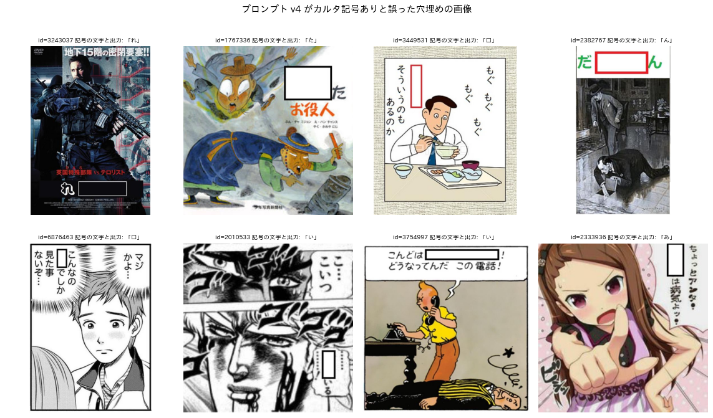
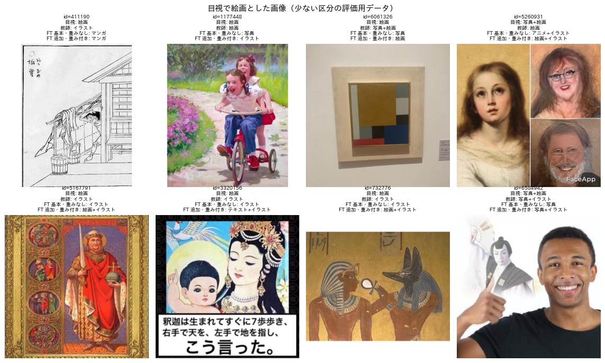
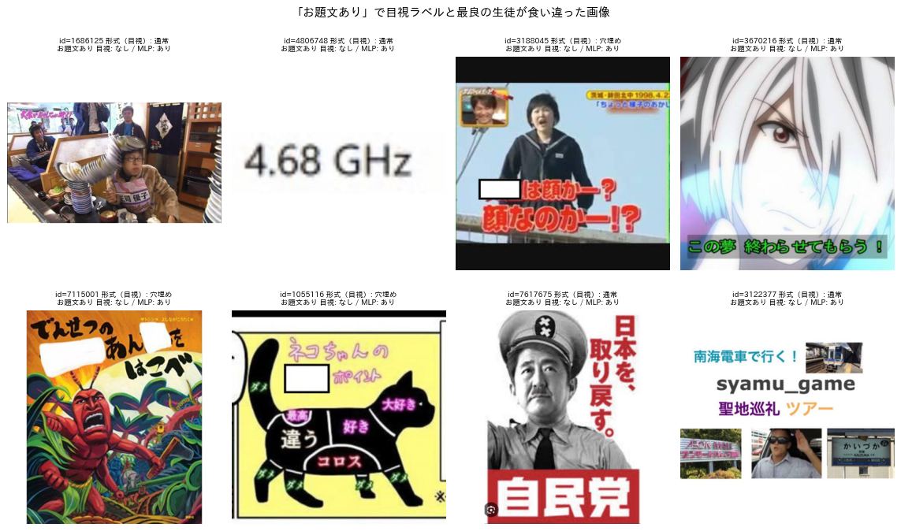
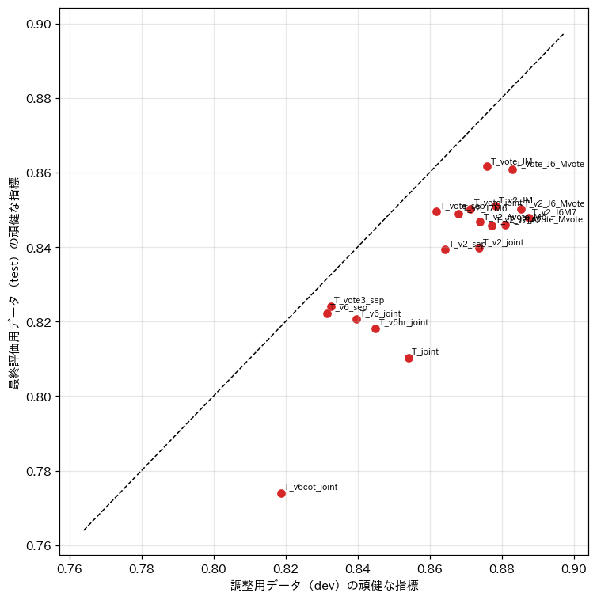

# Qwen3-VL への指示の方法のまとめと，現状の課題および改善案

## 1. 概要

本稿は，お題画像に定義書 v2（`programs/label_guideline/label_definition_v2.md`）のラベルを付ける教師として，Qwen3-VL-8B-Instruct への指示の方法をまとめたものである．指示の方法は report_001 から report_007 で決めたものであり，再現に必要な事項を網羅する．対象は，プロンプトの本文，質問の分け方，出力の制約，入力の条件，後処理の規則である．あわせて，これまでの実験で明らかになった課題と，その改善案を整理する．本稿の数値はすべて既存の実験結果（ex001〜ex005）から引用したものであり，新たな実験は行っていない．

指示の方法の要点は以下のとおりである．

- 1枚の画像に対して，Qwen3-VL-8B に3回質問する．形式は短い英語のプロンプト（F_v2）で，属性は3軸を一括で問う日本語のプロンプト（J_v6）で，媒体は媒体のみを問う日本語のプロンプト（M_v6）で問う．各質問の回答のうち，その軸の値のみを用いる．
- 出力は JSON スキーマによる構造化出力で制約し，ラベルの候補以外を出力できないようにする．温度は0とする．
- 回答を組み合わせた後に，3つの後処理を適用する．属性を形式と整合させる処理，ボケの書き出しによるカルタの照合，媒体が空の場合の補完である．
- この教師の精度は，評価用データ640枚で次のとおりである．形式の正解率は 0.923，属性のマクロ F1 は 0.799，媒体のマクロ F1 は 0.835 である．処理速度は約4.7枚/秒であり，教師ラベル4万枚に約2.4時間を要する．

## 2. 指示の方法

### 2.1 全体の流れ

表1に，1枚の画像に対する処理の流れを示す．

表1 1枚の画像に対する処理の流れ．

| 段階 | 処理 | 用いる値 |
| :---: | :--- | :--- |
| 1 | F_v2 で形式と画風（旧2軸）を問う | 形式（text は odaibun に読み替える） |
| 2 | J_v6 で属性・形式・媒体を一括で問う | 属性（has_karuta_mark，karuta_char，has_blank，has_prompt_text，has_other_text，composite） |
| 3 | M_v6 で媒体のみを問う | 媒体（8項目） |
| 4 | 後処理の規則を適用する（2.5節） | 3軸の最終のラベル |

段階1から3は互いに独立であり，同じモデルで順に実行できる．vLLM ではモデルを1回読み込み，画像の集合ごとに3つのプロンプトを順に一括処理する（`programs/ex005_rare_weighted_distill/teacher.py`）．

### 2.2 モデルと実行の条件

表2に実行の条件を示す．

表2 実行の条件．

| 項目 | 値 |
| :--- | :--- |
| モデル | Qwen/Qwen3-VL-8B-Instruct（BF16，量子化なし） |
| 推論の基盤 | vLLM 0.23（chat API） |
| 入力画像 | 1枚，最大画素数 $` 448 \times 448 `$（`mm_processor_kwargs={"max_pixels": 200704}`） |
| 生成の設定 | 温度0（貪欲生成），最大トークン数 32〜600，seed 0 |
| 出力の制約 | `StructuredOutputsParams(json=スキーマ)`（F_v2 は正規表現でも同等） |
| その他 | `max_model_len=6144`，`gpu_memory_utilization=0.88`，`limit_mm_per_prompt={"image": 1, "video": 0}` |
| 処理速度（RTX PRO 6000 Blackwell） | F_v2 25.3枚/秒，J_v6 7.6枚/秒，M_v6 24.6枚/秒，合計で約4.7枚/秒 |

### 2.3 プロンプトの本文

以下に3つのプロンプトの本文を示す．文言は実験で用いたものと同一である．

#### F_v2（形式）

```text
This image is a prompt image ("odai") from the Japanese comedy site Bokete. Classify it on two axes.

Q1 "format":
- "karuta": a single hiragana character is written inside a circle or square (like a karuta card). Users write a line starting with that hiragana.
- "anaume": there are blank placeholders to fill in, such as empty white boxes, empty speech bubbles, ○○, □, or ？ replacing words.
- "text": the image consists almost entirely of written text (typically a topic or question on a plain or colored background) and has no main photo, anime or manga picture.
- "normal": an ordinary photo, anime, manga or illustration. Pictures that contain captions, subtitles, signs, titles or speech bubbles with words are still "normal".
Q2 "domain" (the visual style of the main picture):
- "photo": real-world photograph or live-action video frame (including TV, movies, photographed toys).
- "anime": screenshot of an animated TV series or film.
- "manga": panel(s) of a manga or comic (line drawing, screentone, speech bubbles).
- "illust": other illustrations, CG, game screens, paintings, or plain text graphics.

Answer with JSON only: {"format": "...", "domain": "..."}
```

出力のスキーマは `format ∈ {normal, text, anaume, karuta}`，`domain ∈ {photo, anime, manga, illust}` である．用いるのは format のみである．

#### J_v6（属性）

```text
この画像は大喜利サイト「ボケて」のお題画像です．以下の項目を上から順に判定し，JSON のみを出力してください．

## 1. 属性（当てはまるものを true）：
- has_karuta_mark：カルタ記号がある（円や四角の枠の中にひらがな1文字だけを書いた，文から独立した記号．中身が空の枠や文章の一部の文字は該当しない．迷ったら false）．karuta_char にそのひらがなを書く（なければ空文字）．
- has_blank：語の代わりに置かれた空欄がある（白や色付きの矩形，○○，□，＿＿，語の代わりの「？」，語の代わりの黒塗り，話者に付いた空の吹き出し．テロップや字幕の中の空欄も含む）．顔や個人情報の目隠し，文末の疑問符は空欄ではない．
- has_prompt_text：投稿者が画像に重畳した，回答者への問いや指示の文がある（問い，指示，題目の句，状況の設定，名前などの列挙）．空欄を含む文そのものは該当せず，空欄とは別に問いや指示の文がある場合のみ true．テレビのテロップや字幕，看板，台詞，題名など投稿者が重畳したのではない文字は該当しない．迷ったら false．
- has_other_text：お題文とカルタ記号以外の，ボケに関わりうる文字がある（テロップ，字幕，看板，台詞など．透かし，ロゴ，判読できない小さな文字は除く）．
- composite：合成画像（複数の画像の貼り合わせ，写真と絵の重ね合わせ）．

## 2. 形式
（F_v6 と同じ形式の判定手順．カルタ → 穴埋め → お題文 → 通常の順に判定する）

## 3. 媒体
（M_v6 と同じ媒体の定義）
```

J_v6 は属性・形式・媒体をすべて出力するが，用いるのは属性のみである．形式と媒体の定義を含めているのは，属性の判定に形式の判定手順の文脈を与えるためである．属性のみを問う A_v6 は属性のマクロ F1 が 0.769 であり，J_v6（0.811）より低かった．出力のスキーマは次の順で生成させる．has_karuta_mark，karuta_char（最大1文字），has_blank，has_prompt_text，has_other_text，composite，format，媒体8項目である．属性を先に答えさせると，形式の判定がその属性に沿う．

#### M_v6（媒体）

```text
この画像は大喜利サイト「ボケて」のお題画像です．媒体（原則1つだけ true．合成画像で異なる媒体の領域が画像の約2割以上ずつある場合のみ複数）：
- photo：現実の写真（実写の映像，フィギュアや人形，着ぐるみ，像を撮影したものを含む）
- anime：アニメのスクリーンショット
- game：ゲーム画面のキャプチャ（ゲームの会話画面，戦闘画面，ドット絵のゲーム画面を含む）
- cg：ゲームやアニメの画面ではない3DCG
- manga：漫画作品から切り抜いたコマ
- text_graphic：文字や記号が主体で，写真や絵がほとんどない画像（ウェブページやアプリの画面を含む）
- painting：古典的絵画（浮世絵などの版画を含み，写真に撮ったものも絵画とする）
- illustration：上記に含まれない絵（キャラクターの描き下ろし，模写，漫画風の一枚絵，カルタの札の絵，手描きの絵を含む）
生成AIによる画像は，同じ見た目の画像を人が作った場合の媒体とする．
JSON のみを出力してください．
```

出力のスキーマは媒体8項目の真偽値である．

### 2.4 質問を分ける理由

表3に，質問の分け方を変えた主な比較を示す（report_006，report_007）．値は評価用データ640枚である．ただし1行目は事前知識を含む旧定義（定義書 v1）での値である．

表3 質問の分け方の比較．

| 構成 | 形式の正解率 | 属性 | 媒体 | 備考 |
| :--- | :---: | :---: | :---: | :--- |
| 4軸を一括（ex004 v3） | 0.850 | 0.707 | 0.769 | 出力約150トークン，8.3枚/秒 |
| 3軸を一括（J_v6 のみ） | 0.902 | 0.773 | 0.761 | 形式は属性から導く |
| 形式 F_v2，属性・媒体 J_v6 | 0.923 | 0.799 | 0.761 | |
| 形式 F_v2，属性 J_v6，媒体 M_v7 | 0.923 | 0.799 | 0.795 | 媒体の定義を具体化した版 |
| **形式 F_v2，属性 J_v6，媒体 M_v6（推奨）** | **0.923** | **0.799** | **0.835** | 約4.7枚/秒 |

一括の質問では，質問が長くなるほど個々の判断の精度が下がった．特に，形式は短い F_v2 で問うと最も正確であった．定義書の文言に合わせた形式のみのプロンプト F_v6 は，F_v2 より正解率が5ポイント低かった（dev 0.894）．画像中の文字とその出所を先に書き出させる方式（F_v6_cot）は 0.828，高解像度の入力（F_v6_hr）は 0.900 であり，いずれも F_v2 に及ばなかった．媒体は，媒体のみを問う M_v6 が一括の J_v6 より高かった．

### 2.5 後処理の規則

3つの回答を組み合わせた後に，以下の規則を順に適用する（`programs/ex005_rare_weighted_distill/combine.py` の `build`）．

1. 媒体の補完：媒体が1つも真でない場合は illustration を真とする．
2. カルタの照合：形式がカルタの画像は，ボケの書き出しで照合する．かなで始まるボケが5件以上あり，そのうち karuta_char で始まるボケの割合が3割未満の場合は，カルタではないとみなす．その場合，形式は has_blank があれば穴埋め，has_prompt_text があればお題文，どちらもなければ通常とする．karuta_char には J_v6 の出力を用い，ひらがな以外の場合はカルタ記号なしとみなす．
3. 属性と形式の整合：has_karuta_mark は形式がカルタの場合のみ真とする．has_blank と has_prompt_text は，形式が穴埋め・お題文の場合に真とする．

規則2は report_006 で導入したものである．プロンプト v4 は，空欄の前後のひらがな（「□い。」の「い」）や中身の空の枠をカルタ記号と誤った（図1）．ボケの書き出しの集中度は，カルタを AUC 0.979 で判別できた（report_004）．



図1 カルタ記号と誤った穴埋めの画像の例（プロンプト v4，report_006）．各画像の上に，モデルが出力した記号のひらがなを示す．

### 2.6 この指示による教師の精度

表4に，推奨の構成の項目ごとの精度を示す（評価用データ640枚）．

表4 推奨の構成の項目ごとの精度（適合率／再現率／F1，括弧内は正例の枚数）．

| 軸 | 項目 | 精度 |
| :---: | :--- | :--- |
| 形式 | カルタ／穴埋め／お題文／通常 | 0.93（47）／0.93（163）／0.81（69）／0.94（361）（F1） |
| 属性 | 空欄あり | 0.90／0.96／0.93（164） |
| 属性 | お題文あり | 0.67／0.94／0.79（88） |
| 属性 | カルタ記号あり | 1.00／0.87／0.93（47） |
| 属性 | その他の文字あり | 0.72／0.99／0.84（256） |
| 属性 | 合成画像 | 0.35／0.94／0.51（33） |
| 媒体 | 写真／マンガ／テキストグラフィック | 0.98／0.93／0.90（F1） |
| 媒体 | アニメ／ゲーム／イラスト | 0.86／0.79／0.77（F1） |
| 媒体 | CG／絵画 | 0.86（4）／0.60（5）（F1） |

少ない区分の評価用データ（200枚，report_007）での教師の F1 は，ゲーム 0.94，CG 0.38，絵画 0.62，カルタ 0.94 である．

## 3. 現状の課題

### 3.1 形式のプロンプトが定義書と一致していない

最も正確な形式のプロンプト F_v2 は，ex002 の旧定義で書かれている．F_v2 の text は「画像の大部分が文字で，主な写真や絵がない」であり，定義書 v2 のお題文（絵があってもよい，投稿者が重畳した問いや指示の文）とは異なる．このため，お題文と絵を含む画像は通常と判定されやすい．例えば「彼女にタコさんウインナーを…やってはいけないことは？」と少女のイラストの画像（ID 6675112）である．定義書の文言で書いた F_v6 は，定義には一致するが形式の正解率が5ポイント低い．定義との一致と精度が両立していない．

### 3.2 合成画像とその他の文字の過剰な検出

合成画像の適合率は 0.35，その他の文字の適合率は 0.72 である．Qwen は，ポスター，パッケージ，番組の画面，文字を書き加えた1枚の画像を合成画像とみなす傾向がある．定義を具体化した J_v7 は，かえって合成画像の F1 を 0.51 から 0.47 に下げた．これらの属性は生徒の学習でも誤りを増やした．重み付き損失を用いると，多い区分の精度の低下の主な原因となった（report_007）．

### 3.3 絵画と CG の境界

教師と目視の判定は，次の2つの境界で食い違っている．

- 「古典的絵画」と「イラスト」：名画を加工した画像，古い挿絵，宗教画の模写など．
- 「生成AIの画像」と「CG・写真」．

少ない区分の評価用データでの教師の F1 は，CG 0.38，絵画 0.62 にとどまる（図2）．生徒の精度はこの教師の判定で頭打ちになっている．



図2 目視で絵画とした画像と，教師および生徒の媒体の予測の例（report_007）．

### 3.4 お題文の判定に残る誤り

テロップをお題文から外したことで，お題文ありの F1 は 0.63 から 0.79 に上がった．しかし，適合率は 0.67 にとどまる．残る誤りは2種類である．1つは，ボケてのテンプレートと番組のテロップの見分けである．もう1つは，空欄を含む文を問いとみなす判断である（図3）．



図3 「お題文あり」で目視ラベルと判定が食い違った画像の例（report_006）．

### 3.5 プロンプトの調整の不安定さ

媒体の定義を具体化した M_v7 は，調整用データで媒体のマクロ F1 を 0.773 から 0.858 に上げた．しかし，最終評価用データでは 0.859 から 0.760 に下げた（図4）．差の大部分は，各3枚以下の CG と絵画の正誤である．評価用データの件数が少ない項目では，プロンプトの優劣を安定して判定できない．推奨の構成で M_v6 を選んだ判断も，最終評価用データを見て行ったものである．



図4 教師の構成の調整用（dev）と最終評価用（test）の頑健な指標（report_007）．

### 3.6 処理の費用と規則の適用範囲

1枚あたり3回の推論を要し，処理速度は約4.7枚/秒である．教師ラベル10万枚には約6時間を要する．ボケによるカルタの照合は，かなで始まるボケが5件以上あるお題（約43%）にしか適用できない．

### 3.7 評価の信頼性

評価用ラベル（640枚と200枚）は，いずれも Claude Code が1名で付与したものである．判断者間の一致度は測っていない．また，プロンプトは評価用データの誤りを見て改訂してきたため，教師の精度は楽観的である．

## 4. 改善案

表5に，課題ごとの改善案を示す．いずれも未検証であり，期待される効果は既存の結果からの見込みである．

表5 課題ごとの改善案．

| 課題 | 改善案 | 期待される効果と根拠 | 費用 |
| :---: | :--- | :--- | :---: |
| 3.1 | F_v2 の構成と英語の文体を保ったまま，text の定義のみを定義書 v2 に合わせる（「投稿者が重畳した問いや指示の文がある．絵や写真があってもよい」） | F_v2 の高い精度は，短さと英語の文体によると考えられる．F_v6 の精度低下が日本語の長い定義によるものであれば，定義の不一致のみを解消できる | 小 |
| 3.1 | F_v2 が通常と答え，かつ J_v6 の has_prompt_text が真の画像を，お題文に変える規則を加える | 属性の判定を形式に反映する．report_007 の構成ではお題文の再現率が 0.96 と高く，誤りは主に適合率にあるため，規則の閾値の検討が必要 | 小 |
| 3.2 | 合成画像とその他の文字を，生徒の学習の重み付けの対象から外す．または，合成画像の判定を「境界線で区切られた複数の写真や絵があるか」のような観測しやすい問いに置き換える | report_007 で頑健な指標が下がった主な原因の項目である | 小 |
| 3.3 | 境界の事例を画像付きで定義書に追加し，プロンプトに数枚の例示画像を含める（数ショットの多画像入力） | 言葉の定義だけでは「古典的」「CG」の範囲が伝わっていない．Qwen3-VL は複数画像の入力に対応している | 中（入力が長くなり速度が下がる） |
| 3.3 | 絵画と CG を独立の質問に分け，「画家が描いた美術作品か」「3DCG ソフトや生成AIで作られたか」のように問う | 媒体のみの質問が一括の質問より高かったことと同じ方向の改善である | 中 |
| 3.4 | お題文の判定に，文字の位置と体裁（テンプレートの枠，画像の上下の帯，無地の背景）を明示的に問う補助の質問を加える | 図3の誤りの多くは体裁から判別できる | 中 |
| 3.5 | プロンプトの比較は，少ない区分の評価用データ（200枚）でも行う．その評価用データを区分ごとに100枚程度に増やす | 件数の少ない項目での偶然の正誤を減らす | 中（目視のラベル付け） |
| 3.5 | 最終評価用の320枚は今後プロンプトの調整に使わず，独立の評価にのみ用いる | 推奨の構成の精度を偏りなく推定する | なし |
| 3.6 | 形式の F_v2 の確率（出力トークンの対数確率）が低い画像，および3つの質問の回答が矛盾する画像のみを，追加の質問や目視の確認に回す | 曖昧な画像に費用を集中させる | 小 |
| 3.6 | 教師ラベルは，生徒の予測で少ない区分を多めに選んだ画像に付ける（report_007 の収集の手順） | 同じ費用で少ない区分の学習データを増やせる | なし |
| 3.7 | 判断者2名で評価用データの一部（200枚）に独立にラベルを付け，Cohen の $` \kappa `$ を測る | 教師と目視の食い違いのうち，定義の曖昧さによるものと教師の誤りによるものを分けられる | 中 |

優先度が高いのは，費用が小さく効果の大きい次の3つである．

1. F_v2 の text の定義の修正（3.1）
2. 合成画像を重み付けの対象から外すこと（3.2）
3. 最終評価用データをプロンプトの調整から切り離すこと（3.5）

その次に，絵画・CG・お題文の境界の事例を定義書とプロンプトに加える改善（3.3，3.4）を行うのが効率的である．

## 5. 未解決の論点

- 4章の改善案はいずれも実験で検証していない．
- 他系統の VLM（InternVL3.5，MiniCPM-V 4.5）は Qwen3-VL 向けのプロンプトでのみ評価しており，各モデルに合わせたプロンプトでの性能は不明である．
- Qwen3-VL-32B は ex002 で 8B と同じ形式の正解率であったが，定義書 v2 のプロンプトでは評価していない．
