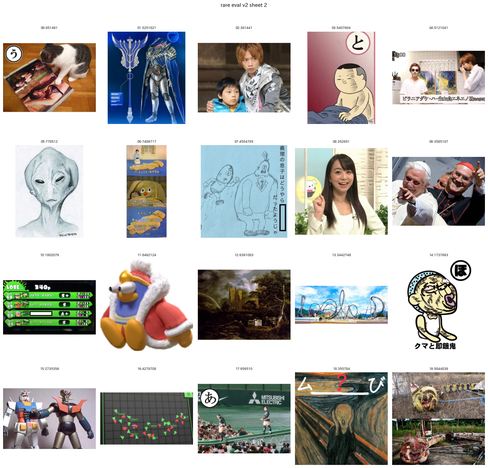
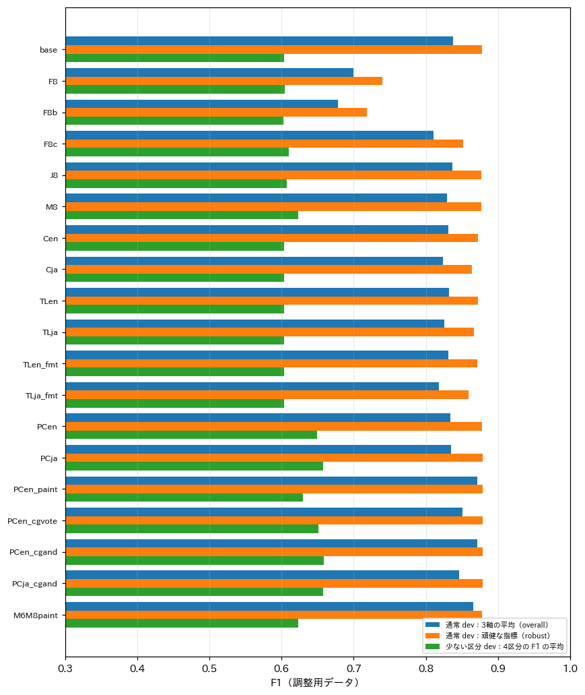
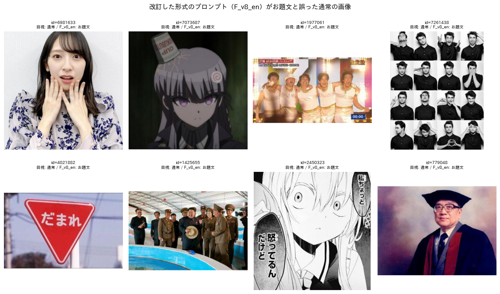
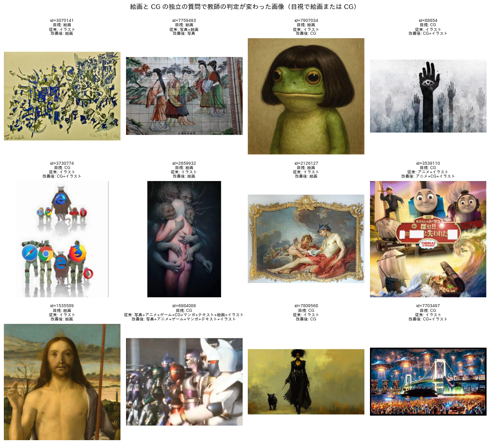
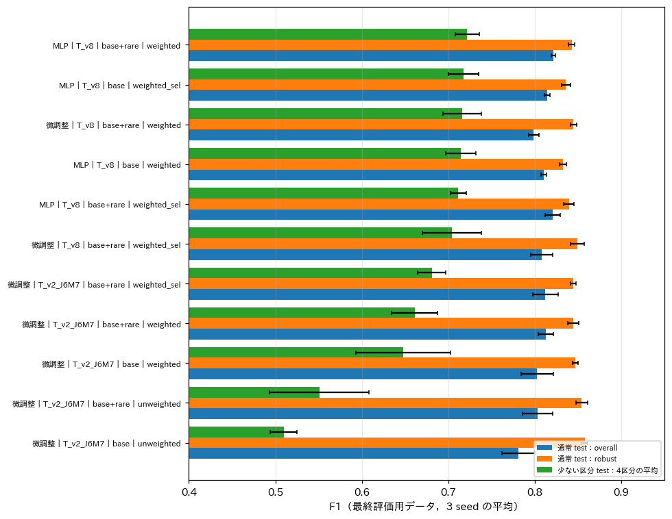
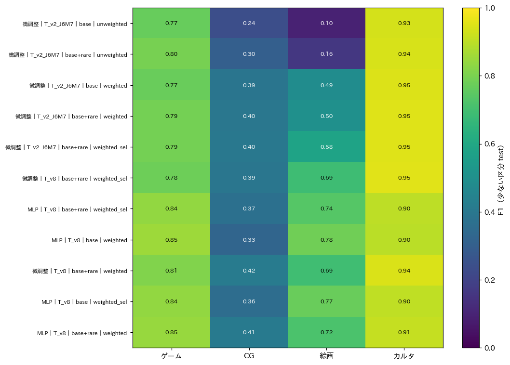

# プロンプトの改善策の検証と，実データから抽出した少ない区分の評価用データの拡充

## 1. 概要

report_008 で挙げた改善策のうち4つを実装し，Qwen3-VL-8B の教師と蒸留した生徒で検証した．改善策は，形式のプロンプトの定義の修正，合成画像の観測しやすい問い方と重み付けの対象の変更，絵画と CG の独立の質問，お題文の体裁を問う補助の質問である．各プロンプトは英語版と日本語版を作って比較した．あわせて，蒸留モデルで実データ約29.5万枚にアノテーションし，少ない区分の候補を層別に抽出した600枚に目視でラベルを付け，評価用データに加えた．主な結果は以下のとおりである．

- 4つの改善策のうち効果があったのは，絵画と CG の独立の質問のみであった．少ない区分の評価用データ（dev）で，教師の4区分の F1 の平均は 0.604 から 0.658 に上がった．絵画の F1 は 0.41 から 0.52，CG は 0.27 から 0.39 である．最終評価用データ（test）でも 0.591 から 0.715 に上がった．通常の評価用データの精度は維持された（test の頑健な指標 0.851 と 0.850）．
- 形式のプロンプトの定義を定義書 v2 に合わせると，通常の画像の大半をお題文と誤った（形式の正解率 0.944 から 0.487）．文言を変えた2版も 0.412 と 0.881 にとどまり，元のプロンプト F_v2 を超えなかった．合成画像の観測しやすい問いと，お題文の体裁の補助の質問も，F1 を下げた．英語と日本語の差は小さく，絵画と CG の質問のみ英語を採用した．
- 改善した教師（T_v8）のラベルで学習した生徒は，少ない区分の評価用データ（test）で4区分の F1 の平均を上げた．最良の生徒は SigLIP2-so400m の埋め込みに対する MLP（追加分あり・重み付き）である．4区分の平均は 0.722 ± 0.014，通常の評価用データ（test）の3軸の平均は 0.822 ± 0.002 であり，いずれも従来の最良（微調整した SigLIP2-B，0.661 と 0.812）を上回った．
- 合成画像とその他の文字を重み付けの対象から外す損失（weighted_sel）の効果は，±0.005 以内で一定しなかった．
- 拡充した評価用データ（計800枚）により，少ない区分の F1 の評価は安定した．seed 間の標準偏差は 0.01〜0.03 程度である．一方で，実データでの CG の再現率の推定は 0.04〜0.18 と低い．蒸留モデルの確率が低い画像に CG が多く含まれる可能性があるが，推定は無作為抽出の2枚の正例に基づくため不確かである．

## 2. 方法

### 2.1 少ない区分の評価用データ第2版

ex005 の最良の蒸留モデル（微調整した SigLIP2-B，追加分あり・重み付き，検証用で最良の seed 1）で，収集の候補30万枚のうち未使用の294,802枚の確率を求めた．モデルがその区分と判定した（確率0.5以上）画像は，ゲーム9,740枚（3.3%），CG 3,435枚（1.2%），絵画1,540枚（0.5%），カルタ2,691枚（0.9%）であった．

区分 c ごとに，次の2層から各60枚を無作為に抽出した．さらに全体から無作為に120枚を加え，計600枚とした．

- 層 pos：確率が0.5以上（モデルがその区分と判定した画像）
- 層 border：確率が0.05以上0.5未満（しきい値付近の画像）

目視のラベル付けでは，層が分からないよう画像の順を混ぜた（図1）．目視でカルタ80枚，ゲーム71枚，CG 41枚，絵画21枚が見つかった．第1版の200枚と合わせた計800枚を，層ごとに調整用（dev）と最終評価用（test）に二分した．プロンプトの選択には dev のみを用いた．

図1 少ない区分の評価用データ第2版の一覧の例（20枚）．

層別の抽出は，実データでの適合率と再現率の推定にも用いた．区分 c について，実データを抽出に用いたモデルの確率で3つの区画（0.5以上，0.05以上0.5未満，0.05未満）に分けた．区画ごとの正例率と予測の率は，その区画から抽出した画像（それぞれ層 pos，層 border，無作為抽出のうち確率0.05未満のもの）で求め，区画の画像数を掛けて合計した．確率0.05未満の区画は実データの9割以上を占めるが，抽出は約115枚であり，推定の誤差が大きい．

### 2.2 プロンプトの改善策

表1に，追加したプロンプトの部品を示す．部品の本文は `programs/ex005_rare_weighted_distill/prompts.py` にある．

表1 追加したプロンプトの部品．

| 改善策 | 部品 | 内容 |
| :--- | :--- | :--- |
| 形式の定義の修正 | F_v8_en，F_v8b_en，F_v8c_en | F_v2 の構成と英語の文体を保ち，text の定義を「投稿者が重畳した問いや指示の文．絵や写真があってもよい」に変える．b は「多くの画像は該当しない」と範囲を絞った版，c は元の定義に「絵があってもテンプレートや帯に問いの文を加えた場合は text」を足した版 |
| 合成画像の観測しやすい問い | C_v8_en，C_v8_ja | 境界線や枠で区切られた別々の写真や絵の枚数と，切り抜きの貼り付けの有無を問う．2枚以上か貼り付けがあれば合成画像 |
| 絵画と CG の独立の質問 | P_v8_en，P_v8_ja | 「画家が描いた美術作品か」「3DCG ソフトや生成AIで作られたか」を独立に問う |
| お題文の体裁の補助の質問 | T_v8_en，T_v8_ja | 主な文の位置（テンプレートの枠，付け足した帯，無地の背景，絵の上，元からある文字，なし）と，回答者に向けた文かを問う |
| 英語版 | J_v8_en，M_v8_en | 属性の一括のプロンプト J_v6 と媒体のプロンプト M_v6 の英訳 |

教師は従来の構成（形式 F_v2，属性 J_v6，媒体 M_v6，以下 base）を基に，1つずつ部品を入れ替えて比較した．絵画と CG の独立の質問については，媒体の回答との組み合わせ方として以下の規則も比較した．

- そのまま置き換える
- 絵画のみ置き換える
- CG は媒体の回答が CG かイラストの場合のみ真とする（cg_and）
- CG は媒体の回答が写真のみでない場合に真とする

### 2.3 生徒

選んだ教師 T_v8 で，基本の4万枚と少ない区分の追加分（4,998枚）の教師ラベルを付け直した．生徒の構成は report_007 と同じであり，SigLIP2-so400m の埋め込みに対する MLP と，微調整した SigLIP2-B である．損失は次の2つを比較した．

- weighted：全項目に重みを付ける．
- weighted_sel：合成画像とその他の文字の正例の重みを1にし，重み付けの対象から外す．

seed は3つとした．

## 3. 結果

### 3.1 プロンプトの改善策の比較

図2は，教師の構成ごとの調整用データの指標である．指標は，通常の評価用データの3軸の平均と頑健な指標，および少ない区分の評価用データの4区分の F1 の平均である．表2に主な構成を示す．

図2 教師の構成ごとの調整用データの指標．

表2 教師の構成の比較．

| 構成 | 通常 dev overall | 通常 dev robust | 少ない区分 dev | 主な変化 |
| :--- | :---: | :---: | :---: | :--- |
| base（F_v2／J_v6／M_v6） | 0.837 | 0.878 | 0.604 | |
| 形式 F_v8_en | 0.699 | 0.740 | 0.605 | 形式の正解率 0.944 → 0.487 |
| 形式 F_v8b_en | 0.678 | 0.718 | 0.602 | 形式の正解率 0.412 |
| 形式 F_v8c_en | 0.811 | 0.852 | 0.610 | 形式の正解率 0.881 |
| 属性 J_v8_en（英語） | 0.836 | 0.877 | 0.608 | ほぼ同じ |
| 媒体 M_v8_en（英語） | 0.829 | 0.877 | 0.623 | 絵画は上がり，CG とイラストは下がる |
| 合成画像 C_v8_en／C_v8_ja | 0.831／0.823 | 0.872／0.864 | 0.604 | 合成画像の F1 0.49 → 0.39／0.28 |
| お題文の体裁 T_v8_en／T_v8_ja | 0.832／0.826 | 0.873／0.867 | 0.604 | お題文ありの F1 0.82 → 0.74／0.65 |
| 絵画と CG P_v8_en（置き換え） | 0.834 | 0.878 | 0.649 | CG の再現率 0.22 → 0.85，適合率 0.35 → 0.22 |
| **絵画と CG P_v8_en（cg_and，採用）** | **0.871** | **0.879** | **0.658** | 絵画 0.41 → 0.52，CG 0.27 → 0.39（少ない区分 dev の F1） |
| 絵画と CG P_v8_ja（cg_and） | 0.846 | 0.879 | 0.657 | |

形式のプロンプトの改訂は失敗した．図3は，F_v8_en がお題文と誤った通常の画像の例である．標識（ID 4021882）や漫画の台詞（ID 2450323）に加え，文字のほとんどない人物の写真（ID 6981633）まで，お題文と判定している．F_v2 の text の定義（「画像の大部分が文字で，主な写真や絵がない」）は定義書と一致しないが，見た目で判定しやすい．そのため，「絵があってもよい」という文言を加えると，モデルは判定の手がかりを失う．F_v2 は調整用データでお題文35枚のうち33枚を正しく判定しており，定義の不一致による実際の損失は小さい．

図3 改訂した形式のプロンプト（F_v8_en）がお題文と誤った通常の画像．

合成画像の観測しやすい問いは，適合率を 0.34 から 0.26（英語），0.18（日本語）に下げた．モデルは，テロップの帯やワイプの小窓を「別々の写真」と数える傾向があった．お題文の体裁の補助の質問は，お題文ありの適合率を 0.75 から 0.61（英語）に下げた．テロップを投稿者が書き加えた文と判定する誤りが多かった．いずれも，問いを分けても見分けの難しさが解消されなかった．

絵画と CG の独立の質問は，媒体の判定を改善した．ただし，CG の質問をそのまま用いると，デジタルのイラストや写真の一部を CG と判定し，適合率が下がった．媒体の質問でも CG かイラストと判定された場合に限る規則（cg_and）で，再現率と適合率の釣り合いが最も良くなった．図4は，独立の質問で教師の判定が変わった画像の例である．西洋の宗教画（ID 1535589）やロココ調の絵画（ID 2126127）は，従来はイラストとされていたが，絵画と正しく判定された．一方，油彩風の生成AIの画像（ID 7907034，カエルの肖像）は，目視では絵画としたが，教師は CG と判定した．

図4 絵画と CG の独立の質問で教師の判定が変わった画像（目視で絵画または CG）．

英語と日本語の差は，属性（J_v8_en と J_v6）で 0.001，絵画と CG の質問で 0.001 であり，ほぼ同等であった．絵画と CG の質問は，cg_and の規則と組み合わせた場合に通常の評価用データの媒体で英語が高かったため（0.874 と 0.798），英語を採用した．

採用した教師 T_v8（base ＋ P_v8_en の cg_and）の最終評価用データの値は，次のとおりである．通常の評価用データの3軸の平均は 0.839（base 0.843），頑健な指標は 0.850（base 0.851）である．少ない区分の評価用データの4区分の F1 の平均は 0.715（base 0.591）である．実データでの推定は以下のとおりである．

- 絵画：適合率 0.50 → 0.58，再現率 0.30 → 0.53
- CG：再現率 0.04 → 0.12，適合率 0.46 → 0.20

CG の再現率の推定は，3.4節で述べるとおり不確かである．処理速度は，絵画と CG の質問が約30枚/秒であり，教師の処理時間は約16%増える．

### 3.2 生徒の比較

図5は，生徒の条件ごとの最終評価用データの指標である．指標は，通常の評価用データの3軸の平均と頑健な指標，および少ない区分の評価用データの4区分の F1 の平均である．表3に主な条件を示す．

図5 生徒の条件ごとの最終評価用データの指標（3 seed の平均 ± 標準偏差）．

表3 主な生徒の最終評価用データでの精度（3 seed の平均．括弧内は標準偏差）．

| 生徒 | 教師 | 通常 overall | 通常 robust | 少ない区分 | ゲーム | CG | 絵画 | カルタ |
| :--- | :---: | :---: | :---: | :---: | :---: | :---: | :---: | :---: |
| **MLP，追加あり・weighted** | T_v8 | **0.822** (0.002) | 0.843 (0.004) | **0.722** (0.014) | 0.85 | 0.41 | 0.72 | 0.91 |
| MLP，追加あり・weighted_sel | T_v8 | 0.821 (0.009) | 0.839 (0.006) | 0.712 (0.009) | 0.84 | 0.37 | 0.74 | 0.90 |
| 微調整，追加あり・weighted | T_v8 | 0.798 (0.006) | 0.845 (0.003) | 0.716 (0.022) | 0.81 | 0.42 | 0.69 | 0.94 |
| 微調整，追加あり・weighted_sel | T_v8 | 0.808 (0.012) | **0.849** (0.008) | 0.704 (0.034) | 0.78 | 0.40 | 0.69 | 0.95 |
| 微調整，追加あり・weighted | T_v2_J6M7（従来） | 0.812 (0.009) | 0.845 (0.006) | 0.661 (0.027) | 0.79 | 0.40 | 0.50 | 0.95 |
| 微調整，追加あり・weighted_sel | T_v2_J6M7 | 0.812 (0.015) | 0.844 (0.003) | 0.681 (0.017) | 0.79 | 0.40 | 0.58 | 0.95 |
| 微調整，基本のみ・重みなし | T_v2_J6M7 | 0.781 (0.019) | 0.857 (0.004) | 0.510 (0.015) | 0.77 | 0.24 | 0.10 | 0.93 |

図6は，少ない区分（test）の区分別の F1 である．

図6 生徒の条件ごとの少ない区分（test）の区分別の F1．

教師を T_v8 に変えると，生徒の絵画の F1 は 0.50 から 0.69〜0.74 に上がった．CG の F1 は 0.40 前後で変わらなかった．少ない区分の4区分の平均は，微調整で 0.661 から 0.716 に上がった．最良は，SigLIP2-so400m の MLP（追加あり・weighted）であった．通常の評価用データの3軸の平均（0.822）でも最良であり，この条件は調整用データでも最良（0.845）であった．微調整した生徒は，形式と頑健な指標では MLP と同等以上である．一方，媒体のマクロ F1 は MLP より低い（0.728 と 0.826）．

weighted_sel の効果は，条件により符号が異なり，大きさも ±0.005 以内であった．合成画像とその他の文字の F1 にも一貫した改善はなかった．report_007 で頑健な指標が下がった主な原因はこの2項目の重み付けと考えたが，今回の結果はそれを支持しない．頑健な指標の低下（0.857 から 0.845）は，少ない区分の重み付けが多い区分の判定境界を動かしたことによると考えられる．

### 3.3 評価の確信度

少ない区分の評価用データを800枚に拡充したことで，test での正例の枚数は増えた．現在の枚数は，カルタ約62枚，ゲーム約66枚，CG 約27枚，絵画約17枚である．4区分の F1 の平均の seed 間の標準偏差は，0.009〜0.034 であった．report_007 の200枚での標準偏差（0.007〜0.056）より，全体として小さい．

ただし，第2版は ex005 の生徒（seed 1）の確率で抽出しており，その生徒が判定した画像を多く含む．このため，その生徒（T_v2_J6M7，追加あり・weighted の seed 1）の評価は有利に偏る可能性がある．この偏りは，T_v8 の生徒が上回ったという結論を強める方向に働く．

### 3.4 実データでの推定

表4に，層別の抽出から推定した実データでの適合率と再現率を示す．

表4 実データ（294,802枚）での推定（教師と最良の生徒）．

| 区分 | 推定の出現率 | 教師 base 適合率／再現率 | 教師 T_v8 適合率／再現率 | 最良の生徒 適合率／再現率 |
| :--- | :---: | :---: | :---: | :---: |
| ゲーム | 2.5% | 0.69／0.88 | 0.69／0.88 | — |
| CG | 2.6%（不確か） | 0.46／0.04 | 0.20／0.12 | 0.21／0.14 |
| 絵画 | 0.23% | 0.50／0.30 | 0.58／0.53 | 0.52／0.57 |
| カルタ | 0.97% | 0.97／0.94 | 0.97／0.94 | — |

CG の推定の出現率（2.6%）と低い再現率は，確率0.05未満の区画で無作為抽出の約115枚中2枚が目視で CG だったことに基づく．この区画が実データの9割以上を占めるため，2枚の正例が大きな推定値になる．出現率の95%信頼区間はおおむね0.5%〜6%と広く，この推定から確かなことは言えない．目視の CG の判定（生成AIの写実的な画像を CG とするか）にも揺れがある．絵画とカルタは，確率0.05未満の区画で正例がなく，推定は比較的安定している．

## 4. 考察

承認いただいた4つの改善策のうち，効果があったのは絵画と CG の独立の質問だけであった．効果のなかった3つ（形式の定義の修正，合成画像の問い，お題文の体裁の問い）には共通点がある．いずれも，モデルが見た目では区別しにくい概念（投稿者が書き加えたか，別の写真か）を問うものであった．問いを分けたり言い換えたりしても，判別の難しさは解消されなかった．一方，絵画と CG は見た目の特徴がはっきりしている．媒体の質問の中では，選択肢の多さに埋もれて見落とされていたと考えられる．独立の質問にしたことで，その見落としが減った．

形式のプロンプトは，定義との一致より判定の安定性を優先し，F_v2 を据え置くのが妥当である．定義書 v2 との不一致は，お題文と絵を含む少数の画像で問題になる．評価用データでの影響は2枚程度であった．

蒸留では，教師の改善が生徒に素直に引き継がれた．教師の少ない区分の F1 の平均が 0.12 上がったのに対し，微調整した生徒は 0.055 上がった（0.661 から 0.716）．生徒は MLP でも微調整でも教師（0.715）と同等になり，MLP は教師を上回った（0.722）．MLP が媒体で微調整より高いのは，SigLIP2-so400m の埋め込みが画風の違いをよく表しているためと考えられる．

## 5. 推奨の構成（report_008 からの更新）

| 段階 | 処理 | 変更点 |
| :---: | :--- | :--- |
| 教師 | 形式 F_v2，属性 J_v6，媒体 M_v6 に，絵画と CG の独立の質問 P_v8_en を加える．絵画はその回答で置き換え，CG は媒体の回答が CG かイラストの場合のみ真とする | P_v8_en と cg_and の規則を追加 |
| 教師ラベル | 基本の4万枚と，少ない区分の追加分（各区分1,000枚以上） | 変更なし |
| 生徒 | SigLIP2-so400m の埋め込みに対する3出力の MLP（重み付き損失）．全件の処理時間は約10.7時間．速度を優先する場合は微調整した SigLIP2-B（約1.7時間） | 精度は MLP が最良 |

## 6. 未解決の論点と次に検討すべき候補

- CG の判定は，教師も生徒も F1 が約0.4にとどまる．実データでの再現率の推定も不確かである．生成AIの画像の扱い（定義書 v2 では見た目に応じた媒体とする）と目視の判定がずれている可能性があるため，CG の事例を定義書に追加し，評価用ラベルを見直す必要がある．
- 実データでの CG の出現率と再現率を確かめるには，確率0.05未満の区画から，さらに数百枚を無作為に抽出して目視する必要がある．
- 合成画像とお題文ありの判定は，今回の改善策では改善しなかった．合成画像の定義の見直し（後段の処理に必要かを含む）を検討する余地がある．
- weighted_sel の効果は確認できなかった．頑健な指標の低下を抑えるには，重みの強さ（$` \alpha `$）の調整や，少ない区分の追加分のみに重みを付ける方法が考えられる．
- 評価用ラベル（通常640枚，少ない区分800枚）は，いずれも Claude Code が1名で付与したものである．
