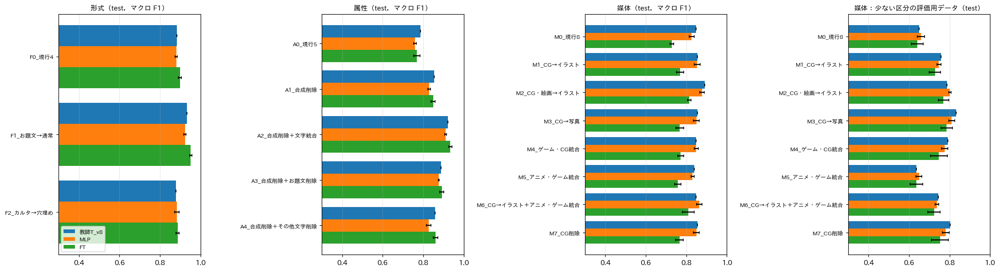

# 形式・属性・媒体のクラスの最適な設定の検討

## 1. 概要

処理の構成（Qwen3-VL-8B で教師ラベルを付け，SigLIP2 の埋め込みに対する MLP または微調整で蒸留する）を固定したうえで，形式・属性・媒体のクラスの設定を見直した．クラスの統合と削除の案は，既存の予測と目視ラベルを同じ規則で読み替えて再評価した．予測は，教師 T_v8，最良の生徒（SigLIP2-so400m の MLP），微調整した SigLIP2-B のものである．評価には，通常の評価用データ640枚と少ない区分の評価用データ800枚を用いた．

推奨する設定を表1に示す．

表1 推奨する設定（現行からの変更点）．

| 軸 | 現行 | 推奨 | 変更 |
| :---: | :--- | :--- | :--- |
| 形式 | カルタ，穴埋め，お題文，通常 | 変更なし | なし |
| 属性 | 空欄あり，お題文あり，カルタ記号あり，その他の文字あり，合成画像 | 空欄あり，カルタ記号あり，**文字あり** | 合成画像を削除．お題文ありとその他の文字ありを「文字あり」に統合 |
| 媒体 | 写真，アニメ，ゲーム，CG，マンガ，テキストグラフィック，絵画，イラスト | 写真，アニメ，ゲーム，マンガ，テキストグラフィック，絵画，イラスト | **CG を削除**し，見た目に応じて写真・ゲーム・イラストに振り分ける |

この設定で，最良の生徒の最終評価用データ（test）の精度は次のとおり見込まれる．

- 属性のマクロ F1：0.759 → 0.911
- 媒体のマクロ F1：0.826 → 0.849
- 3軸の平均：0.822 → 0.880
- 少ない区分（ゲーム，絵画）の F1 の平均：0.659 → 0.781

ただし，これは既存の予測を読み替えた値であり，新しい定義で教師ラベルを付け直して学習した場合の精度ではない．また，件数の少ないクラスを除くとマクロ F1 は機械的に上がる．このため，削除と統合は精度だけでなく，下流の処理での必要性からも判断した（3.4節）．

## 2. 方法

### 2.1 比較した案

表2に，比較した案を示す．統合は，媒体と属性では各クラスの論理和，形式ではクラスの読み替えとし，目視ラベルと予測の両方に同じ規則を適用した．削除はその項目を評価から除くことを意味する．

表2 比較した案．

| 軸 | 案 | 内容 |
| :---: | :--- | :--- |
| 形式 | F0 | 現行の4クラス |
| 形式 | F1 | お題文を通常に統合 |
| 形式 | F2 | カルタを穴埋めに統合 |
| 属性 | A0 | 現行の5項目 |
| 属性 | A1 | 合成画像を削除 |
| 属性 | A2 | 合成画像を削除し，お題文ありとその他の文字ありを「文字あり」に統合 |
| 属性 | A3 | 合成画像とお題文ありを削除 |
| 属性 | A4 | 合成画像とその他の文字ありを削除 |
| 媒体 | M0 | 現行の8クラス |
| 媒体 | M1 | CG をイラストに統合 |
| 媒体 | M2 | CG と絵画をイラストに統合 |
| 媒体 | M3 | CG を写真に統合 |
| 媒体 | M4 | ゲームと CG を統合 |
| 媒体 | M5 | アニメとゲームを統合 |
| 媒体 | M6 | CG をイラストに統合し，アニメとゲームを統合 |
| 媒体 | M7 | CG を削除 |

### 2.2 評価

指標は，形式・属性・媒体の各軸のマクロ F1 である．少ない区分の評価用データでは，媒体のうちゲーム・CG・絵画を含むクラスの F1 の平均を用いた．案の選択は調整用データ（dev）で行い，最終評価用データ（test）で確かめた．生徒は3 seed の平均である．

## 3. 結果

図1は，案ごとの最終評価用データのマクロ F1 である．左から形式，属性，媒体，少ない区分の媒体の順に示す．色はモデル（教師，MLP，微調整）を表し，誤差棒は seed 間の標準偏差である．

図1 案ごとの最終評価用データのマクロ F1．

表3に，最良の生徒（MLP）の値を示す．

表3 最良の生徒（MLP）の案ごとのマクロ F1（3 seed の平均）．

| 軸 | 案 | dev | test | 少ない区分 dev | 少ない区分 test |
| :---: | :--- | :---: | :---: | :---: | :---: |
| 形式 | F0 現行 | 0.935 | 0.880 | | |
| 形式 | F1 お題文→通常 | 0.963 | 0.923 | | |
| 形式 | F2 カルタ→穴埋め | 0.925 | 0.884 | | |
| 属性 | A0 現行 | 0.801 | 0.759 | | |
| 属性 | A1 合成削除 | 0.883 | 0.829 | | |
| 属性 | **A2 合成削除＋文字統合** | **0.944** | **0.911** | | |
| 属性 | A3 合成削除＋お題文削除 | 0.906 | 0.877 | | |
| 属性 | A4 合成削除＋その他文字削除 | 0.906 | 0.828 | | |
| 媒体 | M0 現行 | 0.800 | 0.826 | 0.605 | 0.659 |
| 媒体 | M1 CG→イラスト | 0.836 | 0.853 | 0.715 | 0.748 |
| 媒体 | M2 CG・絵画→イラスト | 0.867 | 0.877 | 0.778 | 0.801 |
| 媒体 | M3 CG→写真 | 0.833 | 0.849 | 0.778 | 0.811 |
| 媒体 | M4 ゲーム・CG 統合 | 0.828 | 0.848 | 0.694 | 0.776 |
| 媒体 | M5 アニメ・ゲーム統合 | 0.809 | 0.830 | 0.596 | 0.649 |
| 媒体 | **M7 CG 削除** | 0.835 | 0.849 | 0.730 | 0.781 |

### 3.1 形式

お題文を通常に統合する案（F1）は，マクロ F1 を約0.04上げた．形式の誤りの多くが「お題文」と「通常」の境界にあるためである．しかし，お題文は文字を読んでから大喜利を作る処理が必要であり，最初の要件で区別が求められた区分である．精度のために統合する理由はない．カルタを穴埋めに統合する案（F2）は，精度がほぼ変わらなかった．カルタの判定は既に正確である（F1 0.93）．このため，形式は現行の4クラスを維持する．

### 3.2 属性

合成画像は，教師も生徒も F1 が0.42〜0.51であり，全項目で最も低い．report_009 で問い方を変えても改善しなかった．また，合成画像を判定しても，ボケの生成の処理は変わらない．これらから，削除するのが妥当である（A1，+0.07）．

「お題文あり」と「その他の文字あり」を「文字あり」に統合すると，さらに +0.08 上がった（A2）．この2項目の誤りの多くは，テロップや字幕を投稿者の重畳した文とするか元からある文字とするかの判断にある．統合すると，この判断が不要になる．下流の処理では，文字があれば読み取る（OCR を行う）という判断が必要なだけで，その文字が誰によって書かれたかは形式の「お題文」で既に表されている．ただし，失われる情報もある．「穴埋めかつ空欄とは別にお題文がある」画像（目視で穴埋め163枚中19枚）である．この場合も「文字あり」は真になるので，文字を読み取る処理は行われる．

空欄ありとカルタ記号ありは形式から導けるが，残すことを推奨する．空欄のあるカルタの札のように，両方が同時に成り立つ場合を表せるためである．

### 3.3 媒体

媒体で精度を下げている主な原因は CG である．少ない区分の評価用データで目視で CG とした53枚について，教師の予測を見ると，CG と判定したのは21枚だけであった．残りは写真19枚，ゲーム15枚，イラスト8枚，アニメ6枚に分散していた（複数選択を含む）．逆に，教師が CG と判定した画像のうち41枚は目視では CG でなかった．その内訳は，イラスト17枚，写真13枚，ゲーム10枚である．CG は，写実的な生成AIの画像（写真に近い），3DCG のゲームやキャラクター（ゲームに近い），デジタルの絵（イラストに近い）にまたがっている．どのクラスに統合しても，CG の一部しか吸収できない（M1，M3，M4）．このため，CG というクラス自体を削除し，見た目に応じて振り分けるのが妥当である（M7）．定義書 v2 も，生成AIの画像は「同じ見た目の画像を人が作った場合の媒体」としており，この方針と整合する．

CG と絵画をイラストに統合する案（M2）は，数値では最も高い（test 0.877）．しかし，絵画の F1 は0.72〜0.76あり，判定できている．名画をもじった画像は元の作品の知識を要するため，下流で区別する価値がある．数値の上昇の多くは，絵画の誤りを除いたことによる機械的なものである．したがって，M2 ではなく M7 を推奨する．

アニメとゲームの統合（M5）は精度を上げなかった．ゲームの F1 は0.81〜0.85あり，判定できている．アニメ，マンガ，ゲームはいずれも作品の知識を要するが，区別できるため統合しない．

残る誤りとして，目視でイラストとした79枚のうち12〜13枚をマンガと予測していた．漫画風の一枚絵と漫画のコマの境界であり，定義書の「漫画作品から切り抜いたコマ（枠線，スクリーントーン，写植の台詞）」をプロンプトに例示付きで示すことで改善できる可能性がある．精度の上では，テキストグラフィックとイラストの混同（9枚）もある．いずれも統合すると下流で必要な区別を失うため，定義の明確化で対応する．

### 3.4 下流の処理との対応

表4に，推奨の設定の各クラスと，下流の処理の対応を示す．

表4 推奨の設定と下流の処理の対応．

| 軸 | クラス | 下流の処理 |
| :---: | :--- | :--- |
| 形式 | カルタ | カルタ記号の検出とひらがなの読み取り，ひらがなで始まる文の生成 |
| 形式 | 穴埋め | 空欄の位置の検出，空欄に入る語の生成 |
| 形式 | お題文 | お題文の読み取り，問いに対する回答の生成 |
| 形式 | 通常 | 画像に一言を付ける通常の生成 |
| 属性 | 空欄あり，カルタ記号あり | 形式と同時に成り立つ記号の検出 |
| 属性 | 文字あり | 画像中の文字の読み取り（OCR） |
| 媒体 | アニメ，マンガ，ゲーム，絵画 | 作品の知識の参照 |
| 媒体 | 写真，テキストグラフィック，イラスト | 画風に応じた生成と分析 |

削除した合成画像と CG は，いずれの処理にも直接は対応しない．統合した「お題文あり」と「その他の文字あり」は，形式のお題文と属性の文字ありで表せる．

## 4. 推奨の設定の定義（定義書 v3 の案）

定義書 v2 からの変更点のみを示す．

- 属性
  - 合成画像を削除する．
  - 「お題文あり」と「お題文，カルタ記号ではない文字あり」を統合し，「文字あり」とする．定義は「ボケに関わりうる読める文字がある（お題文，テロップ，字幕，看板，台詞など．透かし，ロゴ，判読できない小さな文字は除く）」とする．
- 媒体
  - CG を削除する．3DCG や生成AIの画像は見た目に応じて振り分ける．写実的なものは写真，ゲームの画面はゲーム，それ以外はイラストとする．
  - マンガの定義に，「漫画風の一枚絵や吹き出し付きのカットはイラスト」と例示を加える．

教師のプロンプトの変更点は以下のとおりである．

- 媒体の質問から cg の選択肢を除く．
- 絵画と CG の独立の質問は，絵画のみを問う．
- 属性の質問は，空欄あり・カルタ記号あり・文字ありの3項目とする．

## 5. 未解決の論点と次に検討すべき候補

- 本稿の精度は，現行の定義で学習した生徒の予測を読み替えた見込みである．定義書 v3 で教師ラベルを付け直し，生徒を学習し直した精度は測っていない．特に，CG を見た目で振り分ける定義は，目視ラベルの付け直しが必要である（CG とした画像を写真・ゲーム・イラストのいずれかに変える）．
- 合成画像と CG の削除は，研究上の目的（データ分析で合成画像や生成AIの画像を区別したいか）に照らして，研究者の判断が必要である．生成AIの画像を区別したい場合は，媒体ではなく独立の属性「生成AIの画像らしい」として扱う方が，媒体の判定を乱さない．
- 形式のお題文と通常の境界（形式の誤りの大半）は残る．
- 評価用ラベルは Claude Code が1名で付与したものである．
