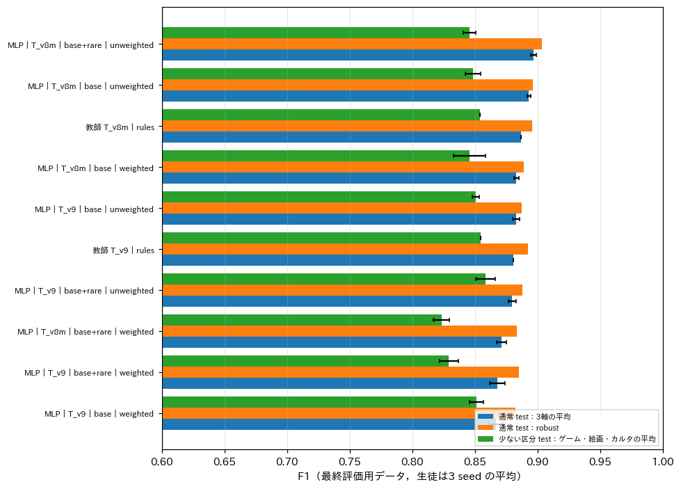
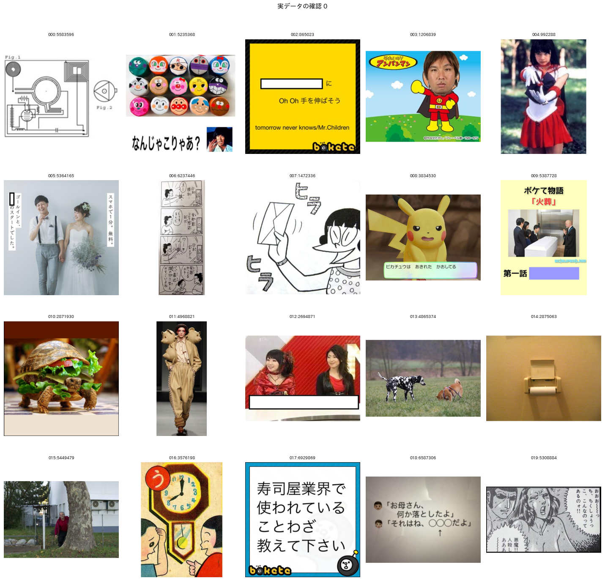
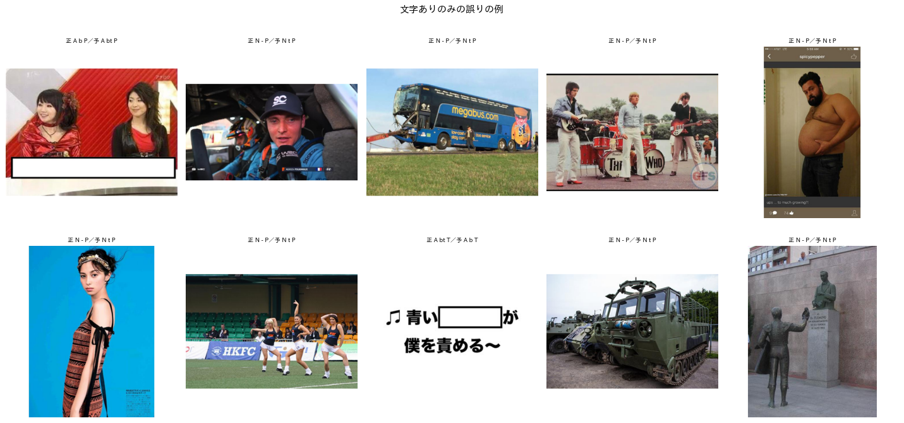
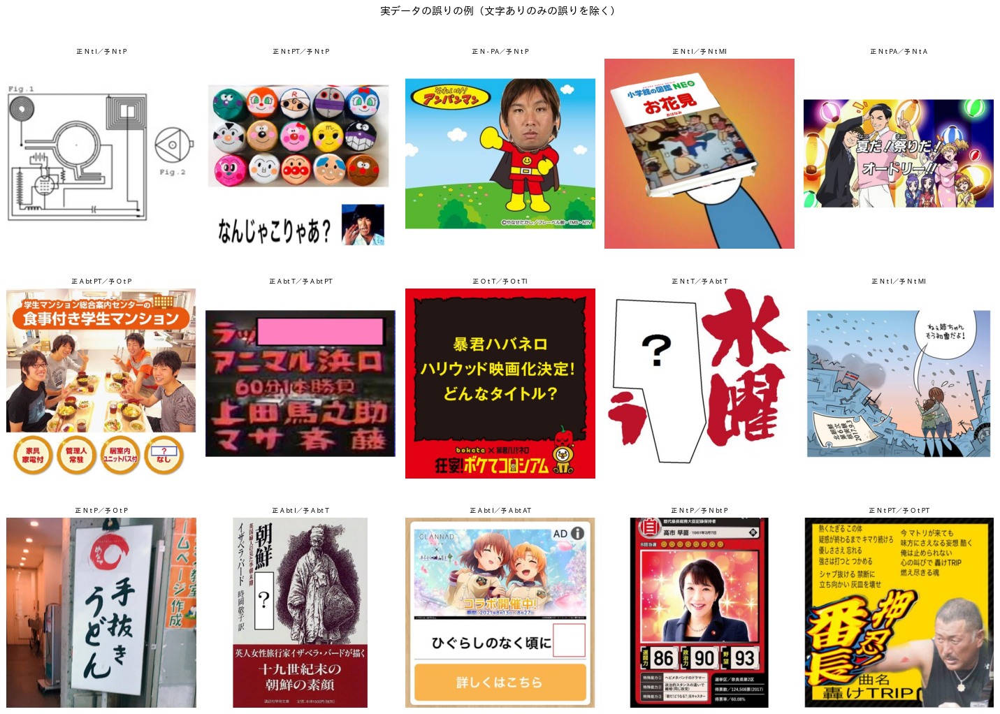

# 定義書 v3 の実装と実データでの検証

## 1. 概要

report_010 で推奨したクラスの設定を定義書 v3 として実装し，教師ラベルの付け直し，生徒の学習，未使用の実データ約29.5万枚へのアノテーションを行った．さらに，実データから無作為に抽出した160枚に予測を見ずに目視でラベルを付け，生徒の予測と比べた．

定義書 v3 の変更点は次の3つである．

- 属性：合成画像を削除し，お題文ありとその他の文字ありを「文字あり」に統合した（空欄あり，カルタ記号あり，文字ありの3項目）．
- 媒体：CG を削除した．3DCG と生成AIの画像は見た目で写真・ゲーム・アニメ・イラストに振り分け，合成画像は媒体の複数選択で表す．
- 形式：変更なし（カルタ，穴埋め，お題文，通常）．

主な結果は次のとおりである．

- 定義書 v3 の生徒（MLP，3 seed の平均）は，最終評価用データ（test）で3軸の平均 F1 が 0.867〜0.897 であった．定義書 v2 の最良の生徒の 0.822 から大きく向上した．
- 実データの無作為抽出160枚では，最良の条件の形式の正解率が 0.950 であった．マクロ F1 は属性 0.939，媒体 0.922 であり，全項目が一致した画像は 74.4% であった．
- 誤り41件のうち18件は「文字あり」だけの誤りであり，そのうち17件は，ロゴや看板，小さな文字を生徒が文字ありとしたものであった．文字ありの境界を変えると，全項目の一致率は 74.4% から 85.6% に上がる．
- 定義書 v2 で有効であった少ない区分の重み付き損失は，v3 では通常の評価用データと実データのどちらでも効果がなかった．重みを付けると媒体の複数選択が増え，誤りが増えた．

推奨する構成は，教師 T_v8m（媒体は M_v6 の回答から CG を削除して読み替える）と，少ない区分の追加あり・重みなしの MLP である．

## 2. 実装

### 2.1 定義書と評価用ラベル

定義書 v3 は `programs/label_guideline/label_definition_v3.md` に置いた．文字ありの定義は「ボケに関わりうる読める文字がある（お題文，テロップ，字幕，看板，台詞など．透かし，ロゴ，著作権表示，判読できない小さな文字は除く）」とした．文字が大喜利の回答に使われているかは，画像だけでは判断できないため区別しない．

既存の評価用ラベルは次の規則で v3 に変換した．

- 通常の評価用データ640枚：文字ありは，お題文ありとその他の文字ありの論理和とした．
- 少ない区分の評価用データ800枚：媒体のみを変換した．
- 目視で CG とした57枚：画像を見直し，イラスト27枚，写真15枚，ゲーム14枚，アニメ1枚に振り分けた（`programs/ex007_label_v3/cg_relabel.txt`）．

### 2.2 教師

教師は次の部品から組み立てた．

| 軸 | 部品 |
| :--- | :--- |
| 形式 | F_v2 |
| 属性 | J_v6 の回答を変換（文字ありは「お題文あり OR その他の文字あり」） |
| 媒体 | 下記の2通り |
| 絵画 | P_v8_en の判定で置き換え |

媒体の部品は次の2通りを比べた．

- T_v9：CG の選択肢を除いた新しいプロンプト M_v9 を用いる．M_v9 には，3DCG と生成AIの画像の振り分けの規則と，漫画風の一枚絵をイラストとする例示を加えた．
- T_v8m：既存の M_v6 の回答から CG を削除する．媒体が空になった場合はイラストとする．

後処理は report_009 と同じである．媒体が空の場合はイラストとし，ボケの書き出しによってカルタの誤判定を取り消し，属性を形式と整合させる．

### 2.3 生徒

生徒は SigLIP2-so400m の埋め込みに対する MLP とした．教師ラベルは，基本の4万枚と，少ない区分の追加分（約5千枚）である．条件は次の3つの組み合わせとし，各条件を3 seed で学習した．

- 教師：T_v9 または T_v8m
- 少ない区分の追加：なし（base）またはあり（base+rare）
- 重み付き損失：なし（unweighted）またはあり（weighted）

seed 0 の生徒は，評価用データ以外の未使用の実データ294,802枚にもアノテーションした．

## 3. 結果

### 3.1 教師

表1に，教師の精度を示す．

表1 教師の精度（3軸の平均 F1，robust は件数10以上の項目の平均．少ない区分は，ゲーム・絵画・カルタの F1 の平均）．

| 教師 | dev 平均 | test 形式 | test 属性 | test 媒体 | test 平均 | test robust | 少ない区分 test |
| :--- | :---: | :---: | :---: | :---: | :---: | :---: | :---: |
| T_v9（M_v9） | 0.912 | 0.881 | 0.923 | 0.837 | 0.880 | 0.892 | 0.855 |
| T_v8m（M_v6 を読み替え） | 0.911 | 0.881 | 0.923 | **0.856** | **0.887** | **0.896** | 0.854 |

新しい媒体のプロンプト M_v9 では精度が上がらなかった．評価用データ640枚全体でのイラストの F1 は，M_v9 で 0.72，M_v6 で 0.78 であった．マンガの例示（漫画風の一枚絵はイラスト）を加えた結果，マンガの F1 が 0.93 から 0.90 に下がり，マンガとイラストの境界がかえって不安定になったと考えられる．プロンプトを作り直すより，既存の回答を読み替える方が良い．

### 3.2 生徒

図1と表2に，生徒の精度を示す．

表2 生徒（MLP）の精度（3 seed の平均）．dev 平均の降順．

| 教師 | 追加 | 損失 | dev 平均 | 少ない区分 dev | test 属性 | test 媒体 | test 平均 | test robust | 少ない区分 test |
| :--- | :--- | :--- | :---: | :---: | :---: | :---: | :---: | :---: | :---: |
| T_v8m | base+rare | 重みあり | 0.903 | 0.751 | 0.910 | 0.840 | 0.871 | 0.883 | 0.823 |
| T_v8m | base | 重みあり | 0.901 | 0.757 | 0.908 | 0.863 | 0.883 | 0.889 | 0.846 |
| T_v9 | base | 重みなし | 0.900 | 0.744 | 0.909 | 0.865 | 0.883 | 0.887 | 0.851 |
| T_v8m | base | 重みなし | 0.899 | 0.757 | 0.904 | **0.900** | 0.893 | 0.896 | 0.849 |
| T_v9 | base+rare | 重みあり | 0.898 | 0.774 | **0.918** | 0.809 | 0.868 | 0.885 | 0.829 |
| T_v9 | base | 重みあり | 0.894 | 0.760 | 0.907 | 0.824 | 0.867 | 0.882 | 0.851 |
| T_v8m | base+rare | 重みなし | 0.891 | 0.771 | 0.913 | 0.896 | **0.897** | **0.903** | 0.846 |
| T_v9 | base+rare | 重みなし | 0.890 | 0.772 | 0.910 | 0.852 | 0.880 | 0.888 | **0.858** |

結果から次のことが分かる．

- **定義書 v3 で精度が大きく上がった．** 定義書 v2 の最良の生徒の test 平均は 0.822 であった．v3 ではどの条件も 0.867 以上であり，読み替えによる見込み（report_010 の 0.880）とほぼ一致した．
- **条件の差は小さい．** dev 平均の差は 0.013 しかなく，dev での順位と test での順位が一致しない．通常の評価用データだけでは，条件を選べない．
- **重み付き損失は効果がない．** test の媒体の F1 は，重みを付けるとどの組み合わせでも下がった（例：T_v8m base+rare で 0.896 → 0.840）．少ない区分の test の F1 も上がらなかった．v2 で重み付き損失が有効であったのは，CG のような境界のあいまいな少ない区分があったためと考えられる．

### 3.3 実データへのアノテーション

未使用の実データ294,802枚にアノテーションした．表3に，そのラベルの分布を，160枚の目視のラベルの分布と並べて示す．生徒は，3.4節で最良であった T_v8m・base+rare・重みなしである．

表3 実データのラベルの割合．

| 項目 | 生徒（294,802枚） | 目視（160枚） |
| :--- | :---: | :---: |
| カルタ | 0.7% | 1.9% |
| 穴埋め | 19.3% | 19.4% |
| お題文 | 11.4% | 6.9% |
| 通常 | 68.6% | 71.9% |
| 文字あり | 53.5% | 51.2% |
| 写真 | 53.3% | 53.7% |
| アニメ | 9.0% | 8.1% |
| ゲーム | 2.7% | 2.5% |
| マンガ | 15.1% | 16.3% |
| テキストグラフィック | 14.8% | 14.4% |
| 絵画 | 0.4% | 0.0% |
| イラスト | 12.1% | 10.6% |
| 媒体の複数選択 | 6.9% | 6.3% |

ほとんどの項目で，生徒の分布は目視の分布とおおむね一致した．お題文だけは，生徒の割合が目視より高い．3.4節で述べるように，看板や番組の画面などの文字を，お題文と判定する誤りがあるためである．絵画は実データでは非常に少なく，160枚には1枚もなかった．

### 3.4 実データの無作為抽出による確認

評価用データに使っていない実データから160枚を無作為に抽出した．予測を見ずに，定義書 v3 で全項目のラベルを付けた（`programs/ex007_label_v3/real_check_v3.txt`）．図2に，その一部を示す．

表4に，8条件の生徒の精度を示す．

表4 実データの無作為抽出160枚での生徒（seed 0）の精度．全一致は，形式・属性・媒体の全項目が一致した画像の割合．

| 教師 | 追加 | 損失 | 形式 正解率 | 形式 F1 | 属性 F1 | 媒体 F1 | 全一致 | 媒体の複数選択 |
| :--- | :--- | :--- | :---: | :---: | :---: | :---: | :---: | :---: |
| T_v8m | base+rare | 重みなし | **0.950** | **0.927** | **0.939** | 0.922 | **0.744** | 6.9% |
| T_v9 | base+rare | 重みなし | 0.931 | 0.894 | 0.930 | 0.925 | 0.731 | 5.8% |
| T_v8m | base | 重みなし | 0.944 | 0.909 | 0.938 | **0.929** | 0.719 | 6.4% |
| T_v9 | base | 重みなし | 0.944 | 0.919 | 0.915 | 0.913 | 0.719 | 7.0% |
| T_v9 | base | 重みあり | 0.938 | 0.911 | 0.919 | 0.897 | 0.706 | 8.3% |
| T_v8m | base+rare | 重みあり | 0.925 | 0.894 | 0.921 | 0.887 | 0.688 | 10.3% |
| T_v8m | base | 重みあり | 0.925 | 0.888 | 0.928 | 0.879 | 0.688 | 9.5% |
| T_v9 | base+rare | 重みあり | 0.925 | 0.892 | 0.920 | 0.894 | 0.675 | 11.0% |

媒体の F1 は，160枚に含まれる媒体（絵画を除く6項目）の平均である．

結果から次のことが分かる．

- 重みなしの4条件が，全一致で上位を占めた．
- 重みを付けると，媒体の複数選択の割合が 6〜7% から 8〜11% に増えた．目視の 6.3% から離れ，余分な媒体を付ける誤りが増えた．
- 最良の条件は，T_v8m・base+rare・重みなしである．この条件は，通常の評価用データの test 平均（0.897）と robust（0.903）でも最良であった．

ただし，160枚の全一致の差は数件分であり，二項分布の95%信頼区間は ±7 ポイント程度ある．条件の差は確定的ではない．

### 3.5 誤りの傾向

最良の条件の誤り41件を分類した（1件に複数の誤りがある場合は重複して数える）．

| 誤りの種類 | 件数 |
| :--- | :---: |
| 文字あり：ロゴ，看板，小さな文字を文字ありとした | 18 |
| 媒体：余分な媒体を付けた | 7 |
| 媒体：合成画像の一方の媒体が欠けた | 6 |
| 空欄あり：空欄がないのにありとした | 4 |
| 形式：通常を穴埋めとした | 3 |
| 形式：通常をお題文とした | 3 |
| 媒体：別の媒体とした | 3 |
| その他（形式の誤り2件，空欄の見落とし1件，文字の見落とし1件） | 4 |

「文字ありのみの誤り」の例を図3に示す．また，それ以外の誤りの例を図4に示す．図の題の「正」は目視のラベル，「予」は生徒の予測であり，順に形式，属性，媒体の記号を示す．

記号の意味は次のとおりである．

- 形式：K カルタ，A 穴埋め，O お題文，N 通常
- 属性：b 空欄，k カルタ記号，t 文字
- 媒体：P 写真，A アニメ，G ゲーム，M マンガ，T テキストグラフィック，E 絵画，I イラスト

**文字あり．** 誤りの最大の原因である．生徒は，ロゴ，看板，ユニフォームの文字，画面の隅の小さな文字を文字ありとする傾向がある．教師の J_v6 の「その他の文字あり」がこれらを含めて回答しているため，生徒もそれを学習している．定義書 v3 はロゴを除くとしており，教師と定義がずれている．文字ありだけの誤りを除くと，全一致は 85.6% になる．

**媒体の合成画像．** 合成画像の誤りには，次の2つの方向がある．

- 欠落：写真にアニメの体を合成した画像で，片方の媒体しか付かない．
- 余分：テキストの帯の付いた画像に，テキストグラフィックやイラストが余分に付く．

合成画像を媒体の複数選択で表す方針は機能している．ただし，どの領域から媒体を付けるか（約2割）の判断は，目視でもあいまいである．例えば，写真の上下に文字の帯がある画像にテキストグラフィックを付けるかは，判断が分かれる．

**形式．** 誤りのほとんどは，お題文と穴埋めの過検出である．

- お題文：看板（「手抜きうどん」），歌の歌詞の画像，図面の「Fig.1」のように，投稿者が書き加えたのではない文字を，お題文とする．
- 穴埋め：顔を隠す図形や，漫画の白い吹き出しを空欄とする．

通常の評価用データでの傾向と同じである．

## 4. 考察と今後の課題

1. **教師は T_v8m，生徒は base+rare・重みなしとする．** 教師の媒体のプロンプトを作り直す必要はない．少ない区分の追加は，通常の評価用データでも実データでも，わずかに良いか同等であった．重み付き損失は，v3 では外す．
2. **文字ありの境界を，教師と定義のどちらかに合わせる．** 次の2案がある．
   - 案A：定義を「読める文字があれば文字あり（ロゴ等も含む）」に変える．教師と生徒をそのまま使える．文字ありの割合は 6割程度に上がる．
   - 案B：教師のプロンプトに「ロゴ，看板の店名，衣服の文字は除く」を加え，教師ラベルを付け直す．

   文字ありの用途は，文字を手がかりにしたボケの候補を絞ることである．その用途では誤って含めても害が小さいため，案Aで十分と考える．
3. **お題文の過検出を減らす．** 看板，歌詞，図面の文字をお題文とする誤りが残る．お題文は「投稿者が書き加えた文字」に限るため，形式のプロンプト F_v2 に「画像に元からある看板や字幕は除く」の例示を加えると改善する可能性がある．
4. **絵画の評価．** 絵画は実データで 0.4% しかなく，無作為抽出では評価できない．絵画の精度は，少ない区分の評価用データ（test の F1 0.76）で見るしかない．
5. **確認の規模．** 160枚の目視の確認は，大きな誤りの傾向をつかむには十分である．一方，条件の差（数ポイント）を判定するには少ない．全件のアノテーションに進む前に，最終の構成で数百枚を追加で確認するのが望ましい．
6. **目視のラベルの偏り．** 160枚のラベルは1人（Claude Code）が付けたものである．特に「約2割の領域」と「ロゴか否か」の判断には，揺れが残る．
