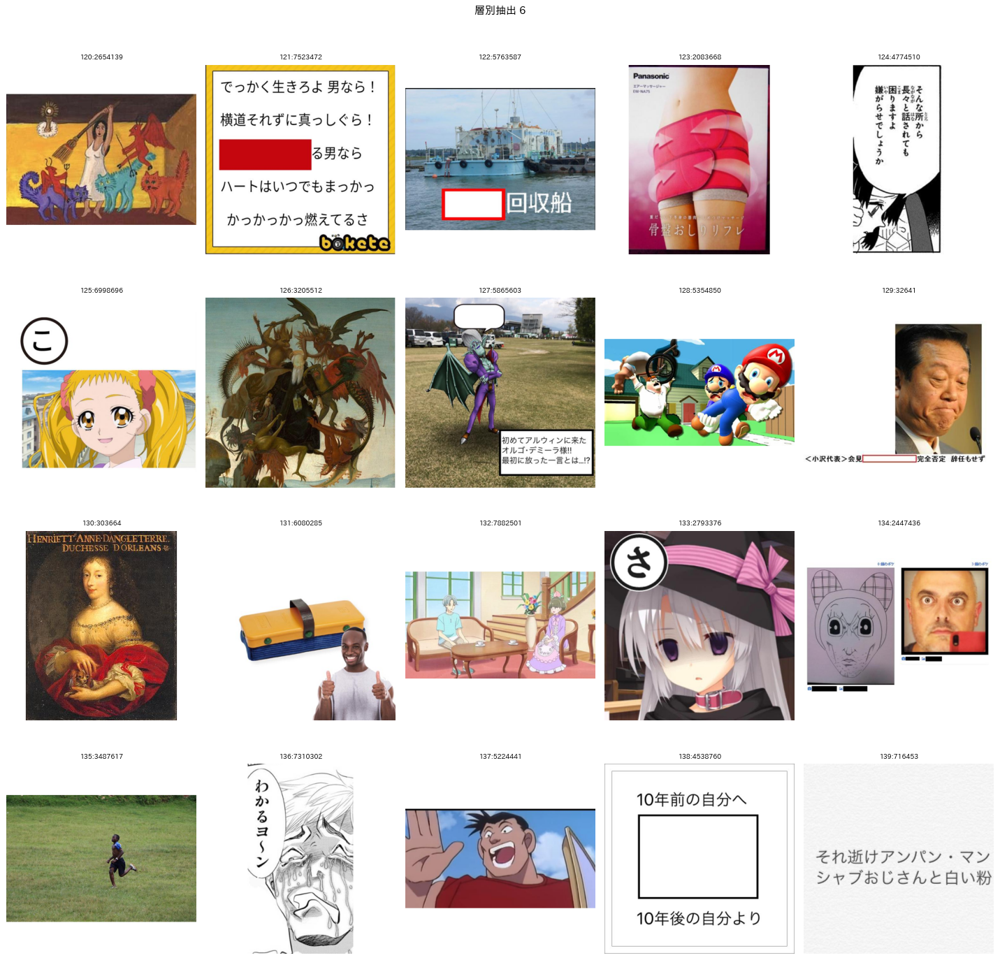
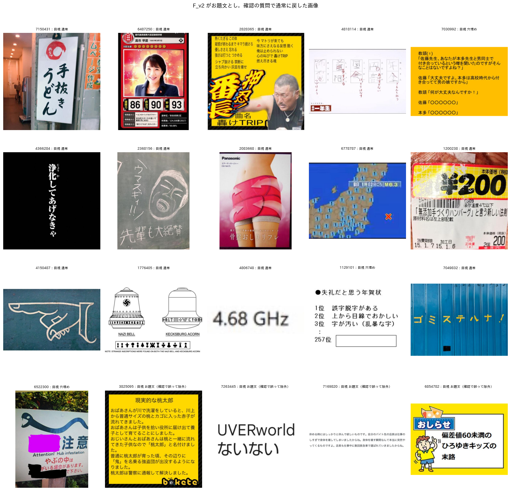
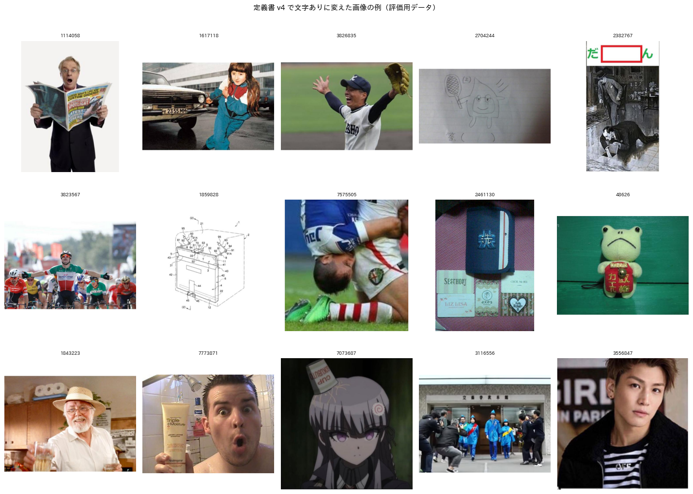
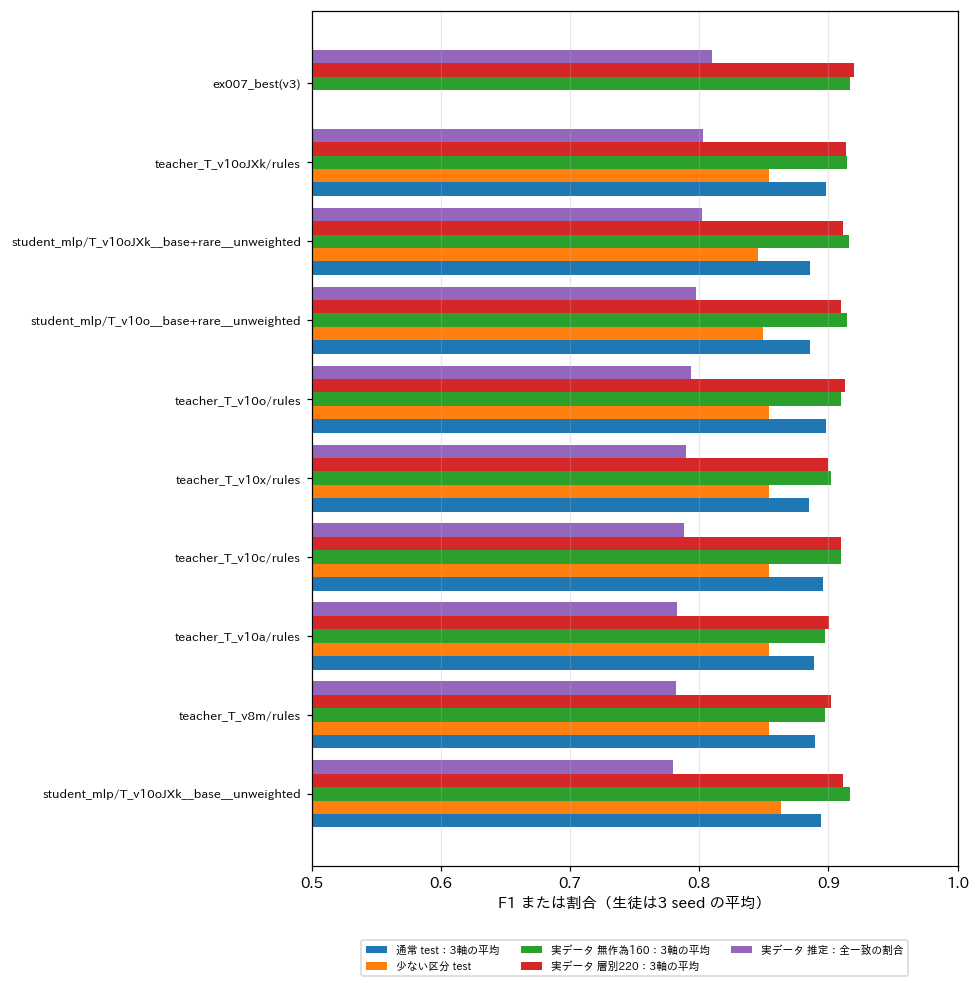
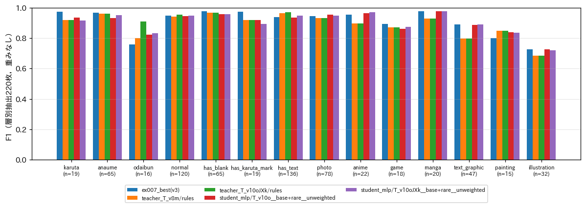

# 定義書 v4（文字ありの拡張）とお題文の過検出対策，目視ラベルの層別追加による再評価

## 1. 概要

report_011 を受けて，次の4点を実施した．

1. 「文字あり」の定義を変えた（案A）．ロゴや透かしなども含め，読める文字があれば文字ありとし，定義書を第4版とした．文字が大喜利に影響しているかは，ボケの文章を見て判断する．形式のお題文は維持した．
2. 重み付き損失を廃止した．
3. お題文の過検出を防ぐため，教師のプロンプトを改良した．
4. 目視ラベルを追加した．現状の生徒の予測に基づいて層別に220枚を抽出し，各クラスの件数がおおむね一様になるようにした．あわせて，既存の目視ラベルの文字ありを第4版の定義で見直した．

主な結果は次のとおりである．

- **お題文の過検出は，別の確認の質問で大きく減った．** 「画像に元からある看板や字幕を除く」を形式のプロンプトの「お題文」の説明に加えると，かえってお題文が増えた．一方，形式の部品がお題文とした画像に限り，「投稿者が回答者に向けて書いた問いか」を別の質問（O_v10_en）で確かめると，誤りが減った．
  - 教師のお題文の F1：実データ 0.769 → 0.873，評価用データ 0.810 → 0.879
  - 実データでの誤検出：13件 → 4件
- **文字ありは，2つの質問の組み合わせが最も良かった．** 既存の J_v6 の回答と，「読める文字があるか」を問う新しい質問（X_v10_en）を組み合わせた．X_v10_en はカルタ記号だけの画像も文字ありと答えるため，カルタ記号のない画像に限って使う．教師の文字ありの F1 は，実データで 0.954 から 0.971 に上がった．
- **生徒は，お題文で改善し，全体ではほぼ同等であった．**
  - 最良の生徒は，教師 T_v10oJXk，少ない区分の追加あり，重みなしである．
  - 層別抽出220枚でのお題文の F1 は，ex007 の最良の生徒の 0.76 から 0.83 に上がった．
  - 実データでお題文と判定する割合は 11.4% から 8.5% に下がり，目視の 6.9% に近づいた．
  - 実際の分布で全項目が一致する割合の推定値は 0.802 であり，ex007 の生徒の 0.810 との差は統計的に区別できない（95%信頼区間 −0.04〜+0.02）．
- **層別抽出により，少ないクラスの精度を測れるようになった．** 生徒の弱いクラスは，イラスト（F1 0.72），お題文（0.83），絵画（0.83），ゲーム（0.87）であった．

## 2. 実施内容

### 2.1 定義書 v4

定義書は `programs/label_guideline/label_definition_v4.md` に置いた．変更は属性の「文字あり」だけである．

- **文字あり：** 読める文字があれば真とする．お題文，テロップ，字幕，看板，台詞，効果音の描き文字，商品の表示，衣服やユニフォームの文字，ロゴ，透かし，著作権表示，日付の写し込みなどを含む．
- **除くもの：** ぼかしやモザイクで読めない文字，判読できないほど小さな文字，カルタ記号のひらがな1文字だけの場合．
- **文字の影響の判断：** 文字が大喜利に影響しているかは，画像のラベルでは扱わない．ボケの文章を見る後段の処理で判断する．画像のラベルの文字ありは，その判断の対象を絞るための目印である．

既存の目視ラベルは，第4版の定義で次のように見直した．

- **評価用データ640枚：** 文字なしとした画像のうち，教師（J_v6），ex007 の生徒，または X_v10_en のいずれかが文字ありと予測したものを見直した．43枚を文字ありに変えた（`programs/ex008_label_v4/text_relabel.txt`）．どのモデルも文字ありと予測しなかった画像は見直していないため，見落としが残っている可能性がある．
- **実データの無作為抽出160枚：** 文字なしとした78枚を全て見直し，15枚を文字ありに変えた（`real_random_v4.txt`）．160枚のうち文字ありは97枚（61%）になった．

### 2.2 目視ラベルの層別追加

ex007 の最良の生徒による実データ294,802枚への予測を用いて，層別に抽出した．手順は次のとおりである．

1. 各画像を，予測されたクラスのうち実データで最も少ないものの層に割り当てた．層は11あり，優先順は，絵画，カルタ，ゲーム，アニメ，お題文，イラスト，テキストグラフィック，マンガ，穴埋め，文字あり，写真である．
2. 各層から20枚ずつ，計220枚を無作為に抽出した．
3. 一覧画像は層が分からないように並べ替え，予測を表示しなかった．この一覧を見て，定義書 v4 で全項目のラベルを付けた（`real_strat_v4.txt`）．図1に一覧の例を示す．

目視ラベルの件数は，層別抽出の220枚だけで次のとおりであった．無作為抽出160枚は，絵画が0件，カルタ3件，ゲーム4件であった．

- 形式：カルタ19，穴埋め65，お題文16，通常120
- 媒体：写真78，アニメ22，ゲーム18，マンガ20，テキストグラフィック47，絵画15，イラスト32

集計は次の3通りで行った．

- **無作為：** 無作為抽出160枚での精度
- **層別：** 層別抽出220枚での重みなしの精度．クラスごとの比較に用いる．
- **推定：** 層別抽出の各画像に抽出確率の逆数（層の画像数 / 20）の重みを付け，無作為抽出160枚と合わせて，実際の分布での精度を推定した値

### 2.3 お題文の過検出の対策

形式の部品 F_v2 に対して，次の4つの改良を比べた．

| 部品 | 内容 |
| :--- | :--- |
| F_v9a | text（お題文）の説明に「看板，ポスター，表紙，商品，テレビの画面と字幕，歌詞，図表，漫画のページなど，元からある文字は大きくても text ではない」を加える |
| F_v9b | F_v9a に加え，「投稿者が回答者に向けて書いた問い・指示・題目の句であること」を明記する |
| F_v9c | 同じ趣旨の除外を，normal（通常）の説明に加える |
| O_v10_en | F_v2 はそのままとし，お題文とした画像について「投稿者が回答者に向けて書いた問い，指示，題目の句があるか」を別に問う．偽なら通常にする |

O_v10_en では，元からある文字の例（看板，表紙，テレビやニュースの画面，ウェブの記事，歌詞，図表，ゲームや漫画の台詞，問いのない引用の一文）を，偽とする条件に挙げた．

### 2.4 文字ありの教師

J_v6 は，旧定義に従ってロゴや透かしを除くよう指示されている．このため，第4版の文字ありを独立に問う X_v10_en を作った．質問は「ロゴ，透かし，著作権表示，衣服の文字なども含め，読める文字があるか」である．文字ありは次の3通りで作り，比べた．

- J：J_v6 の回答
- X：X_v10_en の回答
- JXk：J の回答と，「X の回答 かつ カルタ記号なし」の論理和

### 2.5 生徒

生徒は，SigLIP2-so400m の埋め込みに対する MLP である．条件は次のとおりである．

- 重み付き損失：廃止し，重みなしのみとした．
- 教師：T_v10o（F_v2＋O_v10_en，文字ありは J）と T_v10oJXk（同，文字ありは JXk）の2つ
- 学習データ：少ない区分の追加なし／ありの2通り
- seed：各条件3つ

全 seed で，目視ラベルの380枚の予測も保存した．

## 3. 結果

### 3.1 教師

表1に，教師の精度を示す．

表1 教師の精度．dev，test は評価用データ640枚の分割．お題文と文字ありの F1 の「実」は，実データの目視ラベル380枚（無作為160枚と層別220枚）での値．全一致は，実際の分布での推定値．

| 教師 | 形式 | 文字あり | dev 平均 | test 平均 | お題文 F1 評価／実 | 文字あり F1 評価／実 | 全一致（推定） |
| :--- | :--- | :--- | :---: | :---: | :---: | :---: | :---: |
| T_v8m（ex007） | F_v2 | J | 0.915 | 0.890 | 0.810／0.769 | 0.971／0.954 | 0.782 |
| T_v10a | F_v9a | J | 0.919 | 0.889 | 0.805／0.722 | — | 0.783 |
| T_v10b | F_v9b | J | 0.917 | 0.886 | 0.810／0.750 | — | 0.781 |
| T_v10c | F_v9c | J | 0.915 | 0.896 | 0.841／0.806 | — | 0.788 |
| T_v10o | F_v2＋O | J | **0.919** | 0.898 | **0.879**／0.873 | 0.970／0.954 | 0.794 |
| T_v10x | F_v2 | X | 0.909 | 0.885 | — | 0.923／0.953 | 0.790 |
| T_v10oJXk | F_v2＋O | JXk | 0.916 | 0.898 | **0.879**／0.873 | 0.959／**0.971** | 0.803 |
| T_v10coJXk | F_v9c＋O | JXk | 0.915 | **0.899** | **0.879**／**0.889** | 0.959／**0.971** | **0.806** |

「—」は，T_v8m と同じ部品を用いるため値が同じになる欄である．

**お題文．** 規則をお題文の説明に足した F_v9a と F_v9b では，実データでお題文と誤る画像が13件から18〜19件に増えた．説明を長くすると，Qwen はかえって text を選びやすくなった．規則を通常の側に書いた F_v9c は，少し改善した（誤検出13件 → 10件）．別の質問で確かめる O_v10_en は，大きく改善した．誤検出と見落としは次のとおりである．

| 教師 | 実データ 誤検出 | 実データ 見落とし | 評価用データ 誤検出 | 評価用データ 見落とし |
| :--- | :---: | :---: | :---: | :---: |
| T_v8m | 13 | 2 | 28 | 3 |
| O_v10_en で確認 | 4 | 3 | 10 | 7 |

図2に，確認の質問でお題文から外した画像の例を示す．外した32枚のうち27枚は目視でもお題文ではなかった．看板，選挙のカード，歌詞，答案，報道の画面，ポスターなどである．目視でお題文であった5枚（図2の最下段）は，お話の全文を載せた画像や題目の句だけの画像であった．

**文字あり．**

- X は見落としがほぼない．しかし，カルタ記号だけの画像も文字ありとした（評価用データで誤検出63件）．
- J は，ロゴや衣服の文字を見落とした（実データで14件）．
- JXk は，実データで F1 0.971 と最も高かった．
- 評価用データ640枚では，J の方が高かった（0.970 と 0.959）．ただし，評価用データの見直しは一部の画像に限っている（2.1節）．JXk の誤検出の多くは，判読の境界にある小さな文字であった．

図3に，第4版で文字ありに変えた画像の例を示す．

F_v9c と O を組み合わせた T_v10coJXk は，T_v10oJXk とほぼ同じであった（実データの誤検出が1件少ないだけ）．F_v9c を4万枚に適用する推論の時間に見合わないため，教師ラベルは T_v10o と T_v10oJXk で作った．4万枚の教師ラベルでお題文とされた画像は，4,704枚（T_v8m）から3,287枚に減った．

### 3.2 生徒

図4と表2に，生徒の精度を示す．

表2 生徒（MLP，重みなし，3 seed の平均）の精度．全一致の「無作為」「層別」は各標本での割合，「推定」は実際の分布での推定値．

| 教師 | 追加 | dev 平均 | 少ない区分 dev | test 平均 | 少ない区分 test | 全一致 無作為 | 全一致 層別 | 全一致 推定 | 3軸 F1 推定 |
| :--- | :--- | :---: | :---: | :---: | :---: | :---: | :---: | :---: | :---: |
| T_v10o | base | 0.890 | 0.752 | **0.895** | 0.863 | 0.792 | 0.700 | 0.796 | 0.915 |
| T_v10o | base+rare | **0.902** | 0.774 | 0.885 | 0.849 | 0.790 | 0.703 | 0.797 | 0.917 |
| T_v10oJXk | base | 0.890 | 0.764 | 0.894 | **0.864** | 0.783 | 0.694 | 0.779 | 0.900 |
| T_v10oJXk | base+rare | 0.900 | **0.795** | 0.886 | 0.845 | 0.790 | **0.729** | **0.802** | **0.919** |
| （参考）ex007 の最良（v3） | base+rare | — | — | — | — | 0.806 | 0.714 | 0.810 | 0.916 |

ex007 の生徒は定義書 v3 の教師で学習したものであり，seed 0 の値である．定義書 v4 の目視ラベルで評価した．

- **生徒の選定．** dev の平均と少ない区分の dev の平均が最も高いのは，T_v10oJXk・base+rare であった（0.848）．この条件は，層別抽出の全一致と，実際の分布での推定値でも最良であった．
- **ex007 の生徒との比較．** 推定の全一致は 0.802 と 0.810 であり，ほぼ同じである．画像を対にした自助法（2,000回）による差の95%信頼区間は −0.040〜+0.024 で，区別できない．

### 3.3 項目ごとの精度

図5に，層別抽出220枚での項目ごとの F1 を示す．

| 項目 | ex007 の生徒 | 教師 T_v10oJXk | 生徒 T_v10oJXk・base+rare |
| :--- | :---: | :---: | :---: |
| お題文（n=16） | 0.76 | 0.91 | 0.83 |
| 文字あり（n=136） | 0.94 | 0.97 | 0.95 |
| カルタ（n=19） | 0.97 | 0.92 | 0.92 |
| 絵画（n=15） | 0.80 | 0.85 | 0.83 |
| ゲーム（n=18） | 0.89 | 0.87 | 0.87 |
| テキストグラフィック（n=47） | 0.89 | 0.80 | 0.89 |
| イラスト（n=32） | 0.72 | 0.68 | 0.72 |

- **お題文．** 教師の改善（0.80 → 0.91）は，生徒には半分ほどしか移らなかった（0.76 → 0.83）．お題文かどうかは，文字の内容と出所で決まる．画像全体の埋め込みでは，看板とお題文の帯の違いを捉えにくいと考えられる．
- **文字あり．** 教師は 0.97 であるのに対し，生徒は 0.95 にとどまった．小さなロゴや衣服の文字は，埋め込みからは捉えにくい．
- **カルタ．** 新しい生徒は ex007 の生徒より低い（0.97 → 0.92）．ただし件数は19件であり，1〜2件の差である．
- **イラスト．** 全ての教師と生徒で最も低い（0.68〜0.73）．アニメ風の一枚絵，ゲームの絵，絵本の挿絵との境界があいまいである．目視でも判断が分かれる．
- **絵画．** 実際の分布での推定値は，件数が少ないため不安定である（生徒の条件により 0.41〜0.78）．

### 3.4 実データへのアノテーション

最良の生徒（seed 0）で，未使用の実データ294,802枚にアノテーションした．表3に，ex007 の生徒と目視（無作為抽出160枚）の割合と並べて示す．

表3 実データのラベルの割合．

| 項目 | 新しい生徒 | ex007 の生徒 | 目視（無作為160枚） |
| :--- | :---: | :---: | :---: |
| お題文 | 8.5% | 11.4% | 6.9% |
| 穴埋め | 19.6% | 19.3% | 19.4% |
| カルタ | 0.8% | 0.7% | 1.9% |
| 文字あり | 56.9% | 53.5% | 60.6% |
| 媒体の複数選択 | 6.8% | 6.9% | 6.3% |

お題文の割合は目視に近づいた．文字ありは定義の拡張に合わせて上がったが，目視の 60.6% にはまだ届かない．

## 4. 考察と今後の課題

1. **教師は T_v10oJXk とし，形式の確認の質問を標準とする．** 誤りの多い区分では，説明を書き足すより，別の短い質問で確かめる方が効く．この傾向は，お題文で特に顕著であった．確認の質問は，お題文と判定された約1割の画像にだけ適用すればよいため，推論の費用も小さい．
2. **生徒の伸びは頭打ちである．** 教師ではお題文と文字ありが改善した．一方，生徒の全体の精度は ex007 と区別できなかった．埋め込みに対する MLP の限界と考えられる．次の候補は次の2つである．
   - **画像エンコーダの微調整：** SigLIP2-B の微調整で，文字の細部を学習させる．
   - **確認の質問を本番でも使う：** お題文と判定した画像（約8%）に限って，Qwen の確認の質問を実行する．約700万枚の8%は約56万枚であり，35枚/秒で約4.5時間である．
3. **評価用データの文字ありの見直しは不完全である．** 640枚の見直しは，いずれかのモデルが文字ありと予測した画像に限った．全てのモデルが見落とした小さな文字は残りうる．
4. **層別抽出の効果と限界．** 層別抽出により，絵画・カルタ・ゲーム・お題文を各15〜20件ずつ確保できた．これらの精度を比べられるようになった．ただし，1件あたり F1 が約0.03動くため，項目ごとの差は数件分の誤差を含む．
5. **目視のラベルの揺れ．** 380枚の目視ラベルは，Claude Code が1人で付けたものである．揺れが大きいのは，次の3点である．
   - イラストとアニメ・ゲームの境界
   - 文字の帯が付いた画像に，テキストグラフィックを付けるか
   - 説明文の画像をお題文とするか
