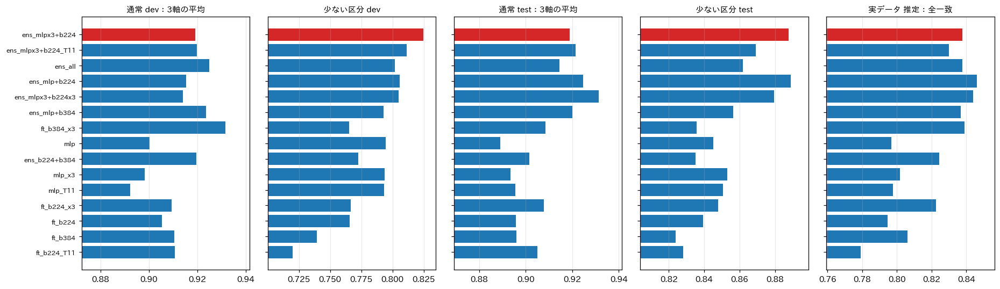
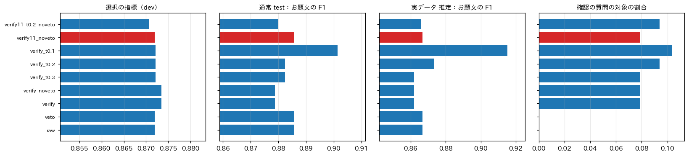
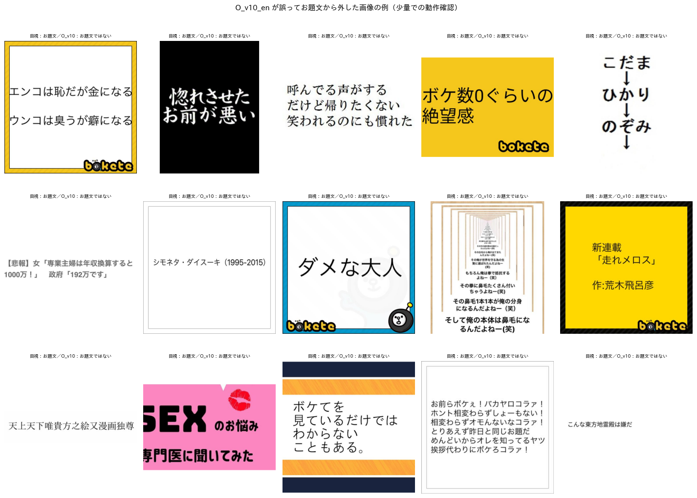
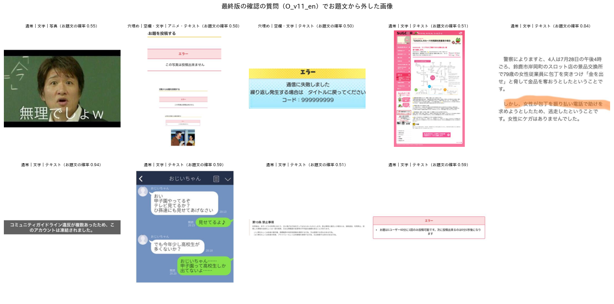
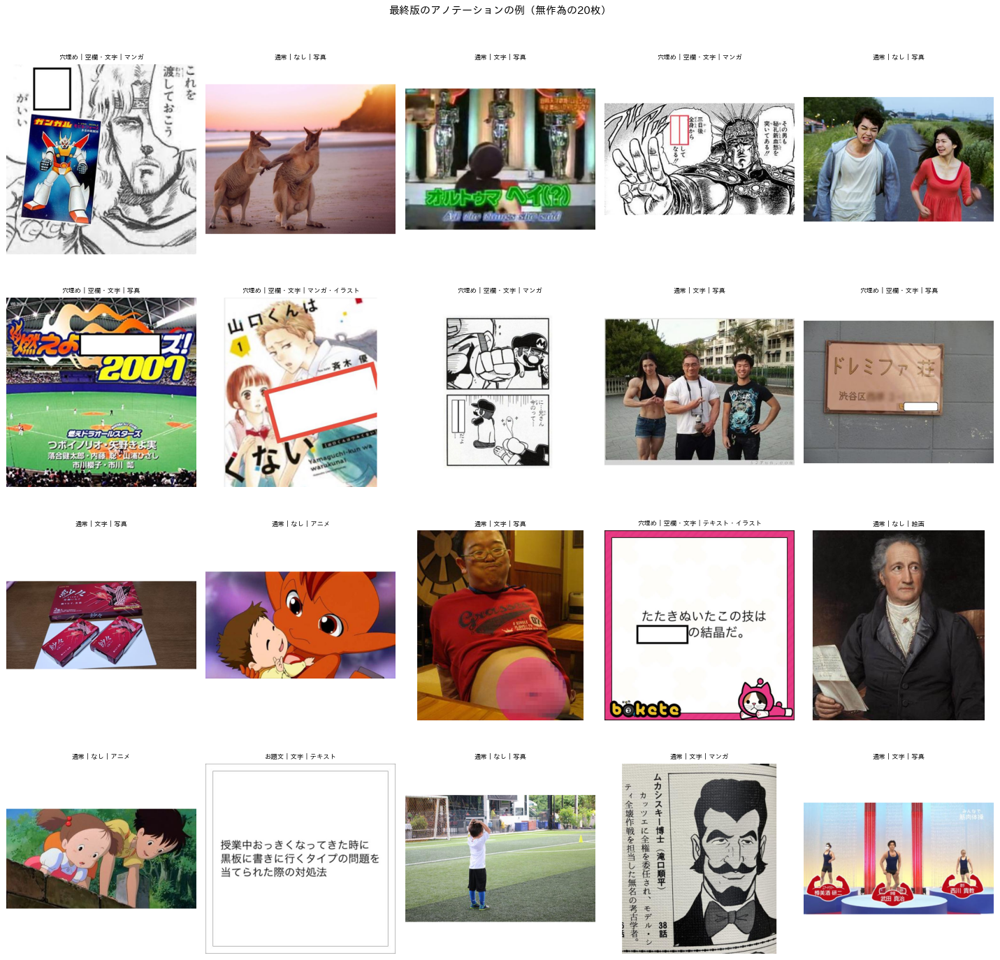

# BoketeDBv5 のアノテーションの方法（最終版）とその根拠

## 1. 概要

BoketeDBv4 の全てのお題画像（6,823,270枚．内容が同じ画像をまとめると6,609,511枚）に，形式・属性・媒体のラベルを付ける方法の最終版を決めた．ラベルの定義は定義書 v4（`programs/label_guideline/label_definition_v4.md`）である．

最終版の方法は次の3段からなる．

1. **生徒の確率：** 2つの生徒の確率を平均する．
   - SigLIP2-so400m の埋め込みに対する MLP（3 seed の平均）
   - 微調整した SigLIP2-B（224画素）
   - 生徒は，Qwen3-VL-8B の教師ラベル（4万枚と少ない区分の追加分，約4.5万枚）で学習した．
2. **お題文の確認：** お題文と予測した画像（約8%）にだけ，Qwen3-VL-8B に確認の質問（O_v11_en）をする．
3. **整合の処理：** 形式から属性を導き，媒体が空なら最も確率の高い媒体を付ける．

最終版の精度は次のとおりである．

| 評価 | 指標 | 値 |
| :--- | :--- | :---: |
| 通常の評価用データ（test，320枚） | 3軸のマクロ F1 の平均 | 0.919 |
| 少ない区分の評価用データ（test） | ゲーム・絵画・カルタの F1 の平均 | 0.888 |
| 実データの目視ラベル380枚 | 全項目一致の割合（実際の分布での推定値） | 0.838 |

ex008 の最良の生徒（埋め込みの MLP 単体）は，それぞれ 0.886，0.845，0.797 であった．処理時間は，単一の GPU で約19時間（予測 約12時間，確認の質問 約7時間）と見積もった．

本稿では，最終版の方法（2章）と，各要素を選んだ根拠（3章）をまとめる．3章の根拠は，report_001〜012 の結果と，本指示での比較による．

本指示での比較で，当初の案から変えた点が2つある．

- **確認の質問を O_v10_en から O_v11_en に替えた．** O_v10_en は，評価用データでは有効に見えた．しかし，全データから無作為に抽出した2万枚では，お題文ではないと答えた145枚のうち98枚（68%）が実際にはお題文であった．ボケてのテンプレートに書かれた「こんな〜は嫌だ」などの典型的なお題文である．典型的な型を明示した O_v11_en は誤って外さず，お題文ではないと答えた9枚はすべて正しかった．
- **ボケの書き出しによるカルタの取り消しを使わない．** 生徒の予測では，評価用データ全体で1枚しか変わらず，その1枚は正しいカルタであった．

## 2. 最終版のアノテーションの方法

### 2.1 ラベルの定義

定義書 v4 の要点を表1に示す．

表1 ラベルの定義（定義書 v4）．

| 軸 | 項目 | 定義の要点 |
| :--- | :--- | :--- |
| 形式（1つ） | カルタ，穴埋め，お題文，通常 | 優先順に判定する．カルタはひらがな1文字の札の記号，穴埋めは語の代わりの空欄，お題文は投稿者が回答者に向けて書いた問い・指示・題目などの文 |
| 属性（複数） | 空欄あり，カルタ記号あり，文字あり | 文字ありは，ロゴや透かしを含め，読める文字があれば真 |
| 媒体（原則1つ） | 写真，アニメ，ゲーム，マンガ，テキストグラフィック，絵画，イラスト | 合成画像は，約2割以上を占める媒体を複数選ぶ．3DCG と生成AIの画像は見た目で振り分ける |

本指示で，お題文の定義に補足を加えた．ボケてのテンプレートや無地の背景に投稿者が書いた文が画像の主題である場合は，問いの形でなくてもお題文とする．台詞，題名，主張の文などである．回答者はその文を読んで大喜利を作るためである．ただし，ニュースの記事，ウェブやアプリの画面，テレビの字幕など，元からある文章を写したものは除く．

この補足に従い，既存の目視ラベルのうち4枚の形式を通常からお題文に改めた（`programs/ex009_final/format_relabel.txt`）．

### 2.2 処理の流れ

全データの処理は `programs/ex009_final/annotate_all.py` で行う．構成は `outputs/ex009_final/final_config.json` に記録した．表2に処理の流れを示す．各段階は途中の結果をファイルに保存するため，中断しても同じコマンドで再開できる．

表2 アノテーションの処理の流れ．時間は単一の GPU（RTX PRO 6000 Blackwell）での見積もり．

| 段階 | 処理 | 対象 | 速度 | 時間 |
| :---: | :--- | :--- | :---: | :---: |
| 1. list | BoketeDBv4 の image の表から画像を列挙．sha256 が同じ画像は代表の1枚だけを予測する | 6,823,270枚 → 6,609,511枚 | — | 数分 |
| 2. predict | 画像を1回読み込み，so400m の埋め込み → MLP（3 seed），SigLIP2-B の微調整のモデルの確率を求めて平均する．埋め込みも保存する | 6,609,511枚 | 約150枚/秒 | 約12時間 |
| 3. verify | お題文と予測した画像に，Qwen3-VL-8B で確認の質問（O_v11_en）を行う | 約8%（約54万枚） | 約23枚/秒 | 約7時間 |
| 4. finalize | 確認の質問で偽なら，お題文以外で確率の最も高い形式にする．形式から属性を導き，お題ごとのラベルを保存する | 6,823,270件 | — | 数分 |

全データでの実行は次のとおりである．

```bash
.venv_annotate/bin/python programs/ex009_final/annotate_all.py --out_dir datasets/ex009_final/BoketeDBv5_annotation
```

出力の `annotation.parquet` は，1行が1お題である．列は次のとおりである．

- お題ID，sha256，予測に用いた代表のお題ID
- 形式，属性3項目，媒体7項目
- 各項目の確率
- 確認の質問の記録（対象か，回答）

### 2.3 教師（学習用のラベルを作る Qwen3-VL-8B）

教師は，Qwen3-VL-8B-Instruct（vLLM，温度0，JSON スキーマによる構造化出力，入力は最大 448×448 画素）への複数の質問の組み合わせである．最終版の教師 T_v10oJXk の構成を表3に示す．

表3 教師 T_v10oJXk の構成．

| 軸 | 質問（部品） | 用い方 |
| :--- | :--- | :--- |
| 形式 | F_v2（形式と画風を問う短い英語のプロンプト） | 形式の回答．text はお題文に読み替える |
| 形式の確認 | O_v10_en（投稿者が回答者に向けて書いた問いか） | F_v2 がお題文とした画像のみ．偽なら通常にする |
| 属性 | J_v6（3軸を一括で問う日本語のプロンプト） | 空欄あり，カルタ記号あり，文字あり（お題文あり OR その他の文字あり） |
| 文字あり | X_v10_en（ロゴ等を含め，読める文字があるか） | 「X_v10_en が真 かつ カルタ記号なし」を J_v6 の文字ありに論理和で加える |
| 媒体 | M_v6（媒体のみを問う日本語のプロンプト） | CG の回答は削除し，媒体が空ならイラスト |
| 絵画 | P_v8_en（美術作品の絵画か） | 媒体の絵画を置き換え，絵画なら同時にイラストを偽にする |
| 後処理 | 規則 | ボケの書き出しによるカルタの照合，形式と属性の整合 |

教師ラベルは，次の画像に付けた．

- BoketeDBv4 から無作為に抽出した4万枚
- 少ない区分の追加分（5回の収集，約5千枚）：Qwen がゲーム・絵画・カルタなどと判定する画像が各1,000枚以上になるまで，生徒の確率の高い画像を追加で収集したもの

教師の形式の確認に O_v10_en を用いた点は，最終版の確認の質問（O_v11_en）と異なる．O_v11_en で作り直した教師（T_v11）のラベルで学習した生徒は，全ての評価で劣った（3.6節）．このため，教師は T_v10oJXk のままとした．

### 2.4 生徒

生徒は次の2つであり，確率を平均する．

- **埋め込みの MLP：**
  - 入力：SigLIP2-so400m（google/siglip2-so400m-patch14-384）の画像埋め込み（1,152次元，float16，L2 正規化）
  - 構造：LayerNorm → 全結合（1,024次元）→ GELU → Dropout 0.3 → 形式・属性・媒体の3つの出力層
  - 学習：AdamW（学習率 3×10⁻⁴，重み減衰 10⁻⁴ または 10⁻²．教師ラベルの検証用分割で選択），40エポック，検証用の3軸のマクロ F1 が最良のエポック
  - 3つの seed の確率を平均する．
- **微調整した SigLIP2-B：**
  - モデル：google/siglip2-base-patch16-224 の画像エンコーダに，3つの線形の出力層を付ける．
  - 学習：224×224 画素，色の揺らぎのみの拡張，AdamW（学習率 3×10⁻⁵，重み減衰 0.05），バッチ 128，5エポック，検証用で最良のエポック（seed 0）

損失は，形式の交差エントロピーと，属性・媒体の2値交差エントロピーの和である（重みなし）．

予測は次の規則で行う．

- 形式：確率が最大のもの
- 属性・媒体：確率0.5以上
- 媒体が空の場合：確率の最も高い媒体を付ける．
- 形式から属性を導く：カルタならカルタ記号あり，穴埋めなら空欄あり，お題文なら文字あり

### 2.5 お題文の確認の質問

O_v11_en の質問文（英語）の要旨は次のとおりである．

- 投稿者が回答者に向けて主題として書いた文があるかを問う．
- 真とするもの：
  - 問い（〜とは？），指示（〜してください）
  - 題目の句（こんな〜は嫌だ，〜あるある，〜した奴優勝，〜にありがちなこと）
  - 状況の設定，テンプレートや無地の背景に書かれた題名風の主題，名前の列挙
- 偽とするもの（文字が全て元の素材から来ている場合）：看板，ポスター，表紙，商品，テレビ・ニュースの画面と字幕，ウェブの記事，歌詞，図表，ゲーム・アニメ・漫画の台詞

## 3. 方法の根拠

### 3.1 VLM の教師から高速な生徒への蒸留（report_001，002）

| 方法 | 精度・速度 | 判断 |
| :--- | :--- | :--- |
| Qwen3-VL-8B を全件に適用 | 精度は高いが，全件で約70〜75時間 | 定義を見直すたびに全件の再処理が必要 |
| 埋め込みのゼロショット分類 | 正解率 0.40〜0.50 | 不採用 |
| メタデータを弱ラベルとした学習 | 正解率 約0.70 | 不採用 |
| Qwen の約1万〜4万枚のラベルで生徒を学習（蒸留） | 教師と同等以上の精度を，教師の6倍以上の速度で得る | **採用** |

教師には Qwen3-VL-8B が最良であった．32B は同じ精度で約3.3倍遅かった．30B-A3B，InternVL3.5-8B，MiniCPM-V 4.5 は精度が劣った．

### 3.2 ラベルの定義（report_003〜012）

ボケの生成に必要な処理から逆算して，形式（排他）・属性（独立）・媒体の3軸とした．事前知識の軸と，媒体の CG，属性の合成画像は廃止した．判断がそろわず，下流での必要性も低いためである（report_007，010）．

文字ありは，読める文字があれば真とした（report_012）．文字が大喜利に影響しているかは画像だけでは判断できないため，ボケの文章を見る後段で判断する．

お題文からは，テロップや字幕など投稿者が重畳したのではない文を外した．これで教師のお題文の F1 は 0.63 から 0.79 に上がった（report_007）．

### 3.3 教師の構成（report_007，009，012）

- **質問の分け方：** 形式・属性・媒体を1つのプロンプトで問うより，軸ごとに分けて問う方が良かった（report_006，007）．形式は短い英語のプロンプト F_v2 が最良であった．F_v2 の定義を書き換えた版（F_v8_en など）は，いずれも F_v2 を超えなかった（report_009）．
- **絵画：** 独立の質問（P_v8_en）で，少ない区分の F1 が上がった（report_009）．
- **お題文：**
  - 説明を書き足す方法は失敗した．F_v2 に「元からある文字は除く」を書き足すと，お題文の誤検出がかえって増えた（実データで13件 → 18〜19件）．
  - 別の短い質問で確かめる方法（O_v10_en）は，教師のお題文の F1 を実データで 0.769 から 0.873 に上げた（report_012）．
- **文字あり：** J_v6 の回答に，「X_v10_en かつ カルタ記号なし」を加えた．実データでの文字ありの F1 は 0.954 から 0.971 に上がった（report_012）．

### 3.4 教師ラベルの集め方と損失（report_002，007，011，012）

- 教師ラベルの枚数を増やすと，精度は単調に上がった（1,000枚で 0.841，3.6万枚で 0.920．report_002）．
- 少ない区分の画像を追加で収集すると，少ない区分の F1 が上がった（report_007）．
- 重み付き損失は，定義書 v3 以降では効果がなかった．媒体を2つ以上付ける誤りが増えたため，廃止した（report_011，012）．

### 3.5 生徒のモデルの比較（本指示）

教師 T_v10oJXk の同じ教師ラベル（4万枚と追加分）で，次のモデルとその組み合わせを比べた（図1，表4）．

- 埋め込みの MLP
- 微調整した SigLIP2-B（224画素と384画素．384画素は文字の細部を捉えるため）
- 確率の平均：MLP＋微調整，3 seed の平均など

選択の指標は，通常の評価用データの dev の3軸の平均と，少ない区分の評価用データの dev の平均の平均とした．test と実データは確認のみに用いた．後処理は最終版（O_v11_en の確認）にそろえた．



表4 生徒のモデルの比較．単体は3 seed の平均．_x3 と mlpx3 は3 seed の確率の平均（1つの値）．全一致は実データの目視ラベルでの推定値．

| モデル | 選択の指標 | dev 3軸 | 少ない区分 dev | test 3軸 | 少ない区分 test | 全一致（推定） | 予測の速度 |
| :--- | :---: | :---: | :---: | :---: | :---: | :---: | :---: |
| **MLP×3 seed ＋ SigLIP2-B 224（採用）** | **0.872** | 0.919 | **0.825** | 0.919 | **0.888** | 0.838 | 約150枚/秒 |
| MLP ＋ SigLIP2-B 224 ＋ 384 | 0.863 | 0.925 | 0.802 | 0.914 | 0.862 | 0.838 | 約115枚/秒（推定） |
| MLP ＋ SigLIP2-B 224 | 0.860 | 0.915 | 0.806 | 0.925 | 0.889 | **0.846** | 約150枚/秒 |
| MLP×3 ＋ SigLIP2-B 224×3 | 0.859 | 0.914 | 0.805 | **0.931** | 0.880 | 0.844 | 約115枚/秒（推定） |
| MLP ＋ SigLIP2-B 384 | 0.858 | 0.924 | 0.793 | 0.920 | 0.856 | 0.837 | 約135枚/秒（推定） |
| SigLIP2-B 384（×3 seed） | 0.848 | **0.932** | 0.765 | 0.909 | 0.836 | 0.839 | 約140枚/秒（推定） |
| MLP（単体） | 0.847 | 0.900 | 0.795 | 0.889 | 0.845 | 0.797 | 約180枚/秒 |
| SigLIP2-B 224（単体） | 0.836 | 0.905 | 0.766 | 0.896 | 0.839 | 0.795 | 約750枚/秒 |
| SigLIP2-B 384（単体） | 0.825 | 0.911 | 0.739 | 0.896 | 0.824 | 0.806 | 約410枚/秒 |

表4の「（推定）」は，各モデルの単体の速度から計算した値である．

- **確率の平均が最も効いた．** 埋め込みの MLP と微調整した SigLIP2-B の確率を平均すると，単体のどちらよりも大きく良くなった．
  - 実データの全一致：約0.80 → 約0.84
  - 少ない区分の test：0.84 → 0.89
  - MLP は少ない区分に強く，微調整は通常の画像の形式・文字に強い．誤りの傾向が異なるためと考えられる．
- **384画素の微調整は単体では dev が高い．** しかし，少ない区分の F1 が低く（dev 0.739），組み合わせでも 224画素を上回らなかった．
- **3 seed の平均．** MLP は埋め込みを共有するため，3 seed にしても計算量はほとんど増えない．微調整のモデルを3 seed にすると予測の時間が約1.5倍になるが，選択の指標は上がらなかった．
- **採用した構成．** 選択の指標で最良の「MLP×3 seed ＋ SigLIP2-B 224」を採用した．「MLP ＋ SigLIP2-B 224」（seed ごとの平均）とは，実データと test でほぼ同等であり，差は seed による揺らぎの範囲内である．

### 3.6 後処理の比較（本指示）

採用したモデルに対し，次の後処理を比べた（図2，表5）．

- カルタの取り消し
- お題文の確認の質問（O_v10_en または O_v11_en）
- 通常と予測した画像のうち，お題文の確率がしきい値以上のものにも確認の質問をする方式



表5 後処理の比較（採用したモデル）．確認の対象は，実データで確認の質問の対象となる画像の割合の推定値．

| 後処理 | 選択の指標 | test お題文 F1 | 全一致（推定） | お題文 F1（推定） | 確認の対象 |
| :--- | :--- | :---: | :---: | :---: | :---: |
| なし | 0.872 | 0.886 | 0.838 | 0.867 | 0% |
| カルタの取り消し | 0.872 | 0.886 | 0.838 | 0.867 | 0% |
| 確認 O_v10_en | 0.873 | 0.879 | 0.835 | 0.862 | 7.9% |
| **確認 O_v11_en（採用）** | 0.872 | 0.886 | 0.838 | 0.867 | 7.9% |
| 確認 O_v11_en（しきい値0.2） | 0.871 | 0.880 | 0.835 | 0.866 | 9.4% |

評価用データ（640枚，800枚，380枚）では，どの後処理もほとんど差がなかった．生徒の確率を平均したことで，お題文の誤検出が既に少ないためである．

一方，無作為の2万枚で全ての段階を動作させたところ，確認の質問の違いがはっきり表れた．お題文と予測した1,615枚のうち，O_v10_en は145枚をお題文ではないと答えた．これを目視で確認した（`programs/ex009_final/verify_reject_labels.txt`）．

表6 確認の質問がお題文ではないと答えた画像の目視の形式（無作為の2万枚のうち，お題文と予測した1,615枚が対象）．

| 確認の質問 | お題文ではないと答えた枚数 | 目視：通常 | 目視：穴埋め | 目視：お題文（誤り） |
| :--- | :---: | :---: | :---: | :---: |
| O_v10_en | 145 | 36 | 11 | **98** |
| O_v11_en | 9 | 9 | 0 | **0** |

O_v10_en が誤って外した98枚の多くは，ボケてのテンプレートに投稿者が書いた主題の文であった（図3）．例えば，「こんな東方地霊殿は嫌だ」「こんな発声練習はダサい」「ここは俺にまかせろ！お前は先にいけ！」である．評価用データにはこの種の画像が少ないため，評価用データだけでは O_v10_en の欠点が見えなかった．

O_v11_en は，お題文ではないと答えた9枚が全て正しかった．アプリのエラー画面，ゲームの画面，報道の画面，看板などである（図4）．その効果は全データの約0.05%（2万枚中9枚）と小さいが，誤りは見つからなかった．このため O_v11_en を採用した．





あわせて，次の2つを確かめた．

- **カルタの取り消し：** 生徒の予測を1枚しか変えず，その1枚は正しいカルタであった（少ない区分の評価用データ）．教師では，カルタの F1 を 0.77 から 0.88 に上げた（report_006），生徒はカルタの誤検出が少ないため効果がない．使わないこととした．
- **教師を O_v11_en で作り直す案（T_v11）：** この教師のラベルで学習した生徒は，お題文と予測する割合が高くなり（実データで 9.5%），全ての評価で劣った（選択の指標 0.866，全一致の推定 0.830）．教師は T_v10oJXk のままとした．

### 3.7 最終版の精度

表7に，最終版の項目ごとの精度を示す．

表7 最終版の項目ごとの F1．

| 項目 | test（320枚） | 実データ 層別220枚 | 実データ 推定 |
| :--- | :---: | :---: | :---: |
| カルタ | 0.88 | 1.00 | 1.00 |
| 穴埋め | 0.93 | 0.98 | 0.94 |
| お題文 | 0.89 | 0.86 | 0.87 |
| 通常 | 0.96 | 0.97 | 0.97 |
| 空欄あり | 0.94 | 0.98 | 0.95 |
| 文字あり | 0.97 | 0.97 | 0.97 |
| 写真 | 0.97 | 0.96 | 0.98 |
| アニメ | 0.89 | 0.96 | 0.88 |
| ゲーム | 0.89（5枚） | 0.91 | 0.90 |
| マンガ | 0.91 | 0.98 | 0.99 |
| テキストグラフィック | 0.95 | 0.90 | 0.92 |
| 絵画 | 1.00（3枚） | 0.79 | 0.46 |
| イラスト | 0.78 | 0.73 | 0.82 |

少ない区分の評価用データ（test）の F1 は，ゲーム 0.857，絵画 0.837，カルタ 0.969 である．絵画の推定値（0.46）は，実データの目視ラベルに絵画が15枚しかなく，重みの大きい1〜2枚の誤りで大きく動くため不安定である．絵画の精度は，少ない区分の評価用データの値（0.84）で見るのが適切である．

図5に，無作為の2万枚のアノテーションの例を示す．無作為の2万枚でのラベルの割合は次のとおりである．

- 形式：カルタ 1.0%，穴埋め 19.9%，お題文 8.0%，通常 71.0%
- 文字あり：57.9%



### 3.8 処理時間と代替案

予測は，GPU での SigLIP2-so400m の計算が律速である．画像の読み込みのプロセス数を増やしても約150枚/秒であり，GPU のみの速度（約205枚/秒）に近い．前処理を torchvision に置き換えると，速度は変わらず，確率がわずかに変わった（最大 0.016）．このため，学習時と同じ前処理器を用いる．

処理時間を優先する場合の代替案を表8に示す．

表8 処理時間を優先する場合の代替案．

| 構成 | 時間 | 精度（実データの全一致の推定） |
| :--- | :---: | :---: |
| 最終版 | 約19時間 | 0.838 |
| 確認の質問を省く | 約12時間 | ほぼ同じ（全データの約0.05%の誤りが残る） |
| SigLIP2-B 224 のみ | 約2.5時間 | 0.795 |

いずれも `final_config.json` と `--stages` の指定で切り替えられる．

## 4. 注意点

1. **目視ラベル：** 実データの目視ラベル（380枚）と確認の質問の見直し（146枚）は，Claude Code が1人で付けたものである．揺れが残るのは，次の境界である．
   - イラストとアニメ・ゲーム
   - テンプレートの文をお題文とするか
   - 約2割の領域に媒体を付けるか
2. **評価用データの偏り：** 評価用データには，テンプレートに書かれた文の画像が少ない．後処理の判断（3.6節）は，無作為の2万枚の目視に依った．全データでの実行後に，同様の無作為抽出で結果を確認するのが望ましい．
3. **教師ラベルの不整合：** 教師ラベルの作成には O_v10_en を用いたため，テンプレートの文の一部が通常とされている．生徒はそれでもこれらの多くをお題文と予測した（無作為の2万枚で，O_v10_en が外した98枚は生徒がお題文と予測したもの）．影響は限定的である．
4. **埋め込みの保存：** 全データの so400m の埋め込みは約15GBで，`embeddings/` に保存される．定義を見直す場合は，教師ラベルを付け直して MLP を学習し直すだけで，埋め込みの再計算を省ける．
