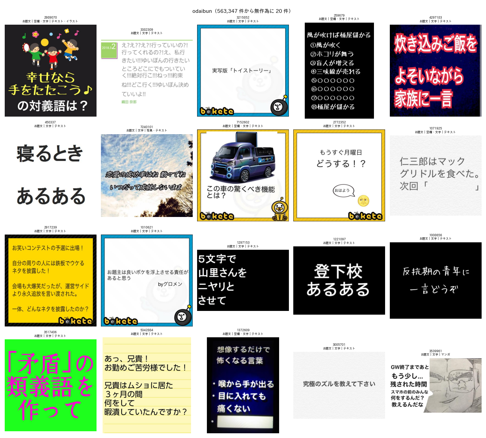
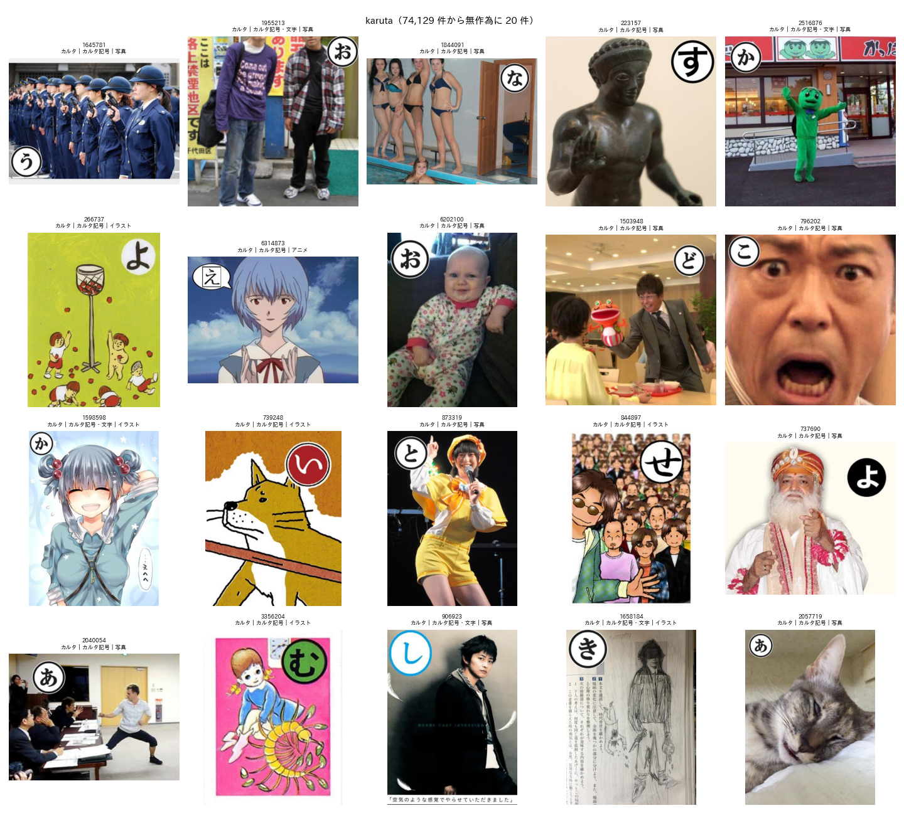
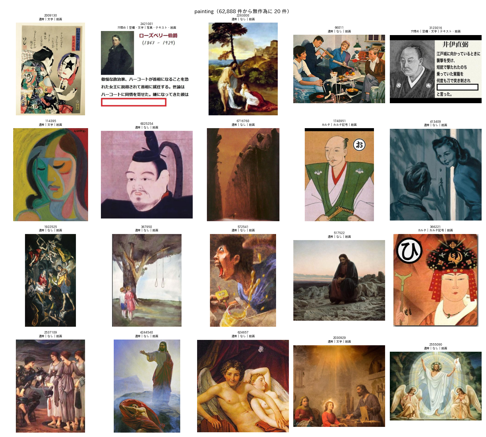
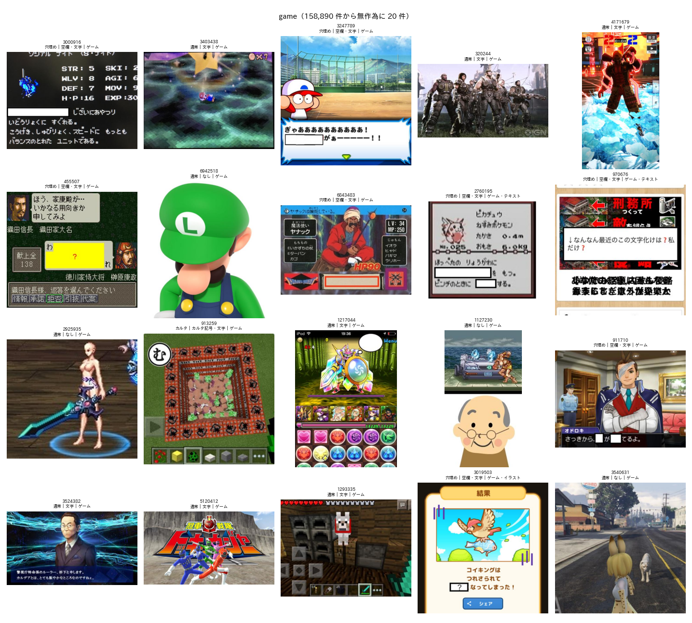

# BoketeDBv5 のお題画像のアノテーションの実施

## 1. 概要

report_013 の最終版の方法を，独立したパッケージ `Bokete_Annotation_programs_v5.0/` として実装した．このパッケージで，BoketeDBv4 の全てのお題画像（6,823,270件）にアノテーションした．

- **パッケージ：** 研究用のプログラム（`programs/`）には依存しない．このディレクトリだけで，セットアップから実行，結果の確認までできる．README.md，前提データと出力の形式，ラベルの定義，方法と精度の説明，テストを含む．
- **研究用の版との一致：** 無作為の2万枚で，研究用の版（ex009 の `annotate_all.py`）の結果と比べた．全てのラベル，確率，確認の質問の回答が一致した．
- **全データの結果：**
  - 保存先：`Bokete_Annotation_programs_v5.0/outputs/BoketeDBv5_annotation/`
  - 処理時間：予測 約10.2時間（180枚/秒），確認の質問 約4.8時間（32枚/秒）
  - 確認の質問：55万1,260枚に行い，3,998枚をお題文から外した．
- **目視の確認：** ラベルごとに無作為の20枚を確認した．
  - カルタは20枚とも正しかった．
  - お題文は20枚中19枚が正しかった．

## 2. パッケージの構成

表1に，パッケージの構成を示す．

表1 `Bokete_Annotation_programs_v5.0/` の構成．

| パス | 内容 |
| :--- | :--- |
| `README.md` | 概要，動作環境，セットアップの流れ，前提データ，実行方法，出力，注意 |
| `docs/label_definition.md` | ラベルの定義（定義書 v4 と補足）．出力の列名との対応を付録に記す |
| `docs/data_format.md` | 前提データ（BoketeDBv4 の `image` の表，お題画像）と出力の形式 |
| `docs/method.md` | 方法，生徒の学習，精度，処理時間 |
| `annotate.py` | 実行のエントリーポイント |
| `config.json` | 構成（モデルの重み，確認の質問，読み込みのプロセス数） |
| `bokete_annotation/` | 本体．`labels.py`，`data.py`，`models.py`，`verify.py`，`postprocess.py`，`pipeline.py` |
| `models/` | 重み（4ファイル，約390MB）．Git の管理外とし，`README.md` に配布の方法を，`checksums.sha256` に SHA-256 を記録した |
| `scripts/check_models.py` | 重みのチェックサムの確認 |
| `scripts/quality_check.py` | ラベルごとに無作為の画像の一覧を作る（目視の確認用） |
| `tests/test_postprocess.py` | 後処理のテスト（pytest，3件とも成功） |
| `outputs/` | アノテーションの結果（Git の管理外） |

GitHub への公開に向けて，次の点に配慮した．

- **重みと出力：** 重み（最大372MB）と出力は，GitHub のファイルの容量の制限を超える．このため `.gitignore` で管理から外した．重みは GitHub Releases などで配布し，チェックサムで確かめる手順を書いた．
- **環境に依存する情報：** パス，トークン，個人の情報は含めていない．データの場所はコマンドライン引数で指定する．
- **依存ライブラリ：** `requirements.txt` は，動作を確認した版で固定した．`uv pip compile` で依存関係を解決できることも確かめた．
- **親のリポジトリ：** 親のリポジトリの `.gitignore` に，このディレクトリを加えた．

## 3. 研究用の版との一致の確認

ex009 の `annotate_all.py` と同じ無作為の2万枚（同じシード）で，両者の出力を比べた．

| 項目 | 結果 |
| :--- | :--- |
| お題IDの一覧 | 一致（2万件） |
| 形式，属性3項目，媒体7項目 | 全件一致 |
| 確率（14列） | 最大の差 0.0 |
| 確認の質問の対象と回答 | 全件一致（お題文から外したのは両者とも9枚） |

全データの実行の途中で，画像の読み込みの方法を変えた（4章）．変えた後の方法についても，次の2つを確かめた．

- 同じ2万枚で，確率が一致した（最大の差 0.0）．
- 保存の単位（シャード）の境界をまたぐ処理でも，確率と埋め込みが一致した．

全データの結果は，2万枚の試行の結果と，同じ画像で全て一致した．

## 4. 全データの実行

全データの実行では，画像の読み込みのプロセスによるメモリ不足が2回起きた．このマシンでは，別のプロセス（VS Code のサーバー）が約45GBのメモリを使っていた．次のように直した．

1. **1回目：** 読み込みのプロセスを fork で起動していたため，親のプロセスの大きな表が，書き込み時の複製でプロセスごとに増えた．
   - spawn で起動するように変えた．
   - spawn は起動に数分かかる．このため，全てのシャードで1つのデータローダーを用いる形にした．
2. **2回目：** 読み込みのプロセスが24個では，空きのメモリが7GBまで減った．16個に減らすと，空きは約25GBで安定した．

この経過は README.md の動作環境（メモリ64GB以上．読み込みのプロセス数16で約55GB）に反映した．中断した分は，保存済みのシャードから再開した．

表2に，全データの処理の記録を示す．

表2 全データの処理の記録（RTX PRO 6000 Blackwell）．

| 段階 | 対象 | 速度 | 時間 |
| :--- | :--- | :---: | :---: |
| list | 6,823,270件（内容が同じ画像をまとめて6,609,511枚） | — | 数分 |
| predict | 6,609,511枚 | 180枚/秒 | 約10.2時間 |
| verify | 551,260枚（8.3%） | 32枚/秒 | 約4.8時間 |
| finalize | 6,823,270件 | — | 数分 |

確認の質問の速度は，2万枚での見積もり（約23枚/秒）より速かった．一度に推論する枚数が多いためである．

出力の大きさは次のとおりである．

| 出力 | 大きさ |
| :--- | :---: |
| `annotation.parquet` | 584MB |
| 埋め込み | 15GB |
| 確率 | 328MB |

## 5. 結果

### 5.1 ラベルの分布

表3に，全データのラベルの割合を示す．

表3 全データ（6,823,270件）のラベルの割合．

| 形式 | 件数 | 割合 |
| :--- | ---: | ---: |
| カルタ | 74,129 | 1.1% |
| 穴埋め | 1,369,160 | 20.1% |
| お題文 | 563,347 | 8.3% |
| 通常 | 4,816,634 | 70.6% |

| 属性・媒体 | 件数 | 割合 |
| :--- | ---: | ---: |
| 空欄あり | 1,460,006 | 21.4% |
| カルタ記号あり | 74,756 | 1.1% |
| 文字あり | 3,995,840 | 58.6% |
| 写真 | 3,624,512 | 53.1% |
| アニメ | 618,613 | 9.1% |
| ゲーム | 158,890 | 2.3% |
| マンガ | 1,039,983 | 15.2% |
| テキストグラフィック | 988,116 | 14.5% |
| 絵画 | 62,888 | 0.9% |
| イラスト | 761,477 | 11.2% |

その他の集計は次のとおりである．

- 媒体を2つ以上付けた画像：6.0%
- 確認の質問の対象：8.3%
- 確認の質問でお題文から外した画像：3,998件（全体の0.06%）

出力の整合も確かめた．

- 全てのお題に1行があり，欠損はない．
- 全ての画像に1つ以上の媒体がある．
- 埋め込みは，内容が同じ画像をまとめた6,609,511枚の全てにある．

### 5.2 目視の確認

`scripts/quality_check.py` で，各ラベルについて無作為に20枚を抽出した一覧を作り，目視で確かめた（図1〜4）．

| ラベル | 20枚中の正しい枚数 | 誤りの内容 |
| :--- | :---: | :--- |
| カルタ | 20 | なし |
| お題文 | 19 | 「次回「　」」の空欄を含む画像を，穴埋めではなくお題文とした（1枚） |
| ゲーム | 約18 | ゲームの画面かどうか判断の難しい合成画像 |
| 絵画 | 約17 | 古い雑誌の広告風のイラストを絵画とした |

いずれも report_013 で報告した精度（お題文の F1 0.87，絵画は少ない区分の評価用データで 0.84）と整合する．

絵画の割合（0.9%）は，ex007 の生徒による推定（0.4%）より高い．一覧には，宗教画や肖像画などの正しい例に加えて，古いイラストも含まれる．絵画を厳密に使う場合は，確率の列 `p_painting` のしきい値を上げることを勧める．

## 6. 今後の課題

1. 重みと出力の配布の方法を決める．重みは GitHub Releases，出力は大容量の保存先を想定している．
2. 公開前にライセンスと引用の方法を決める．README.md には，まだ記していない．
3. 「文字あり」の画像について，ボケの文章を見て，文字が大喜利に影響しているかを判断する後段の処理を作る（定義書 v4）．
