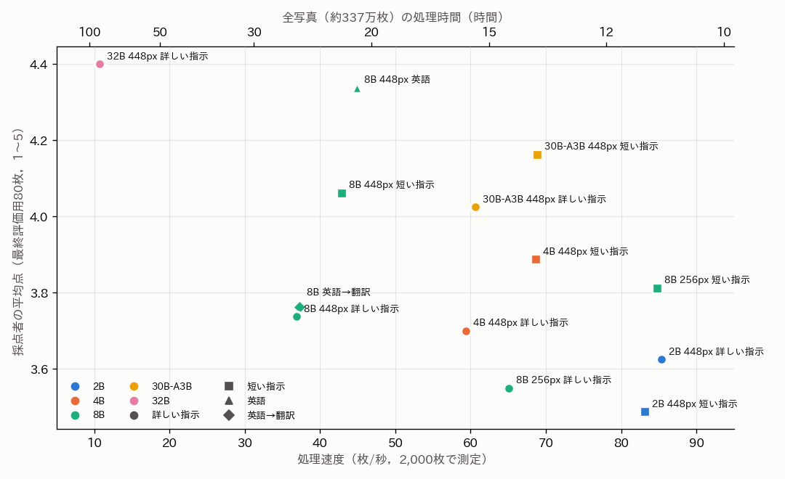
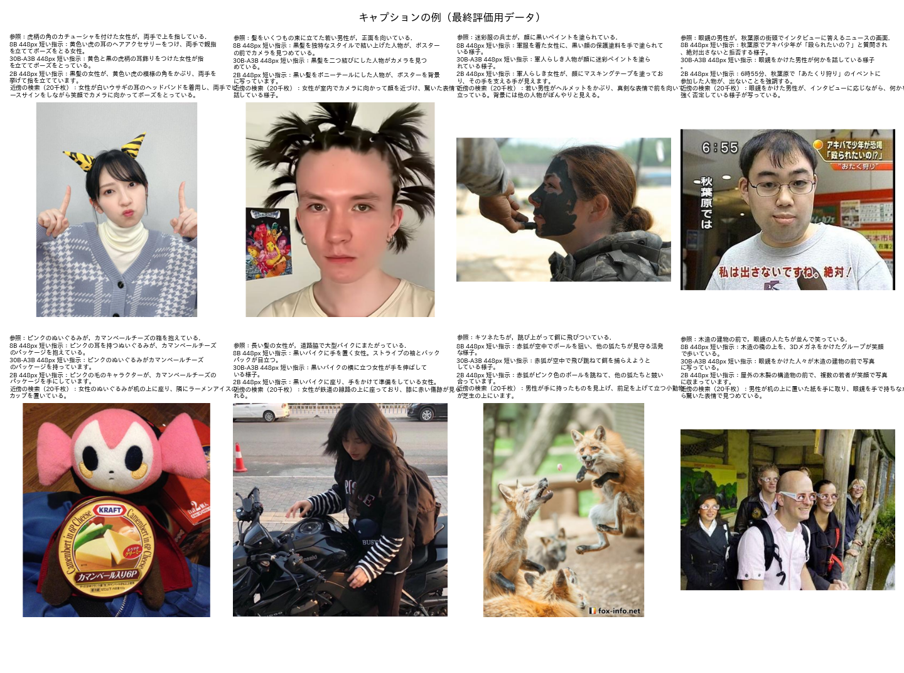
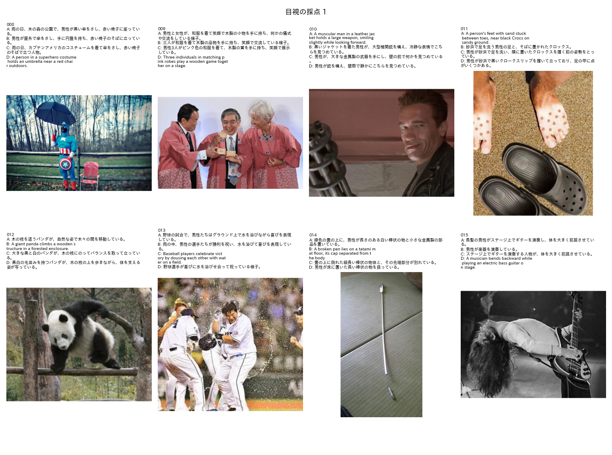

# 写真のお題画像のキャプションの生成方法の比較（試作）

## 1. 概要

BoketeDBv5 のアノテーションで媒体が写真のみのお題画像は，3,371,140枚ある（内容が同じ画像は1枚と数える）．これらに，画像の概要が分かる程度の粒度のキャプションを付ける方法を比べた．キャプションは日本語の1文（30字程度）とした．

比べた方法は次の3系統，計16通りである．

- **VLM での直接の生成（13通り）：** Qwen3-VL の5つの大きさ（2B，4B，8B，30B-A3B，32B），入力の解像度（448画素，256画素），指示の書き方（詳しい指示，短い指示，英語）を組み合わせた．
- **英語で生成してから日本語に翻訳（1通り）**
- **近傍の検索（2通り）：** キャプションを付けた画像から，埋め込みが最も似た画像のキャプションを流用する．

精度は，評価用データの120枚で測った．120枚は写真から無作為に抽出し，Claude Code が参照キャプションを付けた．採点は Qwen3-VL-32B が行い，その一部（160件）を Claude Code の目視の採点と比べて確かめた．

主な結果は次のとおりである．

- **日本語のキャプションでは，Qwen3-VL-30B-A3B に短い指示を与える方法が最も良い．**
  - 速度：約69枚/秒（全写真で約14時間）
  - 精度：採点者の平均点 4.16（5点満点），十分な概要（4点以上）の割合 86%
  - 8B に同じ短い指示を与える方法（4.06，約22時間）と精度はほぼ同じで，速度は約1.6倍である．
- **詳しく指示すると誤りが増える．**「誰・何が，どこで，何をしているかを中心に」と指示すると，VLM が場所や行為を推測して書く．
  - 8B での誤りを含む割合：短い指示 15%，詳しい指示 25%
  - 4B，30B-A3B，8B の256画素でも，短い指示の方が良かった．2B だけは逆であった．
- **大きいモデルは精度が高いが遅い．** 32B は 4.40 と最も高いが，約11枚/秒（全写真で約87時間）である．
- **英語で生成すると採点は高い．** 8B の英語のキャプションは 4.34（約21時間）であった．ただし，同じ内容を日本語に訳すと 3.76 に下がった．訳は正確であったため，採点者が英語の文に甘いと考えられる（3.3節）．英語のキャプションの真の精度は，日本語の短い指示と同程度と見るのが妥当である．
- **近傍の検索は使えない．** 2万枚から流用しても平均 1.39 であった．ボケての写真は多様であり，最も似た画像でも内容が異なる．

## 2. 方法

### 2.1 対象と評価用データ

| 項目 | 内容 |
| :--- | :--- |
| 対象 | `Bokete_Annotation_programs_v5.0/outputs/BoketeDBv5_annotation/annotation.parquet`（読み込みのみ）で，媒体が写真のみ，かつ代表の画像（sha256 の重複を除いたもの）．3,371,140枚 |
| 評価用データ | 対象から無作為に抽出した120枚．調整用（dev）40枚，最終評価用（test）80枚 |
| 参照キャプション | Claude Code が目視で付けた日本語の1文（`programs/ex010_photo_caption/reference_captions.txt`）．人名と画像中の文字の内容は書かない |
| 速度の測定用データ | 評価用データ以外の無作為の2,000枚 |

写真には，テレビの画面，映画の場面，ポスター，像やフィギュア，合成写真が多く含まれる（図2）．

### 2.2 比べた方法

VLM での生成は，vLLM で行った．設定は，温度0，1枚に1回，2,048枚ずつの一括推論である．指示文は次の3種類である．

- **詳しい指示：**「この写真の概要を，日本語の1文（30〜60字）で説明してください．誰・何が，どこで，何をしているかを中心に書き，細部の描写や推測は省いてください．人物の名前や画像中の文字の内容は書かず…」
- **短い指示：**「この写真の内容を，日本語で30字程度の1文で簡潔に説明してください．人物の名前は書かないでください．」
- **英語：** 英語で10〜20語の1文を求める指示

表1 比べた方法．

| 方法 | モデル | 入力 | 指示 |
| :--- | :--- | :---: | :--- |
| 8B 詳しい指示 | Qwen3-VL-8B-Instruct | 448×448 | 詳しい指示 |
| 8B 短い指示 | 同上 | 448×448 | 短い指示 |
| 8B 256画素 | 同上 | 256×256 | 詳しい指示／短い指示 |
| 8B 英語 | 同上 | 448×448 | 英語 |
| 8B 英語→翻訳 | 同上 | 448×448 | 英語で生成し，同じモデルで日本語に訳す（文章のみの入力） |
| 2B，4B | Qwen3-VL-2B／4B-Instruct | 448×448 | 詳しい指示／短い指示 |
| 30B-A3B | Qwen3-VL-30B-A3B-Instruct（FP8．1トークンあたり約30億のパラメータのみを使う MoE） | 448×448 | 詳しい指示／短い指示 |
| 32B | Qwen3-VL-32B-Instruct（FP8） | 448×448 | 詳しい指示 |
| 近傍の検索 | 下記 | — | — |

近傍の検索は次の手順で行った．

1. 写真から無作為に抽出した2万枚に，8B（詳しい指示）でキャプションを付けておく．
2. 評価用データの各画像について，SigLIP2-so400m の埋め込みのコサイン類似度が最大の画像を2万枚から探す．埋め込みは v5.0 のアノテーションで保存済みのものを使う．
3. その画像のキャプションを流用する．

キャプションを付けておく画像は，1千枚，5千枚，2万枚の3通りを試した．

### 2.3 精度の測り方

**採点者：** Qwen3-VL-32B（FP8）に，画像，参照キャプション，候補のキャプションを与えて採点させた．出力は次の4項目である．

- 主な被写体が正しいか
- 場所・行為が正しいか
- 画像にない内容や誤りを含むか
- 総合点（1〜5）：5＝誤りがなく十分な概要，4＝正しいが重要な要素が欠けるか小さな誤りがある，3＝一部が正しい，2＝ほぼ誤り，1＝無関係

参照キャプションそのものも採点させ，全て5点になることを確かめた．

**採点者の確認：** 最終評価用データの40枚について，4つの方法のキャプションを Claude Code が目視で採点した．採点の基準は採点者と同じとし，どの方法のキャプションかは伏せた（図3）．

**速度：** 速度の測定用データ2,000枚での，推論の1秒あたりの枚数である．画像の読み込みは含まない．全写真の処理時間は，この値から換算した．

## 3. 結果

### 3.1 速度と精度

図1と表2に，結果を示す．

表2 各方法の速度と精度．精度は最終評価用データ（80枚）での採点者の値．括弧内は平均点の標準誤差．

| 方法 | 速度（枚/秒） | 全写真の時間 | 平均の字数 | 平均点 | 4点以上 | 誤りを含む | 調整用の平均点 |
| :--- | ---: | ---: | ---: | :---: | ---: | ---: | :---: |
| 32B 詳しい指示 | 10.7 | 87時間 | 49 | **4.40**（0.09） | 93% | 7% | 4.25 |
| 8B 英語 | 44.9 | 21時間 | 81（英字） | 4.34（0.10） | 90% | 10% | 4.45 |
| **30B-A3B 短い指示** | **68.8** | **14時間** | 26 | **4.16**（0.10） | 86% | 12% | 3.88 |
| 8B 短い指示 | 42.9 | 22時間 | 31 | 4.06（0.11） | 84% | 15% | 4.15 |
| 30B-A3B 詳しい指示 | 60.6 | 15時間 | 28 | 4.03（0.12） | 82% | 17% | 3.70 |
| 4B 短い指示 | 68.7 | 14時間 | 30 | 3.89（0.13） | 76% | 23% | 3.98 |
| 8B 256画素 短い指示 | 84.8 | 11時間 | 29 | 3.81（0.12） | 78% | 23% | 3.90 |
| 8B 英語→翻訳 | 37.2 | 25時間 | 37 | 3.76 | 76% | 24% | 3.90 |
| 8B 詳しい指示 | 36.9 | 25時間 | 35 | 3.74 | 75% | 25% | 3.50 |
| 4B 詳しい指示 | 59.3 | 16時間 | 34 | 3.70 | 71% | 29% | 3.67 |
| 2B 詳しい指示 | 85.4 | 11時間 | 40 | 3.62 | 70% | 30% | 3.40 |
| 8B 256画素 詳しい指示 | 65.1 | 14時間 | 34 | 3.55 | 66% | 34% | 3.67 |
| 2B 短い指示 | 83.2 | 11時間 | 30 | 3.49 | 65% | 35% | 3.73 |
| 近傍の検索（2万枚） | 速度は下記 | — | 36 | 1.39 | 4% | 95% | 1.45 |
| 近傍の検索（5千枚） | | | 35 | 1.36 | 4% | 96% | 1.40 |
| 近傍の検索（1千枚） | | | 35 | 1.31 | 3% | 97% | 1.32 |

近傍の検索は，検索そのものは一瞬で終わる．しかし，キャプションを付けておく画像の分だけ VLM の処理が要る．

平均点の標準誤差は約0.1である．このため，平均点の差が0.2未満の方法どうしは区別できない．調整用データ（40枚）と最終評価用データの順位も，上位の方法の間では入れ替わる．

### 3.2 指示の書き方

8B，4B，30B-A3B，8B の256画素では，短い指示の方が平均点が0.1〜0.3高く，誤りを含む割合も低かった．詳しい指示は「どこで，何をしているか」を書くよう求めるため，画像から分からない場所や行為を推測で補う．例えば，畳の上の棒だけの写真に，写っていない男性を補って「男性が床に置いた長い棒状の物を扱っている」と書く（8B 詳しい指示），立っている像を「赤い椅子に座っている」とする（2B 詳しい指示），などである．ただし，推測による誤りは短い指示でもなくなるわけではない（例えば，雨の写っていない写真に「雨の日」と書いた例は 8B の短い指示にもあった）．

2B だけは，短い指示の方が悪かった（3.62 → 3.49）．2B は短い文でも被写体を誤ることが多いためである（主な被写体の正答率：詳しい指示 89%，短い指示 84%）．

入力を256画素に下げると，8B は約2倍速くなる．しかし平均点は0.2〜0.3下がり，4B の448画素と同程度になった．

### 3.3 採点者の確からしさ

40枚 × 4方法 = 160件について，採点者の点と Claude Code の目視の点を比べた（表3）．

表3 採点者と目視の採点（最終評価用データの40枚）．

| 方法 | 目視の平均点 | 採点者の平均点 | 目視で4点以上 |
| :--- | :---: | :---: | ---: |
| 8B 英語 | 4.65 | 4.43 | 93% |
| 8B 短い指示 | 4.33 | 4.03 | 85% |
| 8B 詳しい指示 | 4.33 | 3.80 | 85% |
| 2B 詳しい指示 | 4.15 | 3.68 | 88% |

両者の一致は次のとおりである．

- 点の相関：0.57
- 点の差が±1以内の割合：91%
- 「4点以上」かどうかの一致：87%

方法の順位はほぼ一致した．ただし，次の2点に注意が要る．

- 採点者は，目視より0.2〜0.5点厳しい．
- 目視では，8B の短い指示と詳しい指示が同点であった．目視は大きな誤りに注目し，推測で補った部分を軽く扱ったためである．

英語のキャプションと，それを訳した日本語のキャプションは，内容が同じである（図2の例を参照）．それでも採点者の平均点は 4.34 と 3.76 で，0.58点の差があった．採点の指示文と参照キャプションの扱いが英語に有利に働いたと考えられる．このため，英語と日本語の方法の比較には，この偏りを差し引く必要がある．日本語の方法どうしの比較には影響しない．

### 3.4 近傍の検索

評価用データの画像と，最も似た画像の埋め込みのコサイン類似度は，平均で0.79であった（2万枚の場合）．しかし，流用したキャプションの被写体が正しかったのは25%にとどまった．キャプションを付けておく画像を1千枚から2万枚に増やしても，平均点は1.31から1.39にしか上がらなかった．

ボケての写真は，同じ人物や場面が繰り返し現れることが少ない．構図が似ていても内容が異なる画像が多いため，流用では概要を表せない．近傍の検索は，同じ画像の重複（sha256 の一致）の利用までにとどめるべきである．

### 3.5 キャプションの例

## 4. 考察と推奨

| 目的 | 推奨する方法 | 全写真の時間 | 精度（平均点） |
| :--- | :--- | :---: | :---: |
| 日本語のキャプション（推奨） | **30B-A3B 短い指示** | 約14時間 | 4.16 |
| 日本語で，より確かなもの | 8B 短い指示 | 約22時間 | 4.06 |
| 速度を最優先 | 8B 256画素 短い指示 | 約11時間 | 3.81 |
| 精度を最優先 | 32B（短い指示は未検証） | 約87時間 | 4.40 |
| 英語でよい場合 | 8B 英語 | 約21時間 | 4.34（採点者の偏りを含む） |

1. **30B-A3B に短い指示を与える方法を推奨する．**
   - MoE のため，1トークンあたりの計算は約30億のパラメータ分と少ない．このため 8B より速く，精度は 8B と同等以上である．
   - 調整用データでは 3.88 と，8B の短い指示（4.15）より低かった．最終評価用データとの差は標準誤差の範囲内である．
   - 本番に用いる前に，評価用データを増やして 8B の短い指示と比べるのが望ましい．
2. **指示は短く，推測を求めない書き方がよい．** 概要の粒度では，「どこで・何をしているか」をあえて求めない方が誤りが少ない．
3. **今後の課題：**
   - 32B に短い指示を与える条件と，30B-A3B の256画素の条件は，まだ試していない．
   - 評価用データ（120枚）は少なく，参照キャプションと目視の採点は Claude Code が1人で付けた．採点者の英語への偏りも残る．採点の指示を日本語にする，参照を複数にする，などで採点を改善できる．
   - テレビの画面やポスターの画像では，画像中の文字の内容をキャプションに含めるかを決める必要がある．今回は含めない指示とした．

なお，本試作では `Bokete_Annotation_programs_v5.0/` を編集していない．v5.0 の結果（アノテーションと埋め込み）は読み込みのみに用いた．
