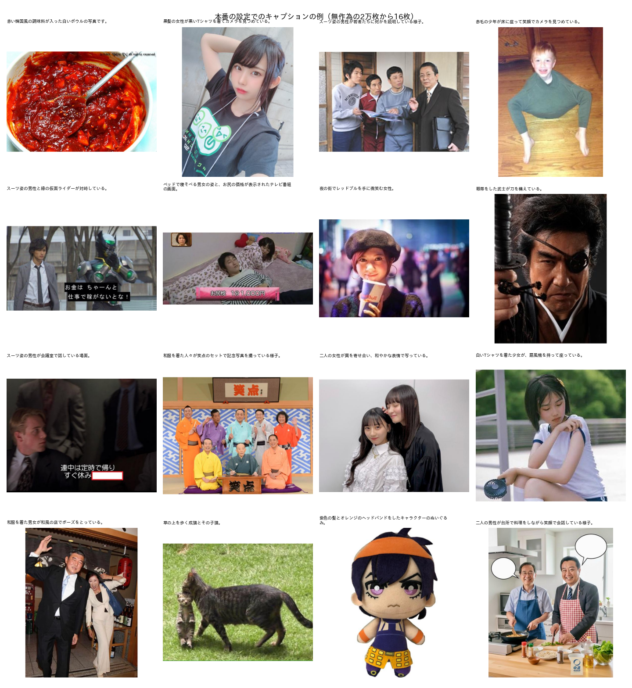

# 写真のキャプションの本番前の最終確認

## 1. 概要

写真のお題画像（3,371,140枚）のキャプションの本番に向けて，方式と本番用のプログラムを確かめた．方式は，report_015 で選んだ Qwen3-VL-30B-A3B（FP8）に短い指示を与える方法である．

本番の設定は表1のとおりとし，このまま本番に進めると判断した．

表1 本番の設定．

| 項目 | 値 |
| :--- | :--- |
| モデル | Qwen/Qwen3-VL-30B-A3B-Instruct-FP8（vLLM 0.23） |
| 入力 | 最大 448×448 画素 |
| 指示 | 「この写真の内容を，日本語で30字程度の1文で簡潔に説明してください．人物の名前は書かないでください．説明の文のみを出力してください．」 |
| 生成 | 温度0，最大64トークン |
| 再現性 | 有効（`VLLM_BATCH_INVARIANT=1`） |
| 後処理 | 句読点を「、」「。」にそろえる（元の出力も残す） |
| 処理時間（見積もり） | 約19.4時間（48.3枚/秒．画像の読み込みを含む） |

主な結果は次のとおりである．

1. **精度：** 評価用データを240枚に増やして比べ直した．30B-A3B と 8B の短い指示は同じ精度であった（平均点 4.13 と 4.12，差 0.00 ± 0.07）．30B-A3B は約1.5倍速いため，30B-A3B で確定した．入力を256画素に下げる案と，推測を禁じる指示を加える案は，いずれも精度を上げなかった．
2. **再現性：** 温度0でも，同じ画像を2回処理すると約半数（49〜52%）しか同じ文にならなかった．vLLM の再現性の設定を有効にすると，次の場合も含め100%一致した．精度は変わらず（差 −0.004 ± 0.037），速度は約2割下がった．
   - 同じ入力をもう一度処理した場合
   - 一緒に処理する画像の組み合わせが異なる場合
3. **本番用のプログラム：** 無作為の2万枚で通しで動かした．出力の異常（空，長すぎる，日本語以外，改行，途中での打ち切り）は0件であった．途中で中断して再開しても，全ての画像に1回ずつキャプションが付いた．

## 2. 精度の確認

### 2.1 評価用データの追加

report_015 の評価用データ（120枚）では，調整用（40枚）と最終評価用（80枚）で，30B-A3B と 8B の順位が入れ替わっていた．そこで，写真から無作為に120枚を追加し，参照キャプションを付けた（`programs/ex011_caption_final/reference_captions_eval2.txt`）．評価用データは計240枚である．採点は report_015 と同じく Qwen3-VL-32B で行った．

### 2.2 結果

表2 240枚での精度と速度．速度は評価用データでの推論の速度（画像の読み込みを含まない）．

| 条件 | 平均点（標準誤差） | 4点以上 | 誤りを含む | 速度 |
| :--- | :---: | ---: | ---: | :---: |
| **30B-A3B 短い指示（本番）** | **4.13**（0.06） | 87% | 13% | 約63枚/秒 |
| 30B-A3B 短い指示，再現性の設定あり | 4.12（0.06） | 86% | 13% | 約50枚/秒 |
| 8B 短い指示 | 4.12（0.06） | 85% | 14% | 約44枚/秒 |
| 30B-A3B「確実に分かることだけを書く」指示 | 4.05（0.06） | 86% | 11% | 約55枚/秒 |
| 30B-A3B 256画素 | 3.97（0.07） | 82% | 18% | 約79枚/秒 |

主な比較の結果は次のとおりである．

- **30B-A3B と 8B：** 同じ画像の対で比べると，差は 0.00 ± 0.07 で区別できない．report_015 の順位の入れ替わりは，40枚と80枚の揺らぎであった．
- **「確実に分かることだけを書く」指示：** 誤りを含む割合はやや下がった（13% → 11%）．一方，説明が簡素になり，平均点はわずかに下がった（差 −0.07 ± 0.06）．効果がはっきりしないため，採用しなかった．
- **256画素：** 約1.3倍速いが，誤りが増えた（13% → 18%）．

## 3. 再現性

`programs/ex011_caption_final/caption_all.py` で同じ2,000枚を処理し，キャプションが一致する割合を調べた（表3）．

表3 再現性．

| 比較 | 一致した割合 |
| :--- | ---: |
| 2万枚の処理の先頭2,000枚と，同じ2,000枚だけを処理した結果（画像の組み合わせが異なる） | 52% |
| 同じ2,000枚を，同じ設定で2回処理 | 49% |
| 再現性の設定あり：同じ2,000枚を2回処理 | **100%** |
| 再現性の設定あり：2万枚の処理の先頭2,000枚と，同じ2,000枚だけの処理 | **100%** |

温度0は「最も確率の高い語を選ぶ」設定である．しかし GPU の計算は，並列の足し算の順序によって結果がわずかに変わる．このため確率の近い語の選択が入れ替わり，文が変わる．30B-A3B は専門家の混合（MoE）のモデルであり，影響を受けやすい．変わった文の多くは言い換えであった．例えば，「本棚の前で机にうつぶせになる男性」が「本棚の前で頭を抱える男性」になる．

再現性の設定は，バッチの構成に依存しない計算方法を使う．この設定では，同じ画像に必ず同じ文が付く．精度は変わらず（表2），2万枚での通しの速度は 64.8 から 48.3枚/秒に下がった．全写真の処理時間は約14.5時間から約19.4時間に延びる．

本番では再現性の設定を有効にする．理由は次の2つである．

- 中断して再開しても，やり直した部分の文が変わらない．
- 同じプログラムで結果を再現できる．データベースとして公開する場合に重要である．

時間を優先する場合は，`--no_batch_invariant` で無効にできる．

## 4. 本番用のプログラムの検証

### 4.1 構成

`programs/ex011_caption_final/caption_all.py` の動作は次のとおりである．

- **対象：** v5.0 のアノテーション（`Bokete_Annotation_programs_v5.0/outputs/BoketeDBv5_annotation/annotation.parquet`．読み込みのみ）のうち，媒体が写真のみの代表の画像である．sha256 の重複は除く．
- **再開の単位：** 5万枚ごとに `parts/part_XXXX.parquet` に保存し，既にある部分は飛ばす．
- **画像の読み込み：** 次の2,048枚の読み込み（32スレッド）を推論と重ねる．
- **まとめ：** 最後に `captions.parquet` にまとめ，異常の検査と処理速度を `summary.json` に保存する．

出力の列は次のとおりである．

| 列 | 内容 |
| :--- | :--- |
| `odaiId` | 代表のお題ID |
| `caption` | 句読点をそろえた文 |
| `caption_raw` | モデルの出力そのもの |
| `n_tokens` | 出力のトークン数 |
| `finish` | 終わり方（`stop` または `length`） |

内容が同じ画像（sha256 が同じお題）には，annotation.parquet の `rep_odaiId` で結合して同じキャプションを付ける．

### 4.2 結果

表4 無作為の2万枚での検証（再現性の設定あり）．

| 項目 | 結果 |
| :--- | :--- |
| 通しの速度（読み込みを含む） | 48.3枚/秒（全写真で約19.4時間） |
| 空の文 | 0件 |
| 80字を超える文 | 0件 |
| 日本語を含まない文 | 0件 |
| 改行を含む文 | 0件 |
| 最大トークン数での打ち切り | 0件 |
| 2文以上（「。」が2つ以上） | 184件（0.9%）．例：「…話している様子。背景には太陽の絵がある。」 |
| 文字数 | 平均25字，95%点 34字 |
| 画像中の文字の引用（「」を含む） | 約2.4% |
| メモリ | 空きメモリ約69GB を保った（v5.0 の実行で問題になったメモリ不足は起きない） |

**中断と再開：** 6,000枚を2,000枚ずつの部分に分けて処理した．最初の部分を保存した直後に処理を止め，再実行した．再実行では残りの2つの部分だけを処理し，6,000枚の全てにキャプションが1回ずつ，正しい順で付いた．

図1に，本番の設定でのキャプションの例を示す．



### 4.3 気になる点

- **画像中の文字：** 短い指示では画像中の文字の引用を禁じていないため，約2.4%の文に字幕や看板の文字が入る（例：「「メロンです！」と話している」）．概要を伝えるうえでは害が小さいため，そのままとした．
- **2文以上の文：** 0.9%にとどまる．必要なら，後で最初の文だけを使える．
- **推測による誤り：** 評価用データでは13%の文に誤りがあった．宣伝の画像を「広告です」と言い切るなど，画像の種類の推測に偏りがある．
- **字の多い画像：** テレビの字幕やポスターなど字の多い画像が，写真の中に多く含まれる．これらは，画像の種類（テレビの画面，ポスター）を書くだけのキャプションになりやすい．

## 5. 本番の手順

1. 実行前に，GPU を使う他の処理がないことを確かめる（vLLM は GPU のメモリの88%を確保する）．
2. 次のコマンドで実行する（約19.4時間）．中断した場合は，同じコマンドで再開できる．

   ```bash
   nohup .venv_annotate/bin/python programs/ex011_caption_final/caption_all.py \
       --out_dir outputs/ex011_caption_final/photo_captions > outputs/ex011_caption_final/photo_captions.log 2>&1 &
   ```

3. 終了後に `summary.json` の異常の件数を確かめ，無作為の画像を目視で確かめる．

本番のプログラムを `Bokete_Annotation_programs_v5.0/` のパッケージに入れるかは未定である．今回は研究用のリポジトリで実行する想定とした．本検証では，v5.0 の結果を読み込みのみに用い，編集していない．
