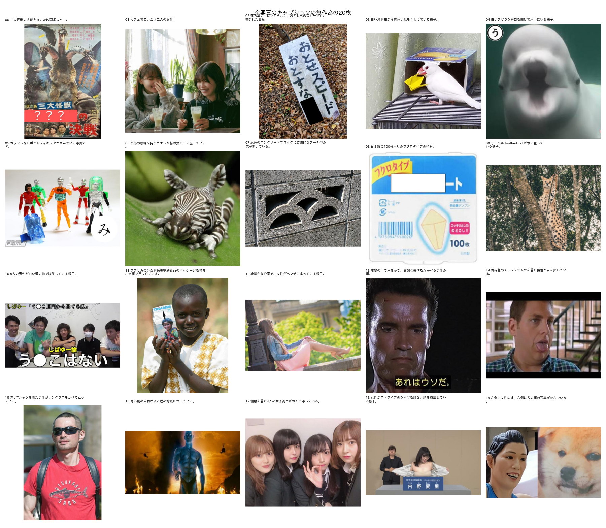

# 写真のお題画像のキャプションの実施

## 1. 概要

report_016 の本番の設定で，写真のお題画像の全てにキャプションを付けた．設定は，Qwen3-VL-30B-A3B（FP8），448画素，短い指示，温度0，再現性の設定ありである．

| 項目 | 結果 |
| :--- | :--- |
| 対象 | 媒体が写真のみの画像 3,371,140枚（内容が同じ画像は1枚と数える）．お題の数では 3,474,756件 |
| 処理時間 | 約19.1時間（10/21 15:21 〜 10/22 09:41，平均49.0枚/秒） |
| 出力 | `outputs/ex011_caption_final/photo_captions/` |
| 正常でない文 | 106件（0.003%）．列 `caption_ok` で区別できる |
| 目視の確認 | 無作為の20枚のうち，約17枚は概要として正しかった |

`Bokete_Annotation_programs_v5.0/` は読み込みのみに用い，編集していない．

## 2. 出力

| ファイル | 内容 |
| :--- | :--- |
| `captions.parquet`（137MB） | 画像（代表のお題ID）ごとの結果．列 `odaiId`，`caption`（句読点を「、」「。」にそろえた文），`caption_raw`（モデルの出力そのもの），`n_tokens`，`finish` |
| `photo_captions_by_odai.parquet`（77MB） | お題ごとの結果．列 `odaiId`，`rep_odaiId`，`caption`，`caption_ok`．内容が同じ画像のお題には同じ文が付く |
| `summary.json` | 設定，出力の検査，処理速度 |
| `postprocess.json` | 正常でない文の件数と例 |

本番用のスクリプトは `programs/ex011_caption_final/caption_all.py`，品質の目印とお題ごとへの展開は `programs/ex011_caption_final/postprocess_captions.py` である．

## 3. 出力の検査

表1 全3,371,140枚の検査．

| 項目 | 件数 | 割合 |
| :--- | ---: | ---: |
| 空の文 | 0 | 0% |
| 最大トークン数での打ち切り | 17 | 0.0005% |
| 80字を超える | 11 | 0.0003% |
| 改行を含む | 2 | 0.0001% |
| 日本語を含まない（英語の文） | 75 | 0.002% |
| 2文以上 | 30,969 | 0.9% |
| 文字数 | 平均25字，95%点 34字 | |

2万枚の試行（report_016）では，異常は0件であった．全件では，まれに次の3種類の壊れた出力が現れた．

- **同じ語の繰り返し：** 例：「…男性の手を包丁で包丁で包丁で…」．最大トークン数で打ち切られる．
- **指示文の言い直し：** 例：「アシスタントは、写真の内容を日本語で30字程度の1文で…」「はい、承知いたしました。…」
- **英語の文：** 例：「spotted fawn lying on the ground, looking directly at the camera」

再現性の設定により，同じ画像では同じ壊れた文が再び出る．このため，付け直さずに `caption_ok` を偽とした（106件）．判定の規則は次のとおりである．

- 打ち切り，80字超，改行，日本語を含まない文
- 指示文の言い直しで始まる文
- 同じ語の4回以上の繰り返し．ただし，笑い声（「はっはっはっ」）や数字（「0.000…」）など，画像中の文字の引用は除く

これらを本当に必要とする場合は，指示文か乱数の種を変えて，106枚だけを付け直せばよい．

英語の語句が日本語の文に混ざる例は，約0.04%（1,421件）あった．例：「bomber jacket を着た男性」．このうち約半数は，画像中の英語の文字の引用である（例：「「only god can judge」と書かれたステッカー」）．意味は通じるため，正常とした．

## 4. 目視の確認

図1に，お題ごとの結果から無作為に抽出した20枚を示す．

20枚のうち，約17枚は概要として正しかった．誤りは次の3件である．

| 番号 | キャプション | 誤り |
| :---: | :--- | :--- |
| 08 | 日本製の100枚入りのフクロタイプの栓材 | 実際はコーヒーのペーパーフィルターで，物の種類を誤った |
| 09 | サーベル toothed cat が木に登っている | 英語が混ざった．実際はサーバル |
| 12 | 女性がベンチに座っている | 実際は手すりにもたれている |

これは，評価用データでの精度と整合する．評価用データでは，平均点4.13，4点以上の割合87%，誤りを含む割合13%であった（report_016）．

## 5. 処理速度

全体の平均は49.0枚/秒であった．最初の15シャード（75万枚）は，1シャード（5万枚）あたり約720秒（約69枚/秒）であった．10/21 18:30以降の52シャードは，約1,040秒（約48枚/秒）に下がり，最後まで戻らなかった．

原因は特定できなかった．終了後の GPU は待機状態であり，その時点での他の処理の有無も記録していない．候補は，他のアプリケーションによる GPU の利用と，温度による動作周波数の低下である．出力の内容は，速度によらず同じである（再現性の設定のため）．

今後，同じ規模の処理を行う場合は，次の2点を勧める．

- シャードごとの GPU の使用率と周波数を記録する．
- 実行中は，GPU を使う他のアプリケーションを止める．

## 6. 今後の課題

1. キャプションを BoketeDBv5 に加えるかを決める．加える場合は，`Bokete_Annotation_programs_v5.0/` のパッケージと出力の形式に入れる．
2. `caption_ok` が偽の106枚を付け直すかを決める．
3. 写真以外の媒体（アニメ，マンガ，イラストなど）のキャプションをどうするかを決める．
