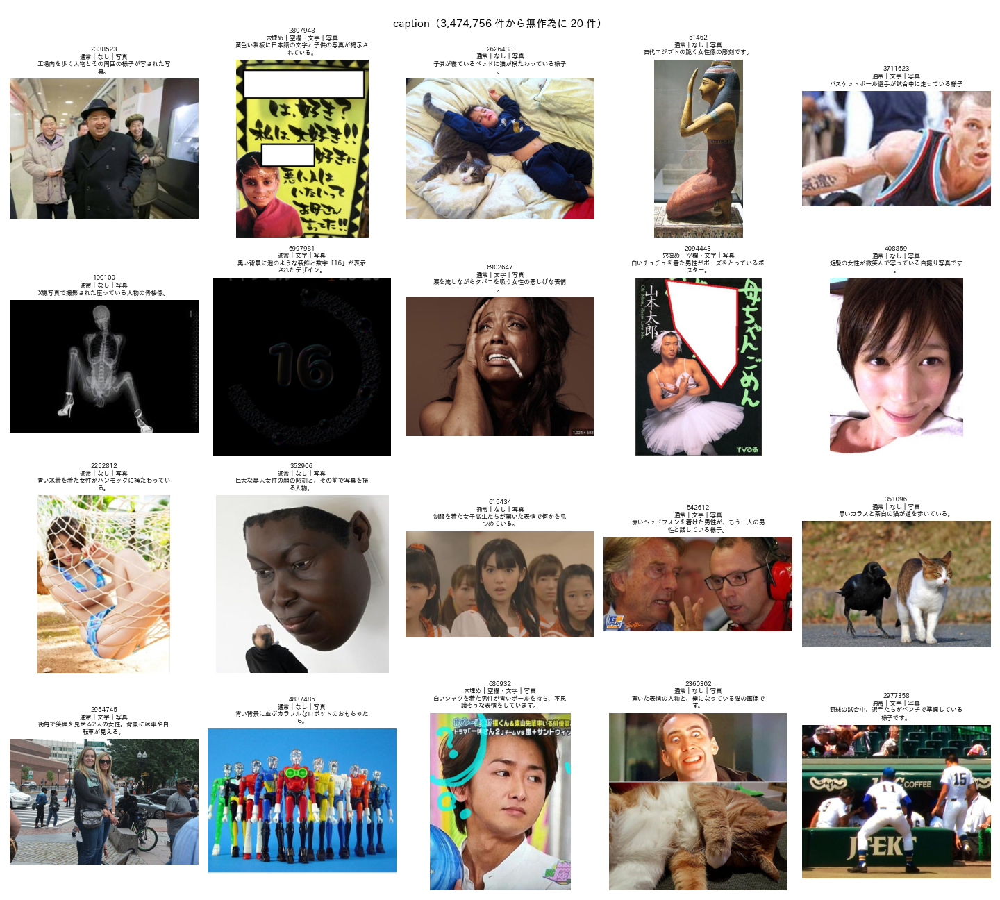

# キャプションの BoketeDBv5 への追加と，アノテーションのプログラムの修正

## 1. 概要

order_017 で付けた写真のキャプションを，BoketeDBv5 のアノテーションの出力に加えた．出力は `Bokete_Annotation_programs_v5.0/outputs/BoketeDBv5_annotation/annotation.parquet` である．

あわせて，`Bokete_Annotation_programs_v5.0/` のパッケージに，キャプションの段階（caption）を加えた．処理の流れは，list → predict → verify → finalize → caption の5段階になった．バージョンは 5.1.0 とした．

結果は次のとおりである．

- **追加した列：** `annotation.parquet` の全6,823,270件に，列 `caption` と `caption_ok` を加えた．媒体が写真のみの3,474,756件にキャプションが付く．写真以外は null である．既存のラベルの列は全て変わっていない．
- **研究用の結果との一致：** お題ごとのキャプションは，研究用のリポジトリの結果と100%一致した．
- **実装の確認：** パッケージに実装した caption の段階で約1万枚を付け直した．order_017 の結果との一致は99.8%であった．残りの0.2%（20枚）は，文末の「。」の有無などの言い換えである．

## 2. パッケージの変更点

| ファイル | 変更 |
| :--- | :--- |
| `bokete_annotation/caption.py` | 新規．キャプションの生成（Qwen3-VL-30B-A3B，vLLM，再現性の設定），句読点の正規化，壊れた出力の判定（`is_ok`） |
| `bokete_annotation/pipeline.py` | caption の段階（`stage_caption`）を追加．5万枚ごとに `caption/part_XXXX.parquet` に保存し，中断しても再開できる．`captions.parquet` を作り，`annotation.parquet` に列を加える |
| `annotate.py` | 段階に caption を追加（既定で実行する） |
| `config.json` | `caption` の設定を追加（モデル，画素数，指示，最大トークン数，温度，乱数の種，再現性の設定，有効・無効） |
| `README.md`，`docs/method.md`，`docs/data_format.md`，`models/README.md` | キャプションの方法，精度，再現性，壊れた出力，出力の列，処理時間，必要な VRAM とディスクを追記 |
| `scripts/quality_check.py` | 一覧の題にキャプションを添え，キャプションの付いた写真の一覧（`caption.png`）も作る |
| `tests/test_caption.py` | 新規．句読点の正規化と壊れた出力の判定のテスト（テストは計6件，全て成功） |
| `README.pdf` | README の変更に合わせて作り直した |

`finalize` の段階は `annotation.parquet` を作り直す．このため，`finalize` を単独で実行し直した場合は，続けて `caption` を実行すると保存済みのキャプションが再び加わる．このとき再計算はしない．この点を README に記した．

## 3. 既存の結果の移し方

全写真のキャプション（order_017）は，研究用のリポジトリで付けたものである．パッケージの caption の段階は，次の条件で同じ計算をする．

- 同じ対象（媒体が写真のみの代表の画像，昇順）
- 同じ区切り（5万枚）
- 同じ列

まず，パッケージが求める対象の3,371,140件が，研究用の対象と同じ順で一致することを確かめた．次に，68個の部分を `caption/` に複写し，caption の段階を実行した．全ての部分が既にあるため，生成は行わず，まとめと結合だけを行った．処理の記録（速度）も `speed.json` に移した．

確認の結果は次のとおりである．

| 確認 | 結果 |
| :--- | :--- |
| `annotation.parquet` の行数 | 6,823,270（変わらず） |
| キャプション以外の列 | 追加の前と完全に一致 |
| キャプションの付いたお題 | 3,474,756件（研究用の結果と100%一致） |
| `caption_ok` が偽 | 107件（106枚．うち1枚は2件のお題で使われている） |
| `annotation.parquet` の大きさ | 584MB → 655MB |

## 4. パッケージの実装の確認

動作確認用の無作為の2万枚の出力（`outputs/test_sample_20k/`）で，caption の段階を実際に動かした．対象は10,203枚で，速度は47.2枚/秒であった．

このうち9,906枚は，全データでも代表の画像であり，order_017 の結果と比べられる．99.8%が同じ文で，残りの20枚は言い換えであった（例：「…様子」と「…様子。」）．再現性の設定でも，一緒に処理する画像の組み合わせが異なると，ごく一部の文が変わる．report_016 では，同じ組み合わせの再実行で100%の一致を確かめていた．docs/method.md には「同じ入力の再実行では100%，組み合わせが異なる場合は99.8%」と記した．

図1に，キャプションの付いた写真の一覧の例を示す（`scripts/quality_check.py` の出力）．

## 5. 注意

- **公開する場合のファイル：** `outputs/` とモデルの重み（`models/*.pth`）は，引き続き Git の管理外である．GitHub に公開する場合，結果は別の方法で配布する必要がある．キャプションの追加で，`annotation.parquet` は655MB になった．
- **必要な資源：** キャプションの段階には，Qwen3-VL-30B-A3B（FP8，重み約32GB）のための GPU のメモリが必要である．README の推奨の VRAM は48GB 以上に改めた．
