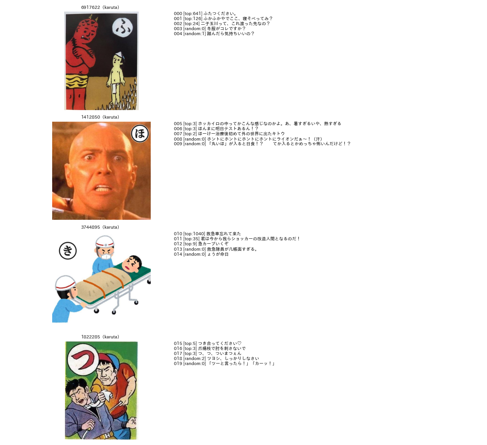
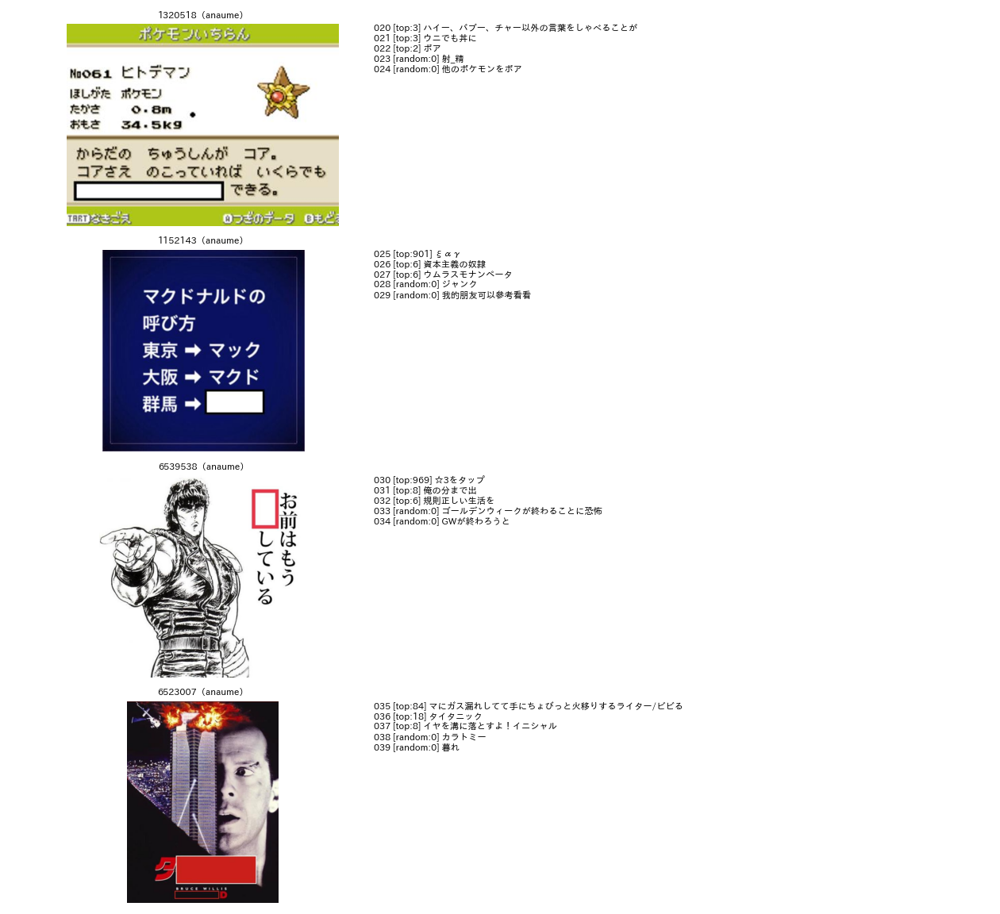

# 大喜利（ボケ）の区分の設計：実例からの検討

## 1. 概要

お題画像に投稿された大喜利（以下，ボケ）に付けるラベルを設計するため，実際のボケを画像と並べて読み，区分の候補を試した．対象は，BoketeDBv5 のお題のラベルで層別に抽出した28件のお題と，そのボケ140件である．大規模な集計には，層ごとに300件のお題のボケの全件（計約2.9万件）を用いた．

結論は次のとおりである．

1. **2種類の観点を分ける．** 依頼で挙げられた観点は，性質の異なる2種類に分かれる．
   - **お題が課す制約：** カルタのひらがなから始める，お題文に従う，画像中の文字に基づく．これらは主に**お題の形式で決まる**．ボケには「制約に従っているか」だけを付ければよく，その多くは自動で判定できる．例えば，カルタのお題では，かなで始まるボケの91%（中央値）が同じかなで始まる．
   - **ボケの内容：** 画像のオブジェクトの知識に基づくかどうか．こちらがボケ自体に付けるべき主なラベルである．
2. **ボケ自体に付けるラベルとして，次の3つを提案する．**
   - **発話の型：** セリフ，心の声，ツッコミ，状況の説明，名付け・見立て，回答の6種．
   - **必要な知識：** 見た目だけ，一般常識，画像に写る固有の対象の同定，画像の外の文化・時事の4段階．
   - **画像中の文字への依存の有無**
3. **「知識に基づく／基づかない」は4段階に分けるべきである．** 試験的な分類（140件）で，知識の要らないボケは26%にとどまった．残りは次のとおりである．
   - 一般常識：31%
   - 画像の外の文化・時事（埼玉の地理，テレビ番組，CM，歌，商品など）：31%
   - 画像に写る固有の人物・キャラクターの同定：11%

   「画像の外の知識」と「画像に写る対象の同定」は，生成でも判定でも必要な処理が異なる．このため，分けて扱うべきである．
4. **下流のタスクの前提に，3つの穴がある．**
   - **キャプションに人名がない：** order_017 のキャプションは人名を書かない設計である．このため，固有の対象を同定する必要があるボケの文脈を与えられない．
   - **穴埋めとお題文の文字がない：** 穴埋めとお題文のボケは，画像中の文の書き起こしがないと読めない（例：「ボア」「☆3をタップ」）．
   - **評価が疎らである：** 評価の件数が5件以上のボケは2〜4%しかない．評価0のボケは，面白くないボケではなく，見られていないボケである．

## 2. 方法

### 2.1 抽出

BoketeDBv5 のお題のラベルで，次の7層を作った．層ごとに，ボケが30件以上あるお題を4件ずつ無作為に抽出した．各お題から，評価（`rateSum`）の上位3件と，それ以外から無作為に2件のボケを取った（計140件．`programs/ex012_boke_scheme/sample.py`）．

| 層 | 条件 |
| :--- | :--- |
| karuta | 形式がカルタ |
| anaume | 形式が穴埋め |
| odaibun | 形式がお題文 |
| photo_text | 形式が通常，写真のみ，文字あり |
| photo_notext | 形式が通常，写真のみ，文字なし |
| anime_manga | 形式が通常，アニメかマンガを含む |
| other | 形式が通常，イラスト・ゲーム・絵画・テキストグラフィックのいずれかを含む |

お題の画像とボケを並べた一覧を作り，Claude Code が読んで区分を検討した（図1，図2）．そのうえで，提案する区分を140件に試験的に付けた（`programs/ex012_boke_scheme/pilot_labels.txt`）．

### 2.2 大規模な集計

各層から無作為に300件のお題を抽出し，そのボケの全件を集計した（`programs/ex012_boke_scheme/stats.py`）．集計した項目は，ボケの文字数，カルタの書き出しの集中度，評価の件数である．

## 3. 実例から分かったこと

### 3.1 お題の形式がボケの形を決める

| 形式 | ボケの形 | 例 |
| :--- | :--- | :--- |
| カルタ | 札のひらがなで始まる一言．多くは画像の人物のセリフ | 「ふ」の札（鬼と子ども）：「ふたつください。」「ふかふかやでここ、寝そべってみ？」 |
| 穴埋め | 空欄に入る語だけのことが多い．お題の文と合わせないと意味が分からない | 「コアさえのこっていれば いくらでも□できる」に「ウニでも丼に」（いくら丼の言葉遊び）．「お前はもう□している」に「☆3をタップ」 |
| お題文 | 問いへの回答．回答の形は問いで決まる（名前，例，質問，二択） | 「悩む二択」に「うす塩かコンソメ」．「埼玉県民がイラッとする質問」に「西武線で来たの？東武線？」 |
| 通常 | 形が自由．セリフ，心の声，ツッコミ，状況の説明，名付け・見立てが混ざる | 卓球選手が大きく反った写真に「「起立」「気を付け」「ちょ礼」」（セリフの連なり），「セルフ膝カックン！！！」（名付け） |

大規模な集計でも，形式によってボケの長さが違った．文字数の中央値は，穴埋め8，お題文10，カルタ12に対し，通常は14〜16であった．

カルタの制約はよく守られている．かなで始まるボケが5件以上あるカルタのお題（217件）で，最も多い書き出しのかなの割合は中央値0.91であった．84%のお題で0.8以上であった．試験的な分類でも，制約に従っていないボケは1件だけであった（「ょうが命日」．「きょうが」の打ち間違い）．

### 3.2 「知識」は1つの軸では足りない

「画像のオブジェクトの知識に基づくか」を試そうとすると，知識の種類で次の4つに分かれた．

| 段階 | 内容 | 例 |
| :--- | :--- | :--- |
| 0：見た目だけ | 画像の表情・姿勢・状況だけで分かる | 赤ちゃんを抱いて寝る男性に「さ〜て。夜泣き開始。」．歯をむき出しにした顔のアップに「深爪したときの親指」 |
| G：一般常識 | 言葉や常識の知識 | 「「ツーと言ったら！」「カーッ！」」．「一石二鳥」の例えに「トイレ行ったら両方出た。」 |
| E：画像に写る固有の対象の同定 | 写っている人物・キャラクター・作品が誰（何）かを知らないと分からない | 政治家の写真に「1位じゃなきゃダメな気がしてきた」（その人の有名な発言の改変）．ドラえもんのしずかちゃんのバイオリンに「バイオリン界のジャイアン」．タイガーマスクに「タイガー「てか天井低すぎ」」 |
| C：画像の外の文化・時事 | 画像に写っていない番組，歌，CM，地域，商品，事件の知識 | チンパンジーの写真に「池の水抜いたらチンパンジー出てきた」（テレビ番組）．「サザエさん最終回のタイトルとは？」に「サザエンド」．虹色のひげの男性に「ファッションモンスターが現れた」（歌の題名） |

ユーザーの挙げた「画像のオブジェクトについての知識」は，E にあたる．ただし実際には，画像に写っていない文化の知識（C）を使うボケが同じくらい多い．しかも，E と C では必要な処理が違う．

- **E：** 画像から対象を同定する必要がある（顔や作品の認識）．
- **C：** 画像の内容をきっかけに，連想する知識を引き出す必要がある．

### 3.3 発話の型

通常のお題のボケは，「誰の視点の，どんな言葉か」で次の6種に分けられた．

| 型 | 内容 | 例 |
| :--- | :--- | :--- |
| S：セリフ | 画像内の人物・動物・物が話す言葉 | 「署長、こいつ下は隠さないのに顔は隠すんです。」 |
| M：心の声 | 画像内の人物の考え | 「男「どの秘密がバレたんだろう・・・」」 |
| T：ツッコミ・呼びかけ | 画像を見る側の感想や，画像の人物への呼びかけ | 「救急隊員が几帳面すぎる。」「ひ、左利きのヴァイオリニスト」 |
| N：状況の説明・物語 | 画像の前後の出来事や状況を作る | 「自宅でよさこいの練習をしていたらタンスの角に小指をぶつけた」 |
| L：名付け・見立て・題名 | 画像全体に名前を付ける．別の物に例える．「〜の時の俺」 | 「異常な反応をしたリトマス紙」「パステルのなめらかプリンを初めて食った時の俺」 |
| A：回答 | お題文の問いや空欄への答え | 「サザエンド」「タイタニック」 |

### 3.4 ボケからお題のラベルの誤りが分かる

形式が「通常」とされたお題（753523）のボケが，全て1語であった（「クラウン」「ジャンプ」「コロコロコミック」）．画像を見直すと，縦書きの文「いつかは□から卒業しようと思ってます」に空欄があり，実際は穴埋めであった．ボケの長さや型の分布から，お題の形式のラベルの誤りを見つけられる．

### 3.5 品質に関わるもの

140件のうち，次のものが見つかった．

| 種類 | 件数 | 例 |
| :--- | ---: | :--- |
| 性的・不適切 | 7件（5%） | — |
| 無関係な宣伝 | 1件 | 中国語の宣伝文 |
| 制約違反 | 1件 | 「ょうが命日」 |

サイトのメタデータは，これらの区別に使えない．

- **`unsafe`：** ボケの表の一部（約1,500万件）で集計すると，0.03%にしか付いていない．試験的な分類で見つかった性的なボケの大半は，付いていなかった．
- **`category`：** 同じ集計で89%が既定値の「バカ」であり，笑いの種類のラベルとしては使えない．

## 4. 試験的な分類の結果

表1に，140件に付けたラベルの集計を示す（`outputs/ex012_boke_scheme/stats.json`）．

表1 試験的な分類（140件）の区分ごとの件数．

| 層 | 発話の型 | 必要な知識（0／G／E／C） | 画像中の文字に依存 |
| :--- | :--- | :---: | :---: |
| カルタ（20） | S 16，M 2，L 1，T 1 | 13／5／0／2 | 1 |
| 穴埋め（20） | A 20 | 2／10／0／8 | 19 |
| お題文（20） | A 20 | 0／6／0／14 | 20 |
| 写真・文字あり（20） | L 5，N 5，A 5，S 4，T 1 | 3／10／0／7 | 5（全て形式の誤りのお題） |
| 写真・文字なし（20） | S 6，N 5，M 5，L 3，T 1 | 7／3／4／6 | 0 |
| アニメ・マンガ（20） | S 13，L 6，T 1 | 4／6／7／3 | 5 |
| その他（20） | S 13，L 4，N 2，M 1 | 8／4／5／3 | 0 |
| **計（140）** | S 52，A 45，L 19，N 12，M 8，T 4 | 37／44／16／43 | 50 |

主な傾向は次のとおりである．

- **画像中の文字への依存は，ほぼ形式で決まる．** 穴埋めとお題文ではほぼ全てが依存する．通常のお題で依存したのは，形式の誤りの1件のお題と，マンガの文字を使ったボケだけであった（「わ…わからない 消えてゆく」に「ぷよぷよ初心者」）．
- **固有の対象の同定（E）は，人物の写真やアニメ・マンガに集中する．** カルタ，穴埋め，お題文では0件であった．
- **評価の上位ほど知識を使う傾向がある．** 知識の要らないボケ（0）の割合は，評価の上位84件で21%，無作為の56件で34%であった．固有の対象の同定（E）は，それぞれ13%と9%であった．ただし件数が少ないため，傾向にとどまる．

## 5. 提案する区分

ラベルを，決まり方で4つの層に分ける．

表2 提案する区分．

| 層 | ラベル | 決め方 | 主な用途 |
| :--- | :--- | :--- | :--- |
| 1. お題から継承 | お題の形式・属性・媒体・キャプション | BoketeDBv5 のアノテーション（付与済み） | 生成の条件，判定の層別 |
| 2. 規則で自動判定 | **制約の順守**：カルタは先頭のかなが札のかなと一致するか（読みの変換を含む）．穴埋めは空欄の語のみか全文か．文字数 | 規則（カルタの札のかなは，ボケの書き出しの最頻値か VLM の読み取り） | 生成の学習データの絞り込み，判定の足切り |
| 3. VLM・LLM で付与（主な提案） | **発話の型**（6種），**必要な知識**（0／G／E／C），**画像中の文字への依存**（はい／いいえ） | 画像とボケ，お題のラベルを与えて問う．試験的なラベルで精度を確かめる | 生成の条件付け，判定の誤りの分析 |
| 4. 必要なら付与 | 笑いの手法（見立て，言葉遊び，パロディ・引用，状況の創作，裏切り）．不適切さ（性的，差別） | VLM・LLM（主観的で一致しにくいため，中核にはしない．不適切さはサイトの `unsafe` では足りない） | 生成の多様性の制御，安全性の除外 |

### 5.1 大喜利の生成への意味

- **条件付けの単位：** お題の形式で，出力の形と制約が決まる（3.1節）．形式ごとに生成を分けるか，形式を条件として与える．通常のお題では，発話の型を条件にすると，セリフや名付けなどを狙って生成できる．
- **必要な入力：**
  - E（固有の対象の同定）のボケを生成するには，画像に写る対象の名前が要る．order_017 のキャプションは人名を書かない設計のため，これを与えられない．
  - 穴埋めとお題文のボケを生成するには，お題の文の書き起こし（空欄の位置を含む）が要る．現在のキャプションは，画像中の文字の内容を書かない指示である．
  - このため，**お題の画像中の文字の書き起こし**を，お題の新しいアノテーションとして加えることを勧める．
- **学習データの絞り込み：** 制約違反，無関係，不適切なボケを除く．知識の段階ごとに分けておくと，知識に頼らない（画像だけで成り立つ）ボケの生成を学習・評価できる．

### 5.2 大喜利の判定への意味

- **妥当性と面白さを分ける：** 制約の順守と無関係さは，規則や分類器で判定できる．これらの妥当性と，面白さの判定を分けて評価する．
- **評価の扱い：** 評価の件数が5件以上のボケは，層によらず2〜4%しかない（中央値は0件）．このため，評価0を「面白くない」とみなしてはいけない．評価は，閲覧の機会（投稿の時刻，お題の人気）を考慮し，同じお題の中での順位として扱うべきである．BoketeDBv4 には，投稿後24時間・72時間の評価の件数（`calcRateCount24h` など）がある．これを用いると，見られた量をそろえて比べられる．
- **知識の段階で分けて報告する：** E や C のボケは，判定するモデルが知識を持たないと面白さを判断できない．判定の精度を知識の段階ごとに報告すれば，知識不足による誤りと，ユーモアの理解の誤りを区別できる．

## 6. 今後の進め方

1. **定義書の作成：** 本稿の区分（発話の型，必要な知識，画像中の文字への依存，制約の順守）の定義書を作る．目視で数百件のボケにラベルを付け，判断の一致度を確かめる．今回の140件は1人の試験的なラベルである．
2. **お題の文字の書き起こし：** 穴埋めとお題文のお題の画像中の文字を書き起こし（空欄の位置を含む），お題のアノテーションに加える．
3. **自動判定とラベル付け：** 制約の順守を規則で自動判定する．発話の型と知識は，お題のアノテーションと同じく，VLM の教師と生徒の蒸留で付けられるかを確かめる．ボケは約9,250万件ある．このため，全件に VLM を適用するのは現実的でない．
