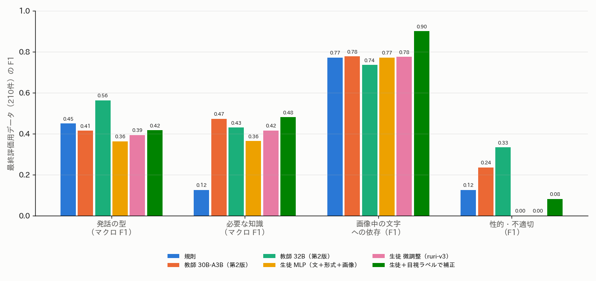

# 大喜利（ボケ）のラベルの定義書，検証データ，自動判定の方法の比較

## 1. 概要

report_019 の区分をもとに，ボケのラベルの定義書 第1版を作った．定義書に従い，層別に抽出したボケ420件に目視でラベルを付けて，検証データとした．そのうえで，ボケ約9,250万件に適用することを想定し，自動判定の方法を比べた．

比べた方法は次の5系統である．

- **規則**
- **VLM の教師：** Qwen3-VL の3つの大きさと，指示の2つの版
- **教師から蒸留した生徒：** 文と画像の埋め込みに対する MLP，ロジスティック回帰，文の分類器の微調整
- **目視のラベルだけで学習した分類器**
- **生徒の出力を目視のラベルで補正する方法**

結論は次のとおりである．項目によって，今すぐ自動化できるものと，まだできないものがはっきり分かれた．

表1 項目ごとの結論（最終評価用データ210件）．

| 項目 | 推奨する方法 | 精度 | 9,250万件の処理 | 判断 |
| :--- | :--- | :--- | :---: | :--- |
| 制約の順守（カルタ） | 規則：書き出しのかなとお題の札のかな（ボケの書き出しの最頻値）の一致 | カルタ・穴埋め・お題文のボケ90件で，正解率0.97 | 約1時間 | すぐ使える |
| 画像中の文字への依存 | 生徒の出力を目視のラベルで補正 | F1 0.90 | 約3〜6時間 | 使える |
| 発話の型 | 規則（回答・セリフ）．細かい型は教師 32B のみ | 規則：正解率0.69，マクロ F1 0.45．教師 32B：0.68，0.56 | 規則：約1時間．教師：約250日 | 回答とセリフ以外は未達 |
| 必要な知識 | 生徒の出力を目視のラベルで補正 | 正解率0.51，マクロ F1 0.48 | 約3〜6時間 | 未達（画像外の知識のみ F1 0.6） |
| 性的・不適切 | なし（全ての方法で再現率0.27以下） | 最良でも F1 0.33 | — | 未達．専用のデータが必要 |

主な発見は次のとおりである．

- **教師の偏り：** VLM の教師は，次の偏りを系統的に持っていた．蒸留した生徒は，この偏りを受け継ぐ．
  - ツッコミの過剰：学習用のボケの48%をツッコミとした．
  - 一般的な語を固有の対象とする．
  - 不適切さ（性的なほのめかし）の見落とし：学習用での陽性率は0.9%．検証データでは6%である．
- **目視のラベルによる補正が最も効いた：** 少量の目視のラベル（210件）で生徒の出力を補正すると，知識と画像中の文字の精度が教師と同等以上になった．
- **検証データの信頼性：** ラベルは1人（Claude Code）が付けたものである．判断の一致度はまだ測れていない．

## 2. 定義書と同定の意味

### 2.1 「同定」の意味（ご質問への回答）

report_019 の「画像に写る固有の対象の同定」は，対象の名前を出力することではない．「写っている特定の対象が何かを知っていないと，ボケが理解できない」ことを指していた．

ご提案に従い，必要な知識を次の4段階に改めた．固有名詞を言い当てられるかはモデルに依存するため，名前を言えるかではなく，必要な情報の種類で判断する．

| 段階 | 内容 |
| :--- | :--- |
| 0 | 見た目だけで分かる |
| G | 一般常識 |
| I | 画像中のオブジェクトの情報が必要 |
| O | 画像外のオブジェクト・事象の情報が必要 |

### 2.2 定義書 第1版

定義書は `programs/label_guideline/boke_label_definition_v1.md` に置いた．項目は次の5つである．

1. **制約の順守：** カルタ・穴埋め・お題文．通常のお題は対象外．
2. **発話の型：** セリフ，心の声，ツッコミ・呼びかけ，状況の説明・物語，名付け・見立て，回答の6種．
3. **必要な知識：** 上の4段階．画像中の文字で名指しされた対象（お題文の「サザエさん」「埼玉県民」など）も，画像中のオブジェクトとする．
4. **画像中の文字への依存**
5. **性的・不適切：** 性的な内容（ほのめかしを含む），差別や侮辱，実在の人物への重大な中傷，暴力や犯罪の助長．

## 3. 検証データ

### 3.1 作り方

report_019 と同じ7層から，お題8件ずつを追加で抽出した．各お題について，評価の上位3件と無作為の2件のボケを取り，280件とした．report_019 の140件と合わせて420件である（お題84件）．

画像と並べて読み，定義書に従ってラベルを付けた（`programs/ex013_boke_labels/eval_labels.txt`）．お題の単位で，層ごとに半数ずつ調整用（dev，210件）と最終評価用（test，210件）に分けた．方法の改良と選択には調整用だけを使った．

表2 検証データのラベルの分布（420件）．

| 項目 | 分布 |
| :--- | :--- |
| 制約の順守 | 順守 176，違反 4，対象外（通常）240 |
| 発話の型 | セリフ 160，回答 140，名付け・見立て 44，状況の説明 36，心の声 28，ツッコミ 12 |
| 必要な知識 | 一般常識 159，画像外 105，見た目だけ 103，画像中のオブジェクト 53 |
| 画像中の文字への依存 | あり 165 |
| 性的・不適切 | あり 27（6.4%） |
| お題の形式の誤り | 20件（お題4件．実際は穴埋めかお題文） |

### 3.2 見直し（確度を上げるための手順）

VLM の教師2つ（30B-A3B と 32B の第2版）の両方が目視と異なった項目を，定義書に照らして見直した．対象は知識143件，発話の型109件，不適切19件である．

大半は，教師の系統的な偏りであった．

- 普通に話している言葉をツッコミとする．
- 「急カーブ」「つきあい」のような一般的な語を固有の対象とする．
- 露骨な性的表現を見落とす．

定義書が教師を支持した38件だけ，目視のラベルを改めた（`adjudication_log.txt`）．多くは，画像中の文字で名指しされた対象の扱いと，地名を画像外の知識とする扱いの明確化によるものであった．この明確化は定義書に追記した．

この見直しは，教師に引きずられないよう，定義書が明確に支持する場合に限った．それでも，1人の判断であることに変わりはない．

## 4. 比べた方法

| 系統 | 方法 | 内容 |
| :--- | :--- | :--- |
| 規則 | `rules.py` | カルタは書き出しのかな（漢字は pykakasi で読み，複数の読みがありうる漢字始まりは順守とみなす）と，お題の札のかな（そのお題のボケの書き出しの最頻値）の一致．発話の型は，形式（穴埋め・お題文は回答）と括弧・文末・語句の手がかり．不適切は一般的な語の辞書 |
| 教師 | Qwen3-VL 8B，30B-A3B，32B | お題画像，形式，ボケを与え，JSON で問う．第2版（3.3節）は30B-A3B と32B |
| 蒸留した生徒 | MLP，ロジスティック回帰 | 30B-A3B（第2版）が3.5万件に付けたラベルで学習．入力は，ボケの文の埋め込み（ruri-v3-310m または multilingual-e5-base），お題の形式・属性・媒体，お題画像の埋め込み（v5.0 の SigLIP2-so400m．読み込みのみ）の組み合わせ．3 seed |
| 蒸留した生徒 | 文の分類器の微調整 | ruri-v3-310m を「形式：…　画像：（キャプション）　ボケ：…」の文で2エポック微調整．3 seed |
| 目視のラベル | ロジスティック回帰 | 教師を使わず，検証データの目視のラベルで学習（調整用で学習して最終評価用を予測） |
| 補正 | stack | 蒸留した MLP の出力の確率とお題の特徴を入力とし，目視のラベル（調整用）でロジスティック回帰を学習して補正．3 seed |

### 4.1 教師の指示の改良（第1版 → 第2版）

第1版は，全項目を1つの質問で問うものであった．調整用データで，次の誤りが多かった．

- 30B-A3B が知識をほぼ全て「画像中のオブジェクト」とした（正解率0.18）．
- 通常のお題のボケを「回答」とした．
- セリフとツッコミを混同した．

第2版では，次のように改めた．

- **回答の型：** 形式から規則で決め，モデルには残りの5種から選ばせる．
- **知識：** 「ボケが頼る特定の人物・作品・事象」を書き出させ，それが画像にあるかと，一般常識・言葉遊びに頼るかを別に問い，規則で4段階にする．
- **不適切：** ほのめかしを含めて明示する．
- **例：** 検証データと重ならないように新たに作った．

## 5. 結果

### 5.1 方法の比較

図1と表3に，最終評価用データでの結果を示す．

表3 最終評価用データ（210件）での結果．生徒は3 seed の平均．速度は1秒あたりの件数（特徴の計算を含まない．文の埋め込みは約4,700〜9,600件/秒）．

| 方法 | 発話 正解率 | 発話 F1 | 知識 正解率 | 知識 F1 | 文字 F1 | 不適切 F1（再現率） | 順守 正解率 | 速度 |
| :--- | :---: | :---: | :---: | :---: | :---: | :---: | :---: | ---: |
| 規則 | **0.69** | 0.45 | 0.33 | 0.12 | 0.77 | 0.12（0.07） | **0.97** | 約4.1万 |
| 教師 8B（第1版） | 0.50 | 0.41 | 0.34 | 0.32 | 0.70 | 0.32（0.20） | 0.88 | 11 |
| 教師 30B-A3B（第1版） | 0.54 | 0.47 | 0.20 | 0.15 | 0.71 | 0.12（0.07） | 0.98 | 14 |
| 教師 30B-A3B（第2版） | 0.53 | 0.41 | 0.49 | 0.47 | 0.78 | 0.24（0.13） | 0.97 | 12 |
| 教師 32B（第1版） | 0.60 | 0.53 | 0.34 | 0.29 | 0.75 | **0.42**（0.27） | 0.98 | 6 |
| 教師 32B（第2版） | 0.68 | **0.56** | 0.46 | 0.43 | 0.74 | 0.33（0.27） | 0.96 | 4 |
| 生徒 MLP（ruri，文のみ） | 0.35 | 0.23 | 0.44 | 0.35 | 0.52 | 0（0） | 0.97 | 約40万 |
| 生徒 MLP（ruri，文＋形式） | 0.50 | 0.33 | 0.44 | 0.39 | 0.77 | 0（0） | 0.97 | 約40万 |
| 生徒 MLP（ruri，文＋形式＋画像） | 0.49 | 0.36 | 0.40 | 0.36 | 0.77 | 0（0） | 0.97 | 約39万 |
| 生徒 MLP（e5，文＋形式＋画像） | 0.51 | 0.33 | 0.39 | 0.37 | 0.77 | 0（0） | 0.97 | 約40万 |
| 生徒 ロジスティック回帰 | 0.47 | 0.33 | 0.38 | 0.35 | 0.77 | 0（0） | 0.97 | — |
| 生徒 微調整（ruri-v3） | 0.56 | 0.39 | 0.48 | 0.42 | 0.78 | 0（0） | 0.97 | 約3,100 |
| 目視のラベルのみ（210件で学習） | 0.55 | 0.37 | 0.39 | 0.36 | **0.90** | 0.04（0.07） | 0.82 | — |
| **生徒＋目視のラベルで補正** | 0.57 | 0.42 | **0.51** | **0.48** | **0.90** | 0.08（0.20） | 0.89 | — |

### 5.2 項目ごとの所見

**制約の順守：** 規則が最も良い（正解率0.97．違反4件のうち2件を検出し，誤検出は2件）．

- 漢字で始まるボケは読みが複数ありうる（「辛い」は，からい／つらい）．このため，かなで始まるボケだけを判定する．
- カルタ以外の形式で制約を破るボケは，ほとんどが無関係な書き込み（宣伝など）であった．

**画像中の文字への依存：** 主に形式で決まる．穴埋め・お題文は依存し，通常はほぼ依存しない．形式だけの規則で F1 0.77，目視のラベルで補正すると0.90 である．

**発話の型：** 回答（F1 0.92）とセリフ（0.71〜0.74）はよく判定できる．残りの4種は，どの方法でも低い．

| 型 | F1 |
| :--- | :--- |
| 心の声 | 教師 32B 0.83 を除き 0.2〜0.65 |
| ツッコミ | 0.06〜0.24 |
| 状況の説明 | 0〜0.40 |
| 名付け・見立て | 0.23〜0.45 |

教師は，セリフをツッコミとする誤りが特に多かった（30B-A3B は学習用の48%をツッコミとした）．蒸留した生徒は，この偏りを受け継ぎ，規則より低くなった．

**必要な知識：** 4段階のマクロ F1 は最高でも0.48 であった．段階ごとには差がある．

- **画像外の知識（O）：** 比較的よく判定できる（F1 0.60〜0.67）．
- **見た目だけ（0）と一般常識（G）：** 互いに混同しやすい．
- **画像中のオブジェクト（I）：** 生徒では F1 0.12〜0.28 と低い．文の埋め込みには，画像の対象が誰かという情報がないためと考えられる．

**性的・不適切：** 教師は性的なほのめかしの多くを見落とした（例：「あんこがでちゃうぅぅ///」）．学習用での陽性率は0.9%で，検証データの6.4%より大幅に低い．このため，蒸留した生徒は陽性を1件も予測しなかった．

- 一般的な語の辞書の再現率は0.07である．
- サイトの `unsafe`（report_019）と同じく，現状ではどの方法も使えない．
- なお，辞書を作る際に検証データに現れた語を加えると，評価が大きく甘くなった（F1 0.58）．そのため，検証データを見る前から想定できる語だけを用いた．

## 6. 考察と今後の進め方

1. **すぐ使える項目から付ける．** 制約の順守（規則）と画像中の文字への依存（形式の規則か補正した生徒）は，9,250万件に数時間で付けられる．これらは，大喜利の生成の学習データの絞り込みと，判定の足切りに使える．
2. **発話の型は，粗い区分にする．** 「回答／セリフ／それ以外」の3区分なら，規則で十分な精度がある．細かい6区分は，教師の偏り（ツッコミの過剰）を直さない限り，蒸留しても規則を超えない．
3. **知識は，「画像外の知識が必要か」の2値から始める．** 4段階のうち O だけが比較的よく判定できる．下流の生成・判定でも，「外部の知識が要るボケ」を分けることが最も重要である．
4. **不適切さには専用のデータを作る．** 陽性は6%と少なく，ほのめかしが多い．次の手順を勧める．
   - 性的・不適切の候補を多めに含むように抽出する（例：教師の確率の上位，コメントや通報に関する情報があればそれ）．
   - 目視のラベルを数百件付け，専用の分類器を学習する．
   - 教師の指示も，例を増やして改める．
5. **少量の目視のラベルの効果が大きい．** 210件の目視のラベルによる補正で，知識と文字の精度が教師と同等以上になった．教師の偏りを直接直すより，目視のラベルを増やして補正する方が効率的である．
6. **検証データの確度：** ラベルは1人が付けたものである．見直しは行ったが，判断の一致度は未測定である．
   - 2人目のラベル（人）を一部に付け，項目ごとの一致度（κ係数）を測ることを勧める．
   - 特に，心の声とセリフ，見た目だけと一般常識の境界は，人でも判断が分かれると考えられる．

教師を全件に適用するのは現実的でない．30B-A3B（第2版）は約19件/秒で，9,250万件に約55日かかる．一方，蒸留した生徒は，文の埋め込み（約4,700件/秒）を含めて約6時間で全件を処理できる．

本検証は試作であり，`Bokete_Annotation_programs_v5.0/` には含めていない．v5.0 のアノテーションと埋め込みは，読み込みのみに用いた．
