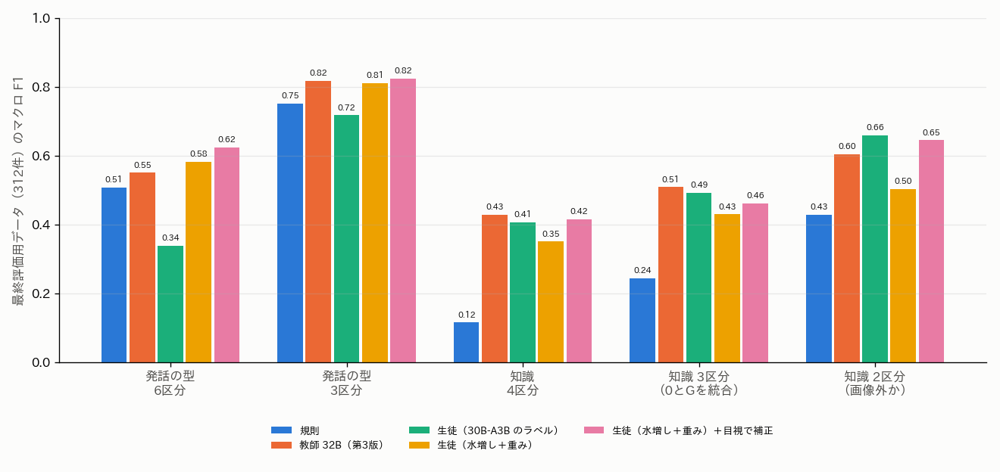

# 大喜利（ボケ）のラベル：制約の順守の判定，発話の型の水増し，必要な知識の定義の再検討

## 1. 概要

report_020 を受けて，次を行った．

1. **不適切の削除：** 性的・不適切の項目を除いた（定義書 第2版）．
2. **穴埋め・お題文の制約の順守：** ボケがお題の空欄や問いに応じているかの判定方法を検討し，比べた．
3. **発話の型：** 教師ラベルを水増しして，少ない型の割合を増やした．検証データに，少ない型を多く含む200件を追加した（計620件）．型を統合した区分も比べた．
4. **必要な知識：** 4段階の定義を見直した．あわせて，次の3つを試した．
   - 上から順に判定する教師の指示
   - 形態素解析（MeCab）の品詞の特徴
   - 見た目だけ（0）と一般常識（G）の統合

結論は次のとおりである．

| 項目 | 結論 |
| :--- | :--- |
| 穴埋め・お題文の制約の順守 | **同じお題の他のボケとの類似度**で判定できる．付け替えた組（違反の代わり）との判別で AUC 0.81（お題文 0.88，穴埋め 0.73）．VLM の教師はほぼ全てを順守とし，判別できなかった（AUC 0.52〜0.55） |
| 発話の型 | 水増しと重み付き損失で，生徒の6区分のマクロ F1 が0.34から0.58に上がり，教師（0.55）を上回った．目視のラベル（調整用）で補正すると0.62 になる．ツッコミ（F1 約0.2）だけは改善しない．3区分（登場人物の言葉／外からの言葉／回答）なら F1 0.82 |
| 必要な知識 | 上から順に判定する指示も，品詞の特徴も，精度を上げなかった（4区分のマクロ F1 は0.42〜0.46 のまま）．0 と G を統合した3区分でも F1 は0.46〜0.52 にとどまった．ボケだけでは判断が難しく，「画像外の知識が要るか」の2値（F1 0.65）を基本とすることを勧める |

## 2. 穴埋め・お題文の制約の順守の判定（ご質問への回答）

### 2.1 何を判定するか

穴埋めとお題文の制約は，カルタと違って文字の一致では確かめられない．

- **穴埋め：** ボケが空欄に入る語句として意味が通るか
- **お題文：** ボケが問いや指示に応じた答えになっているか

実際のボケでは，これらに違反するボケはまれである．検証データの穴埋め・お題文のボケ120件では，違反は1件（他のお題への宣伝）しかなかった．違反の多くは，次のどちらかである．

- お題と無関係な書き込み（宣伝，他のボケへの返信）
- 別のお題に向けたボケ

そこで，検証データの穴埋め・お題文のボケを，同じ形式の別のお題に付け替えた組（120件）を「違反の代わり」とした．元の組（120件）と見分けられるかで，方法を比べた．

### 2.2 比べた方法

| 方法 | 内容 | 必要なもの |
| :--- | :--- | :--- |
| VLM の教師 | お題画像とボケを与え，空欄・問いに応じているかを問う（Qwen3-VL 32B，30B-A3B） | 画像．約5〜33件/秒 |
| 他のボケの平均との類似度 | ボケの文の埋め込み（ruri-v3）と，同じお題の他のボケ（最大50件）の埋め込みの平均とのコサイン類似度 | 同じお題の他のボケ |
| 最も似た他のボケとの類似度（knn5） | 同じお題の他のボケのうち，最も似た5件との類似度の平均 | 同じお題の他のボケ |
| 組の分類器 | ボケの文の埋め込みとお題画像の埋め込みを連結し，正しい組と付け替えた組（学習用2万件）を見分ける MLP | 画像の埋め込み |

「他のボケとの類似度」は，お題の文を書き起こさなくても使える．同じお題の他のボケが，「お題が求める答えの方向」を表すためである．例えば，「悩む二択」のお題では，他のボケが「〜か〜か」の形をしている．

### 2.3 結果

表1 穴埋め・お題文の制約の順守の判別（正120件，付け替え120件）．検出率は，正しい組の95%を順守と判定するしきい値で，付け替えた組を検出できる割合．

| 方法 | AUC | 検出率 | 穴埋め AUC | お題文 AUC |
| :--- | :---: | :---: | :---: | :---: |
| 教師 32B | 0.55 | 13%（正の98%を順守と判定） | — | — |
| 教師 30B-A3B | 0.52 | 6% | — | — |
| 組の分類器 | 0.57 | 10% | 0.54 | 0.65 |
| 他のボケの平均との類似度 | 0.75 | 32% | 0.66 | 0.83 |
| **最も似た他のボケとの類似度（knn5）** | **0.81** | **39%** | **0.73** | **0.88** |

主な結果は次のとおりである．

- **教師はほぼ全てを順守と判定した．** 画像の空欄や問いの文を読んで，ボケとの対応まで確かめることはできていない．
- **組の分類器は弱い．** 画像の埋め込みは，お題の文の中身を表さないためである．
- **他のボケとの類似度が最も良い．** 特に，最も似た数件との類似度は，典型から外れた正しいボケも拾える．お題文では AUC 0.88 であった．
- **穴埋めでは0.73 にとどまる．** 空欄に入る語は，ボケどうしで多様なためである．

### 2.4 運用の提案

- **カルタ：** 規則（書き出しのかな）で判定する．
- **穴埋め・お題文：** 「最も似た他のボケとの類似度」を得点として付ける．しきい値を一つに決めるより，得点のまま残す．
  - 大喜利の生成の学習では，得点の低いボケ（下位数%）を除く．
  - 大喜利の判定では，得点を「お題への応答のしかたが典型的か」の特徴として使う．
- **注意：** この得点は「他のボケと似ているか」を測るので，意外性のある正しいボケも低くなりうる．面白さの判定に使う場合は，順守の確認と面白さを分けて扱う必要がある．
- **ボケの少ないお題：** 他のボケが少ないお題（ボケが数件）では使えない．その場合は，お題の文の書き起こし（report_019 で提案）と，文どうしの判定が必要になる．
- **処理時間：** ボケの文の埋め込み（約4,700件/秒）と，お題ごとの類似度の計算だけで，全9,250万件に数時間で適用できる．

## 3. 定義書 第2版と検証データの追加

定義書は `programs/label_guideline/boke_label_definition_v2.md` に置いた．第1版からの変更点は次のとおりである．

- 性的・不適切を除いた．
- 必要な知識を，上から順に判定する手順として定義し直した（4章）．

検証データには，少ない発話の型を多く含む200件を追加した（`programs/ex014_boke_labels_v2/eval2_labels.txt`）．手順は次のとおりである．

1. ex013 の学習用のボケから，規則か教師が心の声・ツッコミ・状況の説明・名付け・見立て・セリフのいずれかと予測したボケを，型ごとに40件ずつ（お題1件につき1件）抽出した．
2. 予測を見ずに，定義書 第2版でラベルを付けた．
3. お題の単位で半数ずつ，調整用と最終評価用に分けた．

表2 検証データ（620件）の発話の型の件数．

| 型 | 元の420件 | 追加の200件 | 計 |
| :--- | :---: | :---: | :---: |
| セリフ | 156 | 55 | 211 |
| 回答 | 140 | 1 | 141 |
| 状況の説明 | 35 | 62 | 97 |
| 名付け・見立て | 45 | 38 | 83 |
| 心の声 | 30 | 32 | 62 |
| ツッコミ | 14 | 12 | 26 |

ツッコミの候補は，教師も規則もツッコミと予測したボケであった．しかし，多くは目視ではセリフか状況の説明であった．そのため，ツッコミは追加後も少ない．

## 4. 必要な知識の定義の再検討

### 4.1 グラデーションとしての定義

ご指摘のとおり，4つの段階は独立ではなく，必要な知識の量の順に並ぶ．定義書 第2版では，次の問いを上から順に確かめ，最初に当てはまった段階とした．

1. 見た目だけ：画像の見た目とボケの字面だけで面白さが分かるか
2. 一般常識：誰もが知る言葉・慣用句・ダジャレの元の語・日常の事物や行事を加えれば分かるか
3. 画像中のオブジェクトの情報：画像に写っている（または画像中の文字で名指しされた）特定の人物・作品の情報が必要か
4. 画像外のオブジェクト・事象の情報：上のいずれでもなく，画像に写っていない特定の作品・番組・人物・地名・時事の知識が必要か

目視のラベル付けでは，この順で判断すると迷いが減った．特に，1と2の境界（ボケの字面だけで笑えるか，言葉の知識が要るか）は，「1が否なら2」とすれば決めやすい．

### 4.2 試した方法

| 方法 | 内容 |
| :--- | :--- |
| 上から順に問う教師（第3版） | 4つの問いを順に真偽で答えさせ，最初に真となった段階とする（Qwen3-VL 32B，30B-A3B） |
| 品詞の特徴 | MeCab（fugashi＋UniDic-lite）で，固有名詞（人名・地名・組織名）の割合，普通名詞・代名詞・動詞・形容詞・助詞・助動詞・感動詞の割合，文末の品詞，カタカナ語・英字の割合，括弧・疑問符・感嘆符の有無などの34次元を作り，生徒の入力に加える |
| 区分の統合 | 0 と G を統合した3区分，画像外（O）か否かの2区分，固有の対象（I または O）か否かの2区分で評価する |

### 4.3 結果

表3 必要な知識の判定（最終評価用データ312件）．生徒は3 seed の平均．

| 方法 | 4区分 正解率 | 4区分 F1 | 3区分（0+G）正解率 | 3区分 F1 | 画像外か F1 |
| :--- | :---: | :---: | :---: | :---: | :---: |
| 教師 32B（第3版，順に判定） | 0.45 | 0.43 | 0.63 | 0.51 | 0.60 |
| 教師 30B-A3B（第3版，順に判定） | 0.39 | 0.37 | 0.62 | **0.55** | 0.65 |
| 生徒（30B-A3B 第2版のラベル，文＋形式） | 0.45 | 0.41 | 0.63 | 0.49 | **0.66** |
| 生徒 ＋品詞 | 0.43 | 0.39 | 0.61 | 0.48 | 0.63 |
| 生徒（文＋形式＋画像）＋目視で補正 | **0.47** | **0.46** | 0.59 | 0.52 | **0.66** |
| 生徒（文＋形式＋画像＋品詞）＋目視で補正 | **0.47** | **0.46** | 0.58 | 0.52 | **0.66** |

主な結果は次のとおりである．

- **上から順に判定する指示は効果がなかった．** 元の420件で比べると，32B は第2版（0.43）とほぼ同じ0.42 であった．30B-A3B は0.47 から0.37 に下がった．順に問うと，最初の「見た目だけで分かるか」に真と答えやすくなり，見た目だけに偏るためである．
- **品詞の特徴も効果がなかった．** 固有名詞の割合は，画像外の知識を示しそうに見える．しかし実際には，固有名詞を含まないパロディ（「お前は先にいけ！」など有名な台詞の引用）や，固有名詞を含んでも画像中の対象の名前であるボケが多い．UniDic が漫画やタレントの名前を固有名詞と判定しないことも多かった．
- **0 と G を統合しても，精度はあまり上がらない．** 3区分の F1 は0.46〜0.55 である．
  - 0 と G の混同は確かに多い．しかし，それ以上に，I（画像中の対象）と O（画像外）の判定が難しい．
  - 生徒の I の F1 は0.28〜0.40 であった．文の埋め込みからは，画像の対象が誰かが分からないためである．
- **「画像外の知識が要るか」の2値は，比較的安定している．** F1 は0.60〜0.66 であった．

### 4.4 定義についての考察

4段階の定義そのものは，目視では順に判定でき，判断の手順として妥当である．しかし，自動判定にはボケと画像の両方の深い理解が要り，現在の方法では4段階を区別できない．ユースケースから考えると，次の構成を勧める．

| 用途 | 区分 | 理由 |
| :--- | :--- | :--- |
| 大喜利の生成の条件 | 「画像外の知識が要る／要らない」の2値 | 外部の知識を引くかどうかを決める単位であり，最も安定して判定できる |
| 大喜利の判定の分析 | 4段階を目視の検証データでのみ付ける | 判定の誤りを知識の段階ごとに分けて報告するのに使う．全件への自動付与はしない |

0 と G は，ユースケース的には統合してよい．どちらも外部の知識なしに画像とボケだけで生成・判定できるからである．ただし，統合しても I と O の区別の難しさは残る．

## 5. 発話の型の水増しと区分

### 5.1 水増しの方法

発話の型の精度が最も高い教師（32B）で，水増し用のボケ約9千件にラベルを付けた．内訳は，無作為の5千件と，規則か教師（30B-A3B）が少ない型と予測した候補の約4千件である．次の学習データで生徒を比べた．

| 学習データ | 件数 | 発話の型の内訳（セリフ／心の声／ツッコミ／状況の説明／名付け・見立て／回答） |
| :--- | :---: | :--- |
| 30B-A3B（第2版）のラベル（ex013） | 35,000 | 5,503 / 1,359 / 16,946 / 41 / 1,151 / 10,000 |
| 32B（第3版），無作為のみ | 5,000 | 1,079 / 623 / 1,425 / 83 / 331 / 1,459 |
| 32B（第3版），無作為＋少ない型の候補 | 9,041 | 1,617 / 2,004 / 2,979 / 209 / 773 / 1,459 |
| ＋重み付き損失（型の出現の逆数） | 9,041 | 同上 |

教師が状況の説明をほとんど付けない（学習データの0.1〜2%）ため，状況の説明は水増ししても少ない．目視では検証データの16%が状況の説明である．

### 5.2 結果

表4 発話の型の判定（最終評価用データ312件）．生徒は3 seed の平均．

| 方法 | 6区分 正解率 | 6区分 F1 | 少ない型の追加分の F1 | 3区分 F1 |
| :--- | :---: | :---: | :---: | :---: |
| 規則 | 0.64 | 0.51 | 0.35 | 0.75 |
| 教師 32B（第3版） | 0.62 | 0.55 | 0.36 | 0.82 |
| 生徒（30B-A3B のラベル） | 0.40 | 0.34 | 0.19 | 0.72 |
| 生徒（32B，無作為のみ） | 0.52 | 0.43 | — | 0.78 |
| 生徒（32B，無作為＋候補） | 0.56 | 0.48 | 0.28 | 0.80 |
| **生徒（32B，無作為＋候補＋重み）** | **0.65** | **0.58** | **0.43** | 0.81 |
| 生徒（水増し＋重み）＋目視で補正 | **0.70** | **0.62** | **0.49** | **0.82** |

表5 型ごとの F1（最終評価用データ，seed 0）．

| 型 | 規則 | 教師 32B | 生徒（30B-A3B） | 生徒（水増し＋重み） | ＋目視で補正 |
| :--- | :---: | :---: | :---: | :---: | :---: |
| セリフ | 0.64 | 0.73 | 0.58 | 0.78 | 0.77 |
| 心の声 | 0.21 | **0.68** | 0.43 | 0.58 | 0.49 |
| ツッコミ | 0.13 | 0.24 | 0.13 | 0.21 | 0.19 |
| 状況の説明 | 0.59 | 0.34 | 0.00 | 0.57 | **0.69** |
| 名付け・見立て | 0.55 | 0.40 | 0.09 | 0.55 | **0.71** |
| 回答 | 0.92 | 0.92 | 0.92 | 0.92 | 0.91 |

主な結果は次のとおりである．

- **水増しと重みの効果が大きい．** 無作為の5千件だけ（F1 0.43）より，少ない型の候補を加えると0.48，さらに重みを付けると0.58 に上がった．
- **生徒が教師を上回った．** 生徒は文と形式だけを入力とし，画像を見ない．それでも，状況の説明・名付け・見立てを教師より正しく判定した．教師が状況の説明をほとんど使わない偏りを，重み付き損失が打ち消したためと考えられる．
- **ツッコミは，どの方法でも F1 0.2 前後である．** 教師はツッコミを多用する（学習データの33%）．一方，目視では4%しかない．ツッコミとセリフの境界は，誰が話しているかの解釈によって変わる．定義の見直しも必要である．

### 5.3 区分の統合

| 区分 | 内容 | 最良の F1 |
| :--- | :--- | :---: |
| 6区分 | セリフ，心の声，ツッコミ，状況の説明，名付け・見立て，回答 | 0.62 |
| 5区分 | セリフと心の声を統合（登場人物の言葉） | 0.66 |
| 3区分 | 登場人物の言葉（セリフ・心の声），外からの言葉（ツッコミ・状況の説明・名付け・見立て），回答 | 0.82 |

用途に応じて，次のように使い分けることを勧める．

- **全件への付与：** 3区分は十分な精度があり，生成の条件として使いやすい．
  - 登場人物の言葉：画像の人物の視点で生成する．
  - 外からの言葉：画像を外から語る．
  - 回答：お題に答える．
- **細かい区分：** 6区分は，ツッコミを除く5種について，生徒＋目視の補正で F1 0.5〜0.8 である．データの分析には使える．
- **ツッコミの扱い：** ツッコミを「外からの言葉」に含め，独立の区分としないことを勧める．

## 6. 今後の進め方

1. **制約の順守：** 最も似た他のボケとの類似度を，全てのボケに得点として付ける（数時間）．ボケの少ないお題については，お題の文の書き起こしを試す．
2. **発話の型：** 3区分（または5区分）とし，32B の教師ラベルの水増しと重み付き損失で学習した生徒を全件に適用する．
3. **必要な知識：** 「画像外の知識が要るか」の2値から始める．4段階は検証データのみに付け，判定の分析に用いる．
4. **検証データ：** 620件のラベルは1人（Claude Code）が付けたものである．2人目のラベルで一致度（κ係数）を測り，特にセリフとツッコミ，0 と G の境界を確かめることを勧める．

本検証は試作であり，`Bokete_Annotation_programs_v5.0/` には含めていない．v5.0 のアノテーションと埋め込みは，読み込みのみに用いた．
