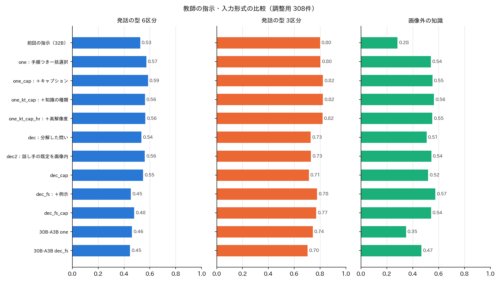
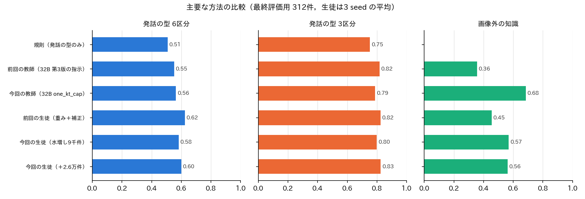
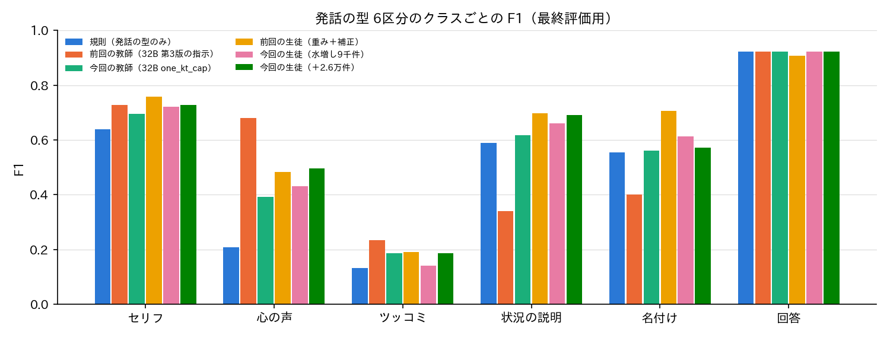

# 大喜利（ボケ）のラベル：画像外の知識の厳密な定義と，発話の型の指示・入力形式の改善

## 1. 概要

report_021 を受けて，次を行った．

1. **入力の確認：** 各方法がボケの判定に何を入力しているかを整理した（第2節）．
2. **画像外の知識：** 「画像外の知識が要るか」の2値とし，定義を厳密にした（定義書 第3版）．
   検証データ620件をこの定義で見直した（第3節）．
3. **発話の型：** 6区分と3区分の両方を持つ．6区分は信頼性の低いラベルとして扱う．
   6区分の精度を上げるため，教師の指示と入力形式を9通り比べた（第4節）．
   選んだ指示で生徒の学習データを付け直し，教師ラベルを約2.6万件追加した（第5節）．
4. **MeCab：** 効果がなかったため，以後用いない．

結論は次のとおりである（最終評価用 312件，生徒は3 seed の平均）．

| 項目 | 前回（report_021） | 今回 | 結論 |
| :--- | :--- | :--- | :--- |
| 画像外の知識（教師） | F1 0.36 | **F1 0.69** | 種類を選ばせる指示で大きく改善した |
| 画像外の知識（生徒） | F1 0.46 | **F1 0.56** | 改善した．ただし教師より低い |
| 発話の型 6区分（教師） | F1 0.55 | F1 0.56 | 調整用では 0.53→0.56〜0.59 と改善したが，最終評価用では差がほぼない |
| 発話の型 6区分（生徒） | F1 0.62 | F1 0.60 | 差は誤差の範囲（差 −0.02，95%信頼区間 −0.08〜+0.03） |
| 発話の型 3区分（生徒） | F1 0.82 | F1 0.83 | 実用の水準である |

- 画像外の知識は，定義を厳密にし，指示で依存する事物の**種類**を選ばせることで，判定できる水準に近づいた．
- 6区分は，指示の分解や例示ではむしろ悪化した．調整用の上では改善が見られたが，最終評価用で前回を上回るとは言えない．
  6区分は人の判断も揺れる区分であり，現状の上限は F1 0.6 前後と考える．
  したがって，6区分を信頼性の低いラベル，3区分を主に用いるラベルとする方針が妥当である．

## 2. ご質問への回答：判定の際に画像と大喜利を入力しているか

方法によって異なる．

| 方法 | 入力 | 備考 |
| :--- | :--- | :--- |
| VLM の教師（Qwen3-VL-32B など） | **お題画像**（最大 448×448 画素）＋お題の形式（文）＋**ボケの文** | 今回は写真のキャプション，媒体，画像中の文字の有無も文で加えた（第4節） |
| 生徒（MLP） | **ボケの文の埋め込み**（ruri-v3-310m）＋お題の形式・属性・媒体（お題のラベル） | お題画像の埋め込み（SigLIP2）を加えた構成も比べた．調整用では加えない方が良かったため，**画像を入れない構成**を選んだ |
| 補正（ロジスティック回帰） | 生徒の確率＋お題の形式・属性・媒体 | |
| 規則 | ボケの文＋お題の形式 | |
| 制約の順守（穴埋め・お題文） | ボケの文と，同じお題の他のボケの文 | report_021 で選んだ方法 |

- 教師は画像とボケの両方を見て判定している．
- 9,250万件に適用する生徒は，画像そのものを見ない．画像の情報は，お題のラベル（形式・属性・媒体）と，画像を見た教師のラベルを通じて間接的に入っている．
- 生徒にお題画像の埋め込みを加えると，次のとおりで，調整用では一貫して加えない方が良かった（表1）．
  - 6区分：調整用 0.642→0.629，最終評価用 0.600→0.608．
  - 画像外の知識：調整用 0.549→0.522．
- 画像全体の埋め込みは「誰が話しているか」「何が写っているか」を細かく表せない．そのため，ボケの文の手がかりに比べて効果が小さいと考える．

## 3. 画像外の知識の定義（定義書 第3版）と検証データの見直し

### 3.1 定義

定義書 programs/label_guideline/boke_label_definition_v3.md の第3節に定めた．要点は次のとおりである．

ボケの面白さを理解するのに，**画像にも画像中の文字にも示されていない，特定の事物についての知識**が必要かを問う．
次の3条件を全て満たすときに「はい」とする．

1. **特定性：** ボケが依存しているのが，次のいずれかの特定の事物である．
   - 作品，キャラクター，人物，団体，商品，ブランド，番組，CM，歌
   - 地名の印象，出来事，流行語，ネットの定型，有名な台詞
   - ボケての機能や慣習
2. **画像の外：** その事物が画像に写っておらず，画像中の文字でも名指しされていない．
   画像に写っている人物やキャラクター自身の設定を使うボケは「いいえ」とする．
3. **必要性：** その事物を知らないと，面白さが成り立たない．名前が背景にすぎない場合は「いいえ」とする．

次のものは「いいえ」とする．

- 一般の語彙，慣用句，ことわざ
- 誰もが知る生活の事物や行事（ラジオ体操，だるまさんがころんだ，給食など）
- 一般的な職業やジャンルの印象（警察官，ヤンキー，時代劇など）

判定は「依存する事物を書き出す → 特定か → 画像の外か → 必要か」の順に行う．

### 3.2 検証データの見直し

検証データ620件の全件を，第3版の定義で見直した．第2版の4段階のうち「画像外（O）」を出発点とし，27件を改めた．

- **はい→いいえ（12件）：** 誰もが知る行事や昔話（ゴールデンウィーク，桃太郎），画像に写っている人物やキャラクター，画像中の文字で示された事物など．
- **いいえ→はい（15件）：** 画像に写っていない作品や人物．例えば，次のようなものである．
  - くまモンの画像に対するふなっしーのボケ
  - 有名な台詞（戦国BASARA，ランバ・ラル）
  - 事件や話題（ジャニー喜多川，草彅剛，藤浪投手）
  - 歌（はなわの「佐賀県」，サザエさんの主題歌）
  - ボケての定番のお題や機能

ラベルは programs/ex015_boke_labels_v3/outside_labels.txt に，見直しの記録は outside_adjudication.txt に保存した．
「はい」は620件中139件（22%）である．

## 4. 教師の指示と入力形式の比較

### 4.1 比べた指示と入力形式

Qwen3-VL-32B-FP8（一部 30B-A3B）で，検証データ620件に次の方法でラベルを付けた．
指示は全て，定義書 第3版の定義に沿うよう書き直した．

| 方法 | 発話の型の問い方 | 画像外の知識の問い方 | 入力の追加 |
| :--- | :--- | :--- | :--- |
| one | 第3版の手順（名付け → 画像内の話し手（声に出すか）→ 画像外の話し手（説明かツッコミか））を示して6区分から1つ選ばせる | 定義を示して真偽を1つ問う | なし |
| one_cap | 同上 | 同上 | 写真のキャプション，媒体，画像中の文字の有無 |
| one_kt_cap | 同上 | 依存する事物と，その**種類**（作品，人物，商品，地名，出来事，ボケての慣習，**一般**，なし）を選ばせ，画像内か・必要かを問う | 同上 |
| one_kt_cap_hr | 同上 | 同上 | 同上＋画像を 896×896 画素で入力 |
| dec | 質問を分解（話し手を短く書く → 名付けか → 話し手は画像内か → 声に出すか → 説明か）し，規則で6区分にする | 依存する事物を書き，特定か・画像内か・必要かを別に問う | なし |
| dec2 | dec の話し手の既定を「画像内の誰か」に変えたもの | 同上 | なし |
| dec_cap | dec と同じ | 同上 | キャプションなど |
| dec_fs, dec_fs_cap | dec と同じ | 同上 | 検証データ以外の13例の例示（文で書いた画像とボケ，判定） |

- 種類を選ばせる方法（kt）は，dec の誤りの分析から追加した．
- 選択は調整用（308件）で行い，最終評価用（312件）は確認にのみ用いた．

### 4.2 結果

表1：主な方法の指標（マクロ F1．画像外の知識は「はい」の F1，括弧は適合率／再現率）

| 方法 | 6区分 調整用 | 6区分 最終評価 | 3区分 調整用 | 3区分 最終評価 | 画像外 調整用 | 画像外 最終評価 |
| :--- | :--- | :--- | :--- | :--- | :--- | :--- |
| 前回の教師（32B 第3版の指示） | 0.525 | 0.551 | 0.800 | 0.817 | 0.282 (0.65/0.18) | 0.356 (0.78/0.23) |
| 32B one | 0.572 | 0.575 | 0.802 | 0.802 | 0.539 | 0.551 |
| 32B one_cap | **0.585** | 0.559 | 0.822 | 0.799 | 0.553 | 0.602 |
| 32B one_kt_cap | 0.562 | 0.563 | 0.822 | 0.788 | 0.564 (0.48/0.69) | **0.685** (0.59/0.81) |
| 32B dec_fs | 0.453 | 0.411 | 0.777 | 0.748 | **0.575** (0.44/0.82) | 0.647 |
| 30B-A3B one | 0.462 | 0.443 | 0.744 | 0.777 | 0.348 | 0.415 |

**画像外の知識：**

- 前回の4段階の指示は「画像外」をほとんど選ばなかった（再現率 0.18）．
- 定義を示して直接問うと，F1 が 0.28 から 0.54 に上がった．
- 質問を分解した方法（dec）の誤りは，次の2つに偏っていた（調整用の誤検出63件）．
  - **普通名詞を特定の事物とする誤り：** リトマス紙，回転寿司，クロール，座薬，居酒屋のキャッチなど．
  - **画像に写っている作品の他の登場人物を画像外とする誤り：** アンパンマンの画像のバタコさん，くまモン関連など．
- そこで kt では，事物の種類を選ばせ，「固有名詞でなければ一般」とした．
  あわせて，「画像に写っているキャラクターと同じ作品の事物は画像内」とした．
- その結果，適合率が 0.44 から 0.48（最終評価用 0.59）に上がった．最終評価用の F1 は 0.685 で，最も高い．
- 残る誤りは，見逃し（定番の台詞や歌詞を事物として挙げない）と，固有名詞が出てくるだけで「必要」と答える誤検出である．

**発話の型（6区分）：**

- 定義書の手順を示して1つ選ばせる方法（one）で，前回より調整用 0.525→0.572 と改善した．
- キャプションを加える（one_cap）と，調整用で 0.585 と最も高くなった．ただし最終評価用では 0.559 で，one（0.575）と差がない．
- **質問の分解（dec）はかえって悪化した．** 混同行列を見ると，モデルが話し手を「画像を見ている人」と答える偏りがあった．
  その結果，セリフ211件のうち134件がツッコミになった．
  話し手の既定を「画像の中の誰か」に変えた dec2 では調整用 0.561 まで戻った．しかし最終評価用は 0.483 で，one に及ばなかった．
- 例示（fs）は，画像外の知識をわずかに改善した．一方で，発話の型をツッコミに寄せて悪化させた．
- 高解像度（hr），30B-A3B は改善しなかった．

**まとめ：** 一括選択に定義書の手順を書き込む方法が最もよく，分解や例示は効果がなかった．
6区分のうちツッコミ（最終評価用26件）は，どの方法でも F1 0.2 前後にとどまる．
教師は水増し用の集合の35%をツッコミとし，検証データ（4%）に比べて大きく多く付ける．
心の声は逆に少なく付ける．これらの偏りが，6区分の上限を決めている．

## 5. 生徒の学習し直しと最終評価

### 5.1 方法

- **教師：** 32B one_kt_cap（発話の型と画像外の知識を1回の推論で付けられ，調整用で両方とも上位）．
- **学習データ：** 次の2つにラベルを付け直した．
  - ex014 の水増し用の集合（9,041件）
  - ex013 の学習用のボケのうち，水増し用と重なるものと検証データのお題のものを除いた **25,593件**
- **教師の速度：** 32B で 3.9件/秒（合計約2.5時間）．
- **生徒：** ボケの文の埋め込み＋お題の形式・属性・媒体の MLP（3 seed）．
  - 発話の型は出現の逆数で重みを付けた交差エントロピー，画像外の知識は正例の比で重みを付けた2値交差エントロピーとした．
  - 画像の埋め込みを加えた構成と，目視のラベルによる補正（2分割）も比べた．
  - MeCab の品詞の特徴は用いない．

### 5.2 結果

表2：生徒の指標（3 seed の平均）

| 生徒 | 6区分 調整用 | 6区分 最終評価 | 3区分 最終評価 | 画像外 調整用 | 画像外 最終評価（適合率／再現率） |
| :--- | :--- | :--- | :--- | :--- | :--- |
| 前回（重み＋補正，品詞あり） | 0.599 | **0.624** | 0.824 | 0.457 | 0.455 (0.50/0.42) |
| 今回 9千件 | 0.633 | 0.582 | 0.799 | 0.552 | 0.569 (0.44/0.81) |
| **今回 9千件＋2.6万件** | **0.642** | 0.600 | **0.826** | 0.549 | 0.562 (0.45/0.75) |
| 今回 9千件＋2.6万件＋画像 | 0.629 | 0.608 | 0.821 | 0.522 | 0.567 |
| 今回 9千件＋2.6万件＋補正 | 0.622 | 0.603 | 0.829 | 0.573 | 0.577 (0.49/0.71) |

- **画像外の知識：** 生徒の F1 は前回の0.46から0.56に上がった．
  ただし教師（0.69）との差は大きい．文の埋め込みだけでは，固有名詞が画像に写っているかどうかを判断できないためと考える．
  しきい値を調整用で選んでも，最終評価用では改善しなかった（0.54）．
- **6区分：** 教師ラベルを増やすと，調整用で 0.633→0.642，最終評価用で 0.582→0.600 と上がった．
  前回の生徒（0.624）との差は −0.025 で，95%信頼区間（ブートストラップ1,000回）は −0.08〜+0.03 である．改善とも悪化とも言えない．
  クラスごとでは，心の声（0.48→0.50）が並び，名付け（0.71→0.57）が下がった．ツッコミは 0.19 のままである．
- **3区分：** 0.826 で，前回（0.824）と同等である．

### 5.3 データベースでの扱い

| 列 | 値 | 信頼性 |
| :--- | :--- | :--- |
| voice6 | セリフ，心の声，ツッコミ・呼びかけ，状況の説明・物語，名付け・見立て，回答 | **低い**（マクロ F1 約0.6．特にツッコミは F1 約0.2）．分析用の参考値とする |
| voice3 | 登場人物の言葉，外からの言葉，回答 | 主に用いる（マクロ F1 約0.83） |
| outside_knowledge | はい／いいえ（と確率） | 中程度（F1 約0.56，再現率が高く適合率が低い）．確率を併せて保存し，用途に応じてしきい値を選べるようにする |

- voice3 は voice6 の確率を足し合わせて求めるため，2つの列は常に整合する．
- 6区分の確率も保存する．そうすれば，下流で「確率の高いものだけを使う」といった選び方ができる．

## 6. 今後の進め方

1. **全件への適用の準備：**
   - 今回の生徒（9千件＋2.6万件，画像なし）の構成で，9,250万件のボケに voice6，voice3，outside_knowledge を付ける．
   - 処理は文の埋め込みの計算が主である．速度を見積もってから実行の可否を判断する．
2. **画像外の知識の精度：** 生徒と教師の差（0.56 と 0.69）を縮める方法として，次が考えられる．
   - 小さな VLM（Qwen3-VL-2B など）を教師ラベルで微調整して生徒とし，画像とボケの両方を入力する．
   - 9,250万件に適用できる速度かを確かめる必要がある．
3. **6区分：** 教師の偏り（ツッコミを多く，心の声を少なく付ける）は，指示では直らなかった．これ以上の改善には，次のいずれかが必要と考える．
   - 目視のラベルを大きく増やし，それで直接学習する．
   - 区分の定義そのものを見直す（ツッコミと呼びかけの扱いなど）．
   - 現時点では信頼性の低いラベルとして保持し，主に3区分を用いることを提案する．

## 付録：実験の構成

- コード：programs/ex015_boke_labels_v3/
  - data.py：検証データと画像外の知識のラベル
  - teacher.py：教師の指示・入力形式の比較と，ラベル付け
  - students.py：生徒
  - evaluate.py：評価
  - figures.py：図
- 出力：outputs/ex015_boke_labels_v3/
  - teacher_{モデル}/{方法}/{eval,aug,extra}.csv
  - student/{ラベル}__{入力}[__stack]/{seed}/eval.csv
  - figures/summary.csv，per_class.json
- ラベル：programs/ex015_boke_labels_v3/outside_labels.txt（画像外の知識620件），outside_adjudication.txt（見直しの記録）
- 定義書：programs/label_guideline/boke_label_definition_v3.md
- 本検証は試作であり，Bokete_Annotation_programs_v5.0/ には含めていない．
