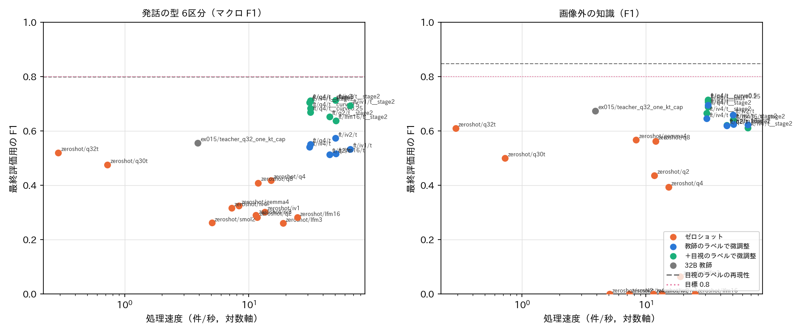

# 大喜利（ボケ）のラベル：小さな VLM による画像外の知識と発話の型の判定

## 1. 概要

画像外の知識の F1 と発話の型6区分のマクロ F1 を0.8以上にすることを目標に，お題画像とボケの両方を入力する小さな VLM を比べた．
Qwen3-VL，InternVL3.5，LFM2-VL，SmolVLM2，Gemma 3 の1〜4B と，推論（Thinking）モデルを試した．
各モデルを，指示だけで判定させる方法（ゼロショット）と，微調整する方法で評価した．
あわせて，検証データ620件の全件を元のラベルを見ずに付け直し，目視のラベル自体の再現性を測った．
不一致を裁定した合意ラベルを正解とした．

結論は次のとおりである（最終評価用312件，合意ラベル）．

| 項目 | 前回（report_022） | 今回の最良 | 目視のラベルの再現性 |
| :--- | :--- | :--- | :--- |
| 発話の型 6区分（マクロ F1） | 0.61（文の埋め込みの生徒） | **0.71**（InternVL3.5-2B／Qwen3-VL-4B の微調整） | 0.80 |
| 画像外の知識（F1） | 0.60（同上） | **0.69〜0.72**（Qwen3-VL-4B の微調整） | 0.85 |
| 発話の型 3区分（マクロ F1） | 0.82 | **0.85〜0.86** | 0.93 |

- **目標の0.8には届かなかった．**
  - 6区分は0.61から0.71に改善した．95%信頼区間は0.65〜0.77である．
  - 画像外の知識は0.60から0.69〜0.72に改善した．
- **画像を入力する VLM の効果は，微調整して初めて現れた．**
  - 小さな VLM のゼロショットは，6区分が0.25〜0.44にとどまった．画像外の知識は，多くのモデルが「はい」をほぼ出さない．
  - 推論モデル（32B，30B-A3B）も，前回の 32B 教師（Instruct）を上回らなかった．
- **最も効いたのは目視のラベルによる微調整である．**
  - 教師（32B）のラベルだけで学習した VLM は，教師と同程度だった（6区分0.55）．
  - そこから目視のラベル931件で微調整すると，0.70〜0.71に上がった．
  - 教師のラベル自体が，目視のラベルとの一致で6区分0.65，画像外の知識0.63にとどまり，これが上限を下げていた．
- **0.8は，目視のラベルの再現性（6区分0.80，画像外の知識0.85）とほぼ同じ高さである．**
  - 同じ定義でも，時間を置いて付け直すと6区分の約2割が変わる．したがって，0.8は現在の定義では実質的に上限に近い．
  - 目視のラベルを232件から931件に増やした効果は6区分で +0.04 であり，増やすほど伸びは緩やかになる．
  - 0.8に近づけるには，目視のラベルを数千件規模に増やすか，揺れの大きい区分（ツッコミ，心の声）の定義を見直す必要がある．

## 2. 目視のラベルの再現性と合意ラベル

### 2.1 方法

検証データ620件（report_022 の目視のラベル）を無作為に並べ替え，元の番号とラベルを伏せた一覧で，定義書 第3版に従って付け直した．
最初に160件を付け直し，次に残りの460件を付け直した．元のラベルとの一致を測り，不一致の項目を裁定して合意ラベルとした．

### 2.2 結果

表1：元のラベルと付け直したラベルの一致（620件）

| 項目 | マクロ F1 | 一致率 | Cohen の κ |
| :--- | :--- | :--- | :--- |
| 発話の型 6区分 | 0.80 | 0.86 | 0.82 |
| 発話の型 3区分 | 0.93 | — | — |
| 画像外の知識 | 0.85（F1） | — | 0.81 |

- 6区分のクラスごとの F1 は，次のとおりである．
  - セリフ 0.89，回答 0.94，状況の説明 0.85，名付け 0.81．
  - 心の声 0.75，ツッコミ 0.55．
- 不一致の内訳は次のとおりである．
  - 多かったのは，心の声→セリフ（11件），セリフ↔ツッコミ，状況の説明↔名付けである．
  - 「形式が通常でも，お題画像が空欄や空の吹き出し，問いを課している場合」を回答とするかの揺れが，約10件あった．
- 合意ラベルの裁定では，次のように決めた．
  - お題画像が空欄・空の吹き出し・問いを課している場合は，形式によらず回答とする．この規則は定義書に追記する候補である．
  - 迷う場合はセリフとする（定義書のとおり）．
  - 画像外の知識の判断が分かれたものは，元のラベルを維持した．
- 合意ラベルは元のラベルから，発話の型55件，画像外の知識22件が変わった．以下の評価は全て合意ラベルを正解とする．

## 3. 比べた方法

| 方法 | 内容 |
| :--- | :--- |
| ゼロショット | vLLM で，report_022 の指示 one_kt_cap（画像＋形式・媒体・キャプション＋ボケ）を与えて JSON を生成させる．画像は長辺448画素以下 |
| 推論モデル | Qwen3-VL-32B-Thinking-FP8，30B-A3B-Thinking-FP8．推論の後に JSON を書かせる（最大4,096トークン） |
| 教師のラベルで微調整（stage 1） | VLM の言語モデルの最後のトークンの隠れ状態に，6区分と画像外の知識の出力層を付け，LoRA（ランク16，全線形層）で学習する．生成せず1回の順伝播で判定する．教師（32B one_kt_cap）のラベル34,634件を使い，4B は2エポック，2B 以下は1エポック学習した．4B では1エポック目が最良だった |
| ＋目視のラベルで微調整（stage 2） | stage 1 の重みから，学習用の目視のラベル931件で4エポック微調整し，調整用で最良のエポックを選ぶ |
| 目視のラベルのみ（対照） | VLM の初期値から，目視のラベル931件のみで8エポック学習する |

**学習用の目視のラベル（931件）：**
- 抽出：教師のラベルの集合（検証データのお題を含まない）から，お題1件につき1件まで抽出した．
  - 半数は無作為に選んだ．
  - 残りは，教師のラベルで少ない型（心の声・ツッコミ・状況の説明・名付け）と，画像外の知識が「はい」のものを多めに選んだ．
- 内訳：
  - 発話の型：セリフ248，回答206，状況の説明156，名付け152，心の声109，ツッコミ60．
  - 画像外の知識の「はい」：26%．
- 教師のラベルとの一致：6区分のマクロ F1 0.65（ツッコミ0.33，状況の説明0.51），画像外の知識の F1 0.63．教師のラベルには大きな誤りが含まれる．

**モデル：**
- Qwen3-VL-2B/4B/8B，InternVL3.5-1B/2B/4B（HF 版），LFM2-VL-1.6B/3B，SmolVLM2-2.2B，Gemma 3 4B．
- MiniCPM-V-4 と Heron-NVILA-Lite-2B は，vLLM の画像の処理でエラーとなり評価できなかった．
- Gemma 3n と sarashina2-vision は，取得の権限がなく試せなかった．
- 画像のトークン数は，タイル分割を止めて200〜300程度にそろえた．

**速度：**
- ゼロショット：vLLM で620件を一括で生成したときの件数/秒．
- 微調整：分類器の順伝播のみ（バッチ32，bfloat16）の件数/秒．画像の読み込み・前処理を含む値は，その約6割である．

## 4. 結果

表2：主な方法の指標（合意ラベル．括弧内は調整用）

| 方法 | 6区分 最終評価 | 3区分 最終評価 | 画像外 最終評価 | 速度（件/秒） |
| :--- | :--- | :--- | :--- | :--- |
| 前回：文の埋め込みの生徒（ex015） | 0.611 (0.649) | 0.824 | 0.599 (0.560) | 未計測（文の埋め込みと MLP のみ） |
| 前回：32B 教師 one_kt_cap | 0.556 (0.559) | 0.785 | 0.674 (0.561) | 3.9 |
| ゼロショット 32B-Thinking | 0.520 (0.500) | 0.789 | 0.610 (0.500) | 0.3 |
| ゼロショット Qwen3-VL-4B | 0.418 (0.440) | 0.744 | 0.394 (0.468) | 15.2 |
| ゼロショット Qwen3-VL-8B | 0.409 (0.436) | 0.713 | 0.563 (0.479) | 11.9 |
| ゼロショット 他の1〜4B（7モデル） | 0.26〜0.33 | 0.54〜0.67 | 0.00〜0.57 | 5〜25 |
| 教師のラベルで微調整 Qwen3-VL-4B | 0.552 (0.605) | 0.790 | 0.695 (0.662) | 31.6 |
| 教師のラベルで微調整 InternVL3.5-2B | 0.574 (0.579) | 0.793 | 0.660 (0.608) | 50.3 |
| **＋目視 Qwen3-VL-4B** | **0.711** (0.758) | **0.864** | **0.690** (0.662) | 31.6 |
| **＋目視 InternVL3.5-2B** | **0.713** (0.768) | 0.848 | 0.641 (0.623) | 50.3 |
| ＋目視 InternVL3.5-4B | 0.705 (0.722) | 0.853 | 0.667 (0.632) | 31.0 |
| ＋目視 InternVL3.5-1B | 0.694 (0.705) | 0.854 | 0.613 (0.610) | 66.4 |
| ＋目視 Qwen3-VL-2B | 0.652 (0.692) | 0.836 | 0.621 (0.646) | 45.0 |
| ＋目視 LFM2-VL-1.6B | 0.639 (0.713) | 0.850 | 0.639 (0.529) | 50.7 |
| 目視のみ Qwen3-VL-4B | 0.673 (0.685) | 0.844 | 0.548 (0.597) | 31.6 |
| 目視のみ Qwen3-VL-2B | 0.706 (0.695) | 0.864 | 0.548 (0.565) | 45.0 |

**ゼロショット：**
- 小さな VLM は指示だけではこの判定ができない．
- 6区分は，最良の Qwen3-VL-4B でも0.42だった．
- InternVL3.5，LFM2-VL，SmolVLM2 は，画像外の知識をほぼ全て「いいえ」とした（F1 0）．
- 推論モデルは6区分0.52で，Instruct の 32B 教師（0.56）を上回らなかった．
  - JSON を書き終えない割合が23〜44%あった．
  - 速度は 32B 教師の1/10以下だった．

**微調整：**
- 教師のラベルだけで学習した VLM は，画像外の知識で 32B 教師と同等以上（4B で0.70）になった．6区分は教師と同程度（0.55〜0.57）だった．
  教師のラベルを再現するところまでは学べるが，教師の誤りも再現する．
- 目視のラベルでの微調整で，6区分は全てのモデルで +0.12〜0.15 上がった．
- 目視のラベルのみの対照は次のとおりである．
  - 6区分は同程度（0.67〜0.71）である．
  - 画像外の知識は0.55で，教師のラベルで事前に学習した場合（0.69）より大きく低い．
- 二段階の効果を分けると，次のようになる．
  - 画像外の知識は，教師のラベル（大量）から学んでいる．
  - 6区分の境界は，目視のラベル（少量だが正確）から学んでいる．
- クラスごとの F1（最終評価用，InternVL3.5-2B／Qwen3-VL-4B）は次のとおりである．
  - セリフ0.83，回答0.91，状況の説明0.76〜0.78，名付け0.74〜0.77．
  - 心の声0.58〜0.64，ツッコミ0.36〜0.45．
  - 目視のラベルの再現性でも低いツッコミと心の声が，マクロ F1 を下げている．
- 次の工夫は効果がなかった．
  - Qwen3-VL-4B と InternVL3.5-4B の確率の平均．
  - 画像外の知識のしきい値の，調整用での選択．

表3：目視のラベルの量と精度（Qwen3-VL-4B，教師のラベルで学習済みの重みから微調整．最終評価用）

| 目視のラベル | 6区分 | 画像外の知識 |
| :--- | :--- | :--- |
| 0件（教師のラベルのみ） | 0.552 | 0.695 |
| 232件（25%） | 0.669 | 0.713 |
| 465件（50%） | 0.684 | 0.716 |
| 931件（100%） | 0.711 | 0.690 |
| 931件＋検証データの半分（約310件．2分割で残り半分を予測） | 0.712（調整用0.755） | 0.707（調整用0.636） |

- 6区分は，目視のラベルを倍にするごとに +0.015〜0.03 程度伸びる．この傾向が続くとしても，0.8には数千件以上が必要と見込まれる．
  ただし，これは観測した3点からの外挿であり，確かめていない．
- 画像外の知識は，目視のラベルを増やしても0.69〜0.72で変わらない．

## 5. 目標に届かなかった理由と考察

1. **目視のラベルの揺れ：**
   - 同じ定義での付け直しの一致は，6区分で0.80，画像外の知識で0.85だった．
   - 合意ラベルでも同程度の揺れが残ると考えられ，0.8はモデルにとって上限に近い．
   - 特にツッコミ（再現性0.55）と心の声（0.75）は，人でも安定しない．
2. **教師のラベルの誤り：** 32B 教師のラベルは，目視のラベルとの一致で6区分0.65，画像外の知識0.63にとどまる．
   教師のラベルだけで学習すると，教師の水準を超えない．
3. **画像外の知識の難しさ：** 「特定の事物を知らないと分からない」の判断には，画像から事物を同定することと，世界知識を持つことの両方が要る．
   2〜4B の VLM は知識が少なく，目視のラベルを増やしても伸びなかった．
   誤りの多くは，有名な台詞・歌詞・ネットの定型を引用していることに気づかないものと，固有名詞が出てくるだけで「はい」とするものである．

## 6. 推奨する構成と，9,250万件への適用

**推奨する構成：** InternVL3.5-2B または Qwen3-VL-4B を，教師のラベル（1エポック）→目視のラベル（4エポック）の順で微調整する．
- InternVL3.5-2B：6区分0.71，3区分0.85，画像外の知識0.64．分類器の順伝播で50件/秒．
- Qwen3-VL-4B：6区分0.71，3区分0.86，画像外の知識0.69．32件/秒．

**処理時間の見積もり：**
- 9,250万件を前処理込みの速度（順伝播の約6割）で処理すると，InternVL3.5-2B で約35日，Qwen3-VL-4B で約55日かかる．
- 現状のままでは全件への適用は現実的でない．
- 同じお題画像に平均約14件のボケが付くため，画像の符号化をお題ごとに1回にすれば，大幅に短縮できる見込みがある．
  画像のトークンの計算を省けるためだが，まだ実装も計測もしていない．
- 前回の文の埋め込みの生徒は，画像を処理しないため VLM よりはるかに軽い（速度は未計測）．用途に応じて，次のように使い分ける案がある．
  - 3区分や，確率による絞り込みで足りる集計には，文の埋め込みの生徒を使う．
  - 画像外の知識など精度が要る部分集合には，VLM を使う．

## 7. 今後の進め方

1. **定義の見直し：**
   - お題画像が空欄・空の吹き出し・問いを課している場合の回答の扱いを，定義書に明記する．
   - ツッコミ（画像の人物への呼びかけを含む）と心の声の境界を見直す．
   - 6区分の再現性を上げることが，自動判定の精度の上限を上げる前提である．
2. **目視のラベルの追加：** 6区分は目視のラベルの量で伸びている．
   2,000〜3,000件に増やした学習曲線で，0.8に届くかを確かめる．
3. **画像外の知識：**
   - 32B 以上の教師を，引用・パロディの元ネタを書き出させる指示で改善し，教師のラベルの質を上げる．
   - より大きな VLM（8B）の微調整も候補である．
4. **全件への適用の高速化：** お題ごとの画像の符号化の共有と，バッチの大型化を実装し，処理時間を計測する．

## 付録：実験の構成

- コード：programs/ex016_boke_small_vlm/
  - data.py：検証データ・合意ラベル・学習データ・目視のラベル
  - ceiling_sheets.py，human_sheets.py：付け直し・学習用の一覧
  - zeroshot.py：ゼロショットと推論モデル
  - model.py，train.py：分類器と微調整
  - stage2_more.py：目視のラベルの量の実験
  - evaluate.py，figures.py
  - run_queue.sh，run_queue2.sh：GPU の実行の順序
- ラベル（programs/ex016_boke_small_vlm/）：
  - ceiling_labels.txt，rest_labels.txt：620件の付け直し
  - consensus160_labels.txt，consensus_labels.txt：合意ラベル
  - human_labels.txt：学習用931件
- 出力（outputs/ex016_boke_small_vlm/）：
  - zeroshot/{モデル}/{eval.csv,speed.json}
  - ft/{モデル}/{条件}[__stage2|__curve*|__plus]/0/{eval.csv,log.json,speed.json,best_model.pt}
  - figures/{summary.csv,table_methods.csv,fig_accuracy_speed.png}
- 追加したライブラリ：peft 0.21.2，num2words 0.5.14（requirements_annotate.txt）．
- 本検証は試作であり，Bokete_Annotation_programs_v5.0/ には含めていない．
