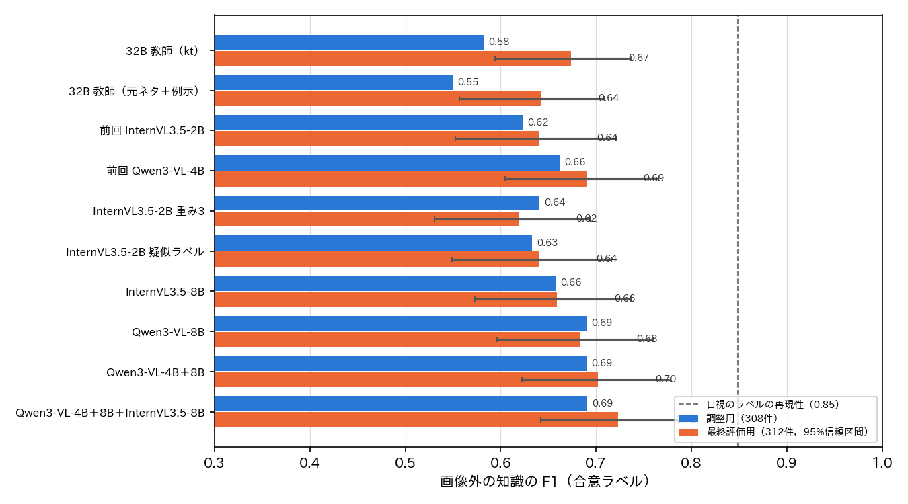
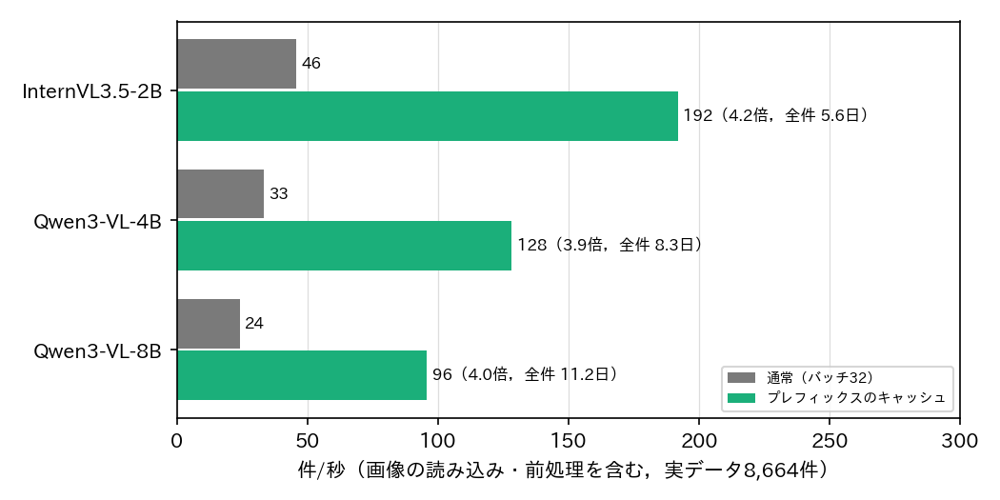

# 大喜利（ボケ）のラベル：画像外の知識の判定の改善と推論の高速化

## 1. 概要

report_023 を受けて，画像外の知識の判定の改善と，判定器の推論の高速化を行った．発話の型（6区分）は現状（最終評価用0.71）のままとした．
評価は report_023 と同じ検証データ620件の合意ラベルで行い，調整用（308件）で選び，最終評価用（312件）で報告する．

結論は次のとおりである．

| 項目 | 前回（report_023） | 今回 |
| :--- | :--- | :--- |
| 画像外の知識（単一のモデル） | Qwen3-VL-4B：調整用0.662，最終評価用0.690 | **Qwen3-VL-8B：調整用0.690，最終評価用0.683** |
| 画像外の知識（アンサンブル） | ― | **Qwen3-VL-4B＋8B：調整用0.690，最終評価用0.702**．＋InternVL3.5-8B の3モデルで 0.691／0.723 |
| 推論の速度（前処理込み） | Qwen3-VL-4B 33件/秒（全件32日） | **プレフィックスのキャッシュで3.9〜4.2倍**．Qwen3-VL-4B 128件/秒（8.3日），InternVL3.5-2B 192件/秒（5.6日） |

**画像外の知識：**
- 改善は調整用で +0.03，最終評価用で +0.01〜0.03 にとどまり，信頼区間（±0.08）の範囲内である．
- 2B〜8B のモデル，教師のラベルの改善，損失の重み，疑似ラベル，再出現の回数の特徴を試したが，いずれも F1 0.66〜0.70 で頭打ちになった．
- 誤りの多くは次の2つである．
  - 有名な台詞・歌詞・ネットの定型の引用に気づかない（知識の不足）．
  - 画像に写っている作品の登場人物の名前を，画像外とする．
- 目視のラベルの再現性（0.85）との差は大きく，小さな VLM の知識量が上限を決めていると考える．

**速度：**
- 同じお題のボケで共通の「画像＋お題の文」の計算をお題ごとに1回にし，ボケごとの計算をボケの文の部分（約20〜60トークン）に限った．
- 予測は，通常の推論と99.7〜99.8%一致した．
- 9,250万件の処理は，Qwen3-VL-4B で約8日，Qwen3-VL-8B で約11日，4B＋8B のアンサンブルで約19日と見積もられる．

## 2. 教師のラベルの改善（32B の指示の変更）

### 2.1 方法

教師（Qwen3-VL-32B-FP8）に，画像外の知識だけを問う4つの指示を与えた．評価には，目視のラベルがある1,551件を使った（学習用931件と検証データ620件）．

| 方法 | 内容 |
| :--- | :--- |
| kt | 前回の指示（依存する事物 → 種類 → 画像内か → 必要か） |
| src | 先に「元ネタ」（作品・人物・台詞・歌詞・CM・流行語・ネットの定型などの引用・もじり・パロディ）を具体的に書かせ，その種類・画像内か・必要かを問い，最後に判定させる |
| src_fs | src に，検証データとは別に作った7つの例を加える |
| src_sc | src を温度0.7で5回生成し，多数決をとる |

### 2.2 結果

表1：教師の画像外の知識（F1．括弧は適合率／再現率）

| 方法 | 学習用931件 | 調整用 | 最終評価用 | 速度 |
| :--- | :--- | :--- | :--- | :--- |
| kt | **0.587** (0.54/0.65) | **0.582** | **0.674** | 4.9件/秒 |
| src | 0.542 (0.44/0.70) | 0.459 | 0.618 | 3.8件/秒 |
| src_fs | 0.537 (0.44/0.68) | 0.549 | 0.642 | 2.8件/秒 |
| src_sc | 0.544 (0.43/0.74) | 0.520 | 0.611 | 2.0件/秒 |

- 元ネタを書き出させると，再現率は上がった．しかし，固有名詞や言い回しをなんでも元ネタとみなして「はい」とするため，適合率が大きく下がり，F1 は悪化した．
- 32B の指示の変更では，教師のラベルを改善できなかった．以下の生徒は，前回の kt（one_kt_cap）のラベルを基本とする．

## 3. 生徒の改善

### 3.1 方法

report_023 の二段階の微調整を基に，次を比べた．

1. **教師のラベルで学習（stage 1）：** LoRA を付けた VLM を，教師のラベル34,634件で1エポック学習する．
2. **目視のラベルで微調整（stage 2）：** 931件で4エポック微調整し，調整用の画像外の知識の F1 が最良のエポックを選ぶ．

変えた要素は次のとおりである．

| 要素 | 内容 |
| :--- | :--- |
| モデル | InternVL3.5-2B／8B，Qwen3-VL-4B（前回）／8B |
| 損失の重み | 画像外の知識の2値交差エントロピーを3倍にする（発話の型は1倍） |
| 疑似ラベル | 前回の Qwen3-VL-4B（二段階の微調整済み）で，学習データの画像外の知識を付け直したラベル．この生徒は検証データで教師より高い（0.69） |
| アンサンブル | 複数のモデルの画像外の知識の確率の平均 |

### 3.2 結果

表2：画像外の知識（F1．調整用／最終評価用．最終評価用の95%信頼区間．AUC は最終評価用）

| 方法 | 調整用 | 最終評価用 | 95%信頼区間 | AUC |
| :--- | :--- | :--- | :--- | :--- |
| 前回 Qwen3-VL-4B（重み1） | 0.662 | 0.690 | 0.60〜0.77 | 0.872 |
| 前回 InternVL3.5-2B（重み1） | 0.623 | 0.641 | 0.55〜0.72 | 0.839 |
| InternVL3.5-2B 重み3 | 0.641 | 0.619 | 0.53〜0.69 | 0.828 |
| InternVL3.5-2B 重み3＋疑似ラベル | 0.633 | 0.640 | 0.55〜0.72 | 0.857 |
| InternVL3.5-8B 重み3 | 0.658 | 0.659 | 0.57〜0.74 | 0.853 |
| **Qwen3-VL-8B 重み3** | **0.690** | 0.683 | 0.60〜0.76 | 0.850 |
| **Qwen3-VL-4B＋8B** | **0.690** | **0.702** | 0.62〜0.78 | 0.880 |
| Qwen3-VL-4B＋8B＋InternVL3.5-8B | 0.691 | **0.723** | 0.62〜0.78 | 0.883 |

- **モデルの大きさ：**
  - Qwen3-VL-8B は，調整用で前回の4B より +0.03 高かった．最終評価用ではほぼ同じだった．
  - InternVL3.5 は 2B から 8B で +0.02〜0.04 上がったが，Qwen3-VL より低い．
  - 画像外の知識には，Qwen3-VL の系列が向いている．
- **損失の重み・疑似ラベル：**
  - 疑似ラベルは，stage 1 の後では効果があった（最終評価用 0.627→0.653）．
  - しかし目視のラベルで微調整した後は，差がなくなった．
  - 重み3も効果がなかった．
- **アンサンブル：** 確率を平均すると，AUC と F1 がわずかに上がった（4B＋8B で最終評価用 +0.01〜0.02）．
- **再出現の回数（参考）：** BoketeDBv4 の全ボケで，同じ文（正規化後）が投稿されたお題の数を数え，特徴として調べた．
  - 引用されやすい台詞が多くのお題に繰り返し投稿されるという仮説に基づく．
  - 画像外の知識との AUC は0.53〜0.56 にとどまった．
  - 短い一般的な言葉（「なにこれ」「いらっしゃいませ」）も多く繰り返されるためである．このため採用しなかった．

### 3.3 誤りの分析（Qwen3-VL-4B＋8B，検証データ620件）

- **見逃し（44件）：** 有名な台詞・歌詞・ネットの定型の引用が大半を占める．例えば，次のようなものである．
  - スラムダンクの「バスケがしたいです」
  - ローランドの「俺か俺以外か」
  - ドラクエの「返事がない。ただの○○のようだ」
  - 鬼滅の刃の「素晴らしい提案をしよう」
  - ポケモンの「こうかはいまひとつのようだ」
  - 文の字面は普通の日本語であるため，元ネタを知らないモデルには判定できない．
- **誤検出（51件）：**
  - 画像に写っているキャラクターと同じ作品の人物を，画像外とするものが多い．例えば，アンパンマンの画像に対するジャムおじさん・バタコさん，ふなっしーの画像に対する「むなっしー」．
  - 固有名詞を含むだけで面白さが一般の知識で分かるものも誤検出された．
  - 一部は目視のラベル自体も判断が分かれる項目である．
- 見逃しは知識の量の問題であり，2〜8B のモデルの微調整では改善が限られる．誤検出は，画像に写っている作品の同定の問題である．

## 4. 推論の高速化

### 4.1 方法

1件ごとの通常の推論では，お題画像（InternVL3.5 で256トークン，Qwen3-VL で画像ごとに可変）とお題の文を含む約300トークンを，毎回計算する．
同じお題のボケ（平均約14件）では，「ボケ：「」までのプレフィックスが共通であるため，計算を次のように分けた（programs/ex017_boke_outside/fast_infer.py）．

1. お題ごとに，プレフィックス（画像の符号化を含む）を1回だけ計算し，言語モデルの KV キャッシュを作る．
   - InternVL3.5：長さが同じプレフィックスをまとめて計算する．
   - Qwen3-VL：左詰めでまとめて計算する．
2. キャッシュをボケの数だけ複製し，ボケの文と閉じ括弧以降だけを計算する．
   - Qwen3-VL の3次元の位置（M-RoPE）は，プレフィックスの最大の位置＋1から続ける．
3. 各ボケの最後のトークンの隠れ状態から，確率を求める．

### 4.2 結果

**正しさ：** 検証データ620件で，通常の推論との一致を確かめた．

| モデル | 判定の一致 | 確率の差（平均） | 確率の差（最大） |
| :--- | :--- | :--- | :--- |
| InternVL3.5-2B | 99.7% | 0.003 | 0.08 |
| Qwen3-VL-4B | 99.8% | 0.003 | 0.07 |

差は，bfloat16 の計算の順序と，プレフィックスとボケの部分を別々にトークン化することによるものである．

**速度：** BoketeDBv4 から無作為に選んだ600お題の全てのボケ（8,664件，1お題あたり14.4件）で，前処理を含む件数/秒を測った．

表3：推論の速度（RTX PRO 6000，前処理8プロセス）

| モデル | 通常（バッチ32） | キャッシュ（ボケ256〜512件ずつ） | 倍率 | 全件の推定日数 |
| :--- | :--- | :--- | :--- | :--- |
| InternVL3.5-2B | 46件/秒 | 192件/秒 | 4.2倍 | 23.3日 → **5.6日** |
| Qwen3-VL-4B | 33件/秒 | 128件/秒 | 3.9倍 | 32.3日 → **8.3日** |
| Qwen3-VL-8B | 24件/秒 | 96件/秒 | 4.0倍 | 44.5日 → **11.2日** |
| Qwen3-VL-4B＋8B（アンサンブル） | 14件/秒 | 55件/秒 | ― | 約19日 |

- 一度にまとめるボケの数を1,024件に増やすと，GPU のメモリの圧迫で遅くなった．256〜512件が最適だった．
- 前処理のプロセスを16に増やしても速くならず，GPU の計算が律速である．

## 5. 推奨する構成

| 用途 | 構成 | 画像外の知識（調整用／最終評価用） | 全件の時間 |
| :--- | :--- | :--- | :--- |
| 精度を優先 | Qwen3-VL-4B＋8B のアンサンブル | 0.690／0.702 | 約19日 |
| 精度と速度の均衡 | Qwen3-VL-8B | 0.690／0.683 | 約11日 |
| 速度を優先 | Qwen3-VL-4B | 0.662／0.690 | 約8日 |

- 3つのいずれも，プレフィックスのキャッシュを用いる．
- 単一のモデルでは，発話の型も同じ判定器で付けられる．Qwen3-VL-8B の6区分は，調整用0.755，最終評価用0.736である．
- 4B と 8B の差は，信頼区間の範囲内である．全件の処理時間を重視するなら，Qwen3-VL-4B が妥当である．

## 6. 未解決の論点と次の候補

1. **画像外の知識の上限：** 誤りの多くは，引用の元ネタを知らないことによる．候補は次のとおりである．
   - より大きなモデル（例：Qwen3-VL-32B）を目視のラベルで微調整し，教師として使う．
   - その教師で付け直したラベルで，4B／8B を学習し直す．
   - 32B の微調整には，LoRA と量子化が必要で，GPU の時間がかかる．
2. **画像中の作品の同定：** 誤検出の多くは，画像に写っている作品の判断の誤りである．
   - お題画像ごとに「写っている作品・キャラクター」を一度だけ 32B で付ける（682万枚）．
   - それを生徒の入力に加える方法が考えられる．お題ごとに1回のため，プレフィックスのキャッシュとも両立する．
3. **全件への適用：** 推奨する構成を，プレフィックスのキャッシュで全件に適用する．
   - 中断と再開に対応した実行のスクリプトを作る．
   - 8〜19日の処理になるため，Bokete_Annotation_programs_v5.0 に組み込むかを判断する．

## 付録：実験の構成

- コード：programs/ex017_boke_outside/
  - data.py
  - teacher.py：32B の指示の変種
  - pseudo.py：疑似ラベル
  - train.py：二段階の微調整
  - recurrence.py：再出現の回数
  - fast_infer.py：プレフィックスのキャッシュ，一致の確認と速度
  - evaluate.py，figures.py
  - run_queue.sh
- 出力（outputs/ex017_boke_outside/）：
  - teacher/{方法}/{labeled,train}.csv
  - ft/{モデル}/{条件}[__stage2]/0/{eval.csv,log.json,speed.json,best_model.pt}
  - fast/{check*,bench_*}.json
  - recurrence/
  - figures/{summary.csv,fig_outside.png,fig_speed.png}
- 本検証は試作であり，Bokete_Annotation_programs_v5.0/ には含めていない．
