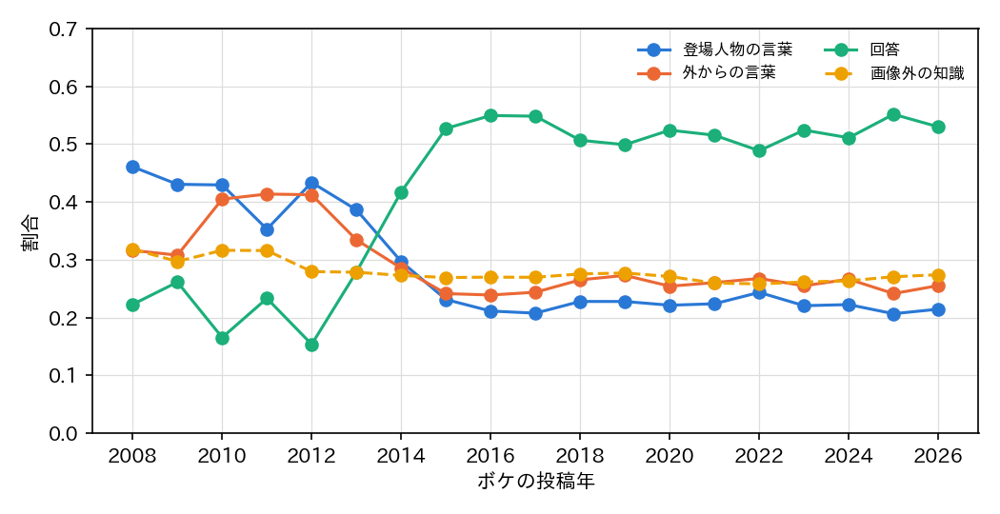
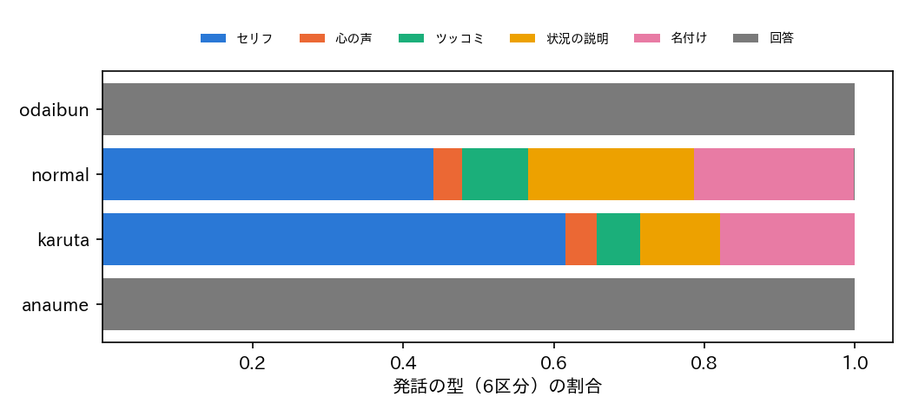
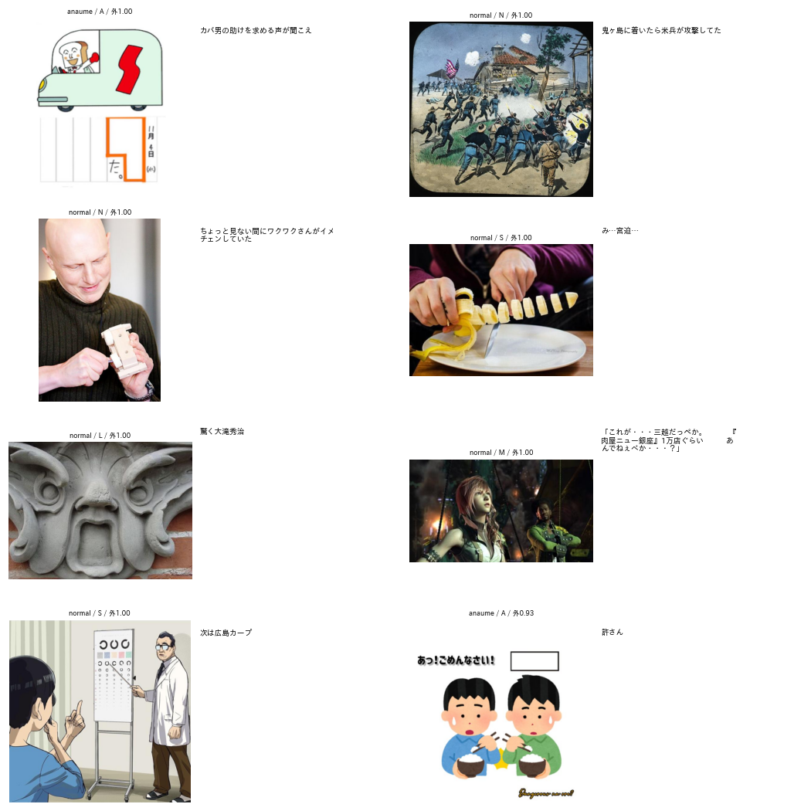

# ボケの全件のアノテーションの実行と結果

## 1. 概要

Bokete_Annotation_programs_v5.0（v5.2.0）のボケの段階で，BoketeDBv4 の全てのボケ（92,495,946件）にアノテーションを行った．
判定器は Qwen3-VL-4B 単独，設定は config.json の既定（report_026）である．

| 項目 | 結果 |
| :--- | :--- |
| 実行期間 | 2026-10-26 01:29 〜 2026-10-29 12:41（約3日11時間．中断なし） |
| 出力 | `outputs/BoketeDBv5_annotation/boke_annotation/part_XXXX.parquet`（814シャード，2.7GB）と `boke_summary.json` |
| 件数 | 全92,495,946件のボケ ID が出力にちょうど1回ずつ含まれる |
| 予測したボケ | 92,492,813件．予測しなかった3,133件は全て，お題画像がない（お題のラベルがない）452お題のボケ |
| 発話の型と画像外の知識の推論 | 85.3時間（約301件/秒．起動は162秒） |
| 制約の順守 | 1.5時間（約17,300件/秒） |

## 2. 処理時間

| 段階 | 件数 | 時間 | 速度 |
| :--- | ---: | ---: | ---: |
| boke_list | 814シャード | 約4分 | — |
| boke_predict | 92,492,813 | 85.3時間 | 301件/秒 |
| boke_compliance | 92,495,946 | 1.5時間 | 17,305件/秒 |
| boke_finalize | 814シャード | 数分 | — |

boke_predict の速度は，事前の調整（report_026）の定常の約345件/秒より約13%遅かった．
主な原因は，後半のシャード（新しいお題）では1お題あたりのボケが少なく，プレフィックス（画像とお題の文）を共有できるボケが減るためと考えられる．
ただし，シャードごとの速度は記録していないため，確かめていない．

## 3. ラベルの分布

表1：全体と形式ごとの分布（予測した92,492,813件）

| 形式 | 件数 | 画像外の知識 | 登場人物の言葉 | 外からの言葉 | 回答 | 順守 |
| :--- | ---: | ---: | ---: | ---: | ---: | :--- |
| 全体 | 92,492,813 | 27.1% | 25.3% | 27.0% | 47.7% | — |
| 通常 | 46,997,640 | 30.1% | 47.8% | 52.1% | 0.1% | — |
| 穴埋め | 33,043,608 | 21.1% | 0.0% | 0.0% | 100.0% | 得点の平均0.846（5%点0.802） |
| お題文 | 10,994,165 | 32.6% | 0.0% | 0.0% | 100.0% | 得点の平均0.841（5%点0.794） |
| カルタ | 1,457,400 | 23.2% | 65.7% | 34.2% | 0.1% | 札のかなで始まる 92.2% |

- **6区分（全体）：** 回答47.7%，セリフ23.3%，状況の説明11.4%，名付け・見立て11.1%，ツッコミ4.5%，心の声2.0%．
- **通常の形式の6区分：** セリフ44.0%，状況の説明22.1%，名付け・見立て21.2%，ツッコミ8.7%，心の声3.8%．
- **回答の扱い：** 穴埋め・お題文のボケは，ほぼ全て（99.999%）回答と判定された．通常とカルタで回答と判定されたのは0.1%であった（画像が空欄・吹き出し・問いを課すお題）．
- **画像外の知識：** 27.1% であり，検証データ（目視で22〜25%）とおおむね一致する．お題文（32.6%）と通常（30.1%）で高く，穴埋め（21.1%）で低い．





**投稿年ごとの推移：**
- 回答の割合は，2012年の15%から2015年の53%へ急増し，以後は約50%で推移した．
  - 穴埋め・お題文のお題の増加によると考えられる．お題画像の論文で示した，形式の投稿年ごとの推移と対応する．
- 登場人物の言葉は，2008〜2012年の約40〜46%から，2015年以降は約21〜24%に減った．
- 画像外の知識は，どの年も26〜32%でほぼ一定であった．

## 4. 目視による確認

ラベルごとに無作為の8件の一覧を作り（`outputs/ex020_boke_full_analysis/sheets/`），目視で確かめた．



**画像外の知識の「はい」：** 8件中6件程度は，画像外の特定の事物に依存しており妥当であった．
- 妥当な例：ワクワクさん，広島カープ，三越，大滝秀治，カバ男．
- 判断が分かれる例：「鬼ヶ島に着いたら米兵が攻撃してた」（桃太郎は誰もが知る昔話であり，定義では「いいえ」に近い）．

**ツッコミ：** 画像の人物の言葉とも読めるボケが含まれた．6区分が信頼性の低いラベルであるという評価（検証データで F1 0.71，ツッコミは0.45）と合う．

## 5. 出力の使い方

```python
import polars as pl

boke = pl.scan_parquet("Bokete_Annotation_programs_v5.0/outputs/BoketeDBv5_annotation/boke_annotation/*.parquet")
# 例：画像外の知識が要らない通常の形式のボケ
plain = boke.filter((pl.col("format") == "normal") & ~pl.col("outside")).collect()
```

列の定義はパッケージの `docs/data_format.md`（2.4節）と `docs/boke_label_definition.md` にある．
6区分（`voice6`）は信頼性が低いため，集計や生成の条件には3区分（`voice3`）を用いること．

## 6. 未解決の論点と次の候補

1. **論文への追記：** `paper_boke/` の論文に，全件への適用の結果の章を加える．内容は，表1，投稿年ごとの推移，処理時間である．
2. **ラベルの利用：** 大喜利の生成や判定の研究で，次のように使う．
   - 3区分を生成の条件にする．
   - 画像外の知識の有無で評価を分ける．
   - 穴埋め・お題文の得点の下位を学習データから除く．
3. **品質の確認の拡大：** 今回の目視の確認はラベルごとに8件のみである．無作為の数百件に目視のラベルを付ければ，実データでの精度を推定できる（お題画像の論文の「実データの目視ラベル」と同様の方法）．
4. **パッケージの公開：** 変更（v5.2.0）はまだ commit していない．重みは Releases などで配布する必要がある．

## 付録

- 実行のログ：`Bokete_Annotation_programs_v5.0/outputs/BoketeDBv5_annotation/logs/boke_full_run1.log`
- 確認と集計：`programs/ex020_boke_full_analysis/analyze.py` → `outputs/ex020_boke_full_analysis/`
  - `check.json`，`dist.json`，`by_format.csv`，`by_year.csv`，`fig_*.png`，`sheets/`
