# Claude Code が目視で付けたラベルの層ごとの例（お題画像と大喜利）

## 1. 概要

本プロジェクトの評価用・検証用のラベルの多くは，Claude Code が画像を見て目視で付けたものである．本稿では，そのうち層別に抽出したお題画像とボケ（大喜利の回答文）のラベルについて，層ごとの分布と例をまとめる．新たなラベルは付けていない．

| 対象 | データ | 件数 | 層 | ラベルの定義 |
| :--- | :--- | ---: | :--- | :--- |
| お題画像 | 実データの層別抽出（ex008，`real_strat_v4.txt`） | 220枚 | 生徒の予測で11層，各層20枚 | 定義書 v4（形式・属性・媒体） |
| ボケ | 検証データの前半（ex013，`eval_labels.txt`） | 420件 | お題のラベルで7層，各層60件（12お題×5件） | 発話の型・画像外の知識は第3版の合意ラベル．その他は第1版 |
| ボケ | 検証データの後半（ex014，`eval2_labels.txt`） | 200件 | 少ない発話の型の候補で5層，各層40件 | 同上（その他は第2版） |

層ごとの分布から，次のことが読み取れる．

- **お題画像：** 層は生徒の予測で決めたため，目視のラベルと一致しない画像を含む．層の名前のクラスが目視でも付いた割合は，マンガ・穴埋め・写真・カルタで19〜20枚，絵画で14枚，お題文で14枚であった．
- **ボケの発話の型：** 穴埋めとお題文の層は全て回答である．形式が通常の層ではセリフが最も多い（42〜60%）．通常の写真・文字ありとアニメかマンガの層にも，画像が問いを課すために回答としたボケが10件ずつある．
- **少ない型の候補：** 規則か教師がツッコミと予測したボケのうち，目視でもツッコミとしたのは40件中6件のみであった．状況の説明は38件，心の声は22件，名付け・見立ては22件が目視でも同じ型であった．

## 2. 対象のデータとラベル

### 2.1 お題画像

ex007 の最良の生徒（T_v8m，少ない区分の追加あり，重みなし，seed 0）の実データへの予測で，各画像を層に割り当てた（ex008 の `sample.py`）．画像は，予測されたクラスのうち最も少ないクラスの層に入る．層の優先順は，絵画，カルタ，ゲーム，アニメ，お題文，イラスト，テキストグラフィック，マンガ，穴埋め，文字あり，写真（残り）である．各層から20枚を無作為に抽出し，層と予測が分からないよう順番を混ぜた一覧で，定義書 v4 に従ってラベルを付けた．ラベルは次の3軸である．

- 形式（1つ）：カルタ，穴埋め，お題文，通常
- 属性（複数）：空欄あり，カルタ記号あり，文字あり
- 媒体（複数）：写真，アニメ，ゲーム，マンガ，テキストグラフィック，絵画，イラスト

### 2.2 ボケ

前半の420件は，BoketeDBv5 のお題のラベルで7層に分けたお題から，各層12お題を抽出し，お題ごとに評価の上位3件と無作為の2件のボケを取った（ex012 と ex013 の `sample.py`，`sample_eval.py`）．後半の200件は，規則か教師（Qwen3-VL-30B-A3B）が心の声・ツッコミ・状況の説明・名付け・セリフと予測したボケから，型ごとに40件を抽出した（ex014 の `sample_rare.py`）．後半の層は，抽出に用いた予測の型（候補）である．

本稿で示すラベルは次のとおりである．

| ラベル | 値 | 出典 |
| :------- | :---------------- | :---------- |
| 発話の型 | セリフ，心の声，ツッコミ・呼びかけ，状況の説明・物語，名付け・見立て，回答（3区分：登場人物の言葉，外からの言葉，回答） | ex016 の合意ラベル（`consensus_labels.txt`） |
| 画像外の知識 | はい／いいえ | 同上 |
| 必要な知識 | 見た目だけ，一般常識，画像中の対象，画像外の対象 | ex013／ex014 のラベル（第1・2版．第3版で画像外の知識の2値に置き換えた） |
| 制約の順守 | はい，いいえ，対象外（形式が通常） | 同上 |
| 画像中の文字への依存 | はい／いいえ | 同上 |

合意ラベルは，620件を元のラベルを見ずに付け直し，元のラベルとの不一致を裁定したものである（report_023）．付け直しとの一致は，6区分のマクロ F1 で0.80，画像外の知識で0.85であった．例の表示からは，第1版で性的・不適切とした27件を除いた．分布の集計には含めている．

例は，各層から無作為に選んだ（お題画像は5枚，ボケは4件．ボケはお題が重ならず，発話の型がなるべく異なるように選んだ）．図と表は ex021 の `make_examples.py` で作った．

## 3. お題画像の層ごとの例

表1に，層ごとの目視のラベルの件数を示す．母集団の枚数は，抽出時に各層に割り当てられた画像の枚数である．

表1 お題画像の層ごとの目視のラベルの件数（各層20枚）．形式は カ：カルタ，穴：穴埋め，題：お題文，通：通常．属性は 空：空欄あり，記：カルタ記号あり，文：文字あり．媒体は 写：写真，ア：アニメ，ゲ：ゲーム，マ：マンガ，テ：テキストグラフィック，絵：絵画，イ：イラスト．

| 層 | 母集団 | カ | 穴 | 題 | 通 | 空 | 記 | 文 | 写 | ア | ゲ | マ | テ | 絵 | イ |
| :------------ | -----: | --: | --: | --: | --: | --: | --: | --: | --: | --: | --: | --: | --: | --: | --: |
| 絵画 | 1,090 | 0 | 3 | 0 | 17 | 3 | 0 | 7 | 1 | 0 | 0 | 0 | 0 | 14 | 5 |
| カルタ | 2,066 | 19 | 0 | 0 | 1 | 0 | 19 | 5 | 12 | 2 | 1 | 0 | 0 | 0 | 5 |
| ゲーム | 7,782 | 0 | 7 | 0 | 13 | 7 | 0 | 11 | 1 | 0 | 17 | 0 | 1 | 0 | 2 |
| アニメ | 25,964 | 0 | 1 | 0 | 19 | 1 | 0 | 4 | 0 | 19 | 0 | 0 | 0 | 0 | 1 |
| お題文 | 32,842 | 0 | 1 | 14 | 5 | 1 | 0 | 20 | 0 | 0 | 0 | 0 | 19 | 0 | 1 |
| イラスト | 26,220 | 0 | 5 | 0 | 15 | 5 | 0 | 11 | 3 | 0 | 0 | 0 | 5 | 1 | 16 |
| テキストグラフィック | 11,372 | 0 | 19 | 1 | 0 | 19 | 0 | 20 | 2 | 1 | 0 | 0 | 18 | 0 | 1 |
| マンガ | 42,668 | 0 | 9 | 0 | 11 | 9 | 0 | 20 | 0 | 0 | 0 | 20 | 0 | 0 | 0 |
| 穴埋め | 13,896 | 0 | 20 | 0 | 0 | 20 | 0 | 20 | 19 | 0 | 0 | 0 | 3 | 0 | 1 |
| 文字あり | 32,928 | 0 | 0 | 1 | 19 | 0 | 0 | 17 | 20 | 0 | 0 | 0 | 1 | 0 | 0 |
| 写真（残り） | 97,214 | 0 | 0 | 0 | 20 | 0 | 0 | 1 | 20 | 0 | 0 | 0 | 0 | 0 | 0 |

層の優先順のため，テキストグラフィックの層の19枚とマンガの層の9枚は穴埋めである．これらは穴埋めと予測されたうえで，より少ないクラスの層に入った画像である．以下に，層ごとの例を示す．各画像の上には，お題 ID と目視のラベル（形式／属性，媒体）を示す．

### 3.1 絵画

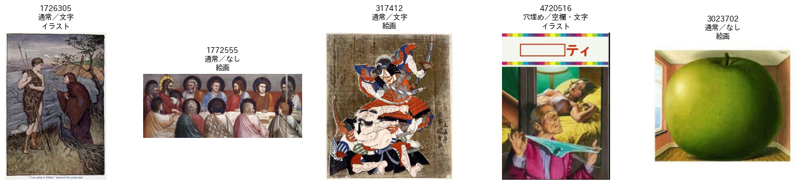

図1 絵画の層の例．古典的な絵画は絵画とし，挿絵や近年の写実的な絵はイラストとした．20枚中14枚が絵画，5枚がイラストであった．

### 3.2 カルタ

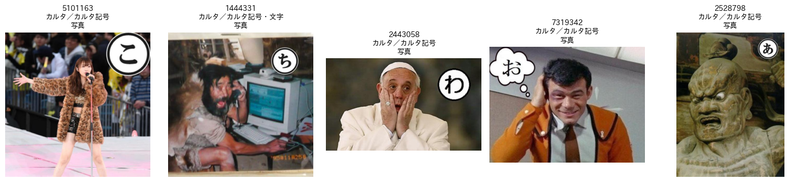

図2 カルタの層の例．丸で囲んだかなの札があればカルタとし，属性にカルタ記号を付けた．20枚中19枚がカルタであった．

### 3.3 ゲーム

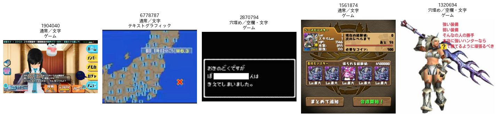

図3 ゲームの層の例．ゲームの画面は17枚であった．ゲームの画面に空欄を加えた穴埋めが7枚含まれる．

### 3.4 アニメ

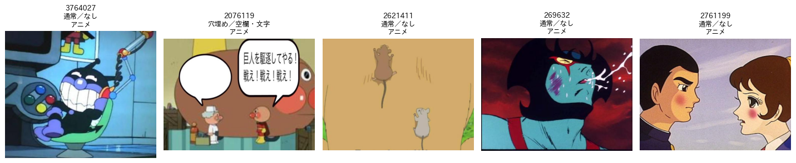

図4 アニメの層の例．20枚中19枚がアニメであった．

### 3.5 お題文

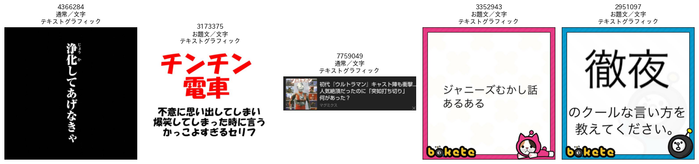

図5 お題文の層の例．ボケての枠で問いや指示を示す画像はお題文とした．記事の見出しや画像に元からある文字だけの画像は通常とした（左端と中央）．20枚中14枚がお題文であった．

### 3.6 イラスト

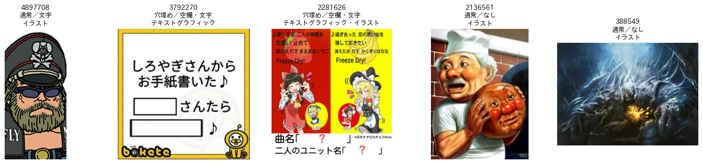

図6 イラストの層の例．20枚中16枚がイラストであり，5枚がテキストグラフィックを含んでいた．

### 3.7 テキストグラフィック

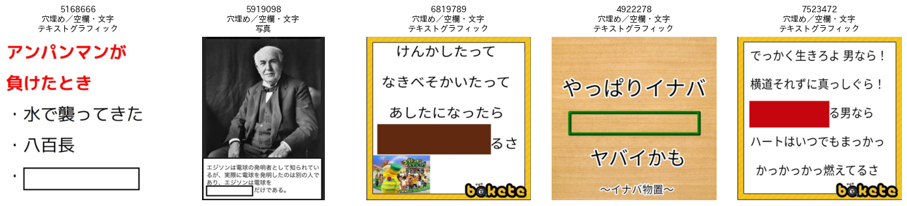

図7 テキストグラフィックの層の例．文字を主体とする画像はテキストグラフィックとし，空欄があれば穴埋めとした．写真に説明文と空欄を加えた画像は，媒体を写真とした（左から2枚目）．

### 3.8 マンガ

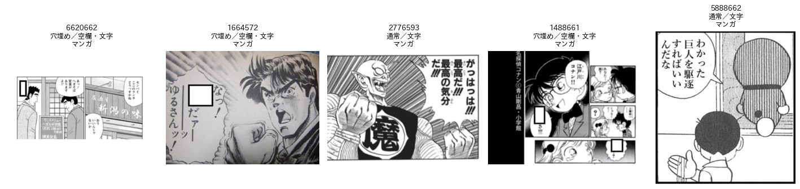

図8 マンガの層の例．全20枚がマンガであり，吹き出しの空欄を穴埋めとした画像が9枚あった．

### 3.9 穴埋め

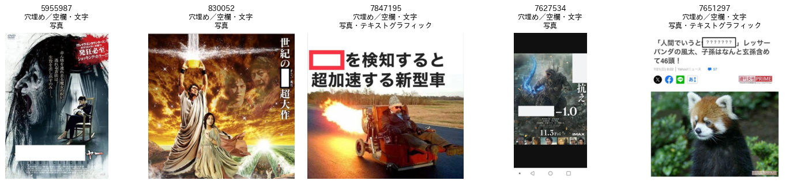

図9 穴埋めの層の例．全20枚が穴埋めであり，19枚は写真に空欄を加えた画像であった．

### 3.10 文字あり

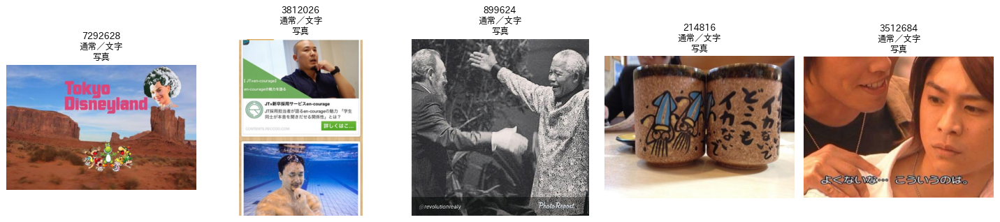

図10 文字ありの層の例．看板，テロップ，ロゴなど読める文字があれば文字ありとした．20枚中17枚が文字ありであった．

### 3.11 写真（残り）

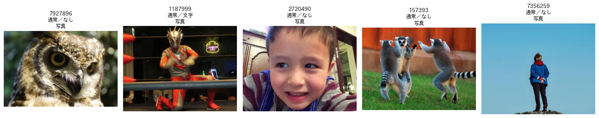

図11 写真（残り）の層の例．母集団の最も大きい層である．全20枚が通常の写真であり，文字ありは1枚であった．

## 4. ボケのお題の層ごとの例

表2に，前半の420件の層ごとのラベルの件数を示す．発話の型と画像外の知識は合意ラベル，必要な知識，順守，文字への依存は第1版のラベルである．

表2 ボケのお題の層ごとのラベルの件数（各層60件）．発話の型は S：セリフ，M：心の声，T：ツッコミ・呼びかけ，N：状況の説明・物語，L：名付け・見立て，A：回答．外：画像外の知識が「はい」．必要な知識は 0：見た目だけ，G：一般常識，I：画像中の対象，O：画像外の対象．違反：制約の順守が「いいえ」．文字：画像中の文字への依存が「はい」．

| 層 | S | M | T | N | L | A | 外 | 0 | G | I | O | 違反 | 文字 |
| :-------------- | --: | --: | --: | --: | --: | --: | --: | --: | --: | --: | --: | ---: | ---: |
| カルタ | 43 | 5 | 2 | 4 | 6 | 0 | 19 | 30 | 11 | 1 | 18 | 3 | 1 |
| 穴埋め | 0 | 0 | 0 | 0 | 0 | 60 | 15 | 5 | 33 | 6 | 16 | 1 | 54 |
| お題文 | 0 | 0 | 0 | 0 | 0 | 60 | 22 | 7 | 23 | 10 | 20 | 0 | 60 |
| 通常・写真・文字あり | 28 | 2 | 3 | 6 | 11 | 10 | 20 | 11 | 26 | 8 | 15 | 0 | 13 |
| 通常・写真・文字なし | 36 | 4 | 2 | 9 | 9 | 0 | 15 | 24 | 13 | 8 | 15 | 0 | 0 |
| 通常・アニメかマンガ | 25 | 4 | 3 | 5 | 13 | 10 | 7 | 13 | 19 | 19 | 9 | 0 | 34 |
| 通常・その他の媒体 | 34 | 6 | 1 | 8 | 11 | 0 | 7 | 23 | 15 | 15 | 7 | 0 | 3 |

表2から，層によって次の違いがある．

- 画像外の知識は，お題文（22件，37%）と写真の2層（15〜20件）で多く，アニメかマンガとその他の媒体（7件，12%）で少ない．アニメやゲームの層では，キャラクターを同定する「画像中の対象」が多い（15〜19件）．
- 文字への依存は，お題文で全件，穴埋めで54件である．アニメかマンガの層では34件と多い．マンガの吹き出しやコマの文字を受けるボケが多いためである．
- 制約の順守を「いいえ」としたのは，カルタの3件と穴埋めの1件のみであった．

以下の各図では，左にお題画像，右にボケの文と目視のラベルを示す．各表の画像外は画像外の知識，知識は必要な知識（第1・2版），順守は制約の順守，文字は画像中の文字への依存である．

### 4.1 カルタ

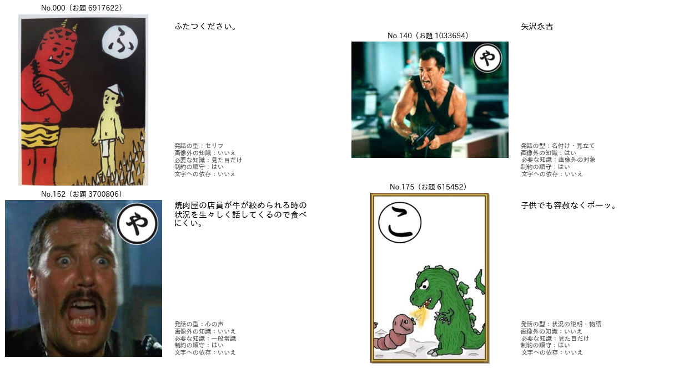

図12 カルタの層の例．

| 番号 | ボケ | 発話の型（3区分） | 画像外 | 知識 | 順守 | 文字 |
| :--: | :---------------------------- | :------------ | :---: | :-------- | :---: | :---: |
| 000 | ふたつください。 | セリフ（登場人物の言葉） | いいえ | 見た目だけ | はい | いいえ |
| 140 | 矢沢永吉 | 名付け・見立て（外からの言葉） | はい | 画像外の対象 | はい | いいえ |
| 152 | 焼肉屋の店員が牛が絞められる時の状況を生々しく話してくるので食べにくい。 | 心の声（登場人物の言葉） | いいえ | 一般常識 | はい | いいえ |
| 175 | 子供でも容赦なくボーッ。 | 状況の説明・物語（外からの言葉） | いいえ | 見た目だけ | はい | いいえ |

カルタのボケは札のかなで始まれば順守とし，札の文字そのものを読む必要はないため，文字への依存は「いいえ」とした．No.140 は人物を実在の歌手に見立てており，画像の外の人物を知らないと面白さが分からないため，画像外の知識を「はい」とした．

### 4.2 穴埋め

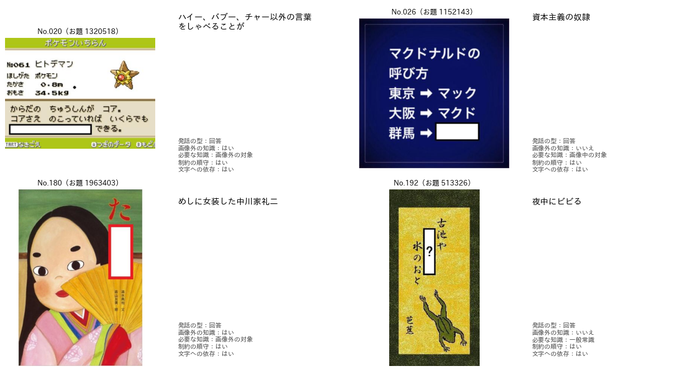

図13 穴埋めの層の例．

| 番号 | ボケ | 発話の型（3区分） | 画像外 | 知識 | 順守 | 文字 |
| :--: | :---------------------------- | :------------ | :---: | :-------- | :---: | :---: |
| 020 | ハイー、バブー、チャー以外の言葉をしゃべることが | 回答（回答） | はい | 画像外の対象 | はい | はい |
| 026 | 資本主義の奴隷 | 回答（回答） | いいえ | 画像中の対象 | はい | はい |
| 180 | めしに女装した中川家礼二 | 回答（回答） | はい | 画像外の対象 | はい | はい |
| 192 | 夜中にビビる | 回答（回答） | いいえ | 一般常識 | はい | はい |

穴埋めのボケは空欄に入る語句であり，全て回答とした．空欄の前後の文を読まないと意味が通らないため，文字への依存は「はい」である．No.020 は『サザエさん』のイクラちゃんの口癖を知っていることが前提のため，画像外の知識を「はい」とした．

### 4.3 お題文

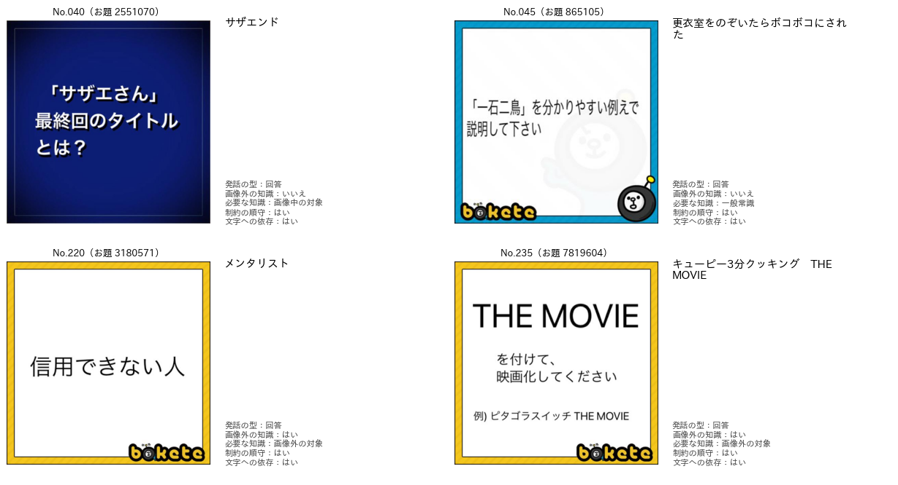

図14 お題文の層の例．

| 番号 | ボケ | 発話の型（3区分） | 画像外 | 知識 | 順守 | 文字 |
| :--: | :---------------------------- | :------------ | :---: | :-------- | :---: | :---: |
| 040 | サザエンド | 回答（回答） | いいえ | 画像中の対象 | はい | はい |
| 045 | 更衣室をのぞいたらボコボコにされた | 回答（回答） | いいえ | 一般常識 | はい | はい |
| 220 | メンタリスト | 回答（回答） | はい | 画像外の対象 | はい | はい |
| 235 | キューピー3分クッキング　THE MOVIE | 回答（回答） | はい | 画像外の対象 | はい | はい |

お題文のボケは，問いや指示への答えとして全て回答とした．No.235 のように番組名をもじるボケは，元の番組を知る必要があるため画像外の知識を「はい」とした．

### 4.4 通常・写真・文字あり

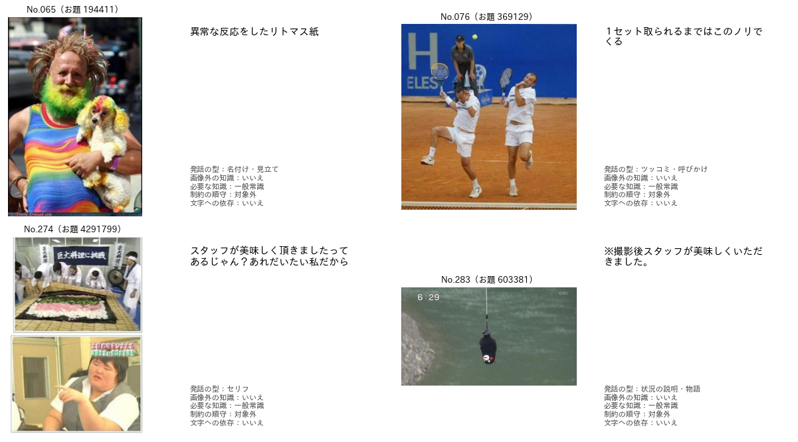

図15 通常・写真・文字ありの層の例．

| 番号 | ボケ | 発話の型（3区分） | 画像外 | 知識 | 順守 | 文字 |
| :--: | :---------------------------- | :------------ | :---: | :-------- | :---: | :---: |
| 065 | 異常な反応をしたリトマス紙 | 名付け・見立て（外からの言葉） | いいえ | 一般常識 | 対象外 | いいえ |
| 076 | １セット取られるまではこのノリでくる | ツッコミ・呼びかけ（外からの言葉） | いいえ | 一般常識 | 対象外 | いいえ |
| 274 | スタッフが美味しく頂きましたってあるじゃん？あれだいたい私だから | セリフ（登場人物の言葉） | いいえ | 一般常識 | 対象外 | いいえ |
| 283 | ※撮影後スタッフが美味しくいただきました。 | 状況の説明・物語（外からの言葉） | いいえ | 一般常識 | 対象外 | いいえ |

No.065 は人物を「リトマス紙」に見立てているため名付け・見立てとした．No.274 は画像中の人物が話す言葉であるためセリフ，No.283 はテロップ風の注記であるため状況の説明とした．画像に文字があっても，ボケがその文字を受けていなければ文字への依存は「いいえ」とした．

### 4.5 通常・写真・文字なし

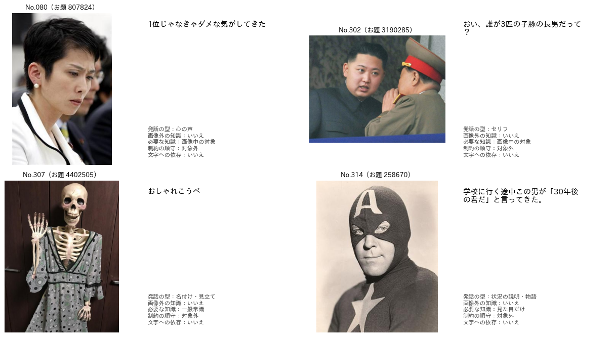

図16 通常・写真・文字なしの層の例．

| 番号 | ボケ | 発話の型（3区分） | 画像外 | 知識 | 順守 | 文字 |
| :--: | :---------------------------- | :------------ | :---: | :-------- | :---: | :---: |
| 080 | 1位じゃなきゃダメな気がしてきた | 心の声（登場人物の言葉） | いいえ | 画像中の対象 | 対象外 | いいえ |
| 302 | おい、誰が3匹の子豚の長男だって？ | セリフ（登場人物の言葉） | いいえ | 画像中の対象 | 対象外 | いいえ |
| 307 | おしゃれこうべ | 名付け・見立て（外からの言葉） | いいえ | 一般常識 | 対象外 | いいえ |
| 314 | 学校に行く途中この男が「30年後の君だ」と言ってきた。 | 状況の説明・物語（外からの言葉） | いいえ | 見た目だけ | 対象外 | いいえ |

No.080 は声に出さない独白であるため心の声，No.302 は相手に向けて発する言葉であるためセリフとした．No.314 は語り手が出来事を語る形であるため，引用のセリフを含んでいても状況の説明・物語とした．

### 4.6 通常・アニメかマンガ

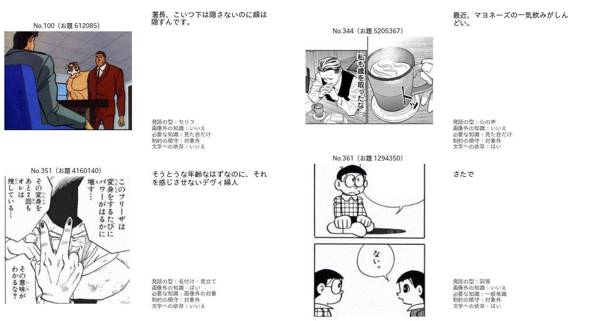

図17 通常・アニメかマンガの層の例．

| 番号 | ボケ | 発話の型（3区分） | 画像外 | 知識 | 順守 | 文字 |
| :--: | :---------------------------- | :------------ | :---: | :-------- | :---: | :---: |
| 100 | 署長、こいつ下は隠さないのに顔は隠すんです。 | セリフ（登場人物の言葉） | いいえ | 見た目だけ | 対象外 | いいえ |
| 344 | 最近、マヨネーズの一気飲みがしんどい。 | 心の声（登場人物の言葉） | いいえ | 見た目だけ | 対象外 | はい |
| 351 | そうとうな年齢なはずなのに、それを感じさせないデヴィ婦人 | 名付け・見立て（外からの言葉） | はい | 画像外の対象 | 対象外 | いいえ |
| 361 | さたで | 回答（回答） | いいえ | 一般常識 | 対象外 | はい |

No.361 は，形式のラベルは通常であるが，マンガの吹き出しが空欄であるため回答とした（第3版で追記した規則）．このような画像は，お題の形式のラベルの誤りの候補でもある．

### 4.7 通常・その他の媒体

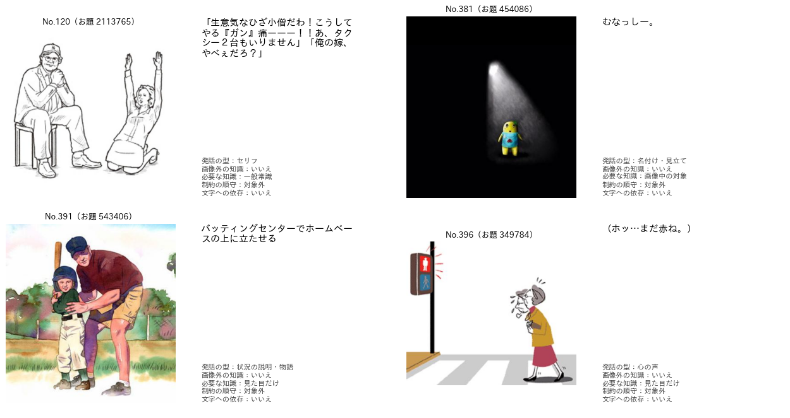

図18 通常・その他の媒体（イラスト，ゲーム，絵画，テキストグラフィック）の層の例．

| 番号 | ボケ | 発話の型（3区分） | 画像外 | 知識 | 順守 | 文字 |
| :--: | :---------------------------- | :------------ | :---: | :-------- | :---: | :---: |
| 120 | 「生意気なひざ小僧だわ！こうしてやる『ガン』痛ーーー！！あ、タクシー２台もいりません」「俺の嫁、やべぇだろ？」 | セリフ（登場人物の言葉） | いいえ | 一般常識 | 対象外 | いいえ |
| 381 | むなっしー。 | 名付け・見立て（外からの言葉） | いいえ | 画像中の対象 | 対象外 | いいえ |
| 391 | バッティングセンターでホームベースの上に立たせる | 状況の説明・物語（外からの言葉） | いいえ | 見た目だけ | 対象外 | いいえ |
| 396 | （ホッ…まだ赤ね。） | 心の声（登場人物の言葉） | いいえ | 見た目だけ | 対象外 | いいえ |

No.381 は画像のキャラクター（ふなっしー）を同定したうえでのもじりである．第1版では「画像中の対象」とし，第3版の画像外の知識は「いいえ」とした．第3版では，画像に写る対象の同定は画像外の知識に含めないためである．No.396 のように括弧で囲んだ独白は心の声とした．

## 5. ボケの少ない型の候補ごとの例

表3に，後半の200件の候補ごとのラベルの件数を示す．必要な知識，順守，文字への依存は第2版のラベルである．

表3 ボケの少ない型の候補ごとのラベルの件数（各層40件）．記号は表2と同じである．

| 候補 | S | M | T | N | L | A | 外 | 0 | G | I | O | 違反 | 文字 |
| :-------------- | --: | --: | --: | --: | --: | --: | --: | --: | --: | --: | --: | ---: | ---: |
| 心の声 | 10 | 22 | 1 | 6 | 1 | 0 | 5 | 19 | 8 | 11 | 2 | 1 | 9 |
| ツッコミ・呼びかけ | 15 | 0 | 6 | 9 | 10 | 0 | 13 | 14 | 6 | 12 | 8 | 0 | 9 |
| 状況の説明・物語 | 2 | 0 | 0 | 38 | 0 | 0 | 6 | 23 | 1 | 12 | 4 | 2 | 8 |
| 名付け・見立て | 12 | 1 | 1 | 2 | 22 | 2 | 11 | 8 | 11 | 11 | 10 | 3 | 9 |
| セリフ | 16 | 2 | 7 | 11 | 3 | 1 | 13 | 17 | 2 | 9 | 12 | 0 | 12 |

候補と目視の型が一致した割合は，状況の説明で0.95，心の声と名付け・見立てで0.55，セリフで0.40，ツッコミで0.15であった．ツッコミの候補は，セリフ（15件），名付け・見立て（10件），状況の説明（9件）に分かれた．教師がツッコミを過剰に予測する偏り（report_020）は，この表にも現れている．

### 5.1 候補：心の声

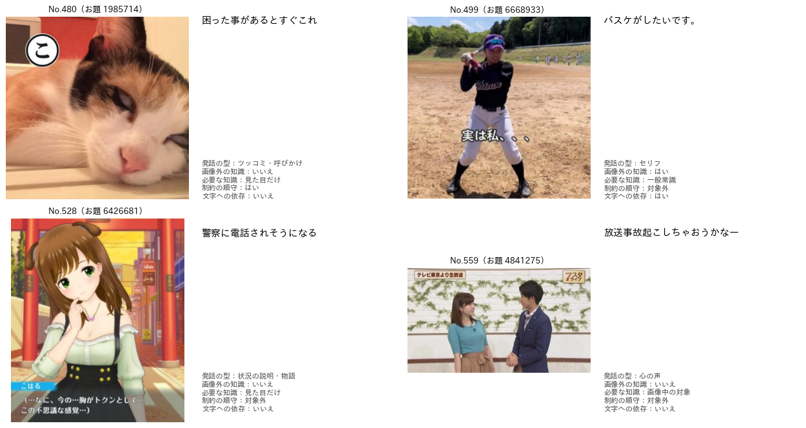

図19 心の声の候補の例．

| 番号 | ボケ | 発話の型（3区分） | 画像外 | 知識 | 順守 | 文字 |
| :--: | :---------------------------- | :------------ | :---: | :-------- | :---: | :---: |
| 480 | 困った事があるとすぐこれ | ツッコミ・呼びかけ（外からの言葉） | いいえ | 見た目だけ | はい | いいえ |
| 499 | バスケがしたいです。 | セリフ（登場人物の言葉） | はい | 一般常識 | 対象外 | はい |
| 528 | 警察に電話されそうになる | 状況の説明・物語（外からの言葉） | いいえ | 見た目だけ | 対象外 | いいえ |
| 559 | 放送事故起こしちゃおうかなー | 心の声（登場人物の言葉） | いいえ | 画像中の対象 | 対象外 | いいえ |

No.480 は画像の人物の振る舞いを外から評する言葉であるため，ツッコミとした．No.499 は『SLAM DUNK』の台詞の引用であり，画像外の知識を「はい」とした．

### 5.2 候補：ツッコミ・呼びかけ

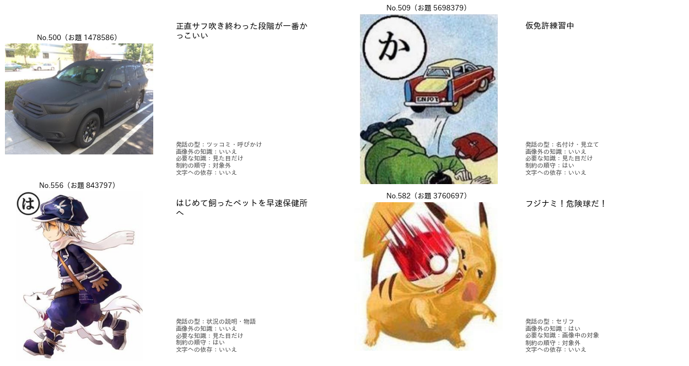

図20 ツッコミ・呼びかけの候補の例．

| 番号 | ボケ | 発話の型（3区分） | 画像外 | 知識 | 順守 | 文字 |
| :--: | :---------------------------- | :------------ | :---: | :-------- | :---: | :---: |
| 500 | 正直サフ吹き終わった段階が一番かっこいい | ツッコミ・呼びかけ（外からの言葉） | いいえ | 見た目だけ | 対象外 | いいえ |
| 509 | 仮免許練習中 | 名付け・見立て（外からの言葉） | いいえ | 見た目だけ | はい | いいえ |
| 556 | はじめて飼ったペットを早速保健所へ | 状況の説明・物語（外からの言葉） | いいえ | 見た目だけ | はい | いいえ |
| 582 | フジナミ！危険球だ！ | セリフ（登場人物の言葉） | はい | 画像中の対象 | 対象外 | いいえ |

No.500 は，黒一色の車をプラモデルの下地塗装（サーフェイサー）に見立てて評する言葉であるため，ツッコミとした．No.509 は場面に題を付ける形であるため名付け・見立てとした．

### 5.3 候補：状況の説明・物語

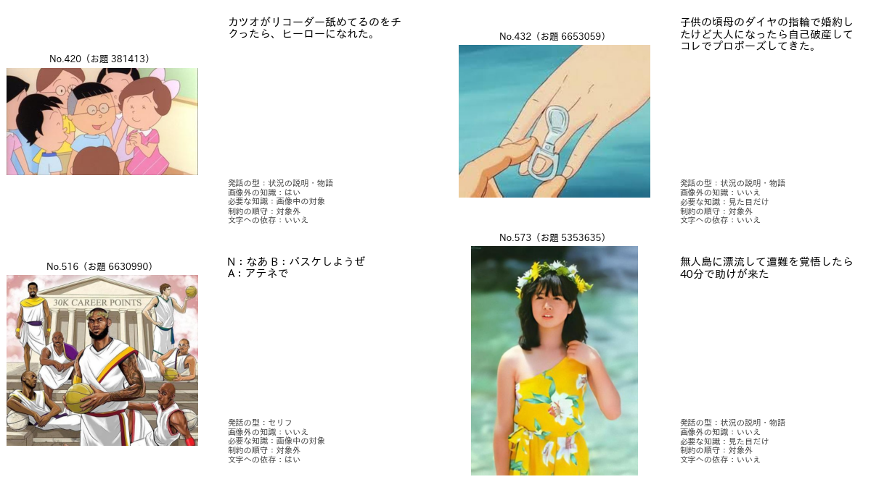

図21 状況の説明・物語の候補の例．

| 番号 | ボケ | 発話の型（3区分） | 画像外 | 知識 | 順守 | 文字 |
| :--: | :---------------------------- | :------------ | :---: | :-------- | :---: | :---: |
| 420 | カツオがリコーダー舐めてるのをチクったら、ヒーローになれた。 | 状況の説明・物語（外からの言葉） | はい | 画像中の対象 | 対象外 | いいえ |
| 432 | 子供の頃母のダイヤの指輪で婚約したけど大人になったら自己破産してコレでプロポーズしてきた。 | 状況の説明・物語（外からの言葉） | いいえ | 見た目だけ | 対象外 | いいえ |
| 516 | N：なあ B：バスケしようぜ A：アテネで | セリフ（登場人物の言葉） | いいえ | 画像中の対象 | 対象外 | はい |
| 573 | 無人島に漂流して遭難を覚悟したら40分で助けが来た | 状況の説明・物語（外からの言葉） | いいえ | 見た目だけ | 対象外 | いいえ |

No.516 は，古代ギリシャ風の装いのバスケットボール選手の絵に対し，NBA の頭文字で文を作った掛け合いであり，セリフとした．候補の状況の説明と目視の型が異なる例である．

### 5.4 候補：名付け・見立て

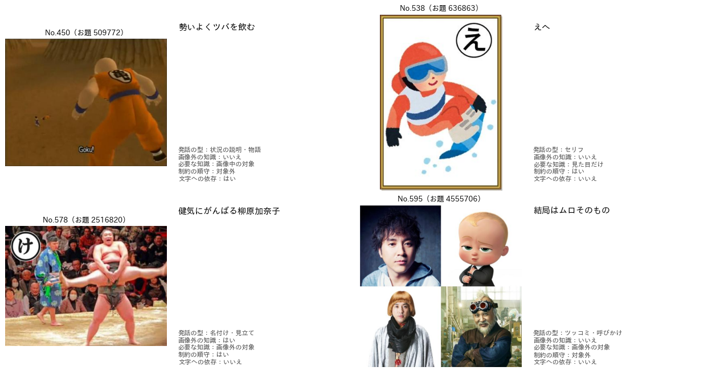

図22 名付け・見立ての候補の例．

| 番号 | ボケ | 発話の型（3区分） | 画像外 | 知識 | 順守 | 文字 |
| :--: | :---------------------------- | :------------ | :---: | :-------- | :---: | :---: |
| 450 | 勢いよくツバを飲む | 状況の説明・物語（外からの言葉） | いいえ | 画像中の対象 | 対象外 | はい |
| 538 | えへ | セリフ（登場人物の言葉） | いいえ | 見た目だけ | はい | いいえ |
| 578 | 健気にがんばる柳原加奈子 | 名付け・見立て（外からの言葉） | はい | 画像外の対象 | はい | いいえ |
| 595 | 結局はムロそのもの | ツッコミ・呼びかけ（外からの言葉） | いいえ | 画像外の対象 | 対象外 | いいえ |

No.578 は人物を実在のタレントに見立てているため，名付け・見立てで画像外の知識を「はい」とした．No.595 は第2版では「画像外の対象」としたが，合意ラベルの画像外の知識は「いいえ」である．このように，第2版の「画像外の対象」と第3版の画像外の知識は一致しない場合がある．

### 5.5 候補：セリフ

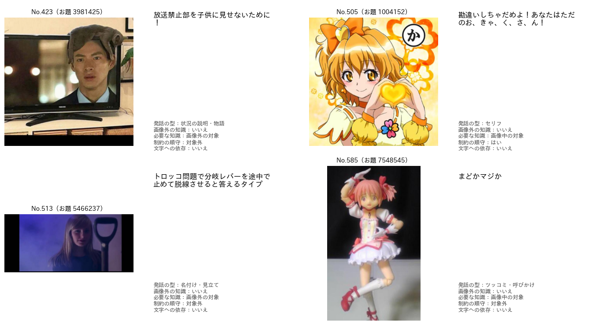

図23 セリフの候補の例．

| 番号 | ボケ | 発話の型（3区分） | 画像外 | 知識 | 順守 | 文字 |
| :--: | :---------------------------- | :------------ | :---: | :-------- | :---: | :---: |
| 423 | 放送禁止部を子供に見せないために！ | 状況の説明・物語（外からの言葉） | いいえ | 画像外の対象 | 対象外 | いいえ |
| 505 | 勘違いしちゃだめよ！あなたはただのお、きゃ、く、さ、ん！ | セリフ（登場人物の言葉） | いいえ | 画像中の対象 | はい | いいえ |
| 513 | トロッコ問題で分岐レバーを途中で止めて脱線させると答えるタイプ | 名付け・見立て（外からの言葉） | いいえ | 画像外の対象 | 対象外 | いいえ |
| 585 | まどかマジか | ツッコミ・呼びかけ（外からの言葉） | いいえ | 画像中の対象 | 対象外 | いいえ |

No.513 は「〜タイプ」と人物を分類する形であるため，名付け・見立てとした．No.585 は画像のキャラクターへの驚きを外から言う言葉であるため，ツッコミとした．

## 6. 考察

お題画像では，層が生徒の予測で決まるため，層の名前と目視のラベルが一致しない画像が各層に含まれる．一致しない画像は，生徒の誤りの例として有用である．例えば，お題文の層の6枚は記事の見出しや画像に元からある文字であり，お題文の過検出（report_012）の典型である．絵画の層ではイラストとの境界が，ゲームの層では穴埋めを加えたゲームの画面が，判断の分かれる例であった．

ボケでは，発話の型の分布はお題の形式で大きく決まる．穴埋めとお題文は全て回答であり，通常の層ではセリフが多数を占める．少ない型の候補の結果から，ツッコミは規則や教師の予測と目視の判断が最も一致しない型である．ツッコミの候補はセリフ，名付け・見立て，状況の説明に分かれ，型の境界の曖昧さを示している．画像外の知識では，実在の人物や番組への見立て・もじりが「はい」の典型である．画像に写るキャラクターの同定は，第3版では「はい」に含めない．

全てのラベルは Claude Code が1人で付けたものであり，人の判断者との一致は測っていない．例で示した判断の根拠（No.065 の見立て，No.480 のツッコミなど）は，定義書の境界の事例として読むことができるが，別の判断者が同じ判断をするとは限らない．

## 7. 未解決の論点と次の候補

1. **人の判断者による確認：** 本稿の例は，人がラベルの妥当性を確かめる材料として使える．特に，ツッコミとセリフ，名付け・見立ての境界，画像外の知識の境界の例を人が見直し，一致度（κ係数）を測ることを勧める．
2. **お題画像の層とラベルの不一致：** 生徒の予測と目視が一致しない画像（お題文の層の通常6枚，絵画の層のイラスト5枚など）を，全件のアノテーションの誤りの傾向として集計できる．
3. **形式のラベルの誤り：** 形式が通常でも空欄や問いを課すお題（アニメかマンガの層の回答10件など）は，お題の形式のラベルの誤りの候補である．全件のボケのアノテーション（order_027）の結果と合わせて，該当するお題の割合を確かめる余地がある．
4. **例の追加：** 本稿の例は各層4〜5件であり，層の多様性を代表するには少ない．必要に応じて `make_examples.py` の `N_IMG`，`N_BOKE`，`SEED` を変えて例を増やせる．

## 8. 作成したファイル

- プログラム：`programs/ex021_annotation_examples/make_examples.py`
- 図：`.reports/figures_028/`（`img_{層}.png`，`boke_stratum_{層}.png`，`boke_cand_{型}.png`）
- 集計：`outputs/ex021_annotation_examples/`（`image_stratum_dist.csv`，`boke_stratum_dist.csv`，`tables.md`）
- 実行：`.venv_annotate/bin/python programs/ex021_annotation_examples/make_examples.py`
