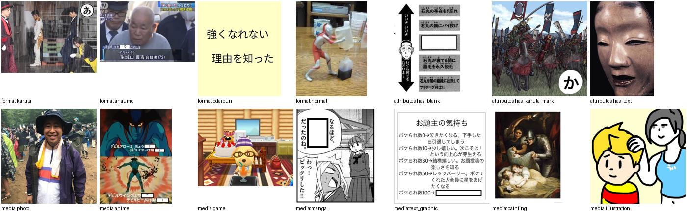
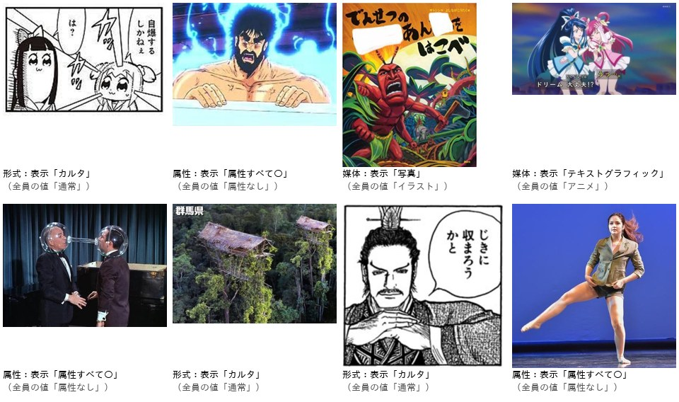
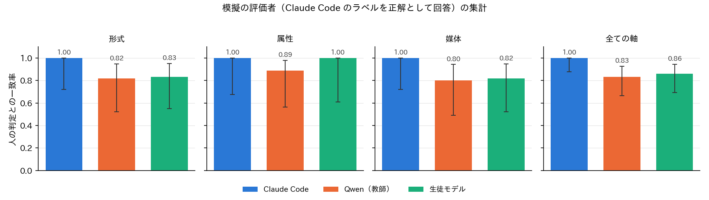

# LINE の公式アカウントによるお題画像のアノテーションの判定 Bot（BoketeImageAnnotator）

## 1. 概要

Claude Code，Qwen，生徒モデルが付けたお題画像のラベルを人が判定するため，LINE の公式アカウントの Bot を独立したリポジトリ `Bokete_LINE_Annotator/` に実装した．サーバーは Cloudflare Workers の無料枠で動作し，評価者の状態と回答は D1（Cloudflare の SQLite），画像は Workers の静的アセットに置く．LINE の公式アカウントの作成とデプロイは利用者のアカウントで行う必要があるため，本作業ではローカルでの動作の確認（wrangler dev と LINE の API の模擬）までを行った．人による判定の結果はまだ存在しない．

| 項目 | 内容 |
| :--- | :--- |
| 判定の対象 | 定義書 v4 のラベルが3者で揃ったお題画像1,020枚（評価用データ640枚，実データの無作為抽出160枚，層別抽出220枚） |
| アノテーター | Claude Code（目視），Qwen（教師 T_v11，Qwen3-VL），生徒モデル（Bokete_Annotation_programs_v5.0 の最終版） |
| 問題 | 通常の問題3,475問（画像×軸×ラベルの値．同じ値を付けたアノテーターは1問にまとめる），注意確認の問題60問 |
| 回答 | 一致する，一致しない，判定できない |
| 試験 | 通しの模擬試験（12項目の検証），vitest 10件，pytest 5件．全て合格 |

## 2. 構成

### 2.1 リポジトリ

`shared/` は将来の BoketeSentenceAnnotator と共有する部分であり，LINE の署名の検証と応答メッセージ（reply）の送信，同意の確認，属性の質問，注意確認の問題の間隔，評価者の表（`users`）を持つ．`BoketeImageAnnotator/` は Worker の本体（`src/`），D1 の表（`schema.sql`），データの準備と集計の Python のスクリプト（`prepare/`）からなる．構成と関数の関係は `Bokete_LINE_Annotator/document.md`，設定と運用の手順は `README.md` にまとめた．

| ファイル | 役割 |
| :--- | :--- |
| `src/index.ts` | `/webhook` で署名を検証して直ちに 200 を返し，処理と応答は `waitUntil` で行う．`/admin/stats` は進み具合の集計 |
| `src/handler.ts` | イベントの処理と状態の遷移（同意 → 属性の質問 → 説明 → 評価 → 参加の取り消し） |
| `src/tasks.ts` | 問題の選択，回答の記録，参加の取り消しの際の回答の削除 |
| `src/messages.ts` | 問題の吹き出し，説明のカルーセル，休憩の確認の Flex Message |
| `prepare/build_dataset.py` | 3者のラベルから問題・注意確認の問題・説明の実例・縮小した画像・投入の SQL を作る |
| `prepare/export_results.py` | D1 の回答を取得し，アノテーター×軸ごとの一致率と図を作る |
| `scripts/simulate_image.mjs` | LINE の API の模擬サーバーと署名付きの Webhook による通しの試験 |

### 2.2 無料枠に収める設計

LINE の無料のプランではプッシュメッセージの通数に月200通の上限がある．本 Bot は全ての応答を，評価者の操作（ボタンの押下，テキストの送信，友だち追加）に対する応答メッセージで返し，プッシュメッセージを用いない．問題の吹き出しの回答のボタンはポストバックであり，押下のたびに新しい応答トークンが得られるため，次の問題をそのトークンで返せる．画像は Workers の静的アセット（無料で2万ファイル，1ファイル25 MiB まで）として配信し，R2 の契約を不要とした．画像1,020枚は長辺1,024画素に縮小して約40 MB であった．デプロイのドライランで，Worker と1,020枚の画像，D1 の束縛が構成されることを確かめた．

## 3. 評価者の体験

### 3.1 評価の前の手順

友だち追加の後，研究の目的，記録する情報，撤回の方法を示して参加の同意を確認する．同意の後，年齢（7区分），性別（4区分），ボケてを見る頻度（4区分），アニメ・マンガ・ゲームへの親しみ（3区分）をクイックリプライで尋ねる．最後の項目は，媒体の判定の正確さが評価者の知識に依存する可能性を後で分析するために加えた．続いて，形式，属性，媒体の順に，各ラベルの定義と実例の画像を横に送るカルーセルで示し，最後に判定の方法（一致しないの基準，判定できないの使い方，注意確認の問題があること）を示す．図1は説明に用いる実例である．実例は3者のラベルが一致した画像から自動で選び，分かりにくかった文字ありの実例のみ手動で指定した（`prepare/examples_override.json`）．

### 3.2 問題

1問は1つの吹き出しであり，上から，問題の番号と軸，お題画像（押すと拡大），ラベルの値，表示した値の定義，問い「このラベルは画像に合っていますか？」，3つのボタン（一致する，一致しない，判定できない）を並べる．属性は3項目の全てを○×で示し，1つでも誤りがあれば「一致しない」とするよう説明する．媒体も同様に，抜けや余計な媒体があれば「一致しない」とする．アノテーターの名前は示さない．問題には「説明を見る」「状況」のクイックリプライを付け，評価の途中で定義を見直せるようにした．30問ごとに休憩の確認を出し，「再開」と送ると続きから再開できる．

### 3.3 問題の作成

判定の単位は「画像×軸×ラベルの値」とした．画像・軸ごとに3者のラベルの値を比べ，同じ値を付けたアノテーターは1問にまとめ，判定の結果を各アノテーターに対応付ける．画像と軸の組は3,060であり，3者の値をそのまま問題にすると9,180問になるが，まとめることで3,475問になった．表1は，問題の値を付けたアノテーターの数の内訳である．3者が一致した組が多いため，3者の差を調べる上で重要な，値が分かれた組の問題（1者または2者の値）は947問である．

**表1：通常の問題の数（その値を付けたアノテーターの数ごと）**

| 軸 | 1者 | 2者 | 3者 | 計 |
| :---: | ---: | ---: | ---: | ---: |
| 形式 | 92 | 83 | 934 | 1,109 |
| 属性 | 127 | 112 | 903 | 1,142 |
| 媒体 | 236 | 140 | 848 | 1,224 |
| 計 | 455 | 335 | 2,685 | 3,475 |

評価者には，その評価者が未回答の問題のうち回答数が最も少ない問題を出す．回答数が同じ問題の間では，準備の際に付けた乱数の順に出すため，回答は問題の間で均等に集まり，同じ画像の問題が続くことは少ない．

### 3.4 注意確認の問題

3者のラベルが一致した画像・軸に，明らかに誤った値を付けた問題を軸ごとに20問，計60問作った．画像の重複はない．誤った値は表2の規則で決めた．注意確認の問題は通常の問題と同じ見た目で，次の問題までの間隔を6〜12問の一様な乱数で決めて挟む．「一致しない」以外の回答を不合格とし，不合格の場合は確認用の問題であったことと正しい回答を返して注意を促す（`CHECK_FEEDBACK` で無効にできる）．図2は注意確認の問題の例である．

**表2：注意確認の問題の誤った値の規則（3者が一致した値 → 表示する値）**

| 軸 | 規則 |
| :---: | :--- |
| 形式 | 通常 → カルタまたは穴埋め，お題文 → カルタ |
| 属性 | 属性なし → 空欄あり・カルタ記号あり・文字ありの全てを○ |
| 媒体 | 写真 → マンガ・テキストグラフィック・アニメ，アニメ → テキストグラフィック・絵画，マンガ → 写真・ゲーム，テキストグラフィック → 写真・アニメ，イラスト → 写真，絵画 → テキストグラフィック，ゲーム → 絵画 |

## 4. 動作の確認

### 4.1 通しの模擬試験

`scripts/simulate_image.mjs` は，LINE の Messaging API の応答の模擬サーバーを立て，ローカルの D1 で wrangler dev を起動し，署名付きの Webhook を送って応答を検証する．模擬の評価者は2人であり，丁寧な評価者は Claude Code のラベルと同じ値なら「一致する」，異なれば「一致しない」，注意確認の問題には「一致しない」と答え，適当な評価者は常に「一致する」と答える．試験では注意確認の間隔を3〜5問，休憩の間隔を15問に短くし，各評価者が40問に答えた．検証した項目と結果を表3に示す．全ての項目が合格した．

**表3：通しの模擬試験の検証項目**

| 項目 | 結果 |
| :--- | :--- |
| 不正な署名の Webhook を 401 で拒む | 合格 |
| 友だち追加 → 同意 → 4問の質問 → 説明3頁（カルーセル）→ 判定の方法 → 最初の問題 | 合格 |
| 同じ評価者に同じ問題を2回出さない | 合格（各40問） |
| 注意確認の問題が出る．丁寧な評価者には注意が出ず，適当な評価者の不合格の全てに注意が出る | 合格（各7問．注意は0回と7回） |
| 休憩の確認が出て，「続ける」で再開する | 合格（各2回） |
| 古い吹き出しのボタンには回答済みの案内を返す | 合格 |
| 同じボタンを同時に2回押しても回答は1回だけ記録される | 合格 |
| 評価者の回答数と回答の記録の数が一致する | 合格 |
| 評価中の「説明」「状況」「再開」 | 合格 |
| 参加の取り消しで回答を削除し，問題の回答数を戻す | 合格 |
| `/admin/stats` は正しいトークンでのみ応答する | 合格 |
| 全ての応答が LINE の制約（応答5件以内，Flex の大きさ，altText 400文字，ラベルの文字数，ポストバック300文字）を満たす | 合格 |

同時の2回の押下は，当初の実装では評価者の行を読んでから更新するまでの間に両方の要求が有効と判定されうるため，回答の受付を1文の UPDATE（出題中の問題と出題の通し番号が一致する場合のみ出題中の問題を取り消す）で確保し，変更の行数が0なら何もしない形にした．

### 4.2 集計の確認

`export_results.py` を模擬試験の回答に適用し，集計と図の作成が動作することを確かめた（図3）．丁寧な評価者は注意確認の問題の7問全てに合格して集計の対象となり，適当な評価者は参加の取り消しにより回答が削除された．模擬の評価者は Claude Code のラベルを正解として答えるため，Claude Code の一致率は定義により1.00となる．図3の値はアノテーターの精度を表すものではなく，集計の経路の確認のみを目的とする．

集計では，注意確認の問題を3問以上解き合格率が0.8以上の評価者の回答のみを用いる（`--min-checks`，`--min-pass`，`--include-unknown` で変更できる）．アノテーター×軸ごとに，回答の単位の一致率とその Wilson の区間，判定できないの割合，多数決（判定できないを除き，同数は除外）で一致とされた問題の割合を出力する．評価者は登録の順に r001 などの匿名の番号に置き換え，属性の回答とともに `raters.csv` に保存する．

## 5. 未解決の論点と次の作業の候補

- **実機での確認：** LINE の公式アカウントの作成，Cloudflare へのデプロイ，Webhook の検証は未実施である．Flex Message の実機での見た目（特に縦長・横長の画像と，属性の○×の行）は，`data/sim/replies.jsonl` の JSON を Flex Message Simulator に貼るか，実機で確認する必要がある．
- **倫理と同意：** 同意の説明は暫定の文言であり，問い合わせ先（`CONTACT`）も仮である．所属機関の倫理審査の要否と，18歳未満の評価者の扱い（現在は記録のみで参加を止めない）を決める必要がある．
- **注意確認の問題の妥当性：** 注意確認の問題の「正しい値」は3者の一致に基づくため，3者が共に誤った場合には注意確認の問題として不適切になりうる．60問を目視で確認することが望ましい．また，属性の注意確認は「全てを○」の1種類のみであり，慣れた評価者に見抜かれる可能性がある．
- **問題の数と必要な評価者の数：** 1問あたり3人の判定を集めるには約1.04万回の回答が必要である．値が分かれた947問を優先して出題する設定（例：`n_annotators` の小さい問題の優先）を加えると，3者の差を少ない回答で調べられる．
- **Gemini の追加：** `build_dataset.py --gemini-model` で Gemini のラベルを判定の対象に加えられるが，今回は3者で作成した．
- **BoketeSentenceAnnotator：** 大喜利の判定では，画像とボケの文を1つの吹き出しに示し，`shared/` の同意・属性の質問・注意確認の間隔・評価者の表を用いる．大喜利の判定の単位（発話の型，画像外の知識，制約の順守のどれを判定させるか）を決める必要がある．
