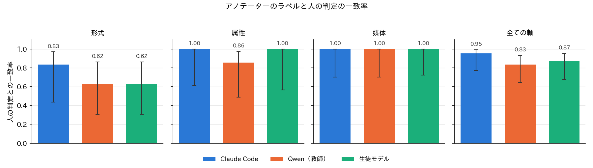
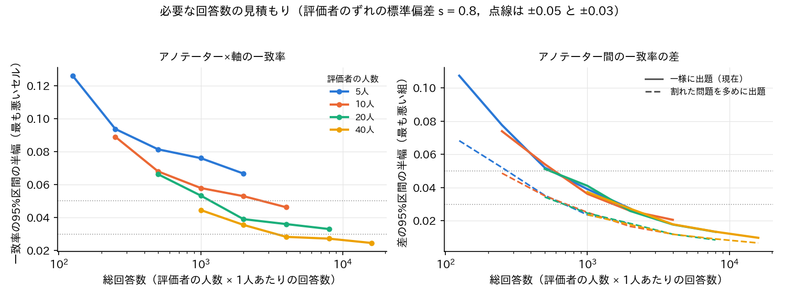
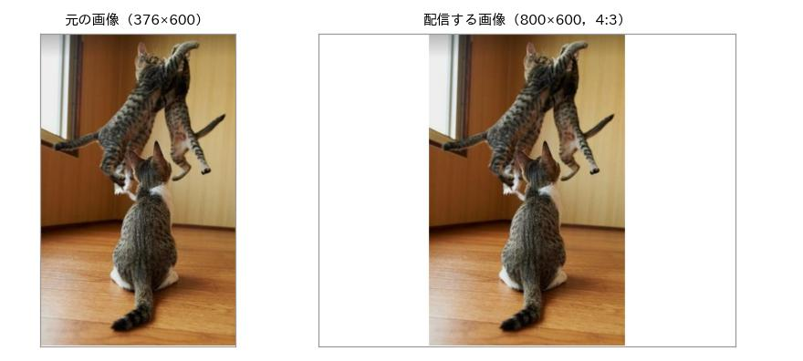

# BoketeImageAnnotator の試行の回答の集計，必要な回答数の見積もり，表示の修正

## 1. 概要

クイックトンネルで運用した BoketeImageAnnotator（report_031）に評価者1名が回答した30件（通常の問題28件，注意確認の問題2件）を集計し，アノテーター（Claude Code，Qwen，生徒モデル）×軸ごとの一致率を求めた．次に，評価者の甘さ・厳しさの個人差を含む回答の収集の模擬（モンテカルロ法）により，確信度の高い一致率を得るのに必要な評価者の人数と1人あたりの回答数を見積もった．また，Bot の表示について，説明のカルーセルの「↑ 実例」の文字の削除，縦長の画像の白地での横長化，属性の表記の変更の3点を修正した．

| 項目 | 内容 |
| :--- | :--- |
| 集計 | `export_results.py --source local --include-unknown`（`results/trial_2026-10-27/`） |
| 見積もり | `prepare/plan_sample_size.py`（新規．`results/plan/`） |
| 修正 | `src/labels.ts`，`src/messages.ts`，`src/content.ts`，`prepare/build_dataset.py`（`--images-only`），起動のスクリプト（SIGHUP） |
| 確認 | vitest 11件，pytest 7件，型の検査，模擬試験（全項目合格） |

## 2. 試行の回答の一致率

評価者1名が注意確認の問題2問に共に合格し（「一致しない」と回答），通常の問題28問に回答した．注意確認の問題が集計の基準（3問以上）に満たないため，信頼性が未定の評価者も含めて集計した．回答の時間の中央値は7.1秒（平均12.0秒．画像の読み込みの待ちとみられる110秒の1件を含む）であった．図1にアノテーター×軸ごとの一致率（一致する ÷（一致する＋一致しない））と Wilson の95%区間を示す．



| アノテーター | 形式 | 属性 | 媒体 | 全ての軸 |
| :---: | :---: | :---: | :---: | :---: |
| Claude Code | 0.83（5/6） | 1.00（6/6） | 1.00（9/9） | 0.95 [0.77, 0.99] |
| Qwen | 0.62（5/8） | 0.86（6/7） | 1.00（9/9） | 0.83 [0.64, 0.93] |
| 生徒モデル | 0.62（5/8） | 1.00（5/5） | 1.00（10/10） | 0.87 [0.68, 0.95] |

全ての軸の一致率は Claude Code が0.95，生徒モデルが0.87，Qwen が0.83であったが，95%区間は大きく重なり，アノテーター間の差は判断できない．セルごとの回答は5〜10件であり，区間の幅は0.3〜0.6に及ぶ．問題の種類で分けると，全てのアノテーターの値が同じ問題では18件中17件が一致する（0.94）であり，値が割れている問題では10件中，一致するが6件，一致しないが3件，判定できないが1件であった．アノテーター間の差は値が割れている問題でのみ生じるため，差の推定に効く回答は全体の約3割にとどまる．

形式の不一致は，Claude Code がお題文とし Qwen と生徒モデルが通常とした2問で，評価者が通常を「一致しない」と判定したものである．この2問では Claude Code の判断が支持された．一方，媒体では，同じ画像で Claude Code と異なる値（Qwen のアニメ＋テキストグラフィック，生徒モデルの写真，Qwen と生徒モデルの絵画）を評価者が「一致する」と判定した例が3件あった．評価者はその画像の Claude Code の値の問題には回答していないため，Claude Code の誤りか，1つの値のみを示されると一致すると判定しやすい傾向かは区別できない．

## 3. 必要な回答数の見積もり

### 3.1 模型

問題 $` t `$ を評価者 $` r `$ が「一致する」と判定する確率を次の式で表す．

```math
P(y_{rt} = 1) = \sigma\left( \mathrm{logit}(p_t) + u_r \right), \quad u_r \sim \mathcal{N}(0, s^2)
```

ここで $` \sigma `$ はシグモイド関数，$` p_t `$ は平均的な評価者が問題 $` t `$ を一致すると判定する確率，$` u_r `$ は評価者 $` r `$ の甘さ・厳しさのずれ，$` s `$ はずれの標準偏差である．$` p_t `$ は試行の結果を参考に，全てのアノテーターの値が同じ問題で0.95，値が割れていて2者が共有する値で0.70，1者のみの値で0.40とした．$` s `$ は評価者が1名のため推定できず，0.8を主とし，0（個人差なし）と1.5を比べた．出題は Bot の出題（回答数の少ない問題から）に近い問題の上の一様な抽出とし，値が割れている問題（3,475問中790問）を4倍の重みで出題する案（推定は重みの逆数で補正）も比べた．評価者の人数を5，10，20，40人，1人あたりの回答数を25〜400件とし，条件ごとに300回の模擬から，推定値と真の値（評価者の母集団の平均）の二乗平均の平方根の1.96倍を95%区間の半幅とした．

### 3.2 結果

図2の左にアノテーター×軸の9つのセルのうち最も悪いセルの一致率の半幅を，右に同じ軸のアノテーター間の一致率の差の半幅を，総回答数に対して示す．



| 評価者の人数 × 1人あたり | 総回答数 | 一致率の半幅（s = 0.8） | 一致率の半幅（s = 0 / 1.5） | 差の半幅（一様 / 割れた問題を多めに） |
| :---: | :---: | :---: | :---: | :---: |
| 10人 × 100件 | 1,000 | 0.058 | 0.038 / 0.110 | 0.036 / 0.025 |
| 20人 × 50件 | 1,000 | 0.053 | 0.039 / 0.080 | 0.041 / 0.025 |
| 40人 × 25件 | 1,000 | 0.045 | 0.038 / 0.064 | 0.037 / 0.024 |
| 20人 × 100件 | 2,000 | 0.039 | 0.028 / 0.073 | 0.026 / 0.018 |
| 40人 × 50件 | 2,000 | 0.036 | 0.027 / 0.053 | 0.027 / 0.018 |
| 40人 × 100件 | 4,000 | 0.028 | 0.019 / 0.050 | 0.018 / 0.012 |
| 5人 × 400件 | 2,000 | 0.067 | 0.029 / 0.141 | 0.027 / 0.018 |

一致率の絶対値の精度は，評価者の個人差により人数で頭打ちになる．5人では総回答数を2,000件にしても半幅は0.067にとどまり，同じ総回答数でも人数が多いほど半幅は小さい．$` s = 0.8 `$ で半幅0.05以下には約20人×50件（1,000件）以上，0.03付近には約40人×100件（4,000件）が必要である．個人差が大きい場合（$` s = 1.5 `$）は40人でも0.05程度にとどまる．一方，アノテーター間の差は同じ評価者が同じ問題に回答することで個人差が打ち消され，主に総回答数で決まる．差の半幅は一様な出題で20人×100件のとき0.026であり，値が割れた問題を多めに出題すると約半分の回答数で同じ精度（20人×50件で0.025）が得られる．

問題ごとの正解を評価者の多数決で決める場合，評価者1人の正答率を $` q `$，1問あたりの人数を $` m `$ とすると，$` q = 0.9 `$ で多数決が正しい確率は $` m = 3 `$ で0.972，$` m = 5 `$ で0.991である（`majority.csv`）．全3,475問に3人ずつでは10,425件，値が割れた790問のみ3人として残りを1人とすると5,055件である．

### 3.3 推奨

1人の回答は中央値7.1秒であり，100件は注意確認の問題と説明を含めて15〜20分程度と見込まれる．以上から，アノテーター間の比較を目的とするなら，20人×100件（2,000件）を最低限の目安とし，値が割れた問題を多めに出題する．この場合，差の半幅は約0.02，一致率の半幅は約0.04と見込まれる．一致率の絶対値を±0.03で示すには40人×100件（4,000件）が必要である．1人あたりは注意確認の問題を3問以上解くよう30件以上とし，1人に多く答えてもらうより人数を増やす方が有効である．問題ごとの正解のデータセットを作る場合は，割れた問題に3人ずつの5,000件程度（例：50人×100件）が必要である．これらは $` p_t `$ と $` s `$ の仮定に依存するため，評価者が数人集まった時点で $` s `$ を推定し，見積もりを更新する必要がある．

## 4. 表示の修正

- 説明のカルーセルの各項目の吹き出しから「↑ 実例」の文字を削除した．
- 横÷縦が4/3より小さい（縦長の）画像を，白地の中央に貼り付けて4:3にして配信するようにした（図3）．押したときは縮小のみの元の画像（`img/orig/`）を開く．D1 の幅・高さは元の画像の大きさのまま保ち，吹き出しの縦横比は Worker の `paddedSize` で `build_dataset.py` と同じ規則（幅 = max(元の幅, ceil(高さ×4/3))）から求める．これにより，運用中の D1 の問題と回答を変えずに済む．
- 属性を「空欄あり ○／カルタ記号あり ×／文字あり ○」の3行の表示から，媒体と同様に付いている項目を「＋」でつないだ1つの表現（「属性なし」「文字あり」「空欄あり＋文字あり」など）に変えた．定義の文には3項目の定義に加えて「表示されていない項目は「なし」の意味です．」を添え，判定の方法の説明も合わせて改めた．



画像は `build_dataset.py --images-only` で1,020枚を作り直した．`seed.sql` と `tasks.csv` のチェックサムが変わらないこと，全ての画像の横÷縦が4/3以上であることを確かめた．模擬試験では，属性の問題が「属性なし」，縦長の画像の縦横比が「534:400」などとなり，拡大の URL が `img/orig/` を指すことを確かめた．なお，新しいディレクトリ（`img/orig/`）の画像は wrangler dev の再起動まで配信されない．また，最初の起動の cloudflared がターミナルを閉じた後も残っていたため，起動のスクリプトで SIGHUP でも子のプロセスを止めるようにした．

## 5. 未解決の論点と次の作業の候補

- 動作中の `npm run image:tunnel` を再起動しないと，拡大表示の画像（`img/orig/`）が 404 になる．再起動で URL が変わり，それ以前の吹き出しの画像は表示されなくなる．
- 評価者の個人差 $` s `$ は評価者1名では推定できない．数人の回答が集まった時点で同じ問題への回答から $` s `$ を推定し，`plan_sample_size.py --rater-sd` で見積もりを更新する．
- 値が割れた問題を多めに出題する案は見積もりのみで，Bot（`pickTask`）には未実装である．実装する場合は集計（`export_results.py`）に出題確率の逆数の重みを入れる必要がある．
- 1つの値のみを示す方式では，同じ画像×軸の異なる値を共に「一致する」と判定しうる（試行の媒体で疑いがある）．同じ評価者に同じ画像×軸の全ての値を続けて出題し矛盾を検出するか，値を選ぶ形式の問題を併用するかを検討する．
- 試行の回答（30件）はローカルの D1 に残っており，本番の集計では除くか，評価者の属性で区別する必要がある．
