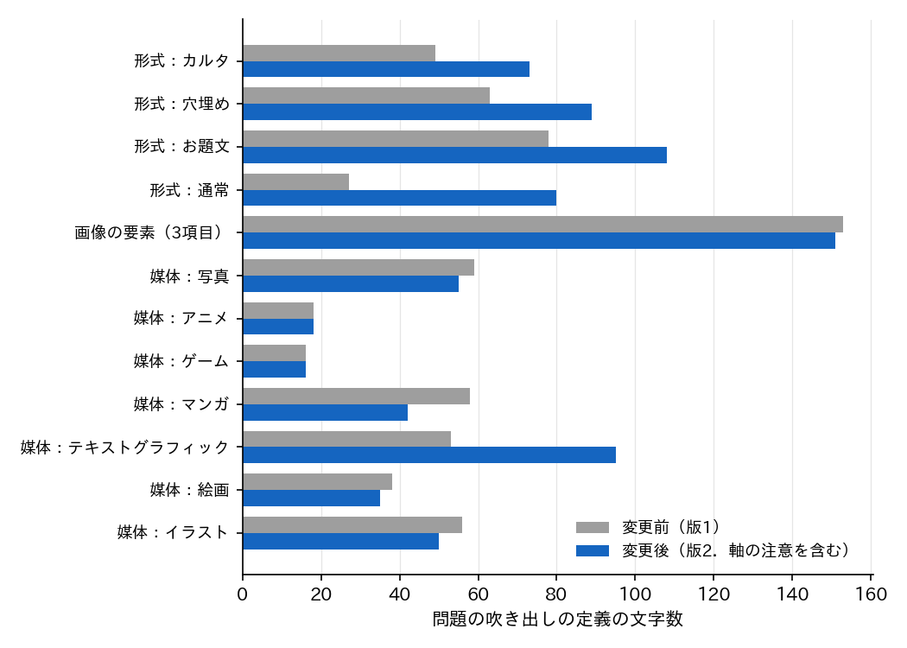

# BoketeImageAnnotator の表示の文言の改訂と表示の版の記録

## 1. 概要

BoketeImageAnnotator を試した協力者から，属性の「属性なし」の意味，属性と形式（カルタ記号ありとカルタ，空欄ありと穴埋め）の違い，形式の「通常」の意味，テキストグラフィックの判断基準が分かりにくいこと，および文字が多く，媒体や形式の説明に他の項目の説明は不要であることの5点の意見が得られた．これらに対し，問題の吹き出しと説明の文言を改めた．D1 の問題の値（`format`，`attributes`，`media` の値）は変えず，表示の名前と定義の文のみを変えた．また，文言の変更の前後の回答を区別するため，回答に表示の版（`ui_version`）を記録するようにした．

| 項目 | 内容 |
| :--- | :--- |
| 変更 | `src/labels.ts`（表示名，定義，軸の注意，`UI_VERSION`），`src/messages.ts`，`src/content.ts`，`src/tasks.ts`，`schema.sql`，`migrations/001_add_ui_version.sql`，`prepare/export_results.py`（`--ui-version`），起動のスクリプト（列の自動の追加） |
| 確認 | vitest 14件，pytest 7件，型の検査，模擬試験（全項目合格．回答の表示の版が2であることを追加），既存の表への列の追加の試験 |
| コミット | `6173c74` |

## 2. 意見ごとの対策

| 意見 | 対策 |
| :--- | :--- |
| 「属性なし」の意味が分かりにくい | 軸の表示名を「属性」から「画像の要素」に変えた（年齢などの属性の質問との混同を避ける）．「属性なし」は「空欄・カルタ記号・文字のどれもなし」と，何がないかを示す表記にした．項目の表記も「空欄あり」から「空欄」のように「あり」を除いた． |
| 属性と形式の違いが分かりにくい | 形式の吹き出しに「1つだけ選ぶ（カルタ＞穴埋め＞お題文＞通常の順に優先）．」，画像の要素の吹き出しに「形式と関係なく，写っているものを全て挙げる．」の1行を添えた．説明の画像の要素の頁に，カルタ記号と空欄が両方ある画像は形式が「カルタ」，画像の要素が「空欄＋カルタ記号」となる比較の例を加えた． |
| 「通常」の意味が分かりにくい | 表示名を「通常（決まりなし）」とし，定義を「画像だけを見て自由にボケる画像．ボケの書き方を決める記号，空欄，問いかけの文がない．」とした． |
| テキストグラフィックの判断基準が分かりにくい | 定義書 第4版の意味は変えず，該当する例（文字だけの画像，SNS やアプリの画面，図や表）と，該当しない例（写真の看板やアニメの字幕のように一部に文字があるだけの場合）を定義に書いた． |
| 文字が多い．他の項目の説明は不要 | 問題の吹き出しの定義から，他の項目に触れる部分（マンガの「漫画風の一枚絵はイラストとする」，イラストの「上記に含まれない絵」，通常の「カルタ，穴埋め，お題文のどれにも当たらない」）を除いた．除いた区別の補足は `LabelDef.note` に移し，説明のカルーセルでのみ示す．画像の要素の3項目の定義も短くした． |

テキストグラフィックの線引きを数値の基準などで細かく定め直すと，アノテーターがラベルを付けたときの定義と異なる基準で判定することになり，ラベルの誤りではなく定義の差による「一致しない」が生じる．このため，定義の意味は変えず，例の追加にとどめた．

## 3. 文字数の変化

図1に，問題の吹き出しに示す定義の文字数（変更後は軸の注意の1行を含む）を変更の前後で示す．

媒体は，他の項目に触れる部分を除いたことでマンガ（58字から42字），イラスト（56字から50字）などが短くなった．テキストグラフィックは例を加えたため53字から95字に増えた．形式は，優先の順を示す注意の1行（28字）を添えたため全ての項目で長くなり，通常は表示名と定義を中身のある文にしたため27字から80字に増えた．画像の要素は，3項目の定義を短くした分と注意の1行が相殺し，153字から151字とほぼ変わらない．すなわち，「他の項目の説明が不要」という意見は媒体と通常の定義では解消したが，吹き出し全体の文字数は形式とテキストグラフィックでむしろ増えた．属性と形式の違いや通常の意味についての意見への対策と，文字数の削減は一部で両立しないため，協力者の再度の試行で分かりやすさと文字の量を確かめる必要がある．

## 4. 表示の版の記録

`labels.ts` に表示の版 `UI_VERSION = 2` を定め，回答の記録（`responses`）の列 `ui_version` に保存する．版1は order_032 までの表示，版2は本改訂の表示である．既存の D1 には `migrations/001_add_ui_version.sql`（`ALTER TABLE responses ADD COLUMN ui_version INTEGER NOT NULL DEFAULT 1`）で列を加え，既存の回答は版1となる．ローカルの D1 は `npm run image:tunnel` の起動時に列の有無を調べて自動で加え，Cloudflare 上の D1 は `npm run image:migrate:remote` を1回実行する．集計は `export_results.py --ui-version 2` で版2の回答のみに絞れ，`summary.json` に版ごとの回答数を記録する．旧い表に1件の回答を入れて列を加え，その回答の `ui_version` が1となることを確かめた．

## 5. 未解決の論点と次の作業の候補

- 動作中の `npm run image:tunnel` を再起動するまで，新しい文言は反映されない．再起動の時にローカルの D1 に `ui_version` の列が加わり，これまでの回答（試行の30件と協力者の回答）は版1となる．
- 新しい文言は実際の LINE の画面で未確認である．特に，形式と画像の要素の注意の1行と，長くなったテキストグラフィックの定義の見え方を確かめる必要がある．
- 協力者に再度試してもらい，5つの意見が解消したか，特に文字の量が許容できるかを確かめる．形式の注意の1行が冗長と判断される場合は，説明のカルーセルのみに移すことを検討する．
- 版1と版2で一致率が変わるかは，版2の回答が集まった後に `--ui-version 1` と `--ui-version 2` の集計を比べて確かめる．
- 画像の要素の吹き出しは3項目の定義を常に示すため，依然として最も長い（151字）．
