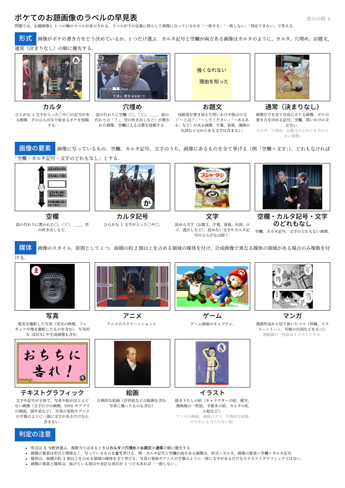
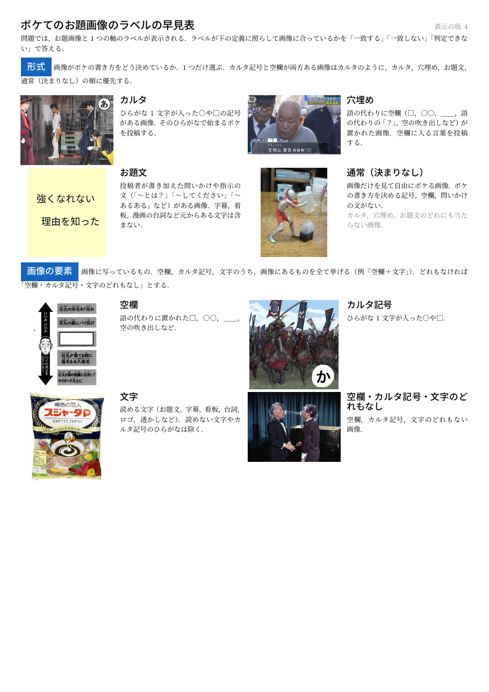
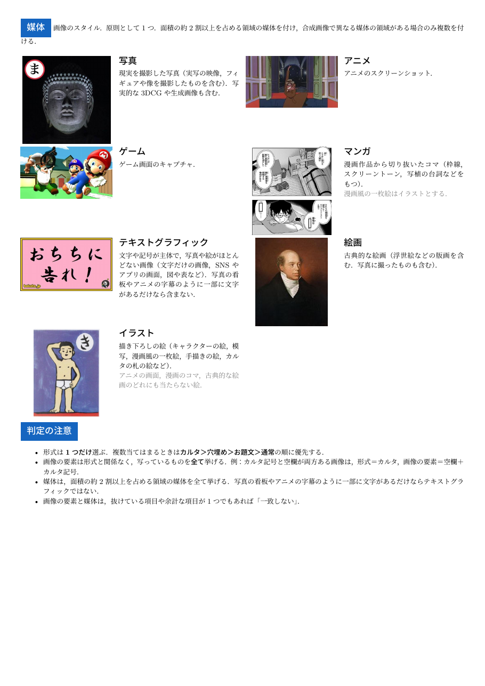

# ラベルの定義と実例の早見表（A4 の1ページ版と2ページ版）の試作

## 1. 概要

BoketeImageAnnotator の評価者が判定の際に手元で参照できるよう，形式，画像の要素，媒体の各ラベルの定義と実例の画像をまとめた早見表を A4 の PDF で試作した．1ページ版と2ページ版の2種類を作った．文言は Bot の表示と同じ `src/labels.ts`（表示の版4）から自動で読み込み，実例の画像は説明のカルーセルと同じ画像（`data/seed.sql` の examples 表）を用いるため，Bot の文言を改めた後も同じスクリプトで作り直せば紙と画面の内容がずれない．

| 項目 | 内容 |
| :--- | :--- |
| スクリプト | `BoketeImageAnnotator/prepare/make_cheatsheet.py`（新規．lualatex，ltjsarticle） |
| 出力 | `BoketeImageAnnotator/results/cheatsheet/cheatsheet_1page.pdf`，`cheatsheet_2page.pdf`（写しを `figures_037/` に置いた） |
| 確認 | pytest 8件（`tests/test_make_cheatsheet.py` を追加），PDF のページ数と見た目 |
| コミット | `1650be2` |

## 2. 構成

早見表は，表題と回答の方法の1文，形式（4項目），画像の要素（3項目と「空欄・カルタ記号・文字のどれもなし」），媒体（7項目），判定の注意の4つの節からなる．各項目は実例の画像，表示名，Bot の問題の吹き出しと同じ定義，説明のカルーセルでのみ示す区別の補足（灰色）を持つ．画像の要素の「どれもなし」は examples 表にないため，3者のアノテーターが共にどれもなしとした画像（お題ID 16972）を用いた．判定の注意には，形式は1つだけで優先の順があること，形式と画像の要素の違いの例，テキストグラフィックに当たらない例，画像の要素と媒体は項目の過不足が1つでもあれば「一致しない」であることを載せた．右上に表示の版を示し，Bot の表示との対応を確かめられるようにした．

1ページ版（図1）は全ての項目を1行4項目の格子に並べ，画像の高さを27 mm，本文を7.2ポイントとした．2ページ版（図2，図3）は1行2項目とし，画像を左，定義を右に置いて画像の高さを38 mm，本文を9ポイントとした．1ページ目に形式と画像の要素，2ページ目に媒体と判定の注意を置いた．

## 3. 考察

1ページ版は全体を一覧できるが，本文が7.2ポイントと小さく，紙に印刷して読む前提となる．スマートフォンの画面で見ると拡大が必要である．2ページ版は文字と画像が大きく読みやすいが，形式・画像の要素と媒体が別のページに分かれる．問題は1問ごとに1つの軸のみを問うため，軸ごとにページが分かれることの不便は小さいと考えられる．

実例の画像には，他の軸の要素を含むものがある．例えば，媒体の写真とイラストの実例にはカルタ記号が，テキストグラフィックの実例には記号が写っている．早見表ではその軸の項目のみを示すため誤解は生じにくいが，紛らわしい場合は `examples_override.json` で実例を差し替える必要がある．

## 4. 未解決の論点と次の作業の候補

- 協力者に1ページ版と2ページ版を見てもらい，どちらが答えやすいかを確かめる．
- 配布の方法（紙，PDF の共有，LINE の「早見表」コマンドで画像を返す）は未定であり，未実装である．LINE で示す場合は，PDF のページを画像にして静的アセットに置き，コマンドで画像のメッセージを返す実装が考えられる．
- 早見表を配る前後で判定の傾向が変わる可能性がある．配布を始める時点で表示の版を上げ，回答を区別する必要がある．
- 実例の画像はボケての投稿であるため，PDF は Git で管理せず，協力者への配布にとどめる．広く公開する場合は利用の条件を確かめる必要がある．
- 他の軸の要素を含む実例の画像（写真，イラスト，テキストグラフィック）を差し替えるかを検討する．
