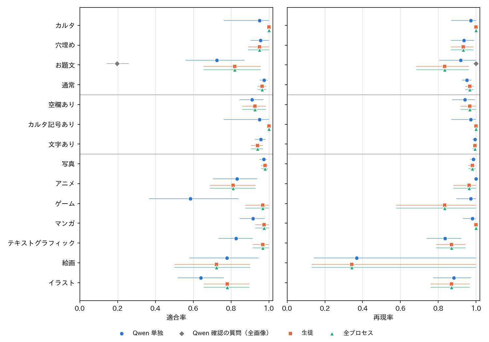
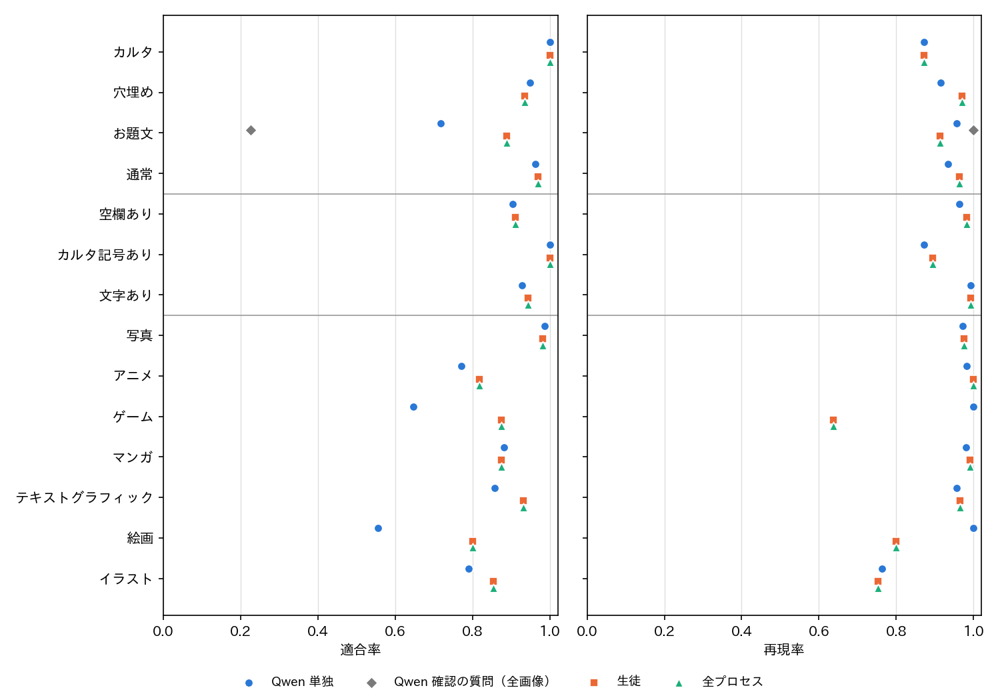

# お題画像のラベルの判断者ごとの適合率と再現率

## 1. 概要

属性と形式のラベルの見直しを判断するため，お題画像のカテゴリ（形式4，属性3，媒体7）ごとの適合率と再現率を，判断者ごとに求めた．
正解は Claude Code の目視のラベル（定義書 v4，1,020枚）である．

結論は次のとおりである．

| 項目 | 結果 |
| :--- | :--- |
| 全プロセスと生徒 | 目視のラベルがある1,020枚では完全に一致した．生徒がお題文と予測した98枚の全てに，Qwen の確認の質問が「お題文である」と答えたためである |
| 全データでの確認の質問の効果 | 対象の567,345枚のうち「お題文でない」としたのは3,998枚（対象の0.7%，全6,823,270枚の0.06%）である |
| Qwen の確認の質問を全画像に行った場合 | お題文の適合率0.20，再現率1.00．画像の47%に「お題文である」と答えた（穴埋めの74%，カルタの72%，通常の24%） |
| Qwen 単独と生徒 | 生徒は，ほとんどのカテゴリで Qwen 単独と同等以上である．全項目が一致する画像の割合（実データの推定）は Qwen 単独0.79，生徒0.83 |
| 弱いカテゴリ | お題文（実データで適合率0.82，再現率0.83），イラストとアニメの適合率（0.78，0.81），ゲームの再現率（0.83），絵画の再現率（0.34．正例が少なく区間が広い） |

## 2. 判断者と処理の流れ

| 判断者 | 内容 |
| :--- | :--- |
| Qwen 単独 | Qwen3-VL-8B だけで全てのラベルを付けた場合．生徒の教師ラベル（T_v11．軸ごとの複数の質問の組み合わせ） |
| Qwen 確認の質問（全画像） | パッケージの確認の質問（「投稿者が回答者に向けて主題として書いた文があるか」）を，生徒の選別をせずに全ての画像に行った回答．お題文のみ |
| 生徒 | 確認の質問を反映する前の生徒の予測．パッケージの `annotation.parquet` の確率から，パッケージの後処理で再構成した |
| 全プロセス | 生徒＋Qwen の確認の質問．パッケージの最終の出力（再構成した値が出力と完全に一致することを確かめた） |

パッケージの現在の処理は，質問の文で述べられた構成と次の点が異なる．

- 生徒は「お題文」を属性ではなく形式の1区分として予測する．形式は4区分の確率が最大のものであり，属性は空欄あり，カルタ記号あり，文字ありの3項目である．属性は形式からも導く（カルタならカルタ記号あり，穴埋めなら空欄あり，お題文なら文字あり）．
- 確認の質問は，形式の予測がお題文の画像にだけ行う．確認の質問が偽なら，お題文以外で確率が最大の形式にする．

そのため，本レポートの「お題文」は形式のお題文として評価した．
目視のラベル（定義書 v4）にも属性のお題文ありはなく，穴埋めやカルタの画像にある問いの文は記録されていない．
確認の質問が偽のときに，生徒の属性から形式を導く場合（質問の文の構成）も模擬した．しかし，目視のラベルがある画像では確認の質問が偽になった画像がないため，結果は全プロセスと同じになった．

## 3. 評価の方法

- 実データ：無作為抽出160枚と層別抽出220枚を，抽出確率の逆数で重み付けして，実際の分布での値を推定した（ex009 と同じ方法）．区間は，無作為抽出の全体と層別抽出の層ごとに復元抽出したブートストラップ（2,000回）の95%区間である．
- 評価用データ：640枚（少ない区分を多く含む．重みなし）．生徒の調整に用いた集合を含むため，生徒にやや有利である．
- 表の「正例」は，目視のラベルで正例の画像の枚数（重みなし）である．

## 4. 結果

### 4.1 実データ

表1：実データでの適合率と再現率（括弧は95%区間）．生徒と全プロセスは同じ値である．

| 軸 | カテゴリ | 正例 | Qwen 単独 適合率 | Qwen 単独 再現率 | 生徒・全プロセス 適合率 | 生徒・全プロセス 再現率 |
| :-- | :------- | --: | -----------: | -----------: | -----------: | -----------: |
| 形式 | カルタ | 22 | 0.95（0.77–1.00） | 0.97（0.88–1.00） | 1.00（1.00–1.00） | 1.00（1.00–1.00） |
| 形式 | 穴埋め | 96 | 0.96（0.90–1.00） | 0.93（0.87–0.99） | 0.95（0.89–1.00） | 0.93（0.87–0.99） |
| 形式 | お題文 | 27 | 0.72（0.57–0.87） | 0.92（0.81–1.00） | 0.82（0.65–0.95） | 0.83（0.68–0.96） |
| 形式 | 通常 | 235 | 0.97（0.95–0.99） | 0.95（0.92–0.97） | 0.96（0.94–0.99） | 0.97（0.94–0.99） |
| 属性 | 空欄あり | 96 | 0.91（0.84–0.97） | 0.94（0.88–0.99） | 0.93（0.86–0.98） | 0.97（0.92–1.00） |
| 属性 | カルタ記号あり | 22 | 0.95（0.77–1.00） | 0.97（0.88–1.00） | 1.00（1.00–1.00） | 1.00（1.00–1.00） |
| 属性 | 文字あり | 233 | 0.96（0.93–0.98） | 0.99（0.98–1.00） | 0.94（0.90–0.97） | 0.99（0.98–1.00） |
| 媒体 | 写真 | 164 | 0.97（0.95–0.99） | 0.99（0.97–1.00） | 0.98（0.96–1.00） | 0.98（0.96–1.00） |
| 媒体 | アニメ | 35 | 0.83（0.72–0.94） | 1.00（1.00–1.00） | 0.81（0.68–0.93） | 0.96（0.88–1.00） |
| 媒体 | ゲーム | 22 | 0.58（0.36–0.85） | 0.97（0.89–1.00） | 0.97（0.88–1.00） | 0.83（0.59–1.00） |
| 媒体 | マンガ | 46 | 0.92（0.84–0.98） | 0.98（0.94–1.00） | 0.97（0.93–1.00） | 1.00（1.00–1.00） |
| 媒体 | テキストグラフィック | 70 | 0.83（0.73–0.91） | 0.84（0.74–0.92） | 0.97（0.92–1.00） | 0.87（0.79–0.95） |
| 媒体 | 絵画 | 15 | 0.78（0.58–0.95） | 0.37（0.14–1.00） | 0.72（0.50–0.90） | 0.34（0.13–1.00） |
| 媒体 | イラスト | 49 | 0.64（0.52–0.76） | 0.88（0.77–0.97） | 0.78（0.66–0.89） | 0.87（0.76–0.96） |

Qwen の確認の質問（全画像）のお題文は，適合率0.20（0.14–0.26），再現率1.00（1.00–1.00）であった．

### 4.2 評価用データ

表2：評価用データ（640枚）での適合率と再現率．生徒と全プロセスは同じ値である．

| 軸 | カテゴリ | 正例 | Qwen 単独 適合率 | Qwen 単独 再現率 | 生徒・全プロセス 適合率 | 生徒・全プロセス 再現率 |
| :-- | :------- | --: | -----------: | -----------: | -----------: | -----------: |
| 形式 | カルタ | 47 | 1.00 | 0.87 | 1.00 | 0.87 |
| 形式 | 穴埋め | 163 | 0.95 | 0.91 | 0.93 | 0.97 |
| 形式 | お題文 | 69 | 0.72 | 0.96 | 0.89 | 0.91 |
| 形式 | 通常 | 361 | 0.96 | 0.93 | 0.97 | 0.96 |
| 属性 | 空欄あり | 164 | 0.90 | 0.96 | 0.91 | 0.98 |
| 属性 | カルタ記号あり | 47 | 1.00 | 0.87 | 1.00 | 0.89 |
| 属性 | 文字あり | 386 | 0.93 | 0.99 | 0.94 | 0.99 |
| 媒体 | 写真 | 279 | 0.99 | 0.97 | 0.98 | 0.97 |
| 媒体 | アニメ | 58 | 0.77 | 0.98 | 0.82 | 1.00 |
| 媒体 | ゲーム | 11 | 0.65 | 1.00 | 0.88 | 0.64 |
| 媒体 | マンガ | 106 | 0.88 | 0.98 | 0.88 | 0.99 |
| 媒体 | テキストグラフィック | 113 | 0.86 | 0.96 | 0.93 | 0.96 |
| 媒体 | 絵画 | 5 | 0.56 | 1.00 | 0.80 | 0.80 |
| 媒体 | イラスト | 93 | 0.79 | 0.76 | 0.85 | 0.75 |

Qwen の確認の質問（全画像）のお題文は，適合率0.23，再現率1.00であった．

### 4.3 全項目の一致

表3：軸ごとに全ての項目が目視と一致する画像の割合．

| 判断者 | 集合 | 形式 | 属性 | 媒体 | 全項目 |
| :--- | :--- | ---: | ---: | ---: | ---: |
| Qwen 単独 | 実データ | 0.946 | 0.941 | 0.864 | 0.794 |
| 生徒・全プロセス | 実データ | 0.950 | 0.939 | 0.909 | 0.830 |
| Qwen 単独 | 評価用データ | 0.927 | 0.906 | 0.875 | 0.769 |
| 生徒・全プロセス | 評価用データ | 0.953 | 0.925 | 0.913 | 0.830 |

### 4.4 確認の質問の段階

表4：生徒がお題文と予測した画像での，目視のラベルと確認の質問の回答の組の枚数．

| 集合 | 目視でお題文・Qwen が「はい」 | 目視でお題文・「いいえ」 | 目視でお題文でない・「はい」 | 目視でお題文でない・「いいえ」 |
| :--- | ---: | ---: | ---: | ---: |
| 実データ | 22 | 0 | 5 | 0 |
| 評価用データ | 63 | 0 | 8 | 0 |

確認の質問は，生徒の誤り（実データ5枚，評価用データ8枚）を1枚も直せなかった．
確認の質問を全ての画像に行うと，目視のラベルごとの「はい」の割合は，お題文96/96，穴埋め192/259，カルタ50/69，通常141/596であった．
確認の質問は，お題文と通常を見分けるよりも，投稿者が書き加えた文の有無に反応している．
穴埋めやカルタの画像の多くにも，投稿者が書き加えた問いや指示の文がある．

### 4.5 お題文の誤りの内訳

1,020枚（重みなし）での生徒のお題文の誤りは，次のとおりである．

- 誤ってお題文とした13枚：目視では通常11枚，穴埋め2枚．
- お題文を見逃した11枚：生徒の予測は通常9枚，穴埋め2枚．

Qwen 単独は，誤ってお題文とした画像が36枚（通常28枚，穴埋め7枚，カルタ1枚）と多く，見逃しは5枚と少ない．
誤りの多くは，お題文と通常の境界（テロップや説明の文，投稿者が書いた文が主題か）にある．

## 5. 考察

**確認の質問の効果：** 現在の Qwen の確認の質問は，結果をほとんど変えていない．目視のラベルがある画像では一度も「いいえ」と答えず，全データでも対象の0.7%しか変えなかった．
確認の質問は，全データの処理で約5〜7時間かかる．残すならお題文と通常を見分けるように質問を作り直す必要があり，外すなら処理時間が減るだけで精度はほぼ変わらない．

**Qwen 単独と生徒：** 生徒は Qwen の出力で学習したが，多くのカテゴリで Qwen 単独を上回った．
特にゲーム（適合率0.58→0.97），テキストグラフィック（0.83→0.97），イラスト（0.64→0.78），お題文（0.72→0.82）の適合率が高い．
Qwen 単独は再現率が高く適合率が低い傾向があり，生徒の学習で偶発的な誤りが平均されたと考えられる．
一方で，ゲームとお題文の再現率は Qwen 単独のほうが高い．

**属性と形式の見直しへの示唆：**
- 形式と属性で弱いのはお題文だけである．カルタ，穴埋め，空欄あり，カルタ記号あり，文字ありは，実データで適合率・再現率がおおむね0.93以上である．
- 「お題文あり」を属性（空欄やカルタ記号と同時に付けられる項目）にする場合，評価に新しい目視のラベルが必要になる．定義書 v4 では，穴埋めやカルタの画像に問いの文があっても記録しないためである．確認の質問の反応からは，穴埋めとカルタの画像の約7割に，投稿者が書き加えた文があると見込まれる．
- 構成を変えても，お題文と通常の境界の判断の難しさは残る．精度に効くのは，構成よりもこの境界の定義と判定の改善である．

**注意：** 実データの正例が少ないカテゴリ（絵画15枚，カルタ・ゲーム22枚，お題文27枚）は区間が広い．また，正解は Claude Code 1人の目視のラベルである．

## 6. 未解決の論点と次の候補

1. **確認の質問の扱い：** 外して処理時間を減らすか，お題文と通常を見分ける質問に作り直すか．作り直す場合は，生徒の誤り（実データ5枚，評価用データ8枚の誤ってお題文とした画像）を直せるかで評価する．
2. **「お題文あり」の属性化：** 採用するなら，定義書を改訂し，穴埋め・カルタの画像に「お題文あり」の目視のラベルを付け直したうえで，生徒の出力層を変えて学習し直す必要がある．
3. **弱い媒体：** イラストとアニメ・ゲームの境界，絵画の見逃し．絵画の正例を増やした評価が必要である．
4. **LINE の評価との照合：** BoketeImageAnnotator の人の評価が集まれば，Claude Code の目視のラベルに頼らない値で同じ比較ができる．

## 付録

- プログラム：`programs/ex023_image_label_pr/`
  - `data.py`：正解，Qwen 単独，生徒，全プロセスのラベルの読み込み．
  - `verify_all.py`：確認の質問を1,020枚の全てに行う（Qwen3-VL-8B，vLLM，52.9秒）．
  - `evaluate.py`：適合率・再現率・F1，ブートストラップの区間，全項目の一致，確認の質問の段階の内訳，図．
- 出力：`outputs/ex023_image_label_pr/`
  - `qwen_verify_all.csv`，`metrics.csv`（F1 と枚数も含む），`overall.csv`，`verify_stage.csv`，`tables.md`，`fig_pr_real.png`，`fig_pr_eval.png`
