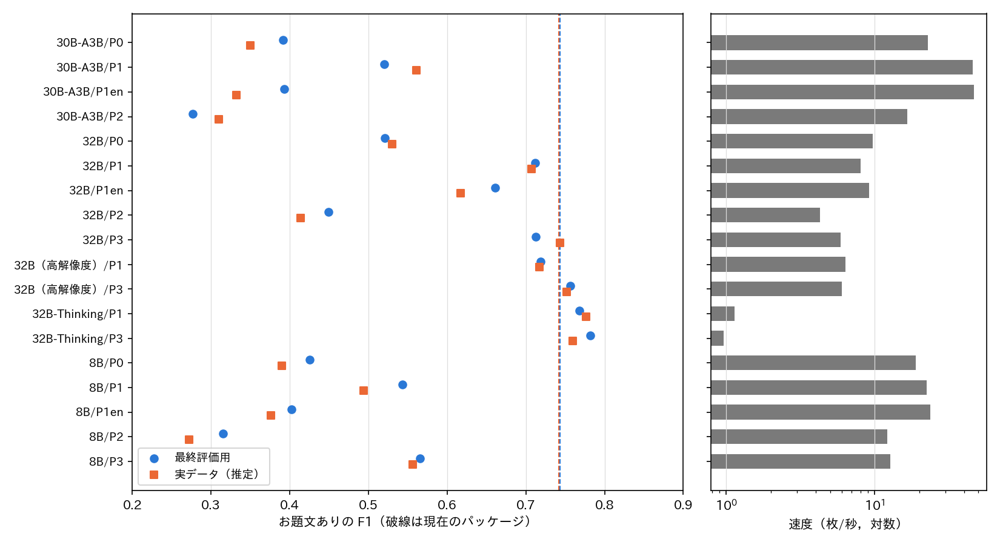
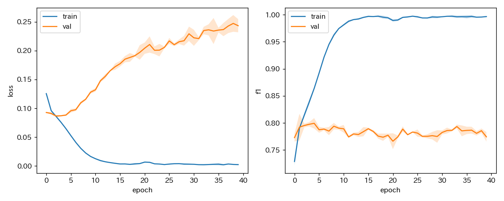
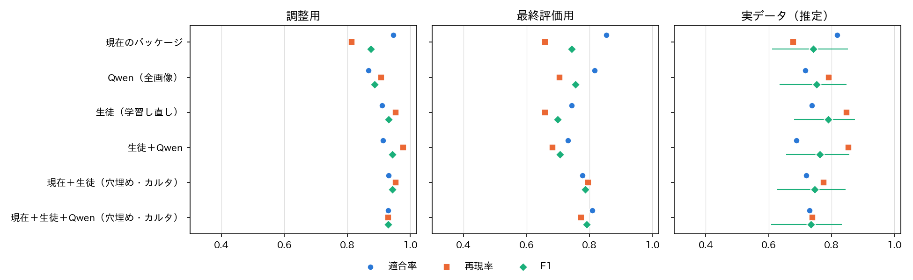

# お題文ありの属性の判定の改善

## 1. 概要

お題画像のラベルを，属性（カルタ記号あり，空欄あり，お題文あり，文字あり）と媒体の2軸にし，形式を属性から導く構成に改める．
その準備として，「お題文あり」の判定の精度の改善に取り組んだ．
「お題文あり」は，空欄やカルタ記号の有無と独立に付ける属性である．

結論は次のとおりである．

| 項目 | 結果 |
| :--- | :--- |
| 正解 | 定義書 v4 の目視のラベル1,020枚に，お題文ありを加えた．穴埋め・カルタの画像328枚は目視で付け直した．そのうちお題文ありは30枚（9%）であった |
| Qwen の指示の改善 | 現在の確認の質問（P0）を全画像に問うと，F1 は最終評価用0.43，実データ0.39（8B）であった．定義と判断の手順を明示した指示（P3）を32B に高解像度で与えると，0.76，0.75 になった |
| モデルの比較 | 8B と 30B-A3B は，どの指示でも「お題文あり」と答えすぎた（適合率0.2〜0.5）．32B が必要であった．推論型の 32B-Thinking はわずかに良い（0.78，0.76）が，約6倍遅い |
| 全体の構成 | 現在のパッケージの F1 は，最終評価用0.74，実データ0.74 である．最も良い構成（現在の生徒＋学習し直した生徒を穴埋め・カルタの画像に使う）は0.79，0.75 であった．ただし，実データの95%区間はどれも重なる（幅は約±0.1） |
| 全データでの影響 | お題文ありの割合は8.3%から10.2%に増える（穴埋め・カルタの画像に1.9%）．属性から逆算した形式の正解率は，現在とほぼ同じである（最終評価用0.931→0.928，実データ0.950→0.952） |
| 処理時間 | 推奨の構成は Qwen を使わない．現在の確認の質問（約5〜7時間）が不要になる．追加の生徒は保存済みの埋め込みに MLP を適用するだけである |

## 2. 定義と正解

### 2.1 定義書 v5 の案

`programs/label_guideline/label_definition_v5.md` に案を作った．主な点は次のとおりである．

- 属性（複数）：カルタ記号あり，空欄あり，お題文あり，文字あり．
- 媒体（複数）：第4版と同じ7項目．
- 形式：属性から導く．カルタ記号あり→カルタ，空欄あり→穴埋め，お題文あり→お題文，それ以外→通常の順である．第4版の形式の優先順位と同じなので，第4版の形式の値と互換である．
- お題文あり：投稿者が回答者に向けて書き加えた，大喜利の題となる文である．
  - 問い，指示，題目の句，状況の設定，テンプレートや無地の背景に書いた主題の文（台本，手紙の書き出しなど）を含む．
  - 次のものはお題文としない．
    - 空欄を含む文そのもの．空欄を含む文章のまとまり（段落，説明文，字幕，歌詞など）は全体を空欄を含む文とみなす．
    - 元の素材にある文字．
    - 絵の中の吹き出しの台詞．

### 2.2 正解の作成

正解は，定義書 v4 の目視のラベル1,020枚から次のように作った．

- 形式がお題文の画像はお題文あり，通常の画像はお題文なしとした．第4版の定義から，そのまま決まる．
- 穴埋め・カルタの画像328枚は，Claude Code が目視で付け直した（`programs/ex024_odaibun_attr/odaibun_relabel.txt`）．
  - お題文ありは30枚（穴埋め259枚中30枚，カルタ69枚中0枚）であった．
  - 例：「世の中で弱いものは？ 1位 赤ちゃん … 523位 □」，「初めてアルウィンに来たオルゴ・デミーラ様!! 最初に放った一言とは…!?」と空の吹き出し，「アンパンマンが負けたとき ・水で襲ってきた ・八百長 ・□」．
  - 判断に迷った境界の例をメモに残した．
    - 絵の中の吹き出しの台詞（4枚）はお題文なしとした．
    - 説明文の中の空欄（8枚）と歌詞（5枚）は，元からある文章としてお題文なしとした．
    - テンプレートに書いた台本（4枚）はお題文ありとした．

表1：正解の正例の枚数．

| 集合 | 枚数 | お題文あり | うち穴埋めの画像 |
| :--- | ---: | ---: | ---: |
| 調整用（評価用データの dev） | 320 | 43 | 8 |
| 最終評価用（評価用データの test） | 320 | 44 | 10 |
| 実データ（無作為160枚＋層別220枚，重み付き） | 380 | 39 | 12 |

## 3. Qwen の指示とモデルの比較

### 3.1 指示

| 指示 | 内容 |
| :--- | :--- |
| P0 | 現在の確認の質問（英語．「投稿者が回答者に向けて主題として書いた文があるか」） |
| P1 | お題文ありの定義（含むもの，含まないもの）を日本語で与え，真偽を答えさせる |
| P1en | P1 の英語版 |
| P2 | 画像中の文を最大6つ書き出させ，文ごとに空欄の有無・出どころ・種類を答えさせ，規則で判定する |
| P3 | P1 に，空欄を含む文章のまとまりの規則と，判断の手順（投稿者の文字を分ける → 空欄を含むまとまりを除く → 残りに問い等があるか．迷えばなし）を加える |
| P4 | P3 で，お題文に当たる文を書き写させる（出力が崩れることがあり，採用しない） |

P3 は，調整用の集合での P1 の誤りを見て作った．そのため，調整用の集合の値は高めに出る．

### 3.2 結果

表2：主な設定の F1（適合率／再現率）．速度は RTX PRO 6000 での1,020枚の推論の値である．

| モデル・指示 | 速度（枚/秒） | 調整用 | 最終評価用 | 実データ |
| :--- | ---: | :---: | :---: | :---: |
| 現在のパッケージ（参考） | — | 0.88（0.95/0.81） | 0.74（0.85/0.66） | 0.74（0.82/0.68） |
| 8B・P0（現在の確認の質問） | 18.9 | 0.46（0.30/1.00） | 0.43（0.27/1.00） | 0.39（0.24/1.00） |
| 8B・P3 | 12.7 | 0.68（0.51/1.00） | 0.57（0.42/0.89） | 0.56（0.39/0.96） |
| 30B-A3B・P1 | 45.7 | 0.71（0.56/0.95） | 0.52（0.40/0.75） | 0.56（0.41/0.88） |
| 32B・P0 | 9.7 | 0.59（0.41/1.00） | 0.52（0.35/1.00） | 0.53（0.36/1.00） |
| 32B・P1 | 8.0 | 0.83（0.76/0.93） | 0.71（0.62/0.84） | 0.71（0.59/0.89） |
| 32B・P3 | 5.9 | 0.89（0.91/0.88） | 0.71（0.72/0.70） | 0.74（0.70/0.79） |
| **32B・P3（高解像度）** | 6.0 | 0.89（0.87/0.91） | 0.76（0.82/0.70） | 0.75（0.72/0.79） |
| 32B-Thinking・P3 | 1.0 | 0.89（0.93/0.86） | 0.78（0.79/0.77） | 0.76（0.76/0.76） |
| 32B-Thinking・P1 | 1.1 | 0.86（0.80/0.93） | 0.77（0.69/0.86） | 0.78（0.69/0.88） |

- 高解像度は，入力の上限を 448×448 画素から 896×896 画素相当に上げたものである．
- 32B-Thinking は出力を JSON に制約しないで生成した．約3%は答えを読み取れず，「なし」として数えた．

考察：

- **小さなモデルの限界：** 8B と 30B-A3B は，定義を詳しく与えても「お題文あり」と答えすぎた．調整用の集合の誤りを見ると，次の3種類が多かった．
  - 空欄を含む文そのもの（例：「部屋と□とわたし」）
  - テレビの字幕
  - 漫画の台詞
- **32B と指示：** 32B は定義の除外の条件を守れた．P0 から P3 への変更で，最終評価用の F1 が0.52から0.71〜0.76に上がった．
- **文を書き出す指示：** 文を書き出して規則で判定する指示（P2）は，どのモデルでも悪かった．書き出しの漏れや，出どころの誤りが判定に直接響くためと考えられる．
- **全画像に Qwen を使う構成：** 32B を全画像に使うと，約661万枚に約12.8日（6枚/秒）かかる．現実的でないため，教師ラベルとして生徒に移す．

## 4. 生徒の学習し直しと全体の構成

### 4.1 生徒

- 教師：32B・P3（高解像度）で，現在の生徒の教師ラベルの画像4.5万枚にお題文ありを付けた（`teacher.py`）．
  - 現在の生徒の文字ありの確率が0.3未満の画像は，質問せずにお題文なしとした．
  - 質問したのは26,577枚で，約75分かかった．お題文ありは4,364枚（4.5万枚の9.7%）であった．
  - 目視のラベルでお題文ありの画像は，全て文字ありの確率が0.99以上であった．
- 生徒：パッケージの埋め込み（SigLIP2-so400m，1,152次元）に，お題文ありの出力層を持つ MLP を付けた（`train.py`）．
  - 比べた入力：埋め込みのみ（emb），埋め込み＋現在の生徒の形式・属性の確率（emb+probs）．
  - 学習率：1e-3，3e-4．各3 seed．
  - 調整用の集合の F1 で，emb+probs，学習率 1e-3（0.93）を選んだ．閾値は0.3である．
  - 学習用の誤差は下がり続けるが，検証用の誤差は2〜4エポック目で最小になり，その後は過学習した．検証用の誤差が最小のエポックの重みを用いた．検証用での教師との一致は F1 約0.80である．

- 埋め込みはパッケージが保存したものを用いた．そのため，画像を読み直さずに学習でき，全データ661万枚にも適用できる．

### 4.2 構成の比較

| 構成 | 内容 |
| :--- | :--- |
| 現在のパッケージ | 形式がお題文の画像をお題文ありとする．穴埋め・カルタの画像にはお題文ありが付かない |
| Qwen（全画像） | 32B・P3（高解像度）を全画像に問う（参考．全データには適用できない） |
| 生徒（学習し直し） | 新しい生徒の確率が0.3以上 |
| 生徒＋Qwen | 生徒の確率が中間の帯（調整用の集合で決めた0.2〜0.3）の画像だけ Qwen に問う |
| 現在＋生徒（穴埋め・カルタ） | 空欄・カルタ記号のない画像は現在のパッケージの判定を使う．穴埋め・カルタと予測した画像は，新しい生徒の判定を使う |
| 現在＋生徒＋Qwen（穴埋め・カルタ） | 上の構成で，穴埋め・カルタの画像は，生徒の確率が0.2以上かつ Qwen が真の場合にお題文ありとする |

表3：構成ごとの適合率／再現率／F1．

| 構成 | 調整用 | 最終評価用 | 実データ | 実データの F1 の95%区間 | 全データで Qwen に問う割合 |
| :--- | :---: | :---: | :---: | :---: | ---: |
| 現在のパッケージ | 0.95/0.81/0.88 | 0.85/0.66/0.74 | 0.82/0.68/0.74 | 0.61–0.85 | 8.3%（現在の確認の質問） |
| Qwen（全画像） | 0.87/0.91/0.89 | 0.82/0.70/0.76 | 0.72/0.79/0.75 | 0.63–0.85 | 100% |
| 生徒（学習し直し） | 0.91/0.95/0.93 | 0.74/0.66/0.70 | 0.74/0.85/0.79 | 0.68–0.87 | 0% |
| 生徒＋Qwen | 0.91/0.98/0.94 | 0.73/0.68/0.71 | 0.69/0.85/0.76 | 0.66–0.86 | 1.5% |
| **現在＋生徒（穴埋め・カルタ）** | 0.93/0.95/0.94 | 0.78/0.80/0.79 | 0.72/0.77/0.75 | 0.63–0.84 | 0% |
| 現在＋生徒＋Qwen（穴埋め・カルタ） | 0.93/0.93/0.93 | 0.81/0.77/0.79 | 0.73/0.74/0.73 | 0.61–0.83 | 2.7% |

- 「現在＋生徒」の2つの構成は，最終評価用と実データの結果を見た後に加えた．そのため，両集合での値はやや楽観的である．
- 現在のパッケージの「Qwen に問う割合」は，現在の確認の質問の対象（形式がお題文と予測した代表の画像）の割合である．

考察：

- **最終評価用と実データで異なる傾向：** 新しい生徒は，実データでは最も良い（0.79）が，最終評価用では最も悪い（0.70）．
  - 最終評価用の集合は，少ない区分の画像（文字が主体の画像など）を多く含む．新しい生徒は，その中の形式がお題文の画像を見逃した．
  - 現在の生徒は，形式がお題文の画像（空欄なし）では，最終評価用でも実データでも適合率・再現率が0.82〜0.85と安定している．
- **推奨の構成：** 「現在＋生徒（穴埋め・カルタ）」は，両集合で現在より良く（0.79，0.75），Qwen を必要としない．
  - 空欄なしの画像では，現在の生徒の安定した判定をそのまま使う．
  - 穴埋め・カルタの画像では，新しい生徒が問いの文を拾う．
- **Qwen の確認の効果：** 穴埋め・カルタの画像で Qwen に確認させても，最終評価用の適合率がわずかに上がるだけで，実データの再現率は下がった．
- **改善の幅：** 改善は最終評価用で0.05，実データで0.01にとどまり，95%区間の幅（約±0.1）より小さい．評価用の正例が各集合で約40枚と少ないため，構成の差を統計的に確かめられていない．

### 4.3 属性から逆算した形式

推奨の構成のお題文ありと，現在のパッケージの空欄あり・カルタ記号ありから形式を逆算し，定義書 v4 の形式と比べた．

表4：形式の正解率と，お題文の適合率／再現率．

| 方法 | 集合 | 形式の正解率 | お題文 | 穴埋め | 通常 |
| :--- | :--- | ---: | :---: | :---: | :---: |
| 現在のパッケージ | 最終評価用 | 0.931 | 0.85/0.85 | 0.91/0.96 | 0.95/0.95 |
| 逆算 | 最終評価用 | 0.928 | 0.87/0.79 | 0.88/0.99 | 0.96/0.94 |
| 現在のパッケージ | 実データ | 0.950 | 0.82/0.83 | 0.95/0.93 | 0.96/0.97 |
| 逆算 | 実データ | 0.952 | 0.82/0.83 | 0.93/0.97 | 0.97/0.96 |

形式の精度は，現在とほぼ同じである．
最終評価用で形式のお題文の再現率が下がったのは，現在の生徒が形式をお題文と予測しつつ空欄ありの確率も0.5以上とした画像（2枚）が，逆算では穴埋めになるためである．

## 5. 未解決の論点と次の候補

1. **パッケージへの組み込み：** 推奨の構成を組み込むには，次を行う．
   - 生徒に「お題文あり」の出力層を加える（今回の MLP の重みを用いる）．
   - 属性の出力に `has_odai_text` を加え，形式を属性から導く．
   - 確認の質問の段階を外す．
   - 全データの画像の予測し直しは不要である．保存済みの埋め込みと確率から計算できる．
2. **お題文の精度の上限：** F1 は0.75〜0.79で頭打ちである．次の2つが要因と考えられる．
   - 境界の例（説明文の中の空欄，テンプレートの台本，吹き出しの台詞）の判断の難しさ．
   - 正解が Claude Code 1人の目視のラベルであること．
   - 目視のラベルの再現性（付け直しの一致率）を測ると，到達できる上限が分かる．
3. **評価の正例の不足：** 正例が各集合で約40枚と少なく，構成の差を確かめられない．お題文ありの候補を多く含む層別抽出で，正例を200枚程度に増やすことが望ましい．
4. **教師の改善：** 推論型の 32B-Thinking は，教師としてわずかに良い可能性がある．ただし，2.7万枚に約7.5時間かかる．
5. **定義書 v5 の確定：** 境界の扱いを確定させる．特に「元からある説明文の中の空欄」と「投稿者が作った説明文」の区別である．

## 付録

- プログラム：`programs/ex024_odaibun_attr/`
  - `data.py`：正解（お題文ありの付け直しを含む），集合と重み，パッケージの埋め込みの読み込み．
  - `make_sheets.py`：付け直しの一覧の画像（`datasets/ex024_odaibun_attr/sheets/`）．
  - `odaibun_relabel.txt`：穴埋め・カルタの画像328枚のお題文ありの目視のラベル．
  - `qwen_odaibun.py`：Qwen の指示とモデルの比較（P0〜P4．`--reparse` で保存済みの出力を解釈し直す）．
  - `evaluate_prompts.py`：指示とモデルごとの適合率・再現率・F1 と図．
  - `teacher.py`：4.5万枚の教師ラベル．
  - `model.py`，`train.py`：お題文ありの生徒（MLP）．
  - `evaluate_pipeline.py`：構成の比較，全データへの適用，形式の逆算．
- 定義書の案：`programs/label_guideline/label_definition_v5.md`
- 出力：`outputs/ex024_odaibun_attr/`
  - `qwen/{モデル}__{画素}/`，`prompt_metrics.csv`，`fig_prompts.png`
  - `teacher/`，`student/`
  - `pipeline/`（`metrics.csv`，`format.csv`，`config.json`，`student_all__*.parquet`，`fig_pipeline.png`）
