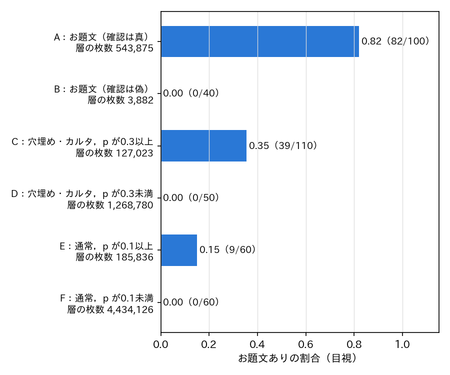
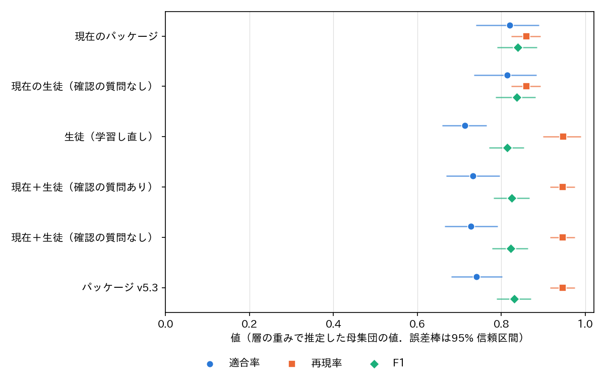
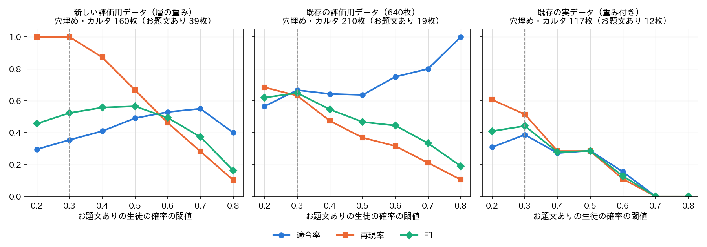

# report_042：お題文ありの評価用データ v5 の作成，パッケージ v5.3.0 への組み込み，定義書 v5 の確定

## 1. 概要

report_041 の次の候補の3項目を実施した．

1. お題文ありの正例を増やした評価用データ（層別抽出の420枚，お題文あり130枚）を作り，構成を比べた．目視のラベルの再現性（同じ付与者による付け直しの一致）も測った．
2. お題文ありの生徒をパッケージ `Bokete_Annotation_programs_v5.0` に組み込み，形式を属性から導くようにした（バージョン 5.3.0）．確認の質問（Qwen3-VL-8B）は既定で外した．全データのお題の段階は，保存済みの埋め込みから計算し直した．
3. 付与で迷った境界の例を反映し，定義書を第5版として確定した（`docs/label_definition.md`）．

主な結論は次のとおりである．

- 新しい評価用データでは，お題文ありの F1 は v5.2.0（形式がお題文をお題文ありとみなす）が0.839，v5.3.0 が0.831であり，差は −0.008（95% 信頼区間 [−0.031, +0.016]）で区別できない．report_041 で推奨した構成（現在＋生徒，確認の質問あり）も0.825であり，report_041 の最終評価用データでの改善（+0.05）は再現しなかった．
- v5.3.0 は再現率を0.86から0.95に上げ，適合率を0.82から0.74に下げる．穴埋め・カルタの画像のお題文ありを付けられるようになったが，その適合率は約0.35〜0.67と低い．
- 確認の質問が偽と答えた画像（v5.2.0 で全データの0.06%）は，抽出した40枚が全てお題文なしであり，判断は正しかった．ただし効果は F1 で −0.003 と小さく，お題文ありの生徒の確率の下限（0.05）で代えられる．確認の質問を外すことで全データの処理が約5〜7時間短くなる．
- 目視のラベルの再現性は，90枚で一致率0.978，Cohen の κ 0.95 であった．

## 2. 方法

### 2.1 新しい評価用データ

既存の目視のラベル（1,020枚）と ex024 の教師ラベル（44,998枚）に含まれない代表の画像（sha256 が同じ画像の1枚）から，v5.2.0 の予測とお題文ありの生徒の確率 $` p `$ で分けた6つの層ごとに無作為に抽出した（`programs/ex025_odaibun_eval_v5/make_sheets.py`）．
1,020枚の評価では確認の質問が偽と答えた画像がなく，確認の質問の効果を測れなかったため，その画像の層 B を設けた．実データの値は，層の枚数を抽出数で割った重みで推定した．95% 信頼区間は層ごとの復元抽出（2,000回）で求め，構成の差は同じ標本の対で求めた．

表1 層と抽出数（層の枚数は代表の画像6,609,511枚の内訳）．

| 層 | 条件 | 層の枚数 | 抽出数 |
| :--- | :--- | ---: | ---: |
| A | 形式の確率が最大のものがお題文，確認の質問が真 | 543,875 | 100 |
| B | 形式の確率が最大のものがお題文，確認の質問が偽 | 3,882 | 40 |
| C | 穴埋め・カルタ，$` p \geq 0.3 `$ | 127,023 | 110 |
| D | 穴埋め・カルタ，$` p < 0.3 `$ | 1,268,780 | 50 |
| E | 通常，$` p \geq 0.1 `$ | 185,836 | 60 |
| F | 通常，$` p < 0.1 `$ | 4,434,126 | 60 |

### 2.2 再現性の確認

既存の1,020枚から，お題文ありの正解（ex024）の3群（形式がお題文，穴埋め・カルタ，通常）ごとに30枚を抽出した．新しい評価用データと混ぜて並べ替え，番号だけを付けた一覧（3×3 枚を1枚として57枚）にし，予測と過去のラベルを伏せて Claude Code が定義書 v5 に従い目視でラベルを付けた（`odai_labels.txt`，510枚）．同じ付与者による再付与の一致であり，付与者間の一致ではない．

### 2.3 比べた構成

$` p `$ は ex024 のお題文ありの生徒（埋め込みに形式・属性の確率を連結した入力の MLP，学習率 1e-3，3 seed の平均）の確率である．

- 現在のパッケージ：v5.2.0 の形式（確認の質問を反映）がお題文
- 現在の生徒（確認の質問なし）：形式の確率が最大のものがお題文
- 生徒（学習し直し）：$` p \geq 0.3 `$
- 現在＋生徒（確認の質問あり・なし）：上の2つの形式がお題文，または穴埋め・カルタで $` p \geq 0.3 `$（report_041 の推奨の構成）
- パッケージ v5.3：形式の確率が最大のものがお題文で $` p \geq 0.05 `$，または穴埋め・カルタで $` p \geq 0.3 `$．確認の質問なし

v5.3 の下限0.05は，層別抽出の評価用データと既存の1,020枚の結果を見て決めた値であり（3.3 節），v5.3 の値はやや楽観的である．閾値0.3は report_041 の調整用データで決めた値をそのまま用いた．

### 2.4 パッケージ v5.3.0 への組み込み

- `bokete_annotation/labels.py`：属性に `has_odai_text` を加え，属性から形式を導く順（`DERIVE_ORDER`）を定めた．
- `bokete_annotation/models.py`：お題文ありの生徒 `OdaiTextMLP` と，その読み込みと予測の関数を加えた．重みは `models/odai_text_mlp_seed{0,1,2}.pth`（各4.8MB）であり，チェックサムを `models/checksums.sha256` に加えた．
- `bokete_annotation/pipeline.py`：段階 `odai_text` を加えた．保存した埋め込み（`embeddings/part_XXXX.npy`）と predict の確率から $` p `$ を求め，`odai_text/part_XXXX.parquet` に保存する．finalize は $` p `$ でお題文ありを決め，形式は属性から導く．
- `bokete_annotation/postprocess.py`：`decide_odai_text`，`derive_format`，`to_labels` を定義書 v5 に合わせた．形式の確率が最大の項目から属性を補う規則（カルタ → カルタ記号あり，穴埋め → 空欄あり）は残し，お題文あり → 文字ありを加えた．
- `config.json`：`odai_text`（重み，`gate_odaibun` 0.05，`threshold_blank` 0.3）を加え，`verify.enabled` を偽にした．
- テスト（`tests/test_postprocess.py`），`README.md`／`README.pdf`，`docs/data_format.md`，`docs/method.md`，`models/README.md`，`scripts/quality_check.py` を更新した．テストは21件が全て通った．

全データは `--stages odai_text finalize caption` で更新した．更新の前に v5.2.0 の `annotation.parquet` と `summary.json` を `outputs/BoketeDBv5_annotation/backup_v5.2.0/` に複製した．

## 3. 結果

### 3.1 層ごとのお題文ありの割合

層ごとの目視のお題文ありの割合を図1に示す．全データのお題文ありの割合の推定は7.9%であった．

図1 層ごとのお題文ありの割合（括弧は正例の数 / 抽出数）．

- 確認の質問が偽と答えた層 B は40枚が全てお題文なしであり，確認の質問の判断は正しかった．
- 穴埋め・カルタで $` p \geq 0.3 `$ の層 C は，お題文ありが35%（39/110）にとどまった．$` p < 0.3 `$ の層 D は0/50であった．
- 通常で $` p \geq 0.1 `$ の層 E には15%（9/60）のお題文ありがあり，いずれの構成も見逃している（全データで約2.8万枚と推定される）．

### 3.2 構成の比較

構成ごとの適合率・再現率・F1 を表2と図2に示す．

表2 お題文ありの適合率・再現率・F1（新しい評価用データ420枚，層の重みで推定．括弧は95% 信頼区間）．差は現在のパッケージとの F1 の差（同じ標本の対で求めた区間）である．

| 構成 | 適合率 | 再現率 | F1 | F1 の差 | 割合 |
| :---------------------- | :------: | :------: | :--------------------: | :---------------------------: | :-----: |
| 現在のパッケージ（v5.2.0） | 0.820 | 0.859 | 0.839 [0.790, 0.885] | — | 8.3% |
| 現在の生徒（確認の質問なし） | 0.814 | 0.859 | 0.836 [0.787, 0.881] | −0.003 [−0.003, −0.003] | 8.3% |
| 生徒（学習し直し） | 0.714 | 0.948 | 0.814 [0.771, 0.854] | −0.025 [−0.072, +0.023] | 10.5% |
| 現在＋生徒（確認の質問あり） | 0.732 | 0.946 | 0.825 [0.781, 0.866] | −0.014 [−0.034, +0.007] | 10.2% |
| 現在＋生徒（確認の質問なし） | 0.728 | 0.946 | 0.823 [0.779, 0.864] | −0.017 [−0.036, +0.004] | 10.3% |
| パッケージ v5.3 | 0.741 | 0.946 | 0.831 [0.789, 0.871] | −0.008 [−0.031, +0.016] | 10.1% |

割合はお題文ありと付ける画像の割合（全データの推定）である．適合率の95% 信頼区間は v5.2.0 が [0.740, 0.890]，v5.3 が [0.680, 0.802]，再現率は同じく [0.824, 0.894]，[0.916, 0.976] である．

図2 構成ごとの適合率・再現率・F1（誤差棒は95% 信頼区間）．

- 生徒を穴埋め・カルタの画像に加えると，再現率は0.86から0.95に上がり，適合率は0.82から0.73〜0.74に下がった．F1 はいずれも v5.2.0 と区別できなかった．
- お題文ありと付ける割合は，v5.3 が10.1%であり，推定の真の割合7.9%より多い．
- 確認の質問をなくすと F1 は0.003下がる（層 B の画像だけが変わるため，信頼区間はほぼ一点である）．v5.3 は下限0.05で層 B の一部と層 A のお題文なしを外し，確認の質問なしの構成より F1 が0.008高い．

### 3.3 穴埋め・カルタの画像の閾値と，お題文の画像の下限

穴埋め・カルタと予測した画像に限った，閾値ごとの適合率・再現率・F1 を図3に示す．

図3 穴埋め・カルタの画像での閾値とお題文ありの適合率・再現率・F1（破線は採用した0.3）．

- F1 が最大になる閾値は，新しい評価用データで0.5（F1 0.57），既存の評価用データ（640枚）と実データ（380枚）で0.3（0.65，0.44）であった．評価用データごとに異なり，正例も各12〜39枚と少ないため，report_041 で決めた0.3を維持した．
- 閾値0.3の適合率は0.35〜0.67，再現率は0.51〜1.00である．穴埋め・カルタの画像のお題文ありは，v5.2.0 では付けられなかった（再現率0）が，v5.3.0 でも精度は高くない．

形式の確率が最大のものがお題文の画像のうち，$` p `$ が下限未満の画像の数を表3に示す．

表3 下限で外れる画像の数（括弧はそのうちのお題文ありの数）．

| 下限 | 新しい評価用データ（140枚） | 既存の評価用データ（71枚） | 既存の実データ（27枚） |
| :---: | :---: | :---: | :---: |
| 0.02 | 7（0） | 0（0） | 0（0） |
| 0.05 | 14（0） | 0（0） | 1（0） |
| 0.1 | 23（0） | 1（1） | 1（0） |
| 0.2 | 40（2） | 6（5） | 1（0） |
| 0.3 | 49（5） | 7（6） | 2（0） |

下限0.05まではお題文なしの画像だけが外れたため，0.05を採用した．

### 3.4 既存の1,020枚での v5.2.0 と v5.3.0 の比較

表4 既存の目視のラベル（ex024 の正解）でのお題文ありの F1 と，形式の一致率．形式の正解は，正解の属性から定義書 v5 の順で導いたものである．

| 集合 | お題文ありの F1（v5.2.0 → v5.3.0） | 適合率（同） | 再現率（同） | 形式の一致率（同） |
| :--- | :---: | :---: | :---: | :---: |
| 調整用（320枚） | 0.875 → 0.943 | 0.946 → 0.932 | 0.814 → 0.953 | 0.975 → 0.969 |
| 最終評価用（320枚） | 0.744 → 0.787 | 0.853 → 0.778 | 0.659 → 0.795 | 0.931 → 0.928 |
| 実データ（380枚，重み付き） | 0.742 → 0.756 | 0.818 → 0.739 | 0.678 → 0.774 | 0.950 → 0.955 |

既存の1,020枚では v5.3.0 の F1 が高いが，閾値0.3はこの集合の調整用データで決めた値であり，新しい評価用データでは差がなかった（3.2 節）．形式の一致率はほぼ変わらない．

### 3.5 目視のラベルの再現性

表5 付け直したラベルと過去のラベルの一致（90枚）．

| 群 | 枚数 | 一致率 | κ | 過去の正例 | 付け直しの正例 |
| :--- | :---: | :---: | :---: | :---: | :---: |
| 形式がお題文 | 30 | 0.967 | — | 30 | 29 |
| 穴埋め・カルタ | 30 | 0.967 | 0.78 | 3 | 2 |
| 通常 | 30 | 1.000 | — | 0 | 0 |
| 全体 | 90 | 0.978 | 0.95 | 33 | 31 |

不一致の2枚は，いずれも過去はお題文あり，付け直しはお題文なしであった．

- 「記者：名前の由来を教えてください」と空の吹き出し：話者を付けた台本はお題文なしとする規則を，今回の付与で定めたため．
- 無地の背景に書き写した既存の歌詞：第4版では無地の背景の詩をお題文の候補としたが，今回は既存の歌詞を元の素材の文字とみなしたため．

いずれも判断のぶれではなく，定義の境界を今回定めたことによる差である．群の内訳が偏っているため（正例が少ない），κ は全体の値を主に見る．

### 3.6 全データの更新

`odai_text` の段階は6,609,511枚を148秒（約4.5万枚/秒）で処理した．$` p `$ は ex024 で全データに適用した値と一致した（差の最大値0）．
キャプションと媒体は v5.2.0 と同じであった．

表6 全データ（6,823,270お題）の形式の割合と，お題文ありの割合．

| 項目 | v5.2.0 | v5.3.0 |
| :--- | :---: | :---: |
| カルタ | 1.09% | 1.10% |
| 穴埋め | 20.07% | 21.39% |
| お題文 | 8.26% | 7.46% |
| 通常 | 70.59% | 70.06% |
| お題文あり | — | 10.04% |

形式が変わったお題は104,088件（1.5%）である．主な内訳は，お題文 → 穴埋め（45,463件．空欄ありの確率が0.5以上），通常 → 穴埋め（44,909件．同），お題文 → 通常（10,881件．下限0.05で外れた）である．
ボケのラベル（`boke_annotation/`）は，ボケの分類器の入力に形式を含み，計算に約3.1日かかるため再計算していない．配布するボケのラベルの `format` は v5.2.0 の形式であり，その旨を `README.md` と `docs/data_format.md` に記した．

## 4. 定義書 v5 の確定

`Bokete_Annotation_programs_v5.0/docs/label_definition.md` を第5版とし，第4版を `docs/label_definition_v4.md` に残した．研究用のリポジトリの `programs/label_guideline/label_definition_v5.md` も同じ内容である．付与で迷った例から，お題文ありの判定に次の規則を加えた．

- 含むもの：無地の背景やテンプレートに投稿者が書いた台詞の書き出しや定型句，投稿者が素材に加えた問いの枠やテロップ，題目の句の見出しと，その下の空欄を含む文の組（「ウサギをなつかせる方法 □をあげる」）．
- 含まないもの：話者を付けた台本（問いの形の台詞を含む），題そのものに空欄を含むもの（「X vs （　）」），題目のない列挙の最後を空欄にしたもの，分類やシリーズの名札だけの見出し（「ことわざ」，「なぞかけ」，「【問題】」）と空欄を含む文の組，既存の歌詞・詩・有名な台詞を書き写したもの，写真に付けた人物の台詞や感想の字幕，テンプレートの定型の見出し（「写真で一言ボケて」）．

## 5. 考察

お題文ありの全体の F1 は，v5.2.0 から改善しなかった．全データのお題文ありの推定の約86%は形式がお題文と予測される画像（層 A）にあり，その判定は v5.2.0 の生徒のままであるためである（穴埋め・カルタの層 C は約9%，通常の層 E は約5%）．v5.3.0 で新たに付くのは，穴埋め・カルタの画像のお題文ありである．ここでは適合率が低く（新しい評価用データで0.35），全体の適合率を下げ，再現率の向上と相殺した．

report_041 では，最終評価用データの F1 が0.74から0.79に上がったことから構成を推奨したが，正例が約40枚の集合での差であった．正例130枚の新しい評価用データでは再現しなかった．小さい評価用データでの改善は，信頼区間が重なる場合は採否の根拠にならないことが確かめられた．

それでも v5.3.0 を採用したのは，次の理由による．F1 が同等である．定義書 v5 の属性（空欄やカルタ記号と独立のお題文あり）を出力できる．確認の質問（約5〜7時間）を外せる．ただし，穴埋め・カルタの画像のお題文ありを用いる分析では，適合率が低いことに注意が要る．適合率を優先する場合は `p_has_odai_text` の閾値を上げる（新しい評価用データでは0.5で適合率0.49，再現率0.67）．

再現性の κ 0.95 は，F1 の上限が目視のラベルのぶれでは決まっていないことを示す．ただし，同じ付与者（Claude Code）による一致であり，人の判断者との一致は測っていない．

## 6. 未解決の論点と次の候補

- 穴埋め・カルタの画像のお題文ありの適合率が低い（0.35〜0.67）．層 C のお題文なし71枚は，空欄を含む1文だけの画像（36枚）と，空欄を含む台本・歌詞・記事・説明文や名札の見出し付きの問題文など（35枚）であった．この区別を学ぶには，境界の例を含む教師ラベルを増やすか，この層に限って Qwen3-VL-32B に問う（層 C は全データの約1.9%，約12.7万枚．約6枚/秒で約6時間）ことが候補である．
- 形式が通常と予測された画像のお題文ありの見逃し（層 E．全データで約2.8万枚と推定）．
- 下限0.05は評価用データを見て決めた値であり，別の評価用データでの確認が要る．
- ボケのラベルは v5.2.0 の形式で付けたままである．v5.3.0 の形式でボケの段階を実行し直すか（約3.1日），変わった1.5%のお題のボケだけを計算し直すかの判断が残る．
- 目視のラベルは全て Claude Code が付けたものである．LINE の Bot（`Bokete_LINE_Annotator/`）による人の判断で，お題文ありの定義書 v5 の境界（台詞の書き出し，名札だけの見出し，書き写した歌詞）の妥当性を確かめることが候補である．
- パッケージの変更はコミットしていない．
