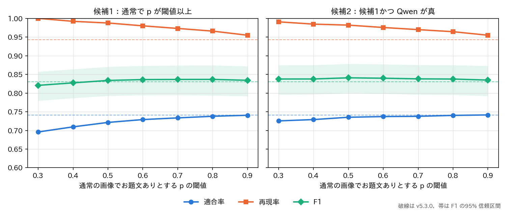

# report_043：形式を通常と予測した画像でのお題文ありの見逃しへの対応の検討

## 1. 概要

パッケージ v5.3.0 は，形式の確率が最大のものが通常の画像（以下，通常の画像）にはお題文ありを付けない．report_042 の層 E（通常の画像で，お題文ありの生徒の確率 $` p `$ が0.1以上）では目視でお題文ありが15%（9/60）あり，全データで約2.8万枚の見逃しと推定した．
本報告では，通常の画像から180枚を追加で抽出して目視でラベルを付け，見逃しの特徴を調べ，次の2つの候補を比べた．

- 候補1：通常の画像でも $` p `$ が閾値以上ならお題文ありとする（追加の計算なし）．
- 候補2：候補1の画像のうち，Qwen3-VL-32B が真と答えた画像だけをお題文ありとする．

主な結論は次のとおりである．

- 見逃しは $` p `$ が0.3以上の画像に限られ，全データで約3.0万枚と推定された（お題文ありの全体の約5.7%）．$` p `$ が0.1〜0.3の画像（約10万枚）は28枚が全てお題文なしであった．
- 候補1（閾値0.7）は追加の計算なしで全体の F1 を0.830から0.836（差 +0.007，95% 区間 [+0.001, +0.013]）に上げた．通常の画像に限ると適合率0.56，再現率0.53である．
- 候補2（閾値0.5）は全体の F1 を0.841（差 +0.011 [+0.005, +0.017]）に上げた．通常の画像に限ると適合率0.62，再現率0.68である．Qwen に問う画像は全データで50,173枚であり，約2.6時間かかる．
- いずれも改善の幅は小さく，閾値は同じデータを見て選んだため値はやや楽観的である．費用のかからない候補1（閾値0.7）の採用を推奨するが，パッケージは変更していない．

## 2. 方法

### 2.1 追加の目視のラベル

report_042 の評価用データ，既存の目視のラベル（1,020枚）と ex024 の教師ラベルの画像を除いた通常の画像から，$` p `$ の区間（0.3〜0.5，0.5〜0.7，0.7以上）ごとに60枚を無作為に抽出した（`programs/ex025_odaibun_eval_v5/normal_miss.py sample`）．
並べ替えて番号だけを付けた一覧（20枚）にし，予測を伏せて Claude Code が定義書 v5 に従い目視でお題文ありを付けた（`normal_labels.txt`）．全てが $` p `$ の高い通常の画像であることは付与者に分かっていたため，report_042 の付与より境界の判断が偏った可能性がある．

### 2.2 重みと評価

通常の画像は，report_042 の層 E と F の画像と追加の画像を $` p `$ の区間（0.1未満，0.1〜0.3，0.3〜0.5，0.5〜0.7，0.7以上）ごとにまとめ，区間の枚数を目視の枚数で割った重みで事後層別した．他の層の重みは report_042 と同じである．
このため，v5.3.0 の値は report_042（F1 0.831）とわずかに異なる（0.830）．95% 区間は層ごとの復元抽出（2,000回）で求め，差は同じ標本の対で求めた．

### 2.3 Qwen

report_042 の評価用データ420枚と追加の180枚に，Qwen3-VL-32B-Instruct（FP8，最大 802,816 画素，ex024 の指示 P3）でお題文ありかを問うた（`normal_miss.py qwen`）．600枚を113.6秒（5.3枚/秒）で処理し，解釈できない出力はなかった．

## 3. 結果

### 3.1 通常の画像の区間ごとのお題文ありの割合

表1 通常の画像の $` p `$ の区間ごとのお題文ありの割合と，Qwen の適合率・再現率．

| $` p `$ の区間 | 区間の枚数 | 目視の枚数 | お題文あり | 割合 | 見逃しの推定 | Qwen の適合率 | Qwen の再現率 |
| :---: | ---: | ---: | ---: | :---: | ---: | :---: | :---: |
| 0.1〜0.3 | 101,478 | 28 | 0 | 0.00 | 0 | 0.00（5枚が真） | — |
| 0.3〜0.5 | 35,458 | 77 | 14 | 0.18 | 約6,400 | 0.29 | 0.71 |
| 0.5〜0.7 | 22,184 | 67 | 23 | 0.34 | 約7,600 | 0.58 | 0.83 |
| 0.7以上 | 27,989 | 68 | 38 | 0.56 | 約15,600 | 0.64 | 0.89 |

見逃しは全データで約3.0万枚と推定され，report_042 の推定（約2.8万枚）とほぼ同じであった．$` p `$ が高いほどお題文ありの割合は高いが，0.7以上でも56%である．

### 3.2 候補の比較

表2 候補ごとのお題文ありの値（全体は層の重みで推定した全データの値．通常の画像は通常の画像に限った値）．適合率・再現率・F1 は全体の値，通常 P・通常 R は通常の画像に限った適合率・再現率，対象は全データで $` p `$ が閾値以上の通常の画像の数である．

| 候補 | 閾値 | 適合率 | 再現率 | F1 | F1 の差 [95% 区間] | 通常 P | 通常 R | 対象 |
| :---------------- | :----: | :-----: | :-----: | :-----: | :---------------------------: | :-----: | :-----: | ------: |
| v5.3.0 | — | 0.741 | 0.943 | 0.830 | — | — | 0.00 | — |
| 候補1 | 0.3 | 0.696 | 1.000 | 0.821 | −0.009 [−0.017, −0.000] | 0.35 | 1.00 | 85,631 |
| 候補1 | 0.5 | 0.721 | 0.988 | 0.834 | +0.004 [−0.003, +0.011] | 0.46 | 0.78 | 50,173 |
| 候補1 | 0.7 | 0.734 | 0.973 | 0.836 | +0.007 [+0.001, +0.013] | 0.56 | 0.53 | 27,989 |
| 候補1 | 0.9 | 0.741 | 0.955 | 0.834 | +0.004 [+0.001, +0.008] | 0.71 | 0.21 | 9,116 |
| 候補2 | 0.3 | 0.725 | 0.991 | 0.838 | +0.008 [+0.001, +0.015] | 0.51 | 0.84 | 85,631 |
| 候補2 | 0.5 | 0.735 | 0.982 | 0.841 | +0.011 [+0.005, +0.017] | 0.62 | 0.68 | 50,173 |
| 候補2 | 0.7 | 0.738 | 0.970 | 0.838 | +0.008 [+0.003, +0.013] | 0.64 | 0.47 | 27,989 |
| Qwen のみ（全画像） | — | 0.580 | 0.833 | 0.684 | −0.146 [−0.259, −0.019] | 0.12 | 0.84 | — |

図1 通常の画像でお題文ありとする閾値と，全体の適合率・再現率・F1（破線は v5.3.0，帯は F1 の95% 区間）．

- 候補1は閾値0.6〜0.8で F1 の差の区間が0を含まなくなった．閾値を下げると通常の画像の適合率が下がり（0.3で0.35），全体の F1 は下がる．
- 候補2は閾値0.3〜0.7の全てで F1 が上がり，閾値0.5で最大（+0.011）であった．閾値0.5の候補1と比べ，Qwen は通常の画像の適合率を0.46から0.62に上げ，再現率を0.78から0.68に下げた．
- Qwen を全ての画像に問う構成は，通常の画像の適合率が0.12と低く，F1 が0.684に下がった．Qwen は生徒で対象を絞った場合にのみ有効である．

### 3.3 誤りの内容

$` p `$ が0.5以上でお題文なしの74枚のうち，Qwen は33枚を真と答えた．その内訳は，ボケての投稿画面の切り抜き，写真や絵に重ねた人物の台詞の字幕，歌詞や有名な台詞，広告などであった．定義書 v5 で除く元の素材の文字や台詞を，Qwen はお題文とみなすことが多い．
逆に Qwen が偽と答えたお題文あり（$` p `$ が0.5以上で8枚）のうち5枚は，「一言ボケて」などの指示，テンプレートや帯に書いた台詞，ゲーム風の状況の文など，定義書 v5 で境界として含めたものであった．
追加の画像のお題文あり66枚のうち17枚は境界の判断（帯やテンプレートの台詞，状況の文など）であり，見逃しの多くは定義の境界にある画像である．

## 4. 考察

通常の画像の見逃しはお題文ありの全体の約6%であり，どの候補でも全体の F1 の改善は+0.01程度にとどまる．見逃しの画像の多くは，写真の上下の帯や写真に重ねた文字の画像である．人物の台詞の字幕（お題文なし）と投稿者が加えた問いや状況の文（お題文あり）が同じ見た目になるため，埋め込みの生徒では区別が難しい．

候補1（閾値0.7）は追加の計算がなく，F1 の差の区間も0を含まないため，パッケージの既定に加える候補として推奨する．通常の画像約2.8万枚にお題文ありを付け，そのうち約1.6万枚がお題文あり，約1.2万枚（約44%）がお題文なしと推定される．
候補2は F1 がやや高いが，約2.6時間の Qwen の処理が要り，v5.3.0 で外した確認の質問の段階を形を変えて戻すことになる．改善の幅（候補1の閾値0.7との F1 の差 +0.005）に対して費用が大きいため，推奨しない．

閾値は本報告と同じデータで選んだため，改善の値は楽観的である．また，追加の画像の付与者は対象が通常の画像であることを知っていた．

## 5. 未解決の論点と次の候補

- 候補1をパッケージに加えるかの判断（`config.json` の `odai_text` に `threshold_normal`（0.7）を加え，`decide_odai_text` で通常の画像にも適用する変更．全データの更新は finalize と caption の段階のみで約10分）．
- 閾値0.7の確認：本報告と独立の目視のラベルでの確認が要る．
- 帯や重ねた文字の画像の区別：台詞の字幕と問いや状況の文を区別する教師ラベル（Qwen の指示に，字幕と投稿者の文の見分け方を加えたもの）で生徒を学習し直すことが候補である．
- 定義書 v5 の境界（帯やテンプレートの台詞をお題文ありとする規則）の妥当性は，人の判断で確かめられていない．
