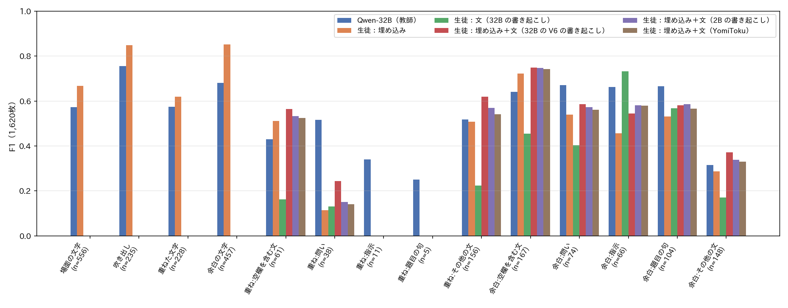
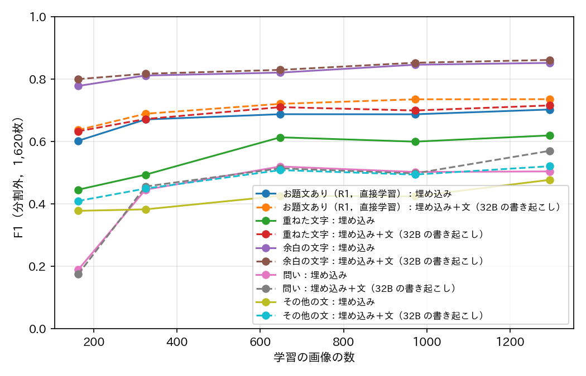

# report_044：文の属性（定義書 v6 の草案）の付与と，生徒で学べるかの確認

## 1. 概要

定義書 v5 のお題文ありは「お題の投稿者が回答者に向けて書き加えた文」として付与しており，投稿者の意図に依存するため，テロップや帯の文字で判定がぶれる．
本報告では，お題文ありを付与する属性から外し，見て決められる文の属性から規則で導く定義書 v6 の草案を作成した．文の属性は，文字の層（軸A：場面の文字，吹き出し，重ねた文字，余白の文字）と，重ねた文字・余白の文字の文の形（軸B：空欄を含む文，問い，指示，題目の句，その他の文）である．
既存の目視のラベル付きの画像1,620枚に v6 の属性を目視で付け，定義の変化，ラベルの再現性，Qwen3-VL の教師としての精度，生徒（画像の埋め込みと書き起こした文の分類器）で学べるかを調べた．パッケージは変更していない．

主な結論は次のとおりである．

- 定義の変化は小さい．v6 の属性から規則 R1 で導いたお題文ありと v5 の目視のお題文ありの一致は，全データの推定で97.3%（κ 0.84）であった．余白のその他の文から空欄を含む文を除く規則 R1b では98.5%（κ 0.90）である．
- v6 の属性の付け直しの一致は，記号の完全一致で94%（90枚）であり，R1 のお題文ありは κ 0.97 であった（v5 のお題文ありの付け直しは κ 0.95，report_042）．
- Qwen3-VL-32B に v6 の属性を問う指示（V6）は，教師として使えない精度であった．Qwen の属性から導いたお題文あり（R1）の F1 は v6 の目視に対して0.43である．特に層の区別（場面の文字と余白の文字など）を誤った．
- 生徒は，余白の文字と吹き出しを埋め込みだけで F1 0.85 で学べたが，文の形（問い，指示，その他の文）は1,620枚の学習では F1 0.1〜0.6 にとどまった．文の特徴を加えると多くの形で改善した．
- 1,620枚で学習した生徒から導いたお題文ありの F1（R1，v6 の目視に対して）は，埋め込みのみ0.66，埋め込み＋文（YomiToku）0.76，お題文ありの直接学習（埋め込み＋文）0.78 であり，パッケージ v5.3.0 の0.79 [0.73, 0.85] に届かなかった．v5.3.0 は4.5万枚の教師ラベルで学習しているため，学習の量の差を含む比較である．
- したがって，v6 の属性の定義は再現性が高く v5 との差も小さいが，現在の Qwen の指示では教師ラベルを作れないことが，v6 への移行の主な障害である．

## 2. 定義書 v6 の草案

草案は `programs/label_guideline/label_definition_v6.md` に置いた．要点は次のとおりである．

- 文字の層（軸A，複数選択）：場面の文字（写っている世界の中の文字，スクリーンショットの画面の文字，透かし・ロゴ・テンプレートの定型の見出しを含む），吹き出し（吹き出しと語りの枠，人物の脇に描き込まれた台詞），重ねた文字（写真や絵の上の字幕・テロップ・書き込み），余白の文字（帯，枠，無地の背景，テンプレートの文字欄）．
- 文の形（軸B，重ねた文字と余白の文字について層ごとに複数選択）：空欄を含む文（空欄を含む文章のまとまり全体を含む），問い（条件の形を含む），指示，題目の句，その他の文．
- お題文ありの規則：R0 は重ねた文字か余白の文字に問い・指示・題目の句がある，R1 は R0 に余白のその他の文を加える（既定），R2 は R1 に重ねた文字のその他の文を加える．
- 誰が書いたか，題のつもりか，既存の歌詞や台詞の引用かは記録しない．

## 3. 方法

### 3.1 目視のラベル

ex024 の1,020枚，ex025 の新しい評価用データ420枚，order_043 の追加の180枚の計1,620枚を並べ替えて番号だけを付けた一覧（9枚ずつ180枚）にし，予測と v5 のラベルを伏せて Claude Code が v6 の属性を付けた（`programs/ex026_text_attr_v6/v6_labels.txt`）．
再現性を確かめるため，1,620枚から無作為に選んだ90枚を番号を付け直して別の一覧にし，付け直した（`v6_labels_repeat.txt`）．
全データの推定値は ex025 の600枚の事後層別の重み（report_043 と同じ）で求め，ex024 の1,020枚は学習（交差検証）と重みなしの値にだけ用いた．

### 3.2 Qwen と書き起こし

Qwen3-VL-32B-Instruct-FP8（最大 802,816 画素）に，v6 の属性と重ねた文字・余白の文字の書き起こしを JSON で答えさせる指示 V6 と，書き起こしだけを答えさせる指示 OCR を問うた（`qwen_v6.py`）．同じ指示を Qwen3-VL-2B-Instruct にも問うた．
軽い日本語 OCR の YomiToku でも全ての文字を書き起こした（`ocr_yomitoku.py`．層は区別しない）．

### 3.3 生徒

生徒は，パッケージが保存した画像の埋め込み（SigLIP2-so400m，1152次元）と，書き起こした文の文字 n-gram（1〜3文字，TF-IDF）を入力とするロジスティック回帰とし，1,620枚の5分割の交差検証で分割外の予測を求めた（`evaluate.py`）．
層は埋め込みで学習し，文の形は埋め込み・文・両方で学習した．お題文ありは，生徒の属性から規則で導く方法と，お題文あり（規則ごとの正解）を直接学習する方法を比べた．比較の基準はパッケージ v5.3.0 の has_odai_text である．

## 4. 結果

### 4.1 属性の頻度と定義の変化

1,620枚で，場面の文字は34%，吹き出しは15%，重ねた文字は14%，余白の文字は28%の画像にあった．重ねた文字と余白の文字の両方がある画像は9枚で，そのうち両層の文の形が異なる画像は4枚であった．画像ごとの属性で組の情報が失われる頻度は小さい．

表1 v5 の目視のお題文ありと，v6 の属性から導いたお題文ありの一致（全データの推定）．R1b は余白のその他の文を，余白に空欄を含む文がない場合に限ったもの．

| 規則 | 一致 | κ | v5 の割合 | v6 の割合 | v5 のみ | v6 のみ |
| :--- | :---: | :---: | :---: | :---: | :---: | :---: |
| R0 | 0.981 | 0.86 | 0.079 | 0.074 | 0.012 | 0.007 |
| R1 | 0.973 | 0.84 | 0.079 | 0.103 | 0.001 | 0.025 |
| R1b | 0.985 | 0.90 | 0.079 | 0.090 | — | — |
| R2 | 0.911 | 0.59 | 0.079 | 0.167 | 0.001 | 0.088 |

- R1 は v5 のお題文ありをほぼ全て含み（v5 のみは0.1%），全データの約2.5%を新たにお題文ありとした．1,620枚で R1 のみ真の画像の多くは，余白のその他の文（36枚．写真の下の台詞や平叙文，歌詞，項目の名札）と，名前と空欄を含む説明の組（21枚）であった．
- R2（重ねた文字の台詞や字幕を含める）は v5 から大きく離れ（κ 0.59），お題文ありが2倍になった．
- 重ねた文字の問い（テレビや映画の字幕の問い，有名な台詞の問いなど，15枚）は，v5 ではお題文なしで R0 / R1 ではお題文ありとなる．

### 4.2 ラベルの再現性

付け直した90枚で，記号（層と形の組）の完全一致は94%（85/90）であった．層の κ は0.95〜1.00，層をまとめた形の κ はその他の文の0.79を除き1.00，R1 のお題文ありは κ 0.97 であった（`outputs/ex026_text_attr_v6/eval/repeat.csv`）．
不一致の5枚は，小さな場面の文字の見落とし，テレビの字幕を場面の文字としたか重ねた文字としたか（1枚），名札や曲名をその他の文として記録するか（3枚）であった．いずれも同じ付与者の付け直しであり，人どうしの一致ではない．

### 4.3 Qwen の教師としての精度と速さ

Qwen3-VL-32B（V6）の属性ごとの F1（1,620枚）は，層が0.57〜0.76，層をまとめた形が問い0.78，空欄を含む文0.77，指示0.73，題目の句0.71，その他の文0.54であった．
層の誤りが大きく，場面の文字を真と答えた651枚の誤りのうち370枚は目視で文字の層がない画像，残りは吹き出し・重ねた文字・余白の文字の画像であった．余白の文字の誤り355枚のうち235枚は場面の文字の画像（スクリーンショットや看板）であった．形の誤りでは，その他の文を広く真とした．
Qwen の属性から導いたお題文ありの F1（全データの推定，v6 の目視に対して）は R0 で0.64，R1 で0.43であった．Qwen3-VL-2B では R1 で0.34であった．

表2 書き起こしと属性の問い合わせの速さ（1,620枚．単一の GPU）．全データの見積もりは，パッケージが文字ありとした代表の画像（387.8万枚）に適用した場合．

| 方法 | 枚/秒 | 文字ありの画像の全てへの見積もり |
| :--- | ---: | ---: |
| Qwen3-VL-32B，V6（属性と書き起こし） | 2.7 | 約16.8日 |
| Qwen3-VL-32B，OCR（書き起こしのみ） | 7.5 | 約6.0日 |
| Qwen3-VL-2B，OCR | 21.2 | 約2.1日 |
| YomiToku（1プロセス） | 6.2 | 約7.2日 |

### 4.4 生徒で学べるか

図1 属性ごとの F1（1,620枚，生徒は5分割の分割外の予測）．括弧内は正例の数．

- 層：余白の文字（F1 0.85）と吹き出し（0.85）は埋め込みだけで学べ，Qwen-32B（0.68，0.76）を上回った．場面の文字（0.67）と重ねた文字（0.62）は低い．
- 文の形：埋め込みだけでは，余白の空欄を含む文（0.72）以外は0.1〜0.6 であった．重ねた文字の問い・指示・題目の句は正例が5〜38枚と少なく，ほとんど学べなかった．文の特徴を加えると，重ねた文字のその他の文（0.51→0.62），余白の指示（0.46→0.58）などが改善した．文のみの生徒は，余白の指示（0.73）を除き埋め込みより低かった．
- 書き起こしの違い：生徒の文の特徴を Qwen-32B の書き起こしから Qwen-2B や YomiToku の書き起こしに替えても，属性の F1 の差は小さかった．

表3 お題文あり（R1）の F1（全データの推定，95% 区間）．生徒は1,620枚の5分割の分割外の予測．

| 方法 | v6 の目視（R1）に対して | v5 の目視に対して |
| :--------------------------------- | :---------------------: | :---------------------: |
| パッケージ v5.3.0 | 0.793 [0.732, 0.851] | 0.830 [0.785, 0.868] |
| Qwen-32B（V6）の属性から導く | 0.433 [0.360, 0.524] | 0.388 [0.318, 0.469] |
| 生徒の属性から導く：埋め込み | 0.656 [0.551, 0.756] | 0.644 [0.542, 0.760] |
| 生徒の属性から導く：埋め込み＋文（32B） | 0.732 [0.633, 0.832] | 0.726 [0.626, 0.823] |
| 生徒の属性から導く：埋め込み＋文（YomiToku） | 0.764 [0.692, 0.838] | 0.761 [0.685, 0.831] |
| 直接学習：埋め込み | 0.747 [0.651, 0.841] | 0.771 [0.672, 0.859] |
| 直接学習：埋め込み＋文（32B） | 0.783 [0.691, 0.871] | 0.757 [0.657, 0.850] |

図2 学習の画像の数と分割外の F1（重みなし，1,620枚）．

- 1,620枚で学習した生徒は，いずれも v5.3.0 に届かなかった．v5.3.0 は v5 の定義に近い教師ラベル4.5万枚で学習しているため，学習の量の差を含む比較である．
- 学習曲線では，余白の文字は約300枚で F1 0.8 に達したのに対し，お題文あり（直接学習）は約650枚以降で伸びが小さく（埋め込み＋文で0.72→0.74），問いとその他の文は1,300枚でも0.5前後であった．文の形を学ぶには，さらに多くのラベルか，より強い文の特徴が要る．

## 5. 考察

v6 の属性は，見て決められる基準だけで定めたため，同じ付与者の付け直しでは v5 と同等以上に再現できた．また，R1 は v5 のお題文ありをほぼ全て含み，差は余白のその他の文と空欄を含む説明に集中した．この差は R1b のように規則を変えるだけで縮められる（κ 0.84→0.90）．属性に分けたことで，テロップを含めるか（R2）などの判断を，ラベルを付け直さずに比べられた．

一方，生徒の学習には教師ラベルが要るが，Qwen3-VL-32B は v6 の層を区別できなかった．Qwen は文字の所在を「場面」「重ねた」「余白」に分けるより，文字があるか・文の種類が何かを答える方が得意であり（層をまとめた形の F1 は0.71〜0.78），層の誤りが規則に伝わってお題文ありの精度を下げた．
生徒の側では，層は埋め込みで学べる見込みが高い一方，文の形は1,620枚の目視のラベルでは不足した．現状の v5.3.0 を置き換えるには，(a) 層は目視または少数のラベルで学習した生徒に任せ，Qwen には層をまとめた文の形だけを問う，(b) 教師ラベルを数万枚に増やす，のどちらかが必要と考えられる．

注意点として，全ての目視のラベルは同じ付与者（Claude Code）が付け，人どうしの一致は測っていない．また，一覧の画像は1枚あたり約400画素であり，小さな透かしや場面の文字を見落とした可能性がある（場面の文字の付け直しの不一致の一因）．場面の文字はお題文ありの規則に用いないため，結論への影響は小さい．

## 6. 未解決の論点と次の候補

- 規則の選択：R1 と R1b（余白のその他の文から空欄を含む説明の組を除く）のどちらを既定とするか．重ねた文字の問い（字幕の問い）を R0 / R1 で含めるかも判断が要る．
- 教師ラベル：Qwen に層を問わず，「重ねた文字または余白の文字か」と文の形だけを問う指示，または層を目視のラベルで学習した生徒で与えたうえで形だけを問う構成を試す．
- 学習の量：教師ラベルを数万枚にした場合に，生徒が v5.3.0（F1 0.79〜0.83）を上回るかを確かめる．
- 書き起こし：生徒の文の特徴には Qwen-2B（21枚/秒）や YomiToku でも大差がなかった．全データへの適用は文字ありの画像に限っても2〜7日かかる．
- 人による確認：v6 の属性の一致を人どうしで測る（100〜200枚）．
- パッケージへの反映：v6 の定義と規則が決まった後に検討する．本オーダーでは変更していない．
