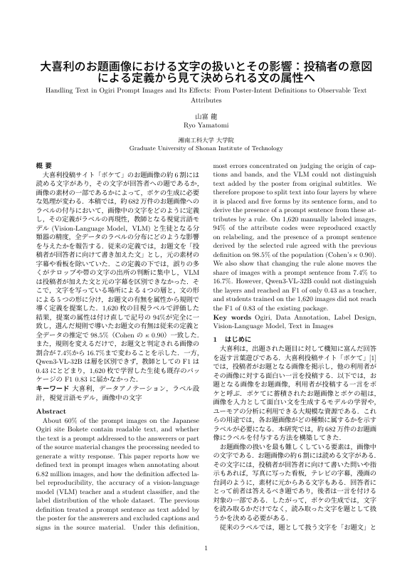
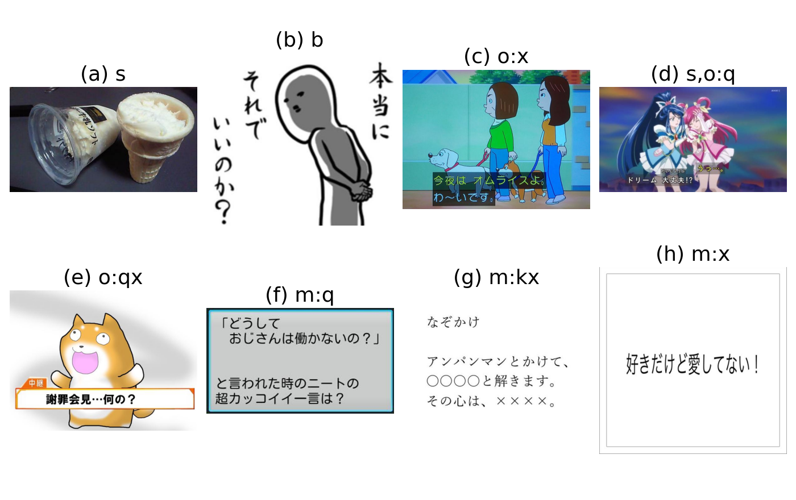
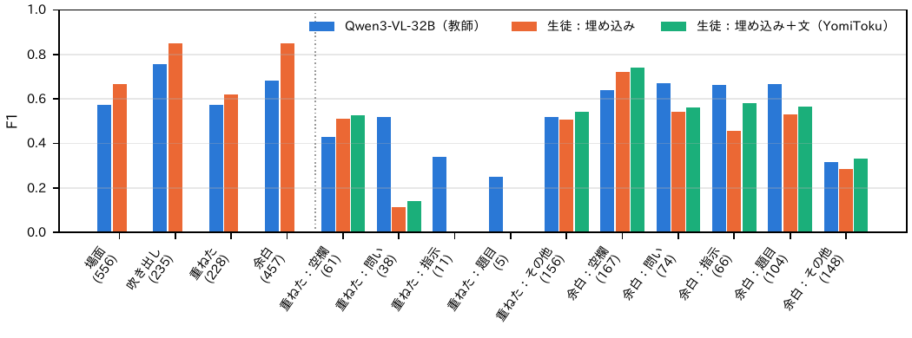
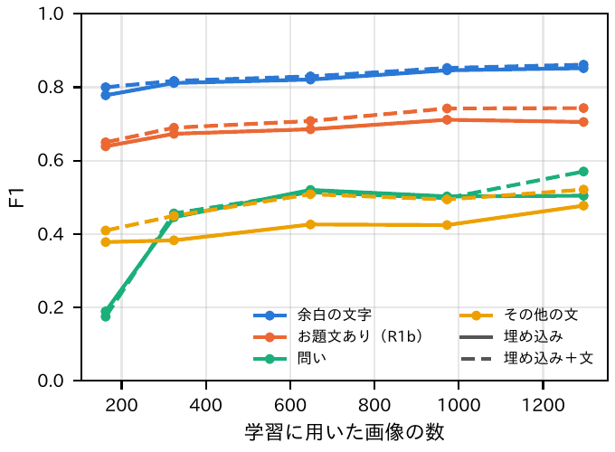

# report_046：お題画像の文字の扱いとその影響をまとめた論文の作成

## 1. 概要

お題画像の中の文字の扱いについて，定義書の改訂の経緯と，各段階の定義がラベルの付与に与えた影響をまとめた和文の論文（TeX）を作成した．
論文は `paper_text/` に置き，`latexmk -pdfdvi -synctex=1 main.tex` で `paper_text/main.pdf`（ieicejsp の二段組，8ページ）を生成した．
投稿先とページ数の指定がなかったため，既存の論文 `paper/` と同じ体裁で8ページとした．新しい実験は行っていない．ただし，図と数値の一部は保存済みの目視のラベルと評価の出力から計算し直した（2節）．

- 対象：投稿先，締切，ページ数の制限は未指定．
- 題目：大喜利のお題画像における文字の扱いとその影響：投稿者の意図による定義から見て決められる文の属性へ．
- 主張：
  - 文字ありは，改訂のたびに観測できる基準に近づいた．
  - お題文は投稿者の意図に基づく定義を保ったため，誤りが文字の出所の判断に集中した．
  - そこで文の属性（層と形）から規則で導く定義（第6版）を提案した．
  - 提案の定義は，再現性と v5 との一致を保ち，規則の選択による違いを明示できる．
  - 一方，教師の層の精度が移行の障害である．

## 2. 論文の構成と材料

| 章 | 内容 | 主な材料 |
| :--- | :--- | :--- |
| 1 はじめに | 文字の役割と，意図に基づく定義の問題 | — |
| 2 データと用語 | 682万件のお題，代表の画像，3軸のラベル，蒸留，目視ラベル | paper/ の2章 |
| 3 関連研究 | 大喜利とユーモア，情景の文字の VQA，ラベルの揺れ，蒸留 | — |
| 4 文字の扱いの変遷 | 第1版〜第6版の文字ありとお題文の扱い（表1） | paper/ の6章，report_012，report_041〜042 |
| 5 意図に基づく定義の影響 | 層別抽出と重みによる推定（式1），確認の質問，第5版の教師の比較（表2），v5.3.0 の評価と残った誤り | report_012，report_040〜043 |
| 6 文の属性による定義 | 層と形の定義，例の図（図1），規則 r0，r1，r1b，r2 の式（式2，式3），比較の規則 r1b′ | label_definition_v6.md，report_045 |
| 7 評価の方法 | 1,620枚の目視ラベル，教師（32B），生徒（ロジスティック回帰），図2 | report_044 |
| 8 結果 | 属性の頻度と再現性，規則とお題文ありの割合（表3），属性の F1（図2），導いたお題文ありの F1（表4），学習曲線（図3），書き起こしの費用（表5） | ex026 の出力，report_044〜045 |
| 9 考察 | 観測可能性と再現性，規則の選択の影響，教師と生徒，限界 | — |
| 10 おわりに | まとめと今後の課題 | — |

図と数値は `programs/paper_text/make_figures.py` で作った（出力は `outputs/paper_text/`．論文の図は `paper_text/figures/` に複製）．

- `numbers.json`：
  - 規則ごとの v5 との一致：r1b′（重ねた文字の形を除く規則）を含む．
  - 付け直しの一致：r1b を含む．ex026 の `repeat.csv` は evaluate.py では作られていなかったため，ここで計算し直した．
  - 重ねた文字の問いの枚数と，R1 と R1b で分かれる画像の枚数．
  - 層と形の頻度：全データの推定を含む．
- `fig_examples.png`：層と形の例の8枚．1,620枚の通し番号 8，50，109，841，1080，199，638，100．
- `fig_attrs.pdf`：属性ごとの F1．教師と，生徒2種（埋め込み，埋め込み＋YomiToku）．
- `fig_curve.pdf`：学習曲線．余白の文字，お題文あり（R1b），問い，その他の文．

図1に論文の1ページ目を，図2〜4に論文の図を示す．

図1 論文の1ページ目（`paper_text/main.pdf`）．

図2 層と形の例（論文の図1）．(a) 商品の表示，(b) 人物の脇の台詞，(c) アニメの字幕の台詞，(d) アニメの字幕の問い，(e) テロップ風に書き加えた問い，(f) 枠の中の問い，(g) 名札と空欄を含む文，(h) 無地の背景の平叙文．

図3 属性ごとの F1（論文の図2．1,620枚，生徒は5分割の分割外の予測）．

図4 学習曲線（論文の図3）．

論文で新たに示した主な数値は次のとおりである（report_045 までに示した値は省く）．

- 全データの推定での層の頻度：場面の文字35.0%，吹き出し14.3%，重ねた文字8.3%，余白の文字12.1%．いずれかの層は58.7%であり，パッケージの文字ありの割合（387.8万枚／661万枚）と一致した．
- 付け直しの一致：R1b のお題文ありの κ は1.00 であった（R1 は0.97，R2 は0.92）．

## 3. 確認した事項

- コンパイルの警告：未定義の参照と Overfull はない．caption パッケージの文書クラスに関する警告は既存の論文と同じであり，体裁には影響しない．
- PDF の目視：図表の位置，表のはみ出しを確認した．全幅の図2は，「評価の方法」の章の冒頭で定義した．これは，結果の章と同じページの上部に置くためである．
- 規約：
  - である調と「，．」を用いた．
  - 図のキャプションは図の下に，表のキャプションは表の上に置いた．
  - ラベルは fig_／tab_／eq_ で付け，章と節までで構成した．
  - 略称は初出で正式名称とともに記した．VLM，MLP，OCR，TF-IDF である．
- `latexmk -C` は PDF も消すため実行していない．中間ファイル（main.dvi など）は既存の `paper/` と同じく残した．

## 4. 未解決の指摘事項と次の候補

- 投稿先とページ数：未指定である．投稿先が決まれば，体裁とページ数を合わせる必要がある．予稿の場合は，サンプルの ja_proceeding_03 または 04 を参考に，2〜4ページに縮める．
- 既存の論文との重複：第1版〜第4版の経緯（4章）は既存の論文 `paper/` の6章と重なる．両方を投稿する場合は，一方を引用する形に改める必要がある．
- 判断者：目視ラベルは全て同じ判断者（Claude Code）によるものであり，人どうしの一致は測っていない．論文では限界として記した．人の判断者による一致を測れば，この記述を置き換えられる．
- 重ねた文字の問いを含めるか：論文では，第5版との一致では決まらないことを示すにとどめた．ボケの内容（回答が問いに答えているか）で確かめる実験は未実施である．
- 教師の改善：層を生徒に任せ，教師には文の形だけを問う構成は提案にとどまり，実施していない．
- 著者と所属：既存の論文 `paper/` と同じ記載とした．共著者や謝辞が必要なら追記する．
