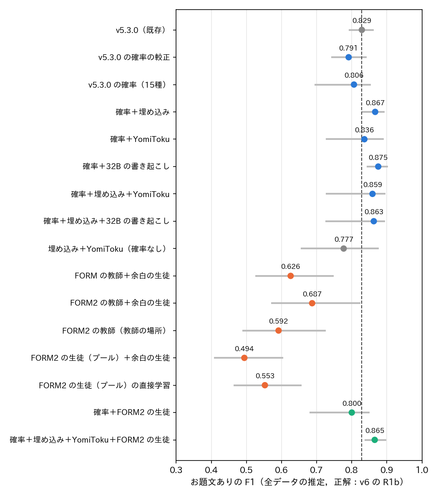
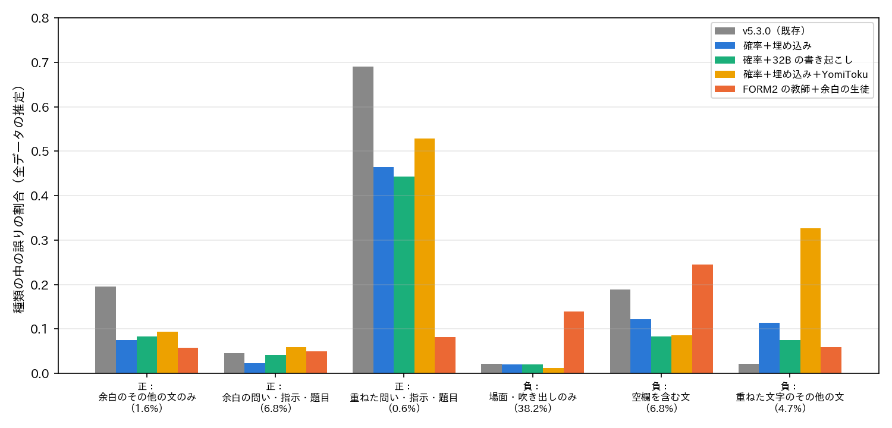

# report_047：お題文ありの判定の改善（v5.3.0 の確率との組み合わせと，文の形を問う教師）

## 1. 概要

お題文ありの判定を，パッケージ v5.3.0（F1 約0.83）より改善する2つの方法を試した．
評価は ex026 の目視のラベル付きの1,620枚で行い，全データの推定値は ex025 の600枚の事後層別の重みで求めた．
正解は定義書 v6 の規則 R1b で導いた目視のお題文あり（以下，v6）とし，v5 の目視のお題文あり（以下，v5）でも求めた．

- **方法1（組み合わせ）**：v5.3.0 の確率と画像の埋め込み，書き起こしを1,620枚で組み合わせる．
  - v6 の正解で，F1 は v5.3.0 の0.829から有意に上がった．
  - 「v5.3.0 の確率＋32B の書き起こし」は0.875（差の95% 区間 [+0.026, +0.067]）であった．
  - 「v5.3.0 の確率＋埋め込み」は0.867（同 [+0.010, +0.058]）であった．追加の推論が要らない．
  - v5 の正解でも，「確率＋32B の書き起こし」は0.877（同 [+0.021, +0.072]）であった．
- **方法2（文の形を問う教師）**：v5.3.0 を上回らなかった．
  - 層を問わず形だけを問う指示（FORM）では，教師が場面の文字と吹き出しの文字を除けなかった．
  - 文ごとに場所と形を問う指示（FORM2）に改めた．それでも，教師から導いたお題文ありの F1 は0.69にとどまった．
  - FORM2 で3万枚に教師ラベルを付けて学習した埋め込みの生徒は，0.49〜0.55であった．
  - 生徒を方法1に加えても，F1 は変わらなかった（0.865）．
- **推奨**：お題文ありの判定は，「v5.3.0 の確率＋埋め込み」のロジスティック回帰を v5.3.0 の後段に加える構成とする．書き起こしを使える場合は「確率＋32B の書き起こし」が最も高い．

## 2. 方法

### 2.1 データ

- 評価：ex026 の1,620枚（ex024 の1,020枚，ex025 の600枚）．
  - 正解は v6 の目視の属性から導いた odai_R1b と，v5 の目視の label_v5 である．
  - 全データの推定は ex025 の600枚（9層，重み $` w = N_h / n_h `$）で求めた．
  - 95% 区間は，層ごとの復元抽出（1,000回）で求めた．
- 教師ラベルのプール：v5.3.0 が文字ありとした代表の画像から，評価の画像を除いて無作為に3万枚を選んだ（`datasets/ex027_odai_text_improve/pool.csv`）．
  - v5.3.0 がお題文ありとした割合は17.0% である．

### 2.2 方法1：v5.3.0 の確率との組み合わせ

v5.3.0 の確率15種（`p_has_odai_text`，`p_has_text`，`p_has_blank`，`p_has_karuta_mark`，形式4種，画風7種）のロジットを標準化して特徴とした．
これに次の特徴を加え，ロジスティック回帰（正例と負例の重みを釣り合わせ，閾値0.5）を1,620枚の5分割の交差検証で評価した．

- 埋め込み：SigLIP 2 の1,152次元の埋め込み．標準化して0.1倍した．
- YomiToku：書き起こしの文字の1〜3-gram の TF-IDF．
- 32B の書き起こし：ex026 の OCR 指示の，重ねた文字と余白の文字の書き起こしの TF-IDF．層ごとに別の語彙とした．

正則化の係数 $` C `$ は，外側の分割の学習用の画像の内側4分割の F1 で格子から選んだ（入れ子の交差検証）．
格子は，密な特徴が {0.01, 0.03, 0.1, 0.3, 1}，疎な特徴を含む場合が {0.25, 1, 4} である．
外側の分割の乱数の種を5通り（0〜4）変え，F1 は5回の平均と標準偏差で示した．
95% 区間と v5.3.0 との差の区間は seed 0 の予測で求めた．
正解ごと（v6 / v5）に別に学習した．

### 2.3 方法2：文の形を問う教師

Qwen3-VL-32B-Instruct-FP8（入力の画素数の上限802,816）に，次の2つの指示を問うた（`qwen_form.py`）．

- **FORM**：層を問わない．写っている世界の中の文字と吹き出しの文字を除いた文字を文ごとに書き起こし，文の形（空欄を含む文，問い，指示，題目の句，その他の文）を選ばせる．
- **FORM2**：全ての読める文字を文ごとに書き起こし，文ごとに場所（場面，吹き出し，重ねた文字，余白の文字）と形を選ばせる．FORM の結果（3.1節）を受けて作った．

画像ごとの形の有無 $` T_f `$ は，重ねた文字か余白の文字の文のいずれかが形 $` f `$ である場合に真とした．
教師は層の区別が不得手である（report_044）．
そのため，余白の文字の有無は1,620枚の目視で学習した埋め込みの生徒（分割外の予測）に任せ，(1)の規則で R1b を近似した．

```math
\hat{y} = T_q \lor T_i \lor T_t \lor ( T_x \land \lnot T_k \land \hat{L}_m )
```

ここで $` \hat{y} `$ が導いたお題文あり，$` T_q, T_i, T_t, T_x, T_k `$ がそれぞれ問い，指示，題目の句，その他の文，空欄を含む文の有無，$` \hat{L}_m `$ が余白の文字の生徒の予測である．
FORM2 では，教師自身の文ごとの場所から R1b をそのまま導く方法（教師の場所）も比べた．

プールの3万枚に FORM2 の教師ラベルを付け，次の生徒を学習した．係数はプールの5分割の F1 で選んだ．

- 形の生徒：$` T_f `$ ごとに，埋め込みのロジスティック回帰を学習する．
- 直接学習：教師自身の場所と形から導いたお題文ありを，埋め込みのロジスティック回帰で学習する．

1,620枚では，形の生徒と余白の文字の生徒から(1)で導く方法と，直接学習を評価した．
また，これらの確率を方法1の特徴に加えた（「確率＋FORM2 の生徒」，「確率＋埋め込み＋YomiToku＋FORM2 の生徒」）．
なお，プールの余白の文字の生徒は1,620枚の全ての目視で学習した．
そのため，後者の組み合わせでは，評価の画像の余白の文字の目視が間接的に入る．

## 3. 結果

### 3.1 教師の文の形の精度

表1に，1,620枚での教師の形ごとの F1 を示す．V6 は ex026 の指示（層ごとの有無と形）の層をまとめた形である．

表1 教師の形ごとの F1（1,620枚，重みなし．正解は目視の重ねた文字か余白の文字の形）．

| 形 | 正例 | V6（ex026） | FORM | FORM2 |
| :--- | ---: | ---: | ---: | ---: |
| 空欄を含む文 | 228 | 0.774 | 0.758 | 0.716 |
| 問い | 111 | 0.776 | 0.650 | 0.726 |
| 指示 | 77 | 0.729 | 0.609 | 0.707 |
| 題目の句 | 109 | 0.713 | 0.783 | 0.646 |
| その他の文 | 298 | 0.545 | 0.458 | 0.549 |

- FORM：問いの適合率が0.50，指示の適合率が0.47と低かった．
  - 問いの誤った正例103枚のうち，72枚は目視で場面の文字か吹き出しの文字しかない画像であった．漫画の台詞の疑問文や，写真に写った印刷物の文が該当する．
  - 層を問わない指示でも，「対象の文字」を選ぶ段階で層の区別が要り，そこで誤った．
- FORM2：問いの適合率は0.69に上がったが，題目の句と空欄を含む文の再現率が下がった．
- 速さ：FORM が2.8枚/秒，FORM2 が2.4〜2.5枚/秒であった．プールの3万枚は約3.3時間である．

### 3.2 お題文ありの F1

図1と表2に，全データの推定のお題文ありの F1 を示す．



図1 お題文ありの F1（全データの推定，正解は v6 の R1b）．点は5つの乱数の種の平均，線は seed 0 の95% 区間，破線は v5.3.0 である．青は方法1，橙は方法2，緑は両者の組み合わせである．

表2 お題文ありの適合率・再現率・F1（全データの推定）．F1 は5つの乱数の種の平均（括弧は標準偏差），差は v5.3.0 との F1 の差の95% 区間（seed 0）である．

| 手法 | 正解 | 適合率 | 再現率 | F1 | 差の区間 |
| :-------------------------------------- | :-- | ----: | ----: | ----------: | :------------------ |
| v5.3.0（既存） | v6 | 0.782 | 0.882 | 0.829 | — |
| 確率＋32B の書き起こし | v6 | 0.829 | 0.927 | 0.875（0.004） | [+0.026, +0.067] |
| 確率＋埋め込み | v6 | 0.810 | 0.932 | 0.867（0.006） | [+0.010, +0.058] |
| 確率＋埋め込み＋YomiToku＋FORM2 の生徒 | v6 | 0.814 | 0.924 | 0.865（0.004） | [+0.014, +0.069] |
| 確率＋埋め込み＋32B の書き起こし | v6 | 0.814 | 0.919 | 0.863（0.024） | [−0.099, +0.062] |
| 確率＋埋め込み＋YomiToku | v6 | 0.810 | 0.915 | 0.859（0.020） | [−0.099, +0.063] |
| 確率＋YomiToku | v6 | 0.751 | 0.943 | 0.836（0.018） | [−0.093, +0.059] |
| v5.3.0 の確率（15種） | v6 | 0.693 | 0.965 | 0.806（0.025） | [−0.131, +0.023] |
| 確率＋FORM2 の生徒 | v6 | 0.692 | 0.949 | 0.800（0.021） | [−0.143, +0.021] |
| v5.3.0 の確率の較正 | v6 | 0.684 | 0.938 | 0.791（0.008） | [−0.083, +0.013] |
| 埋め込み＋YomiToku（確率なし） | v6 | 0.677 | 0.912 | 0.777（0.018） | [−0.175, +0.046] |
| FORM2 の教師＋余白の生徒 | v6 | 0.539 | 0.947 | 0.687 | [−0.255, −0.006] |
| FORM の教師＋余白の生徒 | v6 | 0.466 | 0.954 | 0.626 | [−0.306, −0.079] |
| FORM2 の教師（教師の場所） | v6 | 0.433 | 0.932 | 0.592 | [−0.336, −0.112] |
| FORM2 の生徒（プール）の直接学習 | v6 | 0.389 | 0.952 | 0.553 | [−0.359, −0.170] |
| FORM2 の生徒（プール）＋余白の生徒 | v6 | 0.330 | 0.984 | 0.494 | [−0.418, −0.224] |
| v5.3.0（既存） | v5 | 0.741 | 0.943 | 0.830 | — |
| 確率＋32B の書き起こし | v5 | 0.815 | 0.950 | 0.877（0.002） | [+0.021, +0.072] |
| 確率＋埋め込み＋32B の書き起こし | v5 | 0.814 | 0.949 | 0.876（0.016） | [+0.010, +0.065] |
| 確率＋埋め込み＋YomiToku | v5 | 0.781 | 0.947 | 0.856（0.014） | [−0.035, +0.051] |
| 確率＋YomiToku | v5 | 0.779 | 0.943 | 0.853（0.015） | [+0.002, +0.048] |
| 確率＋埋め込み | v5 | 0.766 | 0.956 | 0.850（0.014） | [−0.031, +0.050] |
| 確率＋埋め込み＋YomiToku＋FORM2 の生徒 | v5 | 0.766 | 0.951 | 0.848（0.013） | [−0.026, +0.060] |
| FORM2 の教師＋余白の生徒 | v5 | 0.479 | 0.950 | 0.637 | [−0.301, −0.061] |

- **方法1**：組み合わせは，適合率と再現率を同時に上げた．
  - v6 の正解では，適合率は0.78から0.81〜0.83に，再現率は0.88から0.92〜0.93に上がった．
  - v5.3.0 の確率だけ（15種，1次元の較正）では v5.3.0 を下回った．v5.3.0 の has_odai_text は確率の閾値だけでなく形式の規則でも決まり，その規則を確率だけでは再現できないためと考えられる．
  - 改善には，埋め込みか書き起こしが要る．
- **乱数の種による揺れ**：「確率＋埋め込み＋YomiToku」と「確率＋埋め込み＋32B の書き起こし」は，seed 0 だけ F1 が0.823と低い（他の種は0.861〜0.881）．そのため，seed 0 の区間は広い．
  - 標準偏差が小さく，安定しているのは「確率＋32B の書き起こし」（0.004）と「確率＋埋め込み」（0.006）である．
- **方法2**：教師から導いたお題文ありでも0.63〜0.69 であり，v5.3.0 に届かなかった．
  - プールの生徒は，教師ラベルをプールの交差検証でも再現できなかった．問いの F1 は0.53，指示は0.36，題目の句は0.41である．
  - 導いたお題文ありは0.49〜0.55であった．
  - 生徒の確率を方法1に加えても，F1 は変わらないか下がった．「確率＋FORM2 の生徒」は0.800，「確率＋埋め込み＋YomiToku＋FORM2 の生徒」は0.865（「確率＋埋め込み＋YomiToku」と同程度）である．

### 3.3 誤りの種類

図2に，v6 の正解の種類ごとの誤りの割合（全データの推定，seed 0）を示す．



図2 正解の種類ごとの誤りの割合（全データの推定，seed 0）．括弧は全データに占めるその種類の割合である．文字のない画像（41.3%）はどの手法も誤りがないため除いた．

- v5.3.0 の誤りは，次の3種類に多い．
  - 重ねた文字の問い・指示・題目（正例）：69% を見逃した．
  - 余白のその他の文だけの画像（正例）：20% を見逃した．
  - 空欄を含む文の画像（負例）：19% を誤って正例とした．
  - いずれも，第5版と第6版で定義が分かれた，または意図に基づく定義の判断が難しかった種類である（report_045，report_046）．
- 方法1は，これらの誤りを減らした．
  - 余白のその他の文だけの画像：20% → 7〜8%．
  - 空欄を含む文：19% → 8〜12%．
  - 重ねた文字の問い：69% → 44〜46%．
  - 一方，重ねた文字のその他の文（負例．例：テレビの字幕の台詞）の誤りは2% から7〜11% に増えた．全データでは4.7% を占める種類である．
- FORM2 の教師は，重ねた文字の問いを8% しか見逃さず，この種類では他のどの手法よりも良い．
  - ただし，場面・吹き出しの文字だけの画像（全データの38.2%）を14% 誤って正例とした．全体の適合率は，この誤りで大きく下がった．

### 3.4 1,620枚（重みなし）の値

1,620枚の重みなしでは，v5.3.0 の F1 は0.616（v6）と低い．
1,620枚は判断の難しい画像を多く含むように抽出しているためである．
この集合では，FORM2 の教師＋余白の生徒が0.772と最も高く，確率＋32B の書き起こし（0.763）が続く．
全データの推定と順位が異なるのは，FORM2 の教師の誤りが全データで多い「場面・吹き出しの文字だけの画像」に集中するためである．

## 4. 考察

- **方法1が効いた理由**：v5.3.0 は約4.5万枚の教師ラベルで学習しているが，その教師ラベルの定義（第5版の教師と構成）は目視の正解と系統的にずれている．
  - 1,620枚の目視で v5.3.0 の確率と埋め込みを組み合わせ直すことで，このずれ（余白のその他の文，空欄を含む文の扱い）を補正できた．
  - v5 の正解でも，書き起こしを加えた場合に有意に改善した．したがって，定義の補正だけでなく，書き起こしの文の情報自体が判定に役立っている．
- **方法2が効かなかった理由**：お題文ありの判定の難しさは，文の形よりも「どの文字が対象か」（場面・吹き出しか，重ねた文字・余白か）にある．
  - Qwen3-VL-32B は，指示の書き方によらず，この区別で誤った．
  - 層を問わない指示でも，対象の文字を選ぶ段階で同じ区別が要る．
  - また，埋め込みの生徒は，誤りを含む教師の形のラベルを学べなかった（プールの交差検証の F1 が0.36〜0.57）．
- **適用の費用**：
  - 「確率＋埋め込み」は，パッケージが保存した確率と埋め込みだけを用いる．全データ（約661万枚）への適用は，1,167次元のロジスティック回帰の推論のみで済む．
  - 「確率＋32B の書き起こし」は，文字ありの代表の画像約388万枚に Qwen3-VL-32B の書き起こしが要る．約6.0日かかる（report_046 の表5の見積もり）．

## 5. 作成・変更したファイル

- `programs/ex027_odai_text_improve/`
  - `data.py`：評価の1,620枚と v5.3.0 の確率の読み込み，プールの作成と埋め込み．
  - `qwen_form.py`：FORM と FORM2 の教師．2,000枚ごとに保存し，途中から再開できる．
  - `train.py`：方法1と方法2の生徒．入れ子の交差検証で，保存済みは飛ばす．
  - `evaluate.py`：F1，差の区間，教師の精度，誤りの種類，図．
- `outputs/ex027_odai_text_improve/`
  - `qwen/`：FORM_eval，FORM2_eval，FORM2_pool の CSV と speed.json．
  - `preds/{手法}/{正解}/{seed}/`：pred.csv と meta.json．
  - `eval/`：odai.csv，odai_summary.csv，teacher_forms.csv，error_breakdown.csv，図．
- `datasets/ex027_odai_text_improve/pool.csv`
- `document.md`：ex027 のツリー，実行方法，結果の保存場所．
- `visualize_result.ipynb`：ex027 のセルを追加して実行した（エラーなし）．

## 6. 未解決の論点と次の候補

- **組み合わせの生徒の適用**：「確率＋埋め込み」を1,620枚の全てで学習し，全データに適用して，お題文ありの割合と分布を確かめる．パッケージに後段として組み込むかも決める．
  - 適用後の評価には，1,620枚と独立な評価用データが要る．
  - 1,620枚の5分割の交差検証の値は，全てで学習した生徒の値と近いと考えられる．ただし，係数の選択を含めて同じ1,620枚を用いている．
- **重ねた文字のその他の文の誤りの増加**：方法1で2% から7〜11% に増えた．字幕の台詞を正例とする誤りである．
- **評価の判断者**：目視のラベルは全て同じ判断者（Claude Code）が付けたものである．1,620枚で組み合わせた生徒は，この判断者の基準に合わせて補正されている．人の判断者との一致は未確認である．
- **方法2の改善の余地**：FORM2 の教師は重ねた文字の問いに強く，場面・吹き出しの文字に弱い．
  - 場面・吹き出しの文字だけの画像を埋め込みの生徒で除いてから教師に問う構成は，未実施である．
  - 同じ区別を，より大きな VLM や推論型のモデルで行う構成も未実施である．
- **書き起こしの費用**：「確率＋32B の書き起こし」の書き起こしを Qwen3-VL-2B（21枚/秒）で代える場合の精度は未確認である．ex026 には 2B の書き起こしがあり，追加の推論なしで比べられる．
