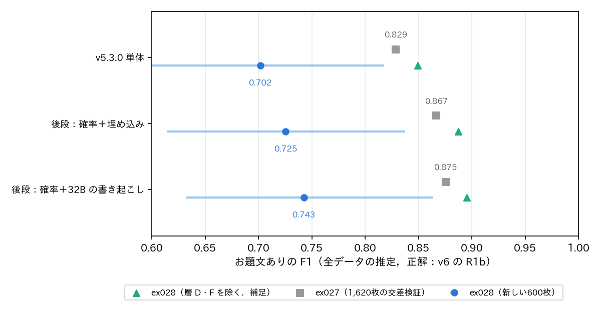
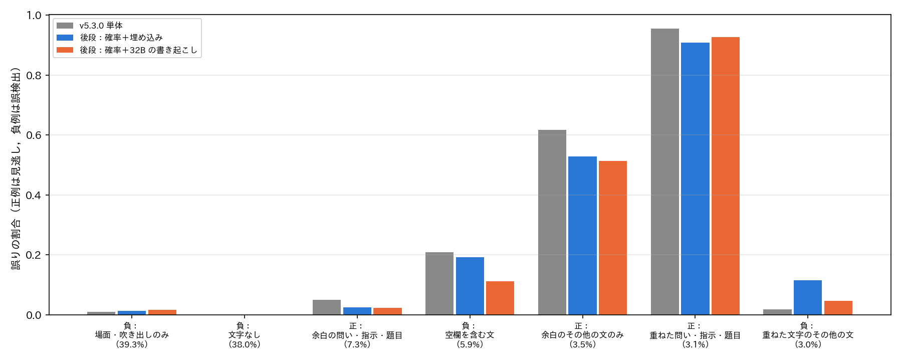

# report_048：独立な評価用データによる，お題文ありの後段の検証

## 概要

ex027 で提案した後段（パッケージ v5.3.0 の確率を特徴に加えたロジスティック回帰）が，学習に用いていない画像でも v5.3.0 単体を上回るかを検証した（ex028）．ex026 の1,620枚，ex024 の教師ラベルの画像，ex025 の抽出の画像，ex027 の教師ラベルのプールのいずれにも含まれない代表の画像から，ex025 と同じ9層で600枚を抽出し，Claude Code が定義書 v6 の属性を目視で付けた．お題文ありは既定の規則 R1b で導いた．後段は1,620枚の全てで学習し，600枚に当てはめた．

判断の基準は事前に次のとおり定めた．全データの推定の F1 について，v5.3.0 との差の95% 区間が0を超えれば後段を採用し，0を含めば構成が単純な v5.3.0 単体のままとする．

結果は次のとおりである．

- 「確率＋埋め込み」は F1 が 0.702 から 0.725 に上がったが，差の95% 区間は $`[-0.008, +0.048]`$ で0を含んだ．基準により同程度と判断し，v5.3.0 単体のままとする．
- 「確率＋32B の書き起こし」は 0.743 で，差の95% 区間は $`[+0.025, +0.060]`$ であった．基準を満たし，5つの乱数の種の全てで区間が0を超えた．ただし，全データに当てはめるには Qwen3-VL-32B の書き起こしが必要である．
- 3つの構成とも，F1 の絶対値は ex027 の推定（0.83〜0.88）より大きく下がった．これは，v5.3.0 の確率が低い層 D・F（全データの約87%）に，ex025 の600枚にはなかったお題文ありの画像が5枚含まれ，どの構成も見逃したためである．層 D・F を除いた部分では，後段の2つの構成ともに v5.3.0 を有意に上回った（補足）．

## 方法

### 評価用データ

抽出は `programs/ex028_odai_holdout/make_sheets.py` で行った．層は ex025 の評価の層（stratum2）と同じであり，パッケージ v5.2.0 の形式（確率が最大のもの），確認の質問の回答，ex024 のお題文ありの生徒の確率 $`p`$ で分ける．層ごとの抽出数も ex025 の600枚と同じにした（表1）．全データの値は，層の重み $`w_h = N_h / n_h`$（$`N_h`$ は層の代表の画像の数，$`n_h`$ は層の抽出数）で推定した．

判断のずれを確かめるため，ex026 の1,620枚から無作為に選んだ36枚を混ぜた．636枚を並べ替え，番号だけを付けた9枚ずつの一覧（71枚）を作り，予測や過去のラベルを見ずに目視した．ラベルは定義書 v6 の付録の書式（文字の層 s, b, o, m と，重ねた文字・余白の文字の文の形 k, q, i, t, x）で `holdout_labels.txt` に記した．

表1：層と抽出数．$`N_h`$ は代表の画像の数，お題文ありは目視で R1b により導いた割合である．

| 層 | 内容 | $`N_h`$ | $`n_h`$ | お題文あり |
|--------------------|----------------------------|--------:|-----:|-----:|
| A_odaibun_yes | 形式がお題文，確認の質問が真 | 547,362 | 100 | 0.94 |
| B_odaibun_rejected | 形式がお題文，確認の質問が偽 | 3,898 | 40 | 0.13 |
| C_blank_p_hi | 形式が穴埋め・カルタ，$`p \ge 0.3`$ | 127,998 | 110 | 0.31 |
| D_blank_p_lo | 形式が穴埋め・カルタ，$`p < 0.3`$ | 1,278,143 | 50 | 0.04 |
| F_normal_p_lo | 形式が通常，$`p < 0.1`$ | 4,465,001 | 60 | 0.05 |
| N0 | 形式が通常，$`0.1 \le p < 0.3`$ | 101,478 | 28 | 0.39 |
| N1 | 形式が通常，$`0.3 \le p < 0.5`$ | 35,458 | 77 | 0.45 |
| N2 | 形式が通常，$`0.5 \le p < 0.7`$ | 22,184 | 67 | 0.46 |
| N3 | 形式が通常，$`p \ge 0.7`$ | 27,989 | 68 | 0.66 |

全データのお題文ありの割合は 13.8% と推定された（ex025 の600枚では 9.0%）．差の主な原因は，層 F（60枚中3枚）と層 D（50枚中2枚）にお題文ありがあったことである．ex025 では両層とも0枚であった．層 F の1枚の重みは約7.4万，層 D は約2.6万であるため，この5枚が全データのお題文ありの約30%を占める．

### 後段

後段は ex027 の構成のうち，次の2つを比べた．

- 確率＋埋め込み（pkg+emb）：v5.3.0 の15種の確率のロジット（標準化）と，SigLIP2 の埋め込み（標準化して0.1倍）．
- 確率＋32B の書き起こし（pkg+ocr32b）：v5.3.0 の確率と，Qwen3-VL-32B の書き起こし（ex026 の指示 OCR．重ねた文字と余白の文字）の文字1〜3-gram の TF-IDF．

`train.py` で，1,620枚の全て（正解は v6 の R1b）で学習した．標準化と TF-IDF の語彙は1,620枚で求め，新しい画像に当てはめた．正則化の係数 $`C`$ は ex027 と同じ格子から，1,620枚の4分割の交差検証の F1 で選んだ．分割の乱数の種を0〜4とし，5つの種の確率の平均（ens）も求めた．閾値は0.5である．選んだ係数は，pkg+emb が seed 0 で $`C = 1.0`$，seed 1〜4 で $`C = 0.3`$，pkg+ocr32b は全ての種で $`C = 4.0`$ であった．1,620枚の5分割の交差検証の F1（重みなし）は pkg+emb が 0.74〜0.76，pkg+ocr32b が 0.76〜0.77 であった（`meta.json`）．636枚の書き起こしは 5.49 枚/秒で，出力を解釈できない画像はなかった．

### 評価

`evaluate.py` で，600枚のお題文ありの適合率・再現率・F1 を重み付きで求めた．95% 区間と v5.3.0 との F1 の差の95% 区間は，同じ標本の対で層ごとに1000回の復元抽出をして求めた．v5.3.0 の予測はパッケージの出力（has_odai_text）である．補足として，層 D・F を除いた部分の推定（excl_DF）も求めた．

## 結果

### お題文ありの精度

表2：お題文ありの精度（全データの推定）．後段の F1 は種の平均（括弧内は標準偏差），区間は種の確率の平均（ens）のもの．「差」は v5.3.0 との F1 の差，「有意な種」は差の区間が0を超えた種の数である．

| 構成 | 適合率 | 再現率 | F1 | F1 の95% 区間 | 差の95% 区間 | 有意な種 |
|------------------------|-----:|-----:|--------:|--------------:|--------------:|----:|
| v5.3.0 単体 | 0.832 | 0.607 | 0.702 | $`[0.593, 0.818]`$ | — | — |
| 確率＋埋め込み | 0.824 | 0.651 | 0.727（0.005） | $`[0.615, 0.838]`$ | $`[-0.008, +0.048]`$ | 1/5 |
| 確率＋32B の書き起こし | 0.860 | 0.653 | 0.743（0.000） | $`[0.633, 0.864]`$ | $`[+0.025, +0.060]`$ | 5/5 |
| v5.3.0 単体（D・F を除く） | 0.832 | 0.867 | 0.849 | — | — | — |
| 確率＋埋め込み（D・F を除く） | 0.847 | 0.930 | 0.887 | — | $`[+0.015, +0.058]`$ | 5/5 |
| 確率＋32B の書き起こし（D・F を除く） | 0.860 | 0.934 | 0.895 | — | $`[+0.027, +0.065]`$ | 5/5 |

図1に示すとおり，F1 の絶対値は3つの構成とも ex027 の推定より 0.13 ほど低い．一方，v5.3.0 との差は ex027 とほぼ同じ大きさで残った．ex027 の推定では pkg+emb が +0.038，pkg+ocr32b が +0.047 であり，今回は +0.023，+0.041 であった．pkg+emb の差の区間が0を含んだのは，次の2つによる．

- 層 D の1枚（番号315，「正直に言います．自分は，□のほうが好きです．」．空欄を含む文でお題文なし）を，pkg+emb は確率 0.514 でお題文ありとした．この1枚の重みは約2.6万で，全データの誤検出の多くを占める．pkg+ocr32b はこの画像を 0.144 とした．
- 層 D・F のお題文あり5枚（放送やアニメの字幕の問い3枚と，余白のその他の文2枚）は，v5.3.0 の確率が 0.001〜0.14 と低く，どの構成も見逃した．差は出ないが，F1 の区間が広がる．

600枚の重みなしの F1 は v5.3.0 が 0.538，pkg+emb が 0.750，pkg+ocr32b が 0.753 であった．抽出が多い不確かな層（B，C，N1〜N3）では，後段の改善が大きい．

### 層ごとの正解率

表3：層ごとのお題文ありの正解率（後段は ens）．

| 層 | v5.3.0 | 確率＋埋め込み | 確率＋32B の書き起こし |
|---|---:|---:|---:|
| A_odaibun_yes | 0.96 | 0.95 | 0.95 |
| B_odaibun_rejected | 0.48 | 0.85 | 0.85 |
| C_blank_p_hi | 0.31 | 0.57 | 0.63 |
| D_blank_p_lo | 0.96 | 0.94 | 0.96 |
| F_normal_p_lo | 0.95 | 0.95 | 0.95 |
| N0 | 0.61 | 0.61 | 0.68 |
| N1 | 0.55 | 0.68 | 0.69 |
| N2 | 0.54 | 0.60 | 0.54 |
| N3 | 0.34 | 0.69 | 0.65 |

v5.3.0 は層 C の全てをお題文ありとし（正解率 0.31 はお題文ありの割合に等しい），層 N3 の全てをお題文なしとした．後段は層 B，C，N3 で正解率を大きく上げた．層 D では pkg+emb が上記の1枚で誤った．

### 誤りの種類

図2の誤りの割合は，ex027 の1,620枚での傾向とおおむね一致した．

- 正：余白の問い・指示・題目（7.3%）：見逃しは 5.1% から 2.4〜2.6% に減った．
- 負：空欄を含む文（5.9%）：誤検出は pkg+ocr32b で 21.0% から 11.2% に減ったが，pkg+emb では 19.2% にとどまった．
- 負：重ねた文字のその他の文（3.0%）：誤検出は pkg+emb で 1.8% から 11.5% に増えた（ex027 でも 2% から 7〜11% に増えた）．pkg+ocr32b では 4.6% である．
- 正：余白のその他の文のみ（3.5%）と，正：重ねた問い・指示・題目（3.1%）：見逃しはどの構成も 51〜95% と高い．多くが層 D・F の画像である．

### 判断のずれ

ex026 の1,620枚から再び目視した36枚では，お題文あり（R1b）の一致が 35/36（0.972，$`\kappa = 0.91`$）であった．記号の完全な一致は 29/36（0.806）である．不一致の多くは，テンプレートのロゴや衣服の表示を場面の文字（s）とするかの違いで，お題文ありには影響しない．お題文ありが変わった1枚は，ex026 で s（場面の文字のみ）とした画像を，今回は s,m:x（余白にその他の文あり）とした．

## 考察

事前に定めた基準では，「確率＋埋め込み」は v5.3.0 と同程度であり，採用しない．ただし，差の点推定は正（+0.023）である．層 D・F を除いた部分では，5つの種の全てで有意に上回った．全体で有意にならなかった主な原因は，層 D の1枚の誤検出（確率 0.514）である．全データの87%を占める層 D・F は，各50〜60枚の抽出で1枚の重みが数万になる．そのため，その層での1枚の誤りが全体の F1 を左右する．後段を層 D・F に当てはめず，v5.3.0 の予測をそのまま使う構成も考えられる．ただし，この構成は今回の結果を見てから考えたものであり，同じ600枚で評価すると楽観的になる．

「確率＋32B の書き起こし」は，種によらず基準を満たした．空欄を含む文の誤検出を半分にし，重ねた文字のその他の文の誤検出の増加も小さい．書き起こしの文字は，空欄の記号と，余白にある文かどうかを直接表す．埋め込みよりもこれらを区別しやすいと考えられる．全データ（文字ありの約388万枚）に当てはめるには，32B の書き起こしに約6日かかる（ex027 の速さで見積もり）．今回の 5.49 枚/秒（636枚）なら約8日である．

F1 の絶対値は，ex027 の推定（ex025 の600枚の重み）より大幅に低い．これは後段の問題ではない．全データの大部分を占める層 D・F に，v5.3.0 が見逃すお題文ありが数%あることによる．ex025 では0枚，今回は5枚であった．全データのお題文ありの割合の推定（9.0% と 13.8%）と F1 の絶対値は，層 D・F の抽出数が少ないため不確かである．どちらの値を報告に用いる場合も，この幅を併記すべきである．見逃した5枚は，放送やアニメの字幕の問い（重ねた文字の問い）と，通常の写真の余白にあるその他の文である．どちらも v5.3.0 の確率が 0.01 未満のものを含み，後段では救えない．

正解とする目視ラベルは，後段の学習のラベルと同じ判断者（Claude Code）が付けた．したがって，今回の評価は「同じ判断者の規則の当てはめにどれだけ合うか」を測っており，人の判断との一致は測っていない．判断のずれの確認ではお題文ありの一致が 97% であり，判断者内の再現性は高い．

## 判断

- 確率＋埋め込み：基準により同程度と判断し，**v5.3.0 単体のままとする**．
- 確率＋32B の書き起こし：基準を満たす（**上回る**）．採用するかは，全データの書き起こしの費用（約6〜8日）で決める．

## ファイル

- プログラム：`programs/ex028_odai_holdout/`（`data.py`，`make_sheets.py`，`qwen_ocr.py`，`train.py`，`evaluate.py`），目視ラベル `holdout_labels.txt`
- データ：`datasets/ex028_odai_holdout/`（`targets.csv`，`population_strata.csv`，`sheets/`）
- 出力：`outputs/ex028_odai_holdout/`（`qwen/OCR.csv`，`preds/{手法}/v6/{seed}/`，`eval/`（`odai.csv`，`odai_summary.csv`，`compare_ex027.csv`，`error_breakdown.csv`，`strata.csv`，`repeat.csv`，図，`evaluate.log`），`emb_holdout.npy`）
- 可視化：`visualize_result.ipynb` の ex028 の節

## 未解決の論点と次の候補

- 層 D・F（全データの87%）の抽出が各50〜60枚と少ない．そのため，全データのお題文ありの割合（9.0% と 13.8%）と F1 の絶対値が不確かである．両層を数百枚ずつ追加で目視すると，v5.3.0 の見逃しの量と種類（重ねた文字の問い，余白のその他の文）を確かめられる．
- 「確率＋32B の書き起こし」の採用の判断：全データの書き起こしの費用（約6〜8日）．小さいモデル（Qwen3-VL-2B）の書き起こしに代えた場合の精度は未検証である．
- 後段を層 D・F に当てはめない構成と，閾値の調整：今回の600枚を見てから考えたため，別の評価用データで確かめる必要がある．
- 正解は全て同じ判断者（Claude Code）のラベルである．人のラベルとの一致は未確認である．
