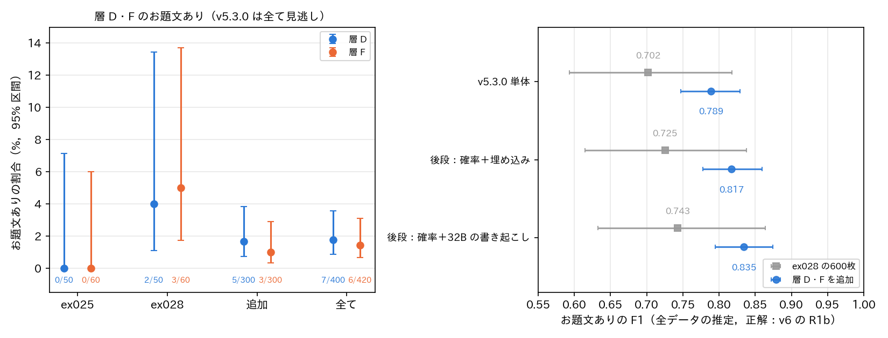

# report_049：層 D・F の追加の抽出による，v5.3.0 の見逃しの規模の確認

## 概要

report_048 で，全データの約87%を占める層 D・F（v5.3.0 の確率が低い穴埋め・カルタと通常の画像）の抽出数が少なく，お題文ありの割合と F1 の推定が不確かであることが分かった．そこで，両層からそれぞれ300枚を追加で無作為に抽出し，Claude Code が定義書 v6 の属性を目視で付けた（ex028 の追加の抽出）．

結果は次のとおりである．

- 層 D・F のお題文ありの割合は，追加の抽出で層 D が 5/300（1.7%），層 F が 3/300（1.0%）であった．ex025・ex028 と合わせると層 D は 7/400（1.75%，95% 区間 $`[0.9, 3.6]`$%），層 F は 6/420（1.4%，$`[0.7, 3.1]`$%）である．v5.3.0 はこの13枚を全て見逃し，両層で誤検出はなかった．
- 見逃しの種類は，重ねた文字の問い・題目の句（放送やアニメの字幕など）が9枚，余白のその他の文が4枚であった．
- 層 D・F を追加して推定し直すと，全データのお題文ありの割合は 11.2%，v5.3.0 の F1 は 0.789（95% 区間 $`[0.747, 0.829]`$）であった．ex025 の推定（0.83，割合 9.0%）と ex028 の600枚の推定（0.70，割合 13.8%）の間に収まった．
- 層 D・F の見逃しは，全データのお題文ありの約13.5%にあたる．そのため，層 D・F で文字を読まない構成では，再現率の上限が約0.87になる．
- 後段の v5.3.0 との差は，「確率＋32B の書き起こし」が $`[+0.020, +0.074]`$ で頑健に正であった．「確率＋埋め込み」は $`[+0.001, +0.060]`$ で，下限が0にほぼ接している．層 D では，確率＋埋め込みが 350枚中9枚（2.6%）を誤検出した．空欄を含む文がほとんどである．

## 方法

`make_sheets_df.py` で，これまでの全ての目視・教師の画像（ex024〜ex027，ex027 のプール，ex028 の636枚）に含まれない代表の画像から，層 D_blank_p_lo と F_normal_p_lo をそれぞれ300枚，無作為に抽出した（乱数の種49）．600枚を並べ替え，番号だけの一覧（67枚）で予測を見ずに目視し，定義書 v6 の書式で `df_labels.txt` に記した．お題文ありは規則 R1b で導いた．

後段（ex027 の確率＋埋め込み，確率＋32B の書き起こし）は，report_048 と同じく1,620枚の全てで学習したモデルである．追加の600枚の確率を `train.py` で求めた．既存の636枚の予測が変わらないことを確かめている．32B の書き起こしは 4.93 枚/秒で，出力を解釈できない画像が1枚あった（空の書き起こしとして扱った）．

`evaluate_df.py` で，次の3つを求めた．

- 層 D・F のお題文ありの割合：出所（ex025，ex028，追加）ごとと，まとめた値．95% 区間は Wilson の方法による．
- 全データの推定（combined）：層 D・F は ex028 と追加の抽出（D 350枚，F 360枚）をまとめた．他の層は ex028 の600枚の画像を用いた．重みは層の枚数を層の抽出数で割ったものである．ex025 の画像は後段の学習に含まれるため，後段の比較には用いていない．後段の予測は5つの乱数の種の確率の平均（ens）とした．v5.3.0 との F1 の差の95% 区間は，層ごとに1000回の復元抽出をして求めた．
- 参考（combined_v53）：v5.3.0 単体について，層 D・F に ex025 の画像も加えた推定．

## 結果

### 層 D・F のお題文あり

表1：層 D・F のお題文ありの割合．v5.3.0 の正検出と誤検出は全ての出所で0である．

| 層 | 出所 | 枚数 | お題文あり | 割合 | 95% 区間 |
|---|---|---:|---:|---:|---:|
| D | ex025 | 50 | 0 | 0.0% | $`[0.0, 7.1]`$% |
| D | ex028 | 50 | 2 | 4.0% | $`[1.1, 13.5]`$% |
| D | 追加 | 300 | 5 | 1.7% | $`[0.7, 3.8]`$% |
| D | 全て | 400 | 7 | 1.75% | $`[0.9, 3.6]`$% |
| F | ex025 | 60 | 0 | 0.0% | $`[0.0, 6.0]`$% |
| F | ex028 | 60 | 3 | 5.0% | $`[1.7, 13.7]`$% |
| F | 追加 | 300 | 3 | 1.0% | $`[0.3, 2.9]`$% |
| F | 全て | 420 | 6 | 1.4% | $`[0.7, 3.1]`$% |

ex025 の0枚と ex028 の4〜5% は，どちらも抽出のぶれの範囲内であった（図の左）．まとめた値は約1.5〜2%である．見逃した13枚の内訳は次のとおりである．

- 重ねた文字の問い・題目の句（9枚）：放送の字幕の問い（「Q. 保育園にいったらどんなことしたい？」，「〜の特徴的な行動」の列挙，「こんなお父さんは嫌だ」など），アニメの字幕の問い，写真に重ねた問い．
- 余白のその他の文（4枚）：絵の脇の不透明な帯の文，写真の間の帯の文，文字が主体の表など．

v5.3.0 の確率は0.000003〜0.26で，全て閾値より低い．どれも v5.3.0 では形式が穴埋め・カルタか通常と判定された画像であり，お題文の判定に入っていない．なお，このうち数枚は判断の分かれる例である．「〜は」で途切れた字幕の引用を問いとした例と，写真の上の不透明な枠を余白の文字とした例がこれにあたる．

### 全データの推定

表2：全データの推定（正解は v6 の R1b）．combined は層 D・F に追加の抽出を加えた推定，ex028 は report_048 の600枚だけの推定である．

| 集合 | 構成 | お題文ありの割合 | 適合率 | 再現率 | F1 | F1 の95% 区間 | 差の95% 区間 |
|------------|--------------------|------:|------:|------:|------:|---------------:|---------------:|
| ex028 | v5.3.0 単体 | 13.8% | 0.832 | 0.607 | 0.702 | $`[0.593, 0.818]`$ | — |
| ex028 | 確率＋埋め込み | 13.8% | 0.817 | 0.652 | 0.725 | $`[0.615, 0.838]`$ | $`[-0.008, +0.048]`$ |
| ex028 | 確率＋32B の書き起こし | 13.8% | 0.860 | 0.653 | 0.743 | $`[0.633, 0.864]`$ | $`[+0.025, +0.060]`$ |
| combined | v5.3.0 単体 | 11.2% | 0.832 | 0.750 | 0.789 | $`[0.747, 0.829]`$ | — |
| combined | 確率＋埋め込み | 11.2% | 0.812 | 0.823 | 0.817 | $`[0.777, 0.859]`$ | $`[+0.001, +0.060]`$ |
| combined | 確率＋32B の書き起こし | 11.2% | 0.845 | 0.824 | 0.835 | $`[0.795, 0.875]`$ | $`[+0.020, +0.074]`$ |
| combined_v53 | v5.3.0 単体（ex025 も加える） | 11.0% | 0.832 | 0.764 | 0.797 | $`[0.756, 0.834]`$ | — |

層 D・F の抽出を約6倍にしたことで，F1 の95% 区間の幅は約0.22から約0.08に縮んだ．v5.3.0 の F1 は 0.79〜0.80 と推定される．適合率は層 D・F の追加でほとんど変わらない．v5.3.0 は層 D・F でお題文ありを出さないためである．再現率は 0.75〜0.76 であり，F1 を下げている主因は再現率である．

### 後段の層 D・F での振る舞い

表3：層 D・F（ex028 と追加の抽出）での正検出と誤検出．

| 層 | 枚数 | お題文あり | v5.3.0（正/誤） | 確率＋埋め込み（正/誤） | 確率＋32B の書き起こし（正/誤） |
|---|---:|---:|---:|---:|---:|
| D | 350 | 7 | 0/0 | 0/9 | 0/4 |
| F | 360 | 6 | 0/0 | 1/0 | 1/0 |

後段は層 F の1枚（放送の字幕「こんなお父さんは嫌だ」）を拾った．一方，層 D では空欄を含む文の画像を誤検出した（確率＋埋め込みで9枚，確率＋32B の書き起こしで4枚）．層 D の1枚の重みは約3,650であり，確率＋埋め込みの9枚は全データで約3.3万枚の誤検出にあたる．

## 考察

v5.3.0 が層 D・F で見逃すお題文ありは，約1.5〜2% であることが確かになった．割合は小さいが，両層は全データの87%（約574万枚）を占める．そのため，全データでは約10万枚（お題文ありの約13.5%）に相当する．これが v5.3.0 の再現率を 0.75 前後にとどめている主因である．ex025 で0枚であったのは，抽出のぶれによるものであった．

見逃しの約7割は，重ねた文字の問い・題目の句（放送やアニメの字幕）であった．定義書 v6 で「元の字幕であっても重ねた文字の問いはお題文あり」とした変更（order_045）の影響が，この層に現れている．v5.3.0 は v5 の定義（元の素材の字幕はお題文なし）で学習されている．そのため，これらを拾えないのは設計どおりの振る舞いでもある．残りの約3割は，余白のその他の文であった．

後段は，層 D・F の見逃しをほとんど拾えなかった（13枚中1枚）．後段の入力は v5.3.0 の確率と埋め込みであり，字幕に問いがあるかを直接表さない．32B の書き起こしを加えても，学習の1,620枚に層 D・F のこの種の例がほとんどないため，学べていない．一方で，層 D の空欄を含む文を誤検出する傾向は大きな抽出でも確かめられた．後段の利得は主に層 B，C，N の改善によるものである（report_048）．

全データの推定を改めると，「確率＋32B の書き起こし」は v5.3.0 を頑健に上回った（$`[+0.020, +0.074]`$）．「確率＋埋め込み」は下限が +0.001 で，ほぼ境界にある．report_048 の事前の基準（600枚で判断し，同程度なら v5.3.0 単体）による結論は変えない．ただし，「同程度」ではなく「わずかに上回る可能性が高いが，確かではない」と言い換えるのが正確である．層 D の空欄の誤検出を抑えれば（例えば後段を層 D に当てはめない），差は広がると見込まれる．しかし，これはここまでの結果を見てから考えた構成であり，検証には別の抽出が要る．

再現率をさらに上げるには，層 D・F の重ねた文字の問い・題目の句を拾う必要がある．そのためには，約574万枚のうち文字のある画像の字幕を読む必要がある．32B の書き起こしだけでなく，それを使って字幕の問いを学ぶ教師データ（層 D・F の正例）も必要である．層 D・F の正例は約1.5〜2% と少ないため，無作為の抽出で集めるのは効率が悪い．書き起こしで「？」や「〜とは」を含む画像を絞り込んでから目視する方法が考えられる．

## 判断

- v5.3.0 の見逃しの規模：層 D・F で約1.5〜2%（全データのお題文ありの約13.5%）．v5.3.0 単体の F1 は約0.79と推定される．
- 後段：確率＋32B の書き起こしは頑健に上回る．確率＋埋め込みは境界（下限 +0.001）であり，report_048 の判断（v5.3.0 単体のまま）を変えるほどの根拠はない．

## ファイル

- プログラム：`programs/ex028_odai_holdout/`（`make_sheets_df.py`，`evaluate_df.py`．`data.py`，`qwen_ocr.py`（`--target df`），`train.py`（`pred_df.csv`）を拡張），目視ラベル `df_labels.txt`
- データ：`datasets/ex028_odai_holdout/`（`targets_df.csv`，`sheets_df/`）
- 出力：`outputs/ex028_odai_holdout/`（`qwen/OCR_df.csv`，`preds/{手法}/v6/{seed}/pred_df.csv`，`eval_df/`（`df_rates.csv`，`df_positives.csv`，`odai_combined.csv`，`fig_df.png`，`evaluate_df.log`））
- 可視化：`visualize_result.ipynb` の ex028 追加の節

## 未解決の論点と次の候補

- 層 D・F の見逃しの約7割は，重ねた文字の問い・題目の句（字幕）である．32B の書き起こしで「？」，「〜とは」，「〜あるある」などを含む画像を層 D・F から絞り込めるかを確かめる．絞り込んだ候補の目視で正例を集め，字幕の問いを判定する生徒を作れるかが次の候補である．
- 層 D の空欄を含む文の誤検出を抑える構成（後段を層 D に当てはめない，閾値を層ごとに変える）．別の抽出での検証が必要である．
- 見逃し13枚のうち数枚は判断の分かれる例である（途切れた字幕の引用，写真の上の不透明な枠）．定義の細則を決めれば，割合は少し変わる可能性がある．
- 正解は全て同じ判断者（Claude Code）のラベルである．人のラベルとの一致は未確認である．
