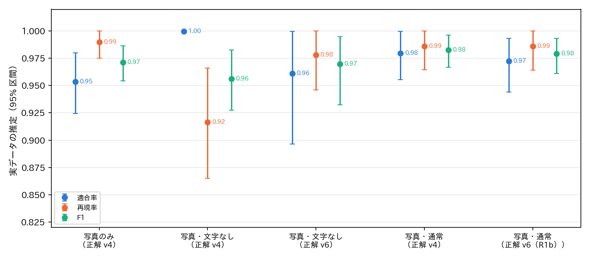

# report_050：写真・文字なしと写真・通常のお題画像の件数と判定精度

## 概要

現実の画像に対する大喜利の面白さの判定に向けて，お題画像を絞り込む2つの条件の件数と判定精度を求めた（ex029）．

- 条件A「写真・文字なし」：パッケージ v5.3.0 の媒体が写真のみ（他の媒体を含まない）で，文字ありが偽．
- 条件B「写真・通常」：媒体が写真のみで，形式が通常（お題文・穴埋め・カルタでない）．

結果は次のとおりである．

- 件数（v5.3.0 の予測）：条件A はお題が約201万件（全体の29.5%），ボケが約2,129万件（23.0%）であった．条件B はお題が約306万件（44.9%），ボケが約2,991万件（32.3%）であった．
- 判定精度（実データの推定）：
  - 条件A は，v4 の正解で適合率 1.00・再現率 0.92・F1 0.96，v6 の文字の正解で適合率 0.96・再現率 0.98・F1 0.97 であった．
  - 条件B は，v4 の正解で適合率 0.98・再現率 0.99・F1 0.98，v6（R1b）の正解で F1 0.98 であった．
  - どちらの条件も，絞り込みに使うのに十分な精度である．
- 条件A の再現率が v4 の正解で 0.92 にとどまったのは，v4 の目視の見落としが主な原因である．見逃し11枚のうち9枚は，v6 の付け直しで文字ありとされた（小さな透かし・看板など）．

## 方法

`programs/ex029_photo_subset/evaluate.py` で次を求めた．

- 件数：annotation.parquet の全てのお題（682万件．重複を含む）と代表の画像（661万枚）について，v5.3.0 の予測で条件を判定した．ボケのアノテーション（約9,249万件）をお題ごとに数え，ボケの件数と画像外の知識の割合も求めた．
- 判定精度：ex022／ex023 で用いた1,020枚の Claude Code の目視のラベル（定義書 v4 の形式・属性・媒体）を正解とした．
  - 実データ（real）：無作為抽出160枚と層別抽出220枚を重み付けした推定である．95% 区間は，抽出の群（無作為・層ごと）ごとに2000回の復元抽出をして求めた．
  - 評価用データ（eval）：少ない区分を多く含む640枚の集合で，重みはない．
  - 同じ1,020枚には ex026 の定義書 v6 の文の属性がある．そこで，条件A は文字ありを v6 の文字の層で付け直した正解でも，条件B は v6 の規則 R1b で導いた通常の正解でも求めた．v6 の正解では，写真のみ・空欄あり・カルタ記号ありは v4 の目視を用いた．

## 結果

### 件数

表1：条件ごとの件数（v5.3.0 の予測）．画像外の知識の割合は，パッケージのボケの判定による．

| 条件 | お題 | 代表の画像 | ボケ | お題の割合 | ボケの割合 | 画像外の知識 |
|----------------------|---------:|---------:|----------:|------:|------:|------:|
| 全て | 6,823,270 | 6,609,511 | 92,492,813 | 100% | 100% | 27.1% |
| 写真のみ | 3,474,756 | 3,371,140 | 38,207,617 | 50.9% | 41.3% | 28.6% |
| 条件A：写真・文字なし | 2,009,955 | 1,947,651 | 21,290,521 | 29.5% | 23.0% | 30.8% |
| 条件B：写真・通常 | 3,063,330 | 2,968,966 | 29,911,515 | 44.9% | 32.3% | 30.2% |
| A かつ B | 1,945,548 | 1,884,236 | 20,421,755 | 28.5% | 22.1% | 31.0% |

条件A のほとんど（97%）は条件B にも含まれる．A に含まれて B に含まれないのは，文字のない空欄や空の吹き出しだけの写真（形式が穴埋め）である．B に含まれて A に含まれないお題は約112万件ある．これは，看板・衣服の文字，透かし，字幕や台詞の文字がある写真である．

条件A のお題1件あたりのボケは約10.6件である（全体は約13.6件）．条件A と B のボケのうち，画像外の知識が要ると判定されたものは約31%で，全体（27.1%）よりやや多い．

### 判定精度

表2：条件ごとの判定精度．実データは重み付きの推定（括弧は95% 区間），評価用データは640枚の重みなしの値である．正例の数は目視の正解の枚数．

| 条件（正解） | 集合 | 正例 | 適合率 | 再現率 | F1 | 正解の割合 | 予測の割合 |
|-------------------|----------|----:|-------------------:|-------------------:|-----:|-------:|-------:|
| 写真のみ（v4） | 実データ | 149 | 0.95（0.93–0.98） | 0.99（0.97–1.00） | 0.97 | 48.9% | 50.7% |
| 条件A（v4） | 実データ | 84 | 1.00（1.00–1.00） | 0.92（0.86–0.97） | 0.96 | 32.9% | 30.1% |
| 条件A（v6 の文字） | 実データ | 73 | 0.96（0.90–1.00） | 0.98（0.95–1.00） | 0.97 | 29.6% | 30.1% |
| 条件B（v4） | 実データ | 108 | 0.98（0.96–1.00） | 0.99（0.96–1.00） | 0.98 | 43.0% | 43.3% |
| 条件B（v6 の R1b） | 実データ | 107 | 0.97（0.94–0.99） | 0.99（0.96–1.00） | 0.98 | 42.7% | 43.3% |
| 写真のみ（v4） | 評価用 | 262 | 0.97 | 0.97 | 0.97 | — | — |
| 条件A（v4） | 評価用 | 161 | 0.99 | 0.89 | 0.94 | — | — |
| 条件A（v6 の文字） | 評価用 | 148 | 0.94 | 0.92 | 0.93 | — | — |
| 条件B（v4） | 評価用 | 201 | 0.98 | 0.97 | 0.98 | — | — |
| 条件B（v6 の R1b） | 評価用 | 200 | 0.98 | 0.98 | 0.98 | — | — |

誤りの内訳（実データ）は次のとおりである．

- **写真のみの誤検出（12枚）**：多くは，写真にテキストグラフィック（スクリーンショットや文字の帯）を貼り合わせた画像であり，ほかにイラストのみの画像（2枚）などがある．前者の多くは文字を含むため，条件A では除かれる．
- **条件A の見逃し（v4 の正解で11枚）**：全て，v5.3.0 が文字ありと判定した写真であった．そのうち9枚は，v6 の付け直しで文字ありとされた（小さな透かし，看板，衣服の文字など）．
- **条件A の誤検出（v6 の正解で4枚）**：3枚は，v6 の付け直しで場面の文字（看板など）だけがあるとした写真である．重ねた文字や余白の文字はないため，ボケを理解するのに文字を読む必要は小さい．残りの1枚は，v4 の目視で写真のみではないとした画像である．
- **条件B**：v4 と v6（R1b）の正解で精度はほぼ同じであった．写真の通常の判定は，お題文の定義の変更の影響をほとんど受けない．

## 考察

2つの条件とも，v5.3.0 の予測で F1 0.96〜0.98 の精度で絞り込める．予測の割合（A 30.1%，B 43.3%）は，目視の推定の割合（A 29.6〜32.9%，B 42.7〜43.0%）とほぼ一致した．したがって，件数も信頼できる．

「文字の認識が要らない」という目的には，条件A が合う．ボケの数は約2,129万件あり，学習や分析には十分な量である．条件A の誤りは，ほとんどが場面の文字（透かしや小さな看板など）の有無の判断であり，読まなくても困らない文字である．目的を損なう誤り（字幕や台詞のある写真が混ざること）はほとんどない．一方，条件B には字幕・台詞・看板の文字がある写真が約112万件（お題の約3分の1）含まれる．文字の認識を避けたい場合は不向きである．

ただし，どちらの条件も「画像と一般知識だけで面白さが分かるボケ」に絞るには十分でない．写真に写った有名人の知識を使うボケは，画像外の知識のラベルでは「いいえ」になるため，残る．また，画像外の知識の判定（F1 約0.69）の誤りによる混入も残る．条件A の写真のボケで画像外の知識の割合が約31%とやや高いことは，写真のボケが実在の事物の知識に頼りやすいことを示唆する．ただし，原因は確かめていない．

精度の推定は，実データの380枚（写真のみの正例149枚）に基づく．そのため，95% 区間の幅は ±3〜5 ポイントある．正解は全て Claude Code の目視であり，v4 の目視は小さな文字を見落とす傾向があった．

## ファイル

- プログラム：`programs/ex029_photo_subset/`（`data.py`，`evaluate.py`）
- 出力：`outputs/ex029_photo_subset/`（`counts.csv`，`metrics.csv`，`confusion.csv`，`boke_counts.parquet`，`fig_metrics.png`，`evaluate.log`）
- 可視化：`visualize_result.ipynb` の ex029 の節

## 未解決の論点と次の候補

- 条件A のボケのうち，画像と一般知識だけで面白さが分かる割合：画像外の知識の閾値ごとに数百件を目視し，有名人への依存による混入の規模を測る．
- 有名人が写っている写真の判定：画像側のラベル（有名人が写っているか）か，ボケ側のラベル（画像に写った人物の知識に依存するか）の追加を検討する．
- 写真のみの判定で，イラストやスクリーンショットの貼り合わせの誤検出が数%ある．条件A では文字ありで多くが除かれるが，残りの規模は未確認である．
- 精度の推定は380枚に基づく．条件A の内部での誤りの率を細かく知るには，条件A の予測から数百枚を抽出して目視するのが効率的である．
