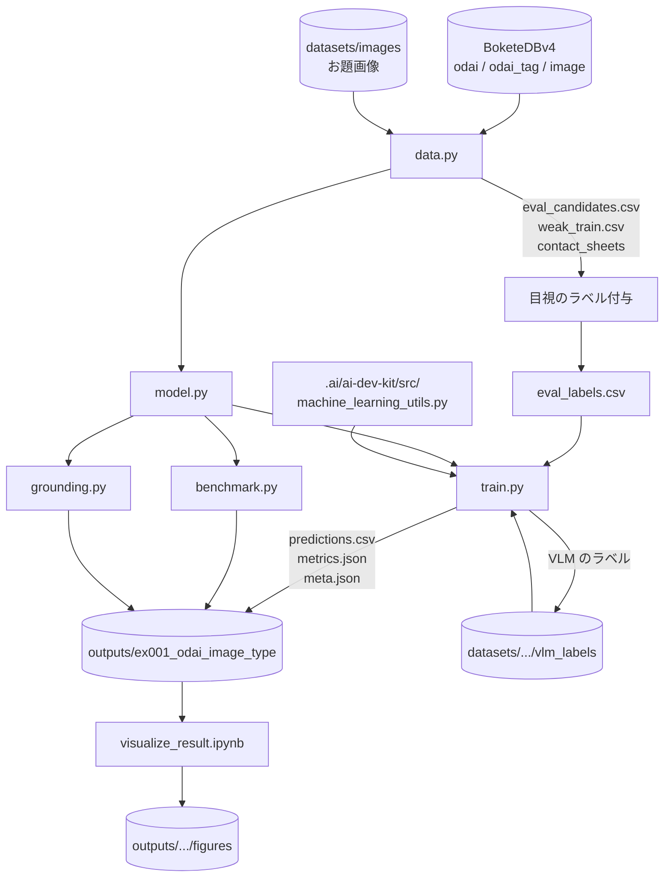
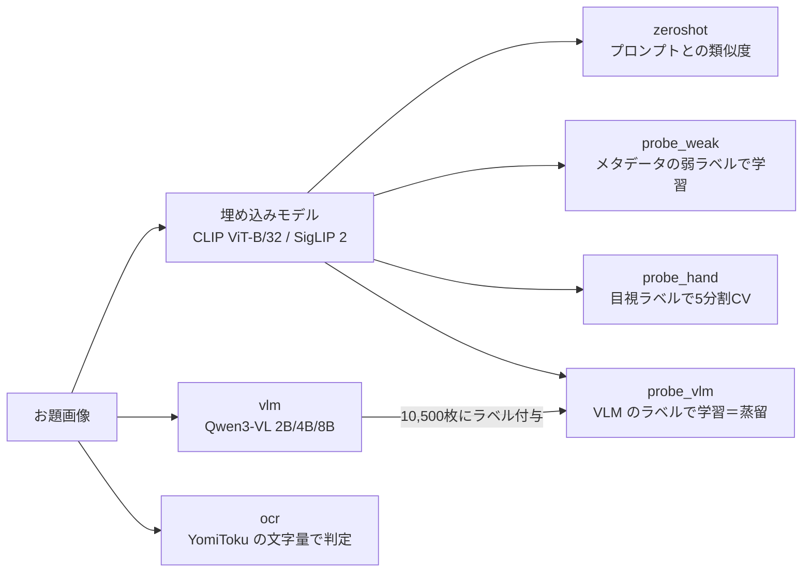
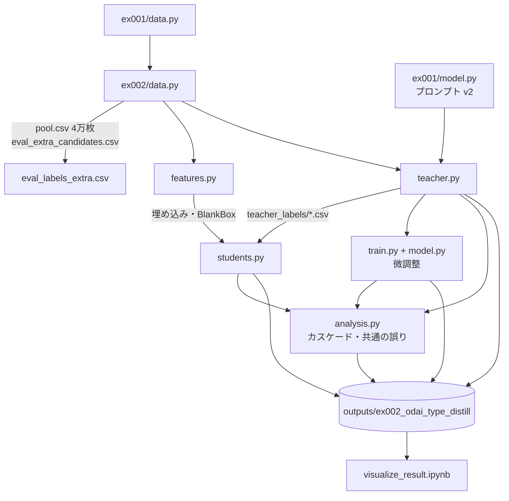
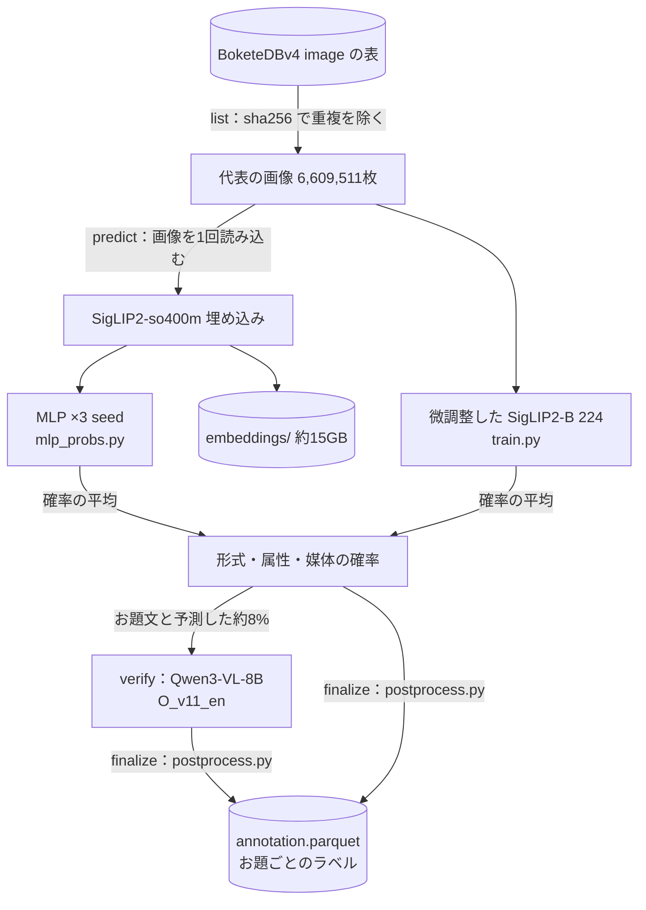

# Bokete_Annotation_v5

## 1. 概要

本リポジトリは，大喜利投稿サイト「ボケて」の1次データベース BoketeDBv4 に注釈を付与し，AIの学習やデータ分析に用いるデータベース BoketeDBv5 を構築するためのプログラムと実験の記録を管理する．現時点では，お題画像の種別（現実画像，アニメ，漫画，文章のお題，穴埋め，カルタ）を有料APIを用いずに単一GPUのローカル環境で判定する方法を比較する実験として，手法の系統を比較した ex001 と，ex001 の最良の方法（VLM から埋め込みモデルへの蒸留）の各要素（教師の VLM，教師ラベルの画像と枚数，生徒の分類器，カスケード）を入れ替えて比較した ex002 を収める．その後，ラベルの定義（programs/label_guideline/，最新は定義書 v4）を改訂しながら蒸留の方法を改良し（ex003〜ex008），ex009 で最終版のアノテーションの方法を決めた．

最終版（programs/ex009_final/annotate_all.py，構成は outputs/ex009_final/final_config.json）は，全てのお題画像に形式（カルタ，穴埋め，お題文，通常），属性（空欄あり，カルタ記号あり，文字あり），媒体（写真，アニメ，ゲーム，マンガ，テキストグラフィック，絵画，イラスト）を付ける．生徒の確率（SigLIP2-so400m の埋め込みに対する MLP の3 seed と，微調整した SigLIP2-B の平均）で予測し，お題文と予測した画像にのみ Qwen3-VL-8B の確認の質問（O_v11_en）を行う．方法と根拠は .reports/report_013.md にまとめた．

全データのアノテーションは，研究用のプログラムに依存しない独立したパッケージ `Bokete_Annotation_programs_v5.0/` で行う（GitHub で独立したリポジトリとして公開する予定）．使い方，前提データと出力の形式は，そのディレクトリの README.md と docs/ にある．結果は `Bokete_Annotation_programs_v5.0/outputs/BoketeDBv5_annotation/` に保存する．ex009 の `annotate_all.py` と同じ結果になることを，無作為の2万枚で確かめた（全てのラベルと確率が一致）．全データ（6,823,270件）のアノテーションは order_014 で完了した（.reports/report_014.md）．order_018 で，写真のキャプション（caption の段階，Qwen3-VL-30B-A3B）をパッケージに加え，`annotation.parquet` に列 `caption`，`caption_ok` を加えた（.reports/report_018.md，バージョン 5.1.0）．order_026 で，ボケの段階（発話の型・画像外の知識・制約の順守．Qwen3-VL-4B の分類器とプレフィックスのキャッシュ）をパッケージに加え，検証と最適化を行った（.reports/report_026.md，バージョン 5.2.0）．order_027 で，ボケの全件（92,495,946件）のアノテーションを完了した（.reports/report_027.md．約3日11時間）．結果は `Bokete_Annotation_programs_v5.0/outputs/BoketeDBv5_annotation/boke_annotation/` にある．order_042 で，定義書 v5（属性にお題文ありを加え，形式は属性から導く）をパッケージに組み込み，お題文ありの生徒（odai_text の段階）を加えて確認の質問を既定で外した（.reports/report_042.md，バージョン 5.3.0）．全データのお題の段階は保存済みの埋め込みから計算し直した（v5.2.0 の出力は `outputs/BoketeDBv5_annotation/backup_v5.2.0/` に複製した）．ボケのラベルは v5.2.0 の形式で付けたまま再計算していない．

アノテーションを人が判定するための LINE の公式アカウントの Bot は，独立したリポジトリ `Bokete_LINE_Annotator/` で開発する（order_030，.reports/report_030.md）．現時点ではお題画像のラベルを判定する `BoketeImageAnnotator`（Cloudflare Workers，D1）を実装し，Claude Code・Qwen（教師 T_v11）・生徒モデルのラベルが揃った1,020枚から3,475問と注意確認の問題60問を作る．Cloudflare のアカウントなしでも，`npm run image:tunnel` で手元の PC から cloudflared のクイックトンネルを通じて運用できる（order_031，.reports/report_031.md）．試行の回答の集計と必要な回答数の見積もり（`prepare/plan_sample_size.py`．目安は20人×100件）は order_032，.reports/report_032.md にある．動作の確認用のデバッグモード（`--debug`．ブロックの解除で新規の参加者として始め直す）は order_033，.reports/report_033.md にある．協力者の意見による表示の文言の改訂（属性を「画像の要素」とし，定義を短くした．回答に表示の版 `ui_version` を記録する）は order_034，.reports/report_034.md にある．問いかけの文と画像の要素の注記の削除（表示の版3）は order_035，.reports/report_035.md にある．「どれもなし」の問題に3項目の定義を示す変更（表示の版4）は order_036，.reports/report_036.md にある．評価者に配るラベルの早見表（A4 の1ページ版と2ページ版．`prepare/make_cheatsheet.py`）の試作は order_037，.reports/report_037.md にある．説明の表示の順の変更と対面の評価に向けた改善（表示の版5，`npm run image:stats`）は order_038，.reports/report_038.md にある．全員に同じ順で最初に出題する共通の問題（30問．`prepare/select_common.py`）は order_039，.reports/report_039.md にある．使い方は同ディレクトリの README.md と document.md にある．大喜利を判定する `BoketeSentenceAnnotator` は今後追加する．

## 2. ディレクトリとファイルの役割

```text
./
├── .ai/                          # AI開発の規約とエージェント（サブモジュール）
├── .orders/order_{n:03}.md       # 作業の指示とその解釈
├── .reports/report_{n:03}.md     # 作業ごとのレポート（PDF も同じ場所に置く）
├── Bokete_Annotation_programs_v5.0/  # 全データのアノテーションの独立したパッケージ（README.md，docs/ を参照．models/*.pth と outputs/ は Git の管理外）
│   ├── annotate.py               # 実行のエントリーポイント（list → predict → odai_text → verify（任意） → finalize → caption，ボケの4段階）
│   ├── config.json               # 最終版の構成（モデル，お題文ありの生徒，確認の質問，キャプション，ボケ）
│   ├── bokete_annotation/        # labels，data，models，verify，caption，postprocess，pipeline
│   ├── models/                   # 重み（mlp_so400m_seed{0,1,2}.pth，odai_text_mlp_seed{0,1,2}.pth，siglip2_b224_finetune_seed0.pth，boke_qwen3vl4b_lora.pt）とチェックサム
│   ├── docs/                     # label_definition.md（第5版），label_definition_v4.md，method.md，data_format.md，boke_label_definition.md
│   ├── scripts/check_models.py，tests/test_postprocess.py
│   └── outputs/                  # アノテーションの結果
├── Bokete_LINE_Annotator/        # LINE の公式アカウントでアノテーションを人が判定する Bot（独立したリポジトリ．README.md，document.md を参照）
│   ├── shared/                   # 署名の検証と応答，同意，属性の質問，注意確認の間隔，評価者の表
│   └── BoketeImageAnnotator/     # お題画像のラベルの判定（src/：Worker，prepare/：問題の作成と集計）
├── programs/
│   └── ex001_odai_image_type/    # お題画像の種別判定の比較実験
│       ├── data.py               # 評価用・弱ラベル学習用の画像の抽出，コンタクトシートの作成，ラベルの読み込み
│       ├── model.py              # 埋め込みモデル，ゼロショット分類，線形プローブ，VLM，OCR の分類器
│       ├── train.py              # 各手法の実行と評価（結果を outputs/ に保存）
│       ├── benchmark.py          # 埋め込みモデルの実運用に近い条件での処理速度の測定
│       ├── grounding.py          # VLM による穴埋めの記号とカルタのひらがなの位置の検出の試行
│       └── eval_labels.csv       # 目視で付与した評価用ラベル（440件，Git で管理する）
│   └── ex002_odai_type_distill/  # 蒸留の各要素を入れ替えた比較実験
│       ├── data.py               # 追加の評価用画像と教師ラベル用の4万枚の抽出，評価用ラベルの結合，データローダー
│       ├── features.py           # 埋め込み（CLIP-B/32，SigLIP2-B，SigLIP2-so400m）と空欄の矩形の特徴の計算
│       ├── teacher.py            # 教師の VLM の評価，4万枚へのラベル付け，多数決
│       ├── students.py           # 生徒の分類器（ロジスティック回帰，MLP，k 近傍法）の比較と学習曲線
│       ├── model.py              # 微調整する画像エンコーダ（ConvNeXt-Tiny，SigLIP2-B）
│       ├── train.py              # 画像エンコーダの微調整（loss_func，metrics_func，iteration，epoch，train）
│       ├── analysis.py           # ex001 の方法の再評価，規則，カスケード，教師の一致率，共通の誤りの分析
│       ├── common.py             # 評価と結果の保存の共通処理
│       └── eval_labels_extra.csv # 追加の評価用ラベル（無作為抽出200件，Git で管理する）
│   ├── ex025_odaibun_eval_v5/    # お題文ありの評価用データ v5（層別抽出420枚）と再現性の確認，パッケージ v5.3.0 の検証（report_042）
│   │   ├── data.py               # 層の定義，母集団（v5.2.0 の予測とお題文ありの生徒の確率），評価用データと再現性の確認の画像の読み込み
│   │   ├── make_sheets.py        # 層別抽出と，予測を伏せた画像の一覧（57枚）
│   │   ├── odai_labels.txt       # 510枚のお題文ありの目視ラベル（Git で管理する）
│   │   ├── evaluate.py           # 構成ごとの重み付きの適合率・再現率・F1，対の復元抽出による差の区間，再現性，閾値と下限の表，既存の1,020枚での v5.2.0 と v5.3.0 の比較
│   │   ├── normal_miss.py        # 通常と予測した画像でのお題文ありの見逃しの検討（追加の抽出，Qwen3-VL-32B，候補の比較．report_043）
│   │   └── normal_labels.txt     # 追加の180枚のお題文ありの目視ラベル（Git で管理する）
│   ├── ex026_text_attr_v6/       # 文の属性（定義書 v6 の草案：文字の層と文の形）の目視ラベル，Qwen の教師としての精度，生徒で学べるかの確認（report_044），お題文ありの既定の規則 R1b（report_045）
│   │   ├── data.py               # 対象の1,620枚（ex024 / ex025 の目視ラベル付きの画像と重み），ラベルの記号の解釈，規則 R0〜R2 によるお題文ありの導出
│   │   ├── make_sheets.py        # 予測を伏せた画像の一覧（180枚）
│   │   ├── make_repeat.py        # 再現性の確認の90枚の一覧
│   │   ├── v6_labels.txt         # 1,620枚の v6 の属性の目視ラベル（Git で管理する）
│   │   ├── v6_labels_repeat.txt  # 付け直した90枚の目視ラベル（Git で管理する）
│   │   ├── qwen_v6.py            # Qwen3-VL に v6 の属性と書き起こし（V6）・書き起こしのみ（OCR）を問う
│   │   ├── ocr_yomitoku.py       # YomiToku の書き起こしと速さ
│   │   └── evaluate.py           # 定義の変化，Qwen と生徒（埋め込み・文の文字 n-gram）の属性ごとの精度，導いたお題文あり，学習曲線
│   ├── ex027_odai_text_improve/  # お題文ありの判定の改善：v5.3.0 の確率との組み合わせ（方法1）と，文の形を問う教師（方法2）（report_047）
│   │   ├── data.py               # 評価の1,620枚（ex026 の目視と v5.3.0 の確率），教師ラベルを付けるプール（3万枚）と埋め込み
│   │   ├── qwen_form.py          # Qwen3-VL-32B に文の形を問う（FORM：層を問わない，FORM2：文ごとに場所と形）
│   │   ├── train.py              # 組み合わせの生徒（入れ子の交差検証，5つの乱数の種）とプールの生徒の分割外の予測
│   │   └── evaluate.py           # 全データの推定の F1，v5.3.0 との差の区間，教師の形ごとの精度，正解の種類ごとの誤り
│   ├── ex031_export_final/       # 最終版を独立したディレクトリ（/mnt/d/BoketeDBv5_annotation_final）に書き出す（report_052）
│   │   ├── export.py             # データ・定義書・指示・目視ラベル・精度の表・パッケージの複写と書き出し（再開できる）
│   │   └── README_final.md       # 書き出し先の README.md の元
│   ├── ex030_final_summary/      # 最終版のアノテーションの精度の集計（新しい推論なし．report_051）
│   │   └── collect.py            # 形式・属性・媒体，少ない区分，お題文あり，ボケの発話の型・画像外の知識の適合率・再現率・F1
│   ├── ex029_photo_subset/       # 写真・文字なしと写真・通常のお題画像とボケの件数，判定精度（report_050）
│   │   ├── data.py               # v5.3.0 の条件の予測，1,020枚の目視の正解（v4 と v6），ボケの件数
│   │   └── evaluate.py           # 件数，条件ごとの適合率・再現率・F1（実データの推定と評価用データ），図
│   ├── ex028_odai_holdout/       # 独立な評価用データ（600枚）での v5.3.0 単体と後段（ex027 の組み合わせ）の比較（report_048），層 D・F の追加の抽出（report_049）
│   │   ├── data.py               # 抽出（ex025 の評価の9層．既存の目視・教師の画像を除く），目視の読み込み，埋め込みと書き起こし
│   │   ├── make_sheets.py        # 600枚と判断のずれの確認の36枚の抽出と，番号だけの画像の一覧
│   │   ├── holdout_labels.txt    # 636枚の v6 の属性の目視ラベル（Git で管理する）
│   │   ├── make_sheets_df.py     # 追加の抽出：層 D・F を各300枚（order_049）
│   │   ├── df_labels.txt         # 追加の抽出600枚の目視ラベル（Git で管理する）
│   │   ├── evaluate_df.py        # 層 D・F のお題文ありの割合と見逃し，追加の抽出を加えた全データの推定（report_049）
│   │   ├── qwen_ocr.py           # Qwen3-VL-32B の書き起こし（ex026 の指示 OCR）
│   │   ├── train.py              # 後段を1,620枚の全てで学習し，636枚の確率を求める
│   │   └── evaluate.py           # 全データの推定の F1，v5.3.0 との差の区間，ex027 の推定との比較，誤りの種類，判断のずれ
│   ├── ex024_odaibun_attr/       # お題文ありの属性（定義書 v5 の案）の判定の改善：Qwen の指示とモデルの比較，教師ラベル，生徒，構成の比較（report_041）
│   │   ├── data.py               # 正解（v4 の目視ラベル＋お題文ありの付け直し），集合と重み，パッケージの埋め込みの読み込み
│   │   ├── make_sheets.py        # 穴埋め・カルタの画像328枚の付け直し用の一覧
│   │   ├── odaibun_relabel.txt   # 穴埋め・カルタの画像のお題文ありの目視ラベル（Git で管理する）
│   │   ├── qwen_odaibun.py       # Qwen の指示（P0〜P4）とモデル（8B，30B-A3B，32B，32B-Thinking）の比較
│   │   ├── evaluate_prompts.py   # 指示とモデルごとの適合率・再現率・F1 と図
│   │   ├── teacher.py            # 4.5万枚のお題文ありの教師ラベル（32B・P3・高解像度）
│   │   ├── model.py，train.py    # お題文ありの生徒（埋め込みに対する MLP）
│   │   └── evaluate_pipeline.py  # 構成の比較（現在，Qwen，生徒，段階的な構成，組み合わせ），全データへの適用，形式の逆算
│   ├── ex023_image_label_pr/     # お題画像のカテゴリごとの適合率・再現率を判断者（Qwen 単独，生徒，全プロセス）ごとに比べる（report_040）
│   │   ├── data.py               # 正解（Claude Code の目視ラベル 1,020枚，実データの重み），Qwen（教師 T_v11），生徒・全プロセス（annotation.parquet から再構成）
│   │   ├── verify_all.py         # パッケージの確認の質問（Qwen3-VL-8B）を1,020枚の全てに行う
│   │   └── evaluate.py           # 適合率・再現率・F1，ブートストラップの区間，全項目の一致，確認の質問の内訳，図
│   ├── ex021_annotation_examples/ # Claude Code の目視ラベル（お題画像220枚，ボケ620件）の層ごとの分布と例（report_028）
│   │   └── make_examples.py      # 層ごとの例の図（.reports/figures_028/）と分布の表（outputs/ex021_annotation_examples/）
│   ├── ex020_boke_full_analysis/ # ボケの全件のアノテーションの確認（件数）と集計（形式・投稿年ごと），目視の確認用の一覧
│   │   └── analyze.py
│   ├── ex019_boke_full/          # ボケの全件のアノテーションに向けたパッケージ（v5.2.0）の検証と最適化
│   │   ├── verify_eval.py        # パッケージの推論で検証データの精度が再現されるか，再実行で一致するか
│   │   ├── verify_sample.py      # 実データ3,000件で，高速な推論と通常の推論（ex016）の一致
│   │   ├── verify_compliance.py  # 制約の順守の得点と規則の検証（付け替えた組の AUC，カルタの正解率）
│   │   ├── verify_edge.py        # 例外的な入力（画像がない，空のボケ，ボケの多いお題，形式がない）
│   │   ├── tune_speed.py，profile_predict.py # 設定ごとの速度と，GPU の時間の内訳
│   ├── paper_text/               # 文字の扱いの論文（paper_text/）の図と数値
│   │   └── make_figures.py       # ex026 の目視ラベルと評価の出力から numbers.json と図（outputs/paper_text/，paper_text/figures/）
│   ├── ex018_paper_boke/         # ボケの論文（paper_boke/）のための評価のし直しと図
│   │   ├── unified_eval.py       # ex014〜ex017 の主な方法を合意ラベルで評価し直す（outputs/ex018_paper_boke/unified.csv）
│   │   └── make_figures.py       # 論文の図（paper_boke/figures/fig_progress.pdf など）
│   ├── ex017_boke_outside/       # 画像外の知識の判定の改善（32B の指示，8B の生徒，疑似ラベル，アンサンブル）と推論の高速化（試作）
│   │   ├── data.py               # ex016 のデータ（合意ラベル，教師のラベル，目視のラベル）
│   │   ├── teacher.py            # 32B の画像外の知識の指示の変種（kt, src, src_fs, src_sc）
│   │   ├── pseudo.py             # 二段階の微調整をした生徒による疑似ラベル
│   │   ├── train.py              # 画像外の知識を重視した二段階の微調整（モデル，教師のラベル，損失の重み）
│   │   ├── recurrence.py         # ボケの文の再出現の回数（全ボケ）
│   │   ├── fast_infer.py         # お題ごとのプレフィックスのキャッシュによる高速な推論（InternVL3.5，Qwen3-VL），一致の確認と速度
│   │   ├── evaluate.py，figures.py # 画像外の知識の評価（アンサンブル，信頼区間）と図
│   │   └── run_queue.sh          # GPU の実行の順序
│   ├── ex016_boke_small_vlm/     # 小さな VLM によるボケのラベルの判定（ゼロショット・微調整の精度と速度，目視のラベルの再現性．試作）
│   │   ├── data.py               # 検証データ（合意ラベル），教師のラベルの学習データ，学習用の目視のラベル
│   │   ├── ceiling_sheets.py，human_sheets.py # 付け直し用・学習用の一覧の作成
│   │   ├── zeroshot.py           # vLLM によるゼロショットと推論モデル
│   │   ├── model.py，train.py    # VLM＋LoRA の分類器と微調整（教師のラベル → 目視のラベル）
│   │   ├── stage2_more.py        # 目視のラベルの量と精度
│   │   ├── evaluate.py，figures.py # 評価（元のラベル／合意ラベル）と図・表
│   │   ├── run_queue.sh，run_queue2.sh # GPU の実行の順序
│   │   ├── ceiling_labels.txt，rest_labels.txt，consensus160_labels.txt，consensus_labels.txt # 検証データの付け直しと合意ラベル（Git で管理する）
│   │   └── human_labels.txt      # 学習用の目視のラベル931件（Git で管理する）
│   ├── ex015_boke_labels_v3/     # ボケのラベル 第3版（画像外の知識の厳密な定義，発話の型の指示・入力形式の比較．試作）
│   │   ├── data.py               # 検証データ620件（ex014 と同じ分割）と画像外の知識のラベル
│   │   ├── teacher.py            # 教師の指示・入力形式の比較（one，one_cap，one_kt_cap，dec など）とラベル付け（eval，aug，extra）
│   │   ├── students.py           # 生徒（発話の型6区分と画像外の知識．重み付き損失，補正．品詞の特徴は用いない）
│   │   ├── evaluate.py，figures.py # 6区分・3区分・画像外の知識の評価と図
│   │   ├── outside_labels.txt    # 検証データ620件の画像外の知識（定義書 第3版．Git で管理する）
│   │   └── outside_adjudication.txt # その見直しの記録（Git で管理する）
│   ├── ex014_boke_labels_v2/     # ボケのラベル 第2版（制約の順守，発話の型の水増し，知識の定義の再検討．試作）
│   │   ├── data.py               # 検証データ620件（ex013 の420件＋少ない型の200件）と区分の統合
│   │   ├── sample_rare.py，make_sets.py # 少ない型の検証データの抽出，付け替えの組・水増し用・制約の分類器の学習用の集合
│   │   ├── teacher.py            # 教師（第3版：知識を上から順に判定）
│   │   ├── features.py           # 品詞の特徴（MeCab）と埋め込み
│   │   ├── compliance.py         # 穴埋め・お題文の制約の順守の判定方法の比較
│   │   ├── students.py           # 生徒（水増し，重み付き損失，品詞，目視のラベルでの補正）
│   │   ├── evaluate.py，figures.py # 区分の統合ごとの評価と図
│   │   └── eval2_labels.txt      # 追加の検証データ200件の目視のラベル（Git で管理する）
│   ├── ex013_boke_labels/        # ボケのラベル（定義書 第1版）の検証データと自動判定の方法の比較（試作）
│   │   ├── data.py               # 検証データ（420件）の読み込みと分割
│   │   ├── sample_eval.py，make_pool.py # 検証データの追加の抽出，教師ラベル用のボケ3.5万件の抽出
│   │   ├── rules.py              # 規則（カルタの制約の順守，発話の型，不適切の辞書）
│   │   ├── teacher.py            # Qwen3-VL の教師（第1版・第2版の指示）
│   │   ├── embed.py              # 文の埋め込み（ruri-v3-310m，multilingual-e5-base）とお題画像の埋め込みの読み込み
│   │   ├── students.py           # 生徒（MLP，ロジスティック回帰，微調整，目視のラベルでの学習と補正）
│   │   ├── evaluate.py，figures.py # 評価と図
│   │   ├── eval_labels.txt       # 検証データ420件の目視のラベル（Git で管理する）
│   │   └── adjudication_log.txt  # 検証データの見直しの記録（Git で管理する）
│   ├── ex012_boke_scheme/        # 大喜利（ボケ）の区分の設計（実例の抽出，試験的な分類，集計）
│   │   ├── sample.py             # お題の層別抽出と，画像とボケを並べた一覧
│   │   ├── stats.py              # 試験的な分類の集計と，大規模な自動の集計（文字数，カルタの書き出し，評価の件数）
│   │   └── pilot_labels.txt      # 140件のボケへの試験的なラベル（Git で管理する）
│   ├── ex011_caption_final/      # 写真のキャプションの本番前の検証と本番用のスクリプト
│   │   ├── caption_all.py        # 本番用（30B-A3B，短い指示，再現性の設定あり．5万枚ごとに保存し再開できる）
│   │   ├── postprocess_captions.py # 品質の目印（caption_ok）とお題ごとへの展開
│   │   ├── judge_eval2.py        # 評価用データ240枚での採点
│   │   ├── run_checks.sh，run_checks2.sh # 2万枚の試行，中断と再開，再現性の検証
│   │   └── reference_captions_eval2.txt # 追加の評価用データ120枚の参照キャプション（Git で管理する）
│   ├── ex010_photo_caption/      # 写真のキャプションの生成方法の比較（試作．v5.0 の結果は読み込みのみ）
│   │   ├── data.py               # 写真の抽出，評価用データ（120枚）と速度の測定用データ（2,000枚）
│   │   ├── generate.py           # VLM（Qwen3-VL 2B〜32B，解像度，指示）によるキャプションの生成と速度の測定
│   │   ├── translate.py          # 英語のキャプションの日本語への翻訳
│   │   ├── retrieval.py          # v5.0 の埋め込みを用いた近傍の検索によるキャプション
│   │   ├── judge.py              # Qwen3-VL-32B による採点
│   │   ├── manual_check.py       # 目視の採点の一覧と，採点者との一致の集計
│   │   ├── summarize.py          # 速度と精度の表と図
│   │   ├── common.py             # 一覧画像，処理速度の記録
│   │   ├── reference_captions.txt # 評価用データの参照キャプション（Git で管理する）
│   │   └── manual_scores.txt     # 目視の採点（Git で管理する）
│   ├── ex009_final/              # 最終版：生徒のモデルと後処理の比較，全データのアノテーション
│   │   ├── data.py               # ex008 のラベル（定義書 v4）に，お題文の補足による形式の見直し（format_relabel.txt）を反映
│   │   ├── train.py              # SigLIP2-B（224/384 画素）の微調整（教師 T_v10oJXk または T_v11，重みなし）
│   │   ├── mlp_probs.py          # 埋め込みの MLP の学習し直し（確率と重みの保存）
│   │   ├── postprocess.py        # 後処理（カルタの取り消し，お題文の確認の質問）．compare.py と annotate_all.py で共用
│   │   ├── compare.py            # モデル・組み合わせ・後処理の比較（dev/test，少ない区分，実データ）と図
│   │   ├── figures.py            # 最終版の項目ごとの精度と，report_013 の図
│   │   ├── annotate_all.py       # 全データのアノテーション（list → predict → verify → finalize．再開可能）
│   │   ├── common.py             # 3軸の評価と結果の保存
│   │   ├── format_relabel.txt    # お題文の補足で形式を見直した目視ラベル（Git で管理する）
│   │   └── verify_reject_labels.txt # 確認の質問がお題文ではないとした146枚の目視の形式（Git で管理する）
│   ├── ex008_label_v4/           # 定義書 v4（文字ありにロゴ等を含める），お題文の確認の質問，目視ラベルの層別追加
│   │   ├── data.py               # v4 の評価用ラベル（文字ありの見直しを反映）と実データの目視ラベルの読み込み
│   │   ├── sample.py             # 生徒の予測による層別抽出（11層×20枚）と，文字ありの見直し用の一覧の作成
│   │   ├── teacher_v4.py         # 教師の構成（形式 F_v2/F_v9a〜c，お題文の確認 O_v10_en，文字あり J/X/JXk）の評価と教師ラベルの作成
│   │   ├── students.py           # 埋め込みに対する3出力の MLP（重みなし．目視ラベルの画像の確率も保存）
│   │   ├── analyze.py            # 評価用データ・少ない区分・実データ（無作為，層別，逆確率重みの推定）での集計と図
│   │   ├── figures.py            # report_012 の実例の図
│   │   ├── common.py             # 3軸の評価と結果の保存
│   │   ├── text_relabel.txt      # 評価用データの文字ありの見直し（Git で管理する）
│   │   ├── real_random_v4.txt    # 実データの無作為抽出160枚の目視ラベル（v4，Git で管理する）
│   │   └── real_strat_v4.txt     # 実データの層別抽出220枚の目視ラベル（Git で管理する）
│   ├── ex007_label_v3/           # 定義書 v3（文字ありへの統合，CG の削除）の教師・生徒と実データでの確認
│   │   ├── data.py               # v3 の項目，評価用ラベルの変換（CG の振り分け直し），教師ラベルの読み込み
│   │   ├── teacher_v3.py         # 教師 T_v9（媒体 M_v9）と T_v8m（M_v6 の読み替え）の評価と教師ラベルの作成
│   │   ├── students.py           # 埋め込みに対する3出力の MLP（seed 0 は未使用の実データ約29.5万枚にもアノテーション）
│   │   ├── real_check.py         # 実データの無作為抽出160枚の一覧の作成と，目視のラベルに対する集計
│   │   ├── summarize.py          # 全条件の集計と図
│   │   ├── common.py             # 3軸の評価と結果の保存
│   │   ├── cg_relabel.txt        # 目視で CG とした57枚の v3 の媒体（Git で管理する）
│   │   └── real_check_v3.txt     # 実データ160枚の目視のラベル（Git で管理する）
│   ├── label_guideline/          # ラベルの定義書（label_definition_v4.md が最新）
│   ├── ex005_rare_weighted_distill/  # 定義書 v2（3軸），プロンプトの比較，少ない区分の追加と重み付き損失
│   │   ├── data.py               # 3軸の項目，評価用データの dev/test 分割，教師ラベル（基本と追加分）の読み込み
│   │   ├── prompts.py            # プロンプトの部品（F_v2，F_v6，F_v6_hr，F_v6_cot，J_v6，J_v7，A_v6，M_v6，M_v7）
│   │   ├── teacher.py            # 部品を Qwen3-VL-8B で画像の集合に適用
│   │   ├── combine.py            # 部品を組み合わせた教師の構成と評価，教師ラベルの作成
│   │   ├── mine.py               # 少ない区分（ゲーム，CG，絵画，カルタ）の候補の収集
│   │   ├── students.py           # 埋め込みに対する3出力の MLP（重み付き損失，しきい値の調整）
│   │   ├── train.py              # SigLIP2-B の3出力の微調整（重み付き損失）
│   │   ├── rare_eval.py          # 少ない区分の評価用データの作成と評価
│   │   ├── examples.py           # レポート用の実例の図
│   │   ├── annotate_real.py      # 蒸留モデルによる実データのアノテーションと，少ない区分の評価用データ第2版の層別抽出
│   │   ├── combine_v8.py         # 改善策（v8 の部品）を組み合わせた教師の構成と評価（通常と少ない区分の評価用データ）
│   │   ├── rare_eval_v8.py       # 教師 T_v8 の教師ラベルの作成と，生徒の少ない区分の評価・実データでの推定
│   │   ├── figures_v8.py         # report_009 の図
│   │   ├── common.py             # 3軸の評価と結果の保存
│   │   ├── rare_eval_labels.txt  # 少ない区分の評価用ラベル 第1版（200枚，Git で管理する）
│   │   └── rare_eval_labels_v2.txt # 少ない区分の評価用ラベル 第2版（600枚，層別抽出，Git で管理する）
│   ├── ex004_four_axis_distill/  # 確定版の4軸の定義による蒸留
│   │   ├── data.py               # 4軸の項目の定義，目視ラベル（eval_labels_v1.txt）の読み込み，データローダー
│   │   ├── teacher.py            # Qwen3-VL-8B のプロンプト v3〜v5 による教師の評価と4万枚へのラベル付け
│   │   ├── rules.py              # 定義書の規則（作品不明）とボケの書き出しによるカルタの照合
│   │   ├── make_teacher_labels.py# 4万枚の VLM の出力に規則を適用した教師ラベルの作成
│   │   ├── hybrid.py             # 形式は v2，他の軸は v5+規則とする組み合わせ教師
│   │   ├── students.py           # 埋め込みに対する4軸の生徒（ロジスティック回帰，MLP）
│   │   ├── model.py, train.py    # SigLIP2-B の4出力の微調整
│   │   ├── baseline.py           # ex002 の予測の新定義の形式での評価（参考）
│   │   ├── examples.py           # レポート用の実例の図
│   │   ├── common.py             # 4軸の評価と結果の保存
│   │   └── eval_labels_v1.txt    # 確定版の定義による目視ラベル（640枚，Git で管理する）
│   ├── ex006_label_scheme/
│   │   └── analyze_schemes.py    # クラスの統合・削除の案を既存の予測の読み替えで比較（report_010）
│   ├── ex003_user_scheme_pilot/
│   │   ├── pilot.py              # ラベル定義の草案を Qwen3-VL-8B に適用するパイロットと，ボケの統計の結合
│   │   └── analyze.py            # ボケの書き出しによるカルタの判別，論点ごとの実例の図（report_004）
│   └── label_guideline/
│       ├── label_definition_v1.md     # ラベル定義 第1版（4軸）
│       ├── label_definition_v2.md     # ラベル定義 第2版（3軸，テロップの扱いを明記）
│       └── make_edge_case_figures.py  # ラベル定義の改訂案（report_003）の境界事例の図の作成
├── datasets/ex00{1,2}_*/         # 抽出したID，埋め込みと特徴量，VLM のラベル（Git 管理外）
├── outputs/ex00{1,2}_*/          # 実験結果と図（Git 管理外）
├── paper_text/                   # お題画像の文字の扱いとその影響の和文論文（main.tex，sections/，figures/，main.pdf）
├── visualize_result.ipynb        # outputs/ を走査して結果を可視化するノートブック
├── requirements_annotate.txt     # 仮想環境 .venv_annotate のライブラリ
└── document.md                   # 本文書
```

## 3. プログラムの依存関係



`train.py` の手法は以下の関係にある．



ex002 のプログラムの関係を以下に示す．ex002 の `data.py` は ex001 の `data.py` を別名 `ex001_data` として読み込み，`teacher.py` は ex001 の `model.py` からプロンプト v2 を読み込む．



ex009（最終版）のアノテーションの処理の流れを以下に示す．生徒は ex008 の教師 T_v10oJXk の教師ラベルで学習した．



外部モジュールとして，`.ai/ai-dev-kit/src/machine_learning_utils.py` の `set_seed` と `ResultLogger` を用いる．

## 4. 環境構築

Python 3.10 と CUDA 対応の GPU を前提とする．仮想環境は `uv` で作成する．

```bash
uv venv .venv_annotate --python 3.10
uv pip install --python .venv_annotate/bin/python -r requirements_annotate.txt
.venv_annotate/bin/python -m ipykernel install --user --name venv_annotate --display-name "Python (.venv_annotate)"
```

動作を確認した環境は，NVIDIA RTX PRO 6000 Blackwell（VRAM 96GB），CUDA 13.0，torch 2.11.0，transformers 5.12.1，vLLM 0.23.0 である．vLLM は JIT コンパイルに `ninja` を用いるため，`model.py` は仮想環境の `bin` を `PATH` に加えてから vLLM を読み込む．

## 5. 実行方法

```bash
# 1. 評価用画像（440枚）と弱ラベル学習用画像（10,500枚）の抽出，コンタクトシートの作成
.venv_annotate/bin/python programs/ex001_odai_image_type/data.py
# 2. 埋め込みモデルの手法
.venv_annotate/bin/python programs/ex001_odai_image_type/train.py --methods zeroshot probe_weak probe_hand
# 3. VLM の手法（プロンプトの版と入力画素数を指定できる）
.venv_annotate/bin/python programs/ex001_odai_image_type/train.py --methods vlm --prompts v1 v2
# 4. VLM のラベルで弱ラベル学習用画像に注釈を付け，線形プローブへ蒸留する
.venv_annotate/bin/python programs/ex001_odai_image_type/train.py --methods vlm --vlm_models Qwen/Qwen3-VL-8B-Instruct --label_weak
.venv_annotate/bin/python programs/ex001_odai_image_type/train.py --methods probe_vlm
# 5. OCR，速度の測定，位置の検出
.venv_annotate/bin/python programs/ex001_odai_image_type/train.py --methods ocr
.venv_annotate/bin/python programs/ex001_odai_image_type/benchmark.py
.venv_annotate/bin/python programs/ex001_odai_image_type/grounding.py
# 6. 可視化
.venv_annotate/bin/jupyter nbconvert --to notebook --execute --inplace visualize_result.ipynb
```

ex002 の実行方法は以下のとおりである．

```bash
# 1. 追加の評価用画像200枚と教師ラベル用の画像4万枚の抽出（評価用画像は目視で eval_labels_extra.csv にラベルを付ける）
.venv_annotate/bin/python programs/ex002_odai_type_distill/data.py
# 2. 埋め込みと空欄の矩形の特徴
.venv_annotate/bin/python programs/ex002_odai_type_distill/features.py
# 3. 教師の VLM の評価とラベル付け，多数決
.venv_annotate/bin/python programs/ex002_odai_type_distill/teacher.py --models Qwen/Qwen3-VL-8B-Instruct Qwen/Qwen3-VL-30B-A3B-Instruct-FP8 --label_pool
.venv_annotate/bin/python programs/ex002_odai_type_distill/teacher.py --models Qwen/Qwen3-VL-32B-Instruct-FP8 OpenGVLab/InternVL3_5-8B openbmb/MiniCPM-V-4_5
.venv_annotate/bin/python programs/ex002_odai_type_distill/teacher.py --vote Qwen3-VL-8B-Instruct Qwen3-VL-32B-Instruct-FP8 Qwen3-VL-30B-A3B-Instruct-FP8
# 4. 生徒の分類器
.venv_annotate/bin/python programs/ex002_odai_type_distill/students.py --suite classifier features size
.venv_annotate/bin/python programs/ex002_odai_type_distill/students.py --suite teacher --teachers Qwen3-VL-30B-A3B-Instruct-FP8
# 5. 画像エンコーダの微調整（処理速度は他の GPU の処理を止めて --speed_only で測り直す）
.venv_annotate/bin/python programs/ex002_odai_type_distill/train.py
.venv_annotate/bin/python programs/ex002_odai_type_distill/train.py --speed_only
# 6. 分析（ex001 の方法の再評価，規則，教師の一致率，カスケード，共通の誤り）
.venv_annotate/bin/python programs/ex002_odai_type_distill/analysis.py --tasks baseline rule agreement common_errors teacher_disagreement \
    --cascade_students student_logreg/Qwen3-VL-8B-Instruct__siglip2-so400m-patch14-384__nall finetune_siglip2_base/Qwen3-VL-8B-Instruct_lr3e-05_ep5
```

ex004 の実行方法は以下のとおりである．

```bash
.venv_annotate/bin/python programs/ex004_four_axis_distill/teacher.py --prompt v5 --label_pool   # 教師（4万枚に約1.7時間）
.venv_annotate/bin/python programs/ex004_four_axis_distill/teacher.py --prompt v5 --rules_only   # 規則の評価
.venv_annotate/bin/python programs/ex004_four_axis_distill/make_teacher_labels.py
.venv_annotate/bin/python programs/ex004_four_axis_distill/hybrid.py
.venv_annotate/bin/python programs/ex004_four_axis_distill/students.py --teachers hybrid_v2format_v5rules Qwen3-VL-8B-Instruct_v5_rules
.venv_annotate/bin/python programs/ex004_four_axis_distill/train.py --teacher hybrid_v2format_v5rules
.venv_annotate/bin/python programs/ex004_four_axis_distill/examples.py
```

ex005 の実行方法は以下のとおりである．

```bash
D=programs/ex005_rare_weighted_distill
.venv_annotate/bin/python $D/teacher.py --sets eval                          # 全部品を評価用データに適用
.venv_annotate/bin/python $D/combine.py                                      # 教師の構成の比較
.venv_annotate/bin/python $D/teacher.py --components M_v7 J_v6 --sets pool   # 4万枚（F_v2 は ex002 のものを複製）
.venv_annotate/bin/python $D/combine.py --teachers T_v2_J6M7 --label_sets pool
.venv_annotate/bin/python $D/mine.py --teacher T_v2_J6M7                     # 少ない区分の収集
.venv_annotate/bin/python $D/students.py --teacher T_v2_J6M7 --tune
.venv_annotate/bin/python $D/train.py --teacher T_v2_J6M7
.venv_annotate/bin/python $D/rare_eval.py --make      # 抽出後，目視で rare_eval_labels.txt を作る
.venv_annotate/bin/python $D/rare_eval.py --evaluate --teachers T_v2_J6M7 T_v2_JM
.venv_annotate/bin/python $D/examples.py
# order_009：改善策の検証と評価用データの拡充
.venv_annotate/bin/python $D/annotate_real.py --annotate --sample   # 抽出後，目視で rare_eval_labels_v2.txt を作る
.venv_annotate/bin/python $D/teacher.py --components F_v8_en F_v8b_en F_v8c_en J_v8_en M_v8_en C_v8_en C_v8_ja P_v8_en P_v8_ja T_v8_en T_v8_ja --sets eval
.venv_annotate/bin/python $D/teacher.py --components F_v2 J_v6 M_v6 M_v8_en P_v8_en P_v8_ja --sets rare_eval rare_eval_v2
.venv_annotate/bin/python $D/combine_v8.py
.venv_annotate/bin/python $D/teacher.py --components M_v6 P_v8_en --sets pool rare_r00 rare_r01 rare_r02 rare_r03 rare_r04
.venv_annotate/bin/python $D/rare_eval_v8.py --make_labels
.venv_annotate/bin/python $D/train.py --teacher T_v8 --only_rare --weight_modes weighted weighted_sel
.venv_annotate/bin/python $D/students.py --teacher T_v8 --weight_modes weighted weighted_sel
.venv_annotate/bin/python $D/rare_eval_v8.py --evaluate
.venv_annotate/bin/python $D/figures_v8.py
# order_011：定義書 v3（M_v9 の部品を4万枚と追加分に適用した後に実行する）
E=programs/ex007_label_v3
.venv_annotate/bin/python $D/teacher.py --components M_v9 --sets eval rare_eval rare_eval_v2 pool rare_r00 rare_r01 rare_r02 rare_r03 rare_r04
.venv_annotate/bin/python $E/teacher_v3.py
.venv_annotate/bin/python $E/students.py --teacher T_v8m
.venv_annotate/bin/python $E/students.py --teacher T_v9
.venv_annotate/bin/python $E/summarize.py
.venv_annotate/bin/python $E/real_check.py --runs student_mlp/T_v8m__base+rare__weighted --make   # 抽出後，目視で real_check_v3.txt を作る
.venv_annotate/bin/python $E/real_check.py --runs $(ls outputs/ex007_label_v3/student_mlp | sed 's#^#student_mlp/#') --analyze
# order_012：定義書 v4，お題文の確認の質問，目視ラベルの層別追加
G=programs/ex008_label_v4
.venv_annotate/bin/python $G/sample.py --strat --text_recheck   # 抽出後，目視で real_strat_v4.txt と text_relabel.txt を作る
.venv_annotate/bin/python $D/teacher.py --components F_v9a F_v9b F_v9c O_v10_en X_v10_en F_v2 J_v6 M_v6 P_v8_en --sets eval rare_eval rare_eval_v2 real_check_v4
.venv_annotate/bin/python $D/teacher.py --components O_v10_en X_v10_en --sets pool rare_r00 rare_r01 rare_r02 rare_r03 rare_r04
.venv_annotate/bin/python $G/teacher_v4.py --labels T_v10o T_v10oJXk
.venv_annotate/bin/python $G/students.py --teacher T_v10o
.venv_annotate/bin/python $G/students.py --teacher T_v10oJXk
.venv_annotate/bin/python $G/analyze.py
.venv_annotate/bin/python $G/figures.py
# order_013：最終版（生徒の比較，後処理の比較，全データのアノテーション）
F=programs/ex009_final
.venv_annotate/bin/python $F/train.py --models b224 b384
.venv_annotate/bin/python $F/mlp_probs.py
.venv_annotate/bin/python $D/teacher.py --components O_v11_en --sets eval rare_eval rare_eval_v2 real_check_v4 pool rare_r00 rare_r01 rare_r02 rare_r03 rare_r04
.venv_annotate/bin/python $G/teacher_v4.py --teachers T_v11 --labels T_v11          # 比較用の教師（採用しない）
.venv_annotate/bin/python $F/mlp_probs.py --teacher T_v11
.venv_annotate/bin/python $F/train.py --models b224 --teacher T_v11 --seeds 0
.venv_annotate/bin/python $F/compare.py
.venv_annotate/bin/python $F/annotate_all.py --sample 20000 --out_dir outputs/ex009_final/annotation_test   # 少量での動作確認
.venv_annotate/bin/python $F/figures.py
# 全データ（約19時間．構成は outputs/ex009_final/final_config.json）
.venv_annotate/bin/python $F/annotate_all.py --out_dir datasets/ex009_final/BoketeDBv5_annotation
# order_015：写真のキャプションの生成方法の比較（試作）
C=programs/ex010_photo_caption
for m in q8_448_ja q8_256_ja q8_448_short q8_448_en q4_448_ja q2_448_ja q30a3_448_ja q32_448_ja q4_448_short q2_448_short q30a3_448_short q8_256_short; do
    .venv_annotate/bin/python $C/generate.py --method $m
done
.venv_annotate/bin/python $C/translate.py
.venv_annotate/bin/python $C/retrieval.py --make_pool
.venv_annotate/bin/python $C/generate.py --method q8_448_ja --no_speed --extra_set pool20k
.venv_annotate/bin/python $C/retrieval.py --predict
.venv_annotate/bin/python $C/judge.py
.venv_annotate/bin/python $C/manual_check.py --make     # 一覧を見て manual_scores.txt を作る
.venv_annotate/bin/python $C/manual_check.py --analyze
.venv_annotate/bin/python $C/summarize.py
# order_016：写真のキャプションの本番前の検証
bash programs/ex011_caption_final/run_checks.sh
bash programs/ex011_caption_final/run_checks2.sh
# 本番（約19.4時間．中断しても同じコマンドで再開できる）
.venv_annotate/bin/python programs/ex011_caption_final/caption_all.py --out_dir outputs/ex011_caption_final/photo_captions
.venv_annotate/bin/python programs/ex011_caption_final/postprocess_captions.py   # order_017：実施済み（report_017）
# order_019：大喜利（ボケ）の区分の設計
.venv_annotate/bin/python programs/ex012_boke_scheme/sample.py   # 一覧を見て pilot_labels.txt を作る
.venv_annotate/bin/python programs/ex012_boke_scheme/stats.py
# order_020：ボケのラベルの検証データと自動判定の方法の比較
B=programs/ex013_boke_labels
.venv_annotate/bin/python $B/sample_eval.py        # 一覧を見て eval_labels.txt を作る
.venv_annotate/bin/python $B/rules.py
for m in q30a3 q8 q32; do .venv_annotate/bin/python $B/teacher.py --model $m --version v1; done
for m in q30a3 q32; do .venv_annotate/bin/python $B/teacher.py --model $m --version v2; done
.venv_annotate/bin/python $B/make_pool.py
.venv_annotate/bin/python $B/teacher.py --model q30a3 --version v2 --sets train
.venv_annotate/bin/python $B/embed.py
.venv_annotate/bin/python $B/students.py --teacher q30a3_v2
.venv_annotate/bin/python $B/evaluate.py
.venv_annotate/bin/python $B/figures.py
# order_021：ボケのラベル 第2版
C2=programs/ex014_boke_labels_v2
.venv_annotate/bin/python $C2/sample_rare.py      # 一覧を見て eval2_labels.txt を作る
.venv_annotate/bin/python $C2/make_sets.py
.venv_annotate/bin/python $C2/teacher.py --model q32 --sets eval swap aug
.venv_annotate/bin/python $C2/teacher.py --model q30a3 --sets eval swap
.venv_annotate/bin/python $C2/features.py
.venv_annotate/bin/python $C2/compliance.py
.venv_annotate/bin/python $C2/students.py
.venv_annotate/bin/python $C2/evaluate.py
.venv_annotate/bin/python $C2/figures.py
# order_022：ボケのラベル 第3版（画像外の知識の2値，発話の型の指示と入力形式）
C3=programs/ex015_boke_labels_v3
.venv_annotate/bin/python $C3/teacher.py --model q32 --sets eval
.venv_annotate/bin/python $C3/teacher.py --model q30a3 --sets eval --variants one dec dec_fs dec_cap dec_fs_cap
.venv_annotate/bin/python $C3/teacher.py --model q32 --sets aug --variants one_cap one_kt_cap
.venv_annotate/bin/python $C3/teacher.py --model q32 --sets extra --variants one_kt_cap   # 約1.8時間
.venv_annotate/bin/python $C3/students.py --labels ex014 q32/one_cap q32/one_kt_cap q32/one_cap+q32/one_kt_cap q32/one_kt_cap@extra
.venv_annotate/bin/python $C3/evaluate.py
.venv_annotate/bin/python $C3/figures.py
# order_023：小さな VLM によるボケのラベルの判定
C4=programs/ex016_boke_small_vlm
.venv_annotate/bin/python $C4/ceiling_sheets.py && .venv_annotate/bin/python $C4/ceiling_sheets.py --rest   # 一覧を見て付け直す
.venv_annotate/bin/python $C4/human_sheets.py      # 一覧を見て human_labels.txt を作る
.venv_annotate/bin/python $C4/zeroshot.py --models q2 q4 q8 iv1 iv2 iv4 smol2 lfm16 lfm3 gemma4 q32t q30t   # 1モデルずつ実行する
.venv_annotate/bin/python $C4/train.py --models q2 iv2 lfm16 iv1 --stage2   # q4・iv4 は2エポック（run_queue2.sh）
.venv_annotate/bin/python $C4/train.py --models q4 q2 --human_only
.venv_annotate/bin/python $C4/stage2_more.py --model q4 --stage1 teacher_lr0.0001_ep2_bs16_r16
.venv_annotate/bin/python $C4/evaluate.py && .venv_annotate/bin/python $C4/figures.py
# order_024：画像外の知識の改善と推論の高速化
C5=programs/ex017_boke_outside
.venv_annotate/bin/python $C5/teacher.py --sets labeled
bash $C5/run_queue.sh            # 疑似ラベル → InternVL3.5-2B（重み3，疑似ラベル）→ InternVL3.5-8B → Qwen3-VL-8B
.venv_annotate/bin/python $C5/recurrence.py
.venv_annotate/bin/python $C5/fast_infer.py --model q4 --weights outputs/ex016_boke_small_vlm/ft/q4/teacher_lr0.0001_ep2_bs16_r16__stage2/0/best_model.pt --check --bench --tag _q4
.venv_annotate/bin/python $C5/evaluate.py --ensemble "ex016/q4_stage2 q8/ex015_wo3_lr0.0001_ep1_bs16_r16__stage2" && .venv_annotate/bin/python $C5/figures.py
```

各スクリプトは `metrics.json` が既にある条件を省略するため，中断後に同じコマンドで再開できる．

### ボケの全件のアノテーション（order_026 で準備，Bokete_Annotation_programs_v5.0 v5.2.0）

ボケの段階（`boke_list` → `boke_predict` → `boke_compliance` → `boke_finalize`）はパッケージに組み込んだ．
分類器の重みは `Bokete_Annotation_programs_v5.0/models/boke_qwen3vl4b_lora.pt`（ex016 の Qwen3-VL-4B の二段階の微調整）．

```bash
cd Bokete_Annotation_programs_v5.0
../.venv_annotate/bin/python annotate.py --db_dir /mnt/d/Bokete_Scraping_v3.2/outputs/BoketeDBv4 \
    --image_dir /mnt/d/Bokete_Scraping_v3.2/datasets/images --stages boke_list boke_predict boke_compliance boke_finalize   # 約3.2日
# 検証（研究用のリポジトリ）
.venv_annotate/bin/python programs/ex019_boke_full/verify_eval.py
.venv_annotate/bin/python programs/ex019_boke_full/verify_sample.py
.venv_annotate/bin/python programs/ex019_boke_full/verify_compliance.py
.venv_annotate/bin/python programs/ex019_boke_full/verify_edge.py
.venv_annotate/bin/python programs/ex019_boke_full/tune_speed.py --shards part_0003 part_0004
```

### 目視ラベルの層ごとの例（order_028）

Claude Code が目視で付けたラベルのうち，お題画像の層別抽出220枚（ex008，定義書 v4）とボケの検証データ620件（ex013／ex014．発話の型と画像外の知識は ex016 の合意ラベル）について，抽出の層ごとの分布と例をまとめる（.reports/report_028.md）．

```bash
.venv_annotate/bin/python programs/ex021_annotation_examples/make_examples.py
```

### お題画像のラベルの判断者ごとの適合率・再現率（order_040）

Qwen 単独，生徒，全プロセス（生徒＋確認の質問）のカテゴリごとの適合率・再現率を，Claude Code の目視ラベルで求める（.reports/report_040.md）．`verify_all.py` は GPU を用いる（約1分）．

```bash
.venv_annotate/bin/python programs/ex023_image_label_pr/verify_all.py
.venv_annotate/bin/python programs/ex023_image_label_pr/evaluate.py
```

### お題文ありの属性の判定の改善（order_041）

定義書 v5 の案（`programs/label_guideline/label_definition_v5.md`）の「お題文あり」の判定を改善する（.reports/report_041.md）．`qwen_odaibun.py` と `teacher.py` は GPU を用いる（32B の教師ラベルは約75分）．

```bash
.venv_annotate/bin/python programs/ex024_odaibun_attr/make_sheets.py
.venv_annotate/bin/python programs/ex024_odaibun_attr/qwen_odaibun.py --model Qwen/Qwen3-VL-32B-Instruct-FP8 --prompts P1 P3 --max_pixels 802816
.venv_annotate/bin/python programs/ex024_odaibun_attr/evaluate_prompts.py
.venv_annotate/bin/python programs/ex024_odaibun_attr/teacher.py --model Qwen/Qwen3-VL-32B-Instruct-FP8 --prompt P3 --max_pixels 802816
.venv_annotate/bin/python programs/ex024_odaibun_attr/train.py --teacher Qwen3-VL-32B-Instruct-FP8__802816__P3
.venv_annotate/bin/python programs/ex024_odaibun_attr/evaluate_pipeline.py --teacher Qwen3-VL-32B-Instruct-FP8__802816__P3
```

### お題文ありの評価用データ v5 とパッケージ v5.3.0（order_042）

新しい評価用データの抽出と一覧の作成，目視のラベル（`odai_labels.txt`）の後に評価する（.reports/report_042.md）．
パッケージの全データの更新は，保存済みの埋め込みを用いるため画像を読み直さない（約10分）．
`evaluate.py` の「現在のパッケージ」と層は，`backup_v5.2.0/annotation.parquet`（v5.3.0 で finalize する前の複製）で求める．

```bash
.venv_annotate/bin/python programs/ex025_odaibun_eval_v5/make_sheets.py
cd Bokete_Annotation_programs_v5.0
mkdir -p outputs/BoketeDBv5_annotation/backup_v5.2.0 && cp outputs/BoketeDBv5_annotation/{annotation.parquet,summary.json} outputs/BoketeDBv5_annotation/backup_v5.2.0/
../.venv_annotate/bin/python annotate.py --db_dir /mnt/d/Bokete_Scraping_v3.2/outputs/BoketeDBv4 \
    --image_dir /mnt/d/Bokete_Scraping_v3.2/datasets/images --stages odai_text finalize caption
cd ..
.venv_annotate/bin/python programs/ex025_odaibun_eval_v5/evaluate.py
# order_043：通常と予測した画像の見逃し（目視のラベル normal_labels.txt の後に evaluate．qwen は GPU で約5分）
.venv_annotate/bin/python programs/ex025_odaibun_eval_v5/normal_miss.py sample
.venv_annotate/bin/python programs/ex025_odaibun_eval_v5/normal_miss.py qwen
.venv_annotate/bin/python programs/ex025_odaibun_eval_v5/normal_miss.py evaluate
```

### 文の属性（定義書 v6 の草案）と生徒で学べるかの確認（order_044）

定義書 v6 の草案は `programs/label_guideline/label_definition_v6.md`．一覧を作り目視のラベル（`v6_labels.txt`，`v6_labels_repeat.txt`）を付けた後に，Qwen と OCR（GPU．32B は約14分，2B は約3分，YomiToku は約5分）を実行して評価する（.reports/report_044.md）．お題文ありの既定の規則は R1b（余白のその他の文は，同じ余白に空欄を含む文がない場合に限る．重ねた文字の問いは元の字幕でも含める）である（.reports/report_045.md）．

```bash
.venv_annotate/bin/python programs/ex026_text_attr_v6/make_sheets.py
.venv_annotate/bin/python programs/ex026_text_attr_v6/make_repeat.py
.venv_annotate/bin/python programs/ex026_text_attr_v6/qwen_v6.py --model Qwen/Qwen3-VL-32B-Instruct-FP8 --prompt V6 OCR
.venv_annotate/bin/python programs/ex026_text_attr_v6/qwen_v6.py --model Qwen/Qwen3-VL-2B-Instruct --prompt OCR V6
.venv_annotate/bin/python programs/ex026_text_attr_v6/ocr_yomitoku.py
.venv_annotate/bin/python programs/ex026_text_attr_v6/evaluate.py
```

### お題文ありの判定の改善（order_047）

方法1は CPU のみ（約2時間．入れ子の交差検証）．方法2の教師は GPU で，1,620枚が約10分，プールの3万枚が約3.3時間（2,000枚ごとに保存し，途中から再開できる）．プールの教師の後に train.py を再び実行すると，方法2の生徒と組み合わせを加える（保存済みの手法は飛ばす）（.reports/report_047.md）．

```bash
.venv_annotate/bin/python programs/ex027_odai_text_improve/qwen_form.py --prompt FORM --target eval
.venv_annotate/bin/python programs/ex027_odai_text_improve/qwen_form.py --prompt FORM2 --target eval
.venv_annotate/bin/python programs/ex027_odai_text_improve/qwen_form.py --prompt FORM2 --target pool --n_pool 30000
.venv_annotate/bin/python programs/ex027_odai_text_improve/train.py
.venv_annotate/bin/python programs/ex027_odai_text_improve/evaluate.py
```

### 独立な評価用データによる後段の検証（order_048）

抽出と一覧（約1分），目視のラベル（holdout_labels.txt），書き起こし（GPU．636枚で約2分＋モデルの読み込み），学習と評価（CPU．各1分程度）の順に実行する（.reports/report_048.md）．

```bash
.venv_annotate/bin/python programs/ex028_odai_holdout/make_sheets.py
.venv_annotate/bin/python programs/ex028_odai_holdout/qwen_ocr.py
.venv_annotate/bin/python programs/ex028_odai_holdout/train.py
.venv_annotate/bin/python programs/ex028_odai_holdout/evaluate.py
# 層 D・F の追加の抽出（order_049．目視のラベルは df_labels.txt）
.venv_annotate/bin/python programs/ex028_odai_holdout/make_sheets_df.py
.venv_annotate/bin/python programs/ex028_odai_holdout/qwen_ocr.py --target df
.venv_annotate/bin/python programs/ex028_odai_holdout/train.py
.venv_annotate/bin/python programs/ex028_odai_holdout/evaluate_df.py
```

### 写真・文字なしと写真・通常の件数と判定精度（order_050）

全てのボケのアノテーションを集計するため，初回は数十秒かかる（お題ごとのボケの件数を outputs に保存する）（.reports/report_050.md）．

```bash
.venv_annotate/bin/python programs/ex029_photo_subset/evaluate.py
```

### 論文（paper_boke/）

大喜利の回答文（ボケ）のラベルの設計と自動判定の経緯をまとめた和文論文は `paper_boke/` にある（`main.tex` から `sections/*.tex` を読み込む．図は `paper_boke/figures/`）．
表の値は，ex014〜ex017 の予測を ex016 の合意ラベルで評価し直した `outputs/ex018_paper_boke/unified.csv` に基づく．

```bash
.venv_annotate/bin/python programs/ex018_paper_boke/unified_eval.py
.venv_annotate/bin/python programs/ex018_paper_boke/make_figures.py
cd paper_boke && latexmk -pdfdvi -synctex=1 main.tex && latexmk -c
```

### 論文（paper_text/）

お題画像の文字の扱い（定義書の第1版〜第6版）とその影響をまとめた和文論文は `paper_text/` にある（`main.tex` から `sections/*.tex` を読み込む．図は `paper_text/figures/`．.reports/report_046.md）．
数値と図は，ex026 の目視ラベル（`v6_labels.txt`，`v6_labels_repeat.txt`）と `outputs/ex026_text_attr_v6/eval/` から作る．第5版以前の数値は report_012，report_040〜043 の値である．

```bash
.venv_annotate/bin/python programs/paper_text/make_figures.py   # outputs/paper_text/ と paper_text/figures/
cd paper_text && latexmk -pdfdvi -synctex=1 main.tex && latexmk -c
```

### 論文（paper/）

これまでの経緯と分析をまとめた和文論文は `paper/` にある（`main.tex` から `sections/*.tex` を読み込む．図は `paper/figures/`）．
全データのラベルの分布と投稿年ごとの推移の図は，`Bokete_Annotation_programs_v5.0/outputs/BoketeDBv5_annotation/` の predict 段階の出力から作る．

```bash
.venv_annotate/bin/python programs/ex010_paper/full_distribution.py   # outputs/ex010_paper/full_distribution.json と paper/figures/fig_full_year_*.pdf
cd paper && latexmk -pdfdvi -synctex=1 main.tex && latexmk -c
```

## 6. 結果の保存場所

- 実験結果：`outputs/ex001_odai_image_type/{手法}/{設定}/{seed}/` に `predictions.csv`（画像ごとの予測），`metrics.json`（評価用データと学習用データの指標），`meta.json`（条件と処理速度）を保存する．
- ex005（3軸，少ない区分の追加と重み付き損失）：`outputs/ex005_rare_weighted_distill/`．部品の出力，教師ラベル，候補の埋め込みは `datasets/ex005_rare_weighted_distill/`．
- ex025（お題文ありの評価用データ v5）：`outputs/ex025_odaibun_eval_v5/`（`metrics.csv`，`strata.csv`，`repeat.csv`，`repeat_pairs.csv`，`old_set.csv`，`threshold_blank.csv`，`gate_odaibun.csv`，`fig_metrics.png`，`fig_strata.png`，`fig_threshold_blank.png`，`evaluate.log`，`normal_miss/`（`qwen.csv`，`bins.csv`，`metrics.csv`，`fig_normal.png`））．抽出の一覧と画像の一覧は `datasets/ex025_odaibun_eval_v5/`（`targets.csv`，`targets_normal.csv`，`population_strata.csv`，`sheets/`，`sheets_normal/`）．
- ex026（文の属性 v6）：`outputs/ex026_text_attr_v6/`（`qwen/{モデル}__{画素}/`（`V6.csv`，`OCR.csv`，`speed.json`），`ocr/`（`yomitoku.csv`，`speed.json`），`eval/`（`definition_shift.csv`，`definition_diff_R1.csv`，`definition_diff_R1b.csv`，`repeat.csv`，`attrs.csv`，`odai.csv`，`learning_curve.csv`，`summary.json`，`fig_attrs.png`，`fig_curve.png`，`evaluate.log`），`emb_1620.npy`）．一覧は `datasets/ex026_text_attr_v6/`（`targets.csv`，`repeat_targets.csv`，`sheets/`，`sheets_repeat/`）．
- ex027（お題文ありの判定の改善）：`outputs/ex027_odai_text_improve/`（`qwen/`（`{指示}_{対象}.csv`，`parts_{指示}_{対象}/`，`speed.json`），`preds/{手法}/{正解 v6|v5}/{seed}/`（`pred.csv`，`meta.json`），`eval/`（`odai.csv`，`odai_summary.csv`，`teacher_forms.csv`，`error_breakdown.csv`，`fig_odai_v6.png`，`fig_odai_v5.png`，`fig_errors.png`），`emb_pool.npy`，`*.log`）．プールの一覧は `datasets/ex027_odai_text_improve/pool.csv`．
- ex031（最終版の書き出し）：書き出し先は `/mnt/d/BoketeDBv5_annotation_final/`（リポジトリの外．約19GB）．実行は `.venv_annotate/bin/python programs/ex031_export_final/export.py`（`--skip_large` で埋め込みとボケのラベル以外のみ）．記録は `outputs/ex031_export_final.log` と書き出し先の `export_log.json`．
- ex030（最終版の精度の集計）：`outputs/ex030_final_summary/`（`image_metrics.csv`，`rare_metrics.csv`，`odai_text_metrics.csv`，`boke_metrics.csv`，`collect.log`）．最終版の構成・指示・精度のまとめは `.reports/report_051.md`．実行は `.venv_annotate/bin/python programs/ex030_final_summary/collect.py`．
- ex029（写真・文字なしと写真・通常）：`outputs/ex029_photo_subset/`（`counts.csv`，`metrics.csv`，`confusion.csv`，`boke_counts.parquet`，`fig_metrics.png`，`evaluate.log`）．
- ex028（独立な評価用データによる後段の検証）：`outputs/ex028_odai_holdout/`（`qwen/`（`OCR.csv`，`speed.json`），`preds/{手法}/v6/{seed}/`（`pred.csv`，`meta.json`），`eval/`（`odai.csv`，`odai_summary.csv`，`compare_ex027.csv`，`error_breakdown.csv`，`strata.csv`，`repeat.csv`，`fig_holdout.png`，`fig_errors.png`，`evaluate.log`），`emb_holdout.npy`，`qwen_ocr.log`）．追加の抽出（order_049）は `qwen/OCR_df.csv`，`preds/{手法}/v6/{seed}/pred_df.csv`，`eval_df/`（`df_rates.csv`，`df_positives.csv`，`odai_combined.csv`，`fig_df.png`，`evaluate_df.log`）．抽出の一覧と画像の一覧は `datasets/ex028_odai_holdout/`（`targets.csv`，`targets_df.csv`，`population_strata.csv`，`sheets/`，`sheets_df/`）．
- ex024（お題文ありの属性）：`outputs/ex024_odaibun_attr/`（`qwen/{モデル}__{画素}/{指示}.csv`，`prompt_metrics.csv`，`fig_prompts.png`，`teacher/`，`student/{教師}/{手法}/{条件}/{seed}/`，`pipeline/`）．埋め込みのキャッシュと付け直しの一覧は `datasets/ex024_odaibun_attr/`．
- ex023（お題画像のラベルの判断者ごとの適合率・再現率）：`outputs/ex023_image_label_pr/`（`qwen_verify_all.csv`，`metrics.csv`，`overall.csv`，`verify_stage.csv`，`tables.md`，`fig_pr_{real,eval}.png`）．
- ex017（画像外の知識・高速化）：`outputs/ex017_boke_outside/`（`teacher/{方法}/`，`ft/{モデル}/{条件}/0/`，`fast/`（一致の確認と速度），`recurrence/`，`figures/`）．
- ex016（小さな VLM）：`outputs/ex016_boke_small_vlm/`（`zeroshot/{モデル}/`，`ft/{モデル}/{条件}/0/`（`eval.csv`，`log.json`，`speed.json`，LoRA と出力層の重み `best_model.pt`），`figures/summary.csv`，`table_methods.csv`，`fig_accuracy_speed.png`），`datasets/ex016_boke_small_vlm/`（一覧と抽出の表）．
- ex015（ボケのラベル 第3版）：`outputs/ex015_boke_labels_v3/`（`teacher_{モデル}/{方法}/{eval,aug,extra}.csv`，`student/{ラベル}__{入力}[__stack]/{seed}/eval.csv`，`figures/summary.csv`，`per_class.json`，`fig_*.png`）．定義書は `programs/label_guideline/boke_label_definition_v3.md`（画像外の知識の2値，発話の型の6区分と3区分）．
- ex014（ボケのラベル 第2版）：`datasets/ex014_boke_labels_v2/`（`eval2_bokes.csv`，`aug_pool.csv`，`swap_pairs.csv`，`swap_train.csv`，`feat/`），`outputs/ex014_boke_labels_v2/`（教師・生徒の `eval.csv`，`compliance.json`，`figures/summary.csv`，`fig_schemes.png`）．定義書は `programs/label_guideline/boke_label_definition_v2.md`．
- ex013（ボケのラベルの方法の比較）：`datasets/ex013_boke_labels/`（`eval_bokes.csv`，`train_pool.parquet`，`emb/`，`sheets/`），`outputs/ex013_boke_labels/`（方法ごとの `eval.csv`，`figures/summary.csv`，`per_class.json`，`fig_methods.png`）．ボケの定義書は `programs/label_guideline/boke_label_definition_v1.md`．
- ex012（ボケの区分の設計）：`datasets/ex012_boke_scheme/`（`sample_bokes.csv`，`pilot_labeled.csv`，`sheets/`），`outputs/ex012_boke_scheme/stats.json`．
- ex011（写真のキャプションの本番前の検証）：`outputs/ex011_caption_final/`（`test_20k_bi/`，`determinism*/`，`bi*/`，`resume/`，候補の方法の採点）．本番の出力は `outputs/ex011_caption_final/photo_captions/`（`captions.parquet`：画像ごと，`photo_captions_by_odai.parquet`：お題ごと，`summary.json`，`postprocess.json`）．order_017 で全写真に実施済み．
- ex010（写真のキャプション，試作）：`outputs/ex010_photo_caption/{方法}/`（`captions_{eval,speed}.csv`，`judge_eval.csv`，`meta.json`），`figures/summary.csv`，`fig_speed_quality.png`，`manual_check.json`．評価用データの分割と近傍の検索の候補は `datasets/ex010_photo_caption/`．
- ex009（最終版）：`outputs/ex009_final/`（微調整 `finetune/{b224,b384}/{教師}__base+rare/{seed}/`（重み，`probs_{eval,rare,check}.npz`），MLP `mlp/{教師}__base+rare/{seed}/`（`best_model.pth`，確率），比較 `compare/summary.csv`・図，`figures/final_metrics.json`，最終の構成 `final_config.json`，少量での動作確認 `annotation_test/`）．全データのアノテーションの出力先は `datasets/ex009_final/BoketeDBv5_annotation/`（`annotation.parquet`，`summary.json`，`embeddings/`）．
- ex008（定義書 v4）：`outputs/ex008_label_v4/`（教師 `teacher_{名前}/rules/0/`（`check_predictions.csv` は実データの目視ラベルの画像への予測），生徒 `student_mlp/{教師}__{base|base+rare}__unweighted/{seed}/`（`check_probs.npz`，seed 0 の `real_annotation_v4.parquet`），`figures/summary.csv`，`real_check.json`，図）．層別抽出の一覧と抽出の表は `datasets/ex005_rare_weighted_distill/real_check_v4/`，目視ラベルの画像のお題IDは `candidates/real_check_v4.csv`．
- ex007（定義書 v3）：`outputs/ex007_label_v3/`（教師 `teacher_{T_v9,T_v8m}/`，生徒 `student_mlp/{教師}__{base|base+rare}__{unweighted|weighted}/{seed}/`，seed 0 の `real_annotation_v3.parquet` は実データ294,802枚のアノテーション，`figures/summary.csv`，`fig_summary.png`，`real_check.json`）．教師ラベルは `datasets/ex005_rare_weighted_distill/teacher_labels/{T_v9,T_v8m}_{pool,rare}.csv`，確認用の一覧は `datasets/ex005_rare_weighted_distill/real_check_v3/`．
- ex006（ラベルの設定の比較）：`outputs/ex006_label_scheme/`（scheme_summary.csv，per_item.csv，fig_schemes.png）．
- ex004（4軸の蒸留）：`outputs/ex004_four_axis_distill/`．教師ラベルとボケの統計は `datasets/ex004_four_axis_distill/`．
- ラベル定義の草案のパイロット：`outputs/ex003_user_scheme_pilot/`（`predictions_with_boke_signals.csv`，`boke_stats.json`，`analysis.json`，図）．
- ラベル定義の改訂案の境界事例：`outputs/label_guideline/`（`edge_cases.csv` と図）．定義の改訂案は `.reports/report_003.md` の第5章にある．
- 図と集計表：`outputs/ex001_odai_image_type/figures/`，`outputs/ex002_odai_type_distill/figures/`．
- ex002 の微調整：`outputs/ex002_odai_type_distill/finetune_{モデル}/{教師}_lr{学習率}_ep5/{seed}/` に `log.json`（エポックごとの学習用・検証用の誤差と正解率），`best_model.pth`，`last_model.pth`，`last_optimizer.pth` を保存する．
- ex002 の教師ラベルと特徴量：`datasets/ex002_odai_type_distill/teacher_labels/`，`datasets/ex002_odai_type_distill/features/`．
- 埋め込みのキャッシュと VLM のラベル：`datasets/ex001_odai_image_type/embeddings/`，`datasets/ex001_odai_image_type/vlm_labels/`．
- 論文：`paper/main.pdf`（ソースは `paper/main.tex`，`paper/sections/`）．全データの集計は `outputs/ex010_paper/full_distribution.json`．
- 文字の扱いの論文：`paper_text/main.pdf`（ソースは `paper_text/main.tex`，`paper_text/sections/`）．数値と図は `outputs/paper_text/`（`numbers.json`，`fig_examples.png`，`fig_attrs.pdf`，`fig_curve.pdf`）．
- レポート：`.reports/report_{n:03}.md` と同名の PDF．

## 7. 設定ファイルと Git 管理上の注意

- `tokens.json` は API トークンを格納し，`.gitignore` で Git の管理から除外する．本実験で用いたモデルはすべて公開モデルであり，トークンは不要である．
- `datasets/`，`outputs/`，`.venv_*/` は Git の管理から除外する．目視の評価用ラベル `programs/ex001_odai_image_type/eval_labels.csv`，`programs/ex002_odai_type_distill/eval_labels_extra.csv`，`programs/ex004_four_axis_distill/eval_labels_v1.txt`，`programs/ex005_rare_weighted_distill/rare_eval_labels.txt`，`rare_eval_labels_v2.txt`，`programs/ex007_label_v3/cg_relabel.txt`，`real_check_v3.txt`，`programs/ex008_label_v4/text_relabel.txt`，`real_random_v4.txt`，`real_strat_v4.txt`，`programs/ex009_final/format_relabel.txt`，`verify_reject_labels.txt`，`programs/ex010_photo_caption/reference_captions.txt`，`manual_scores.txt`，`programs/ex011_caption_final/reference_captions_eval2.txt`，`programs/ex012_boke_scheme/pilot_labels.txt`，`programs/ex013_boke_labels/eval_labels.txt`，`adjudication_log.txt`，`programs/ex014_boke_labels_v2/eval2_labels.txt`，`programs/ex015_boke_labels_v3/outside_labels.txt`，`outside_adjudication.txt`，`programs/ex016_boke_small_vlm/` の `*_labels.txt`，`programs/ex024_odaibun_attr/odaibun_relabel.txt`，`programs/ex025_odaibun_eval_v5/odai_labels.txt`，`normal_labels.txt`，`programs/ex026_text_attr_v6/v6_labels.txt`，`v6_labels_repeat.txt`，`programs/ex028_odai_holdout/holdout_labels.txt`，`df_labels.txt` は再現に必須であるため Git で管理する．
- BoketeDBv4 は `/mnt/d/Bokete_Scraping_v3.2/outputs/BoketeDBv4/`，お題画像は `/mnt/d/Bokete_Scraping_v3.2/datasets/images/` を参照する（`data.py` の `DB_DIR`，`IMAGE_DIR`）．
