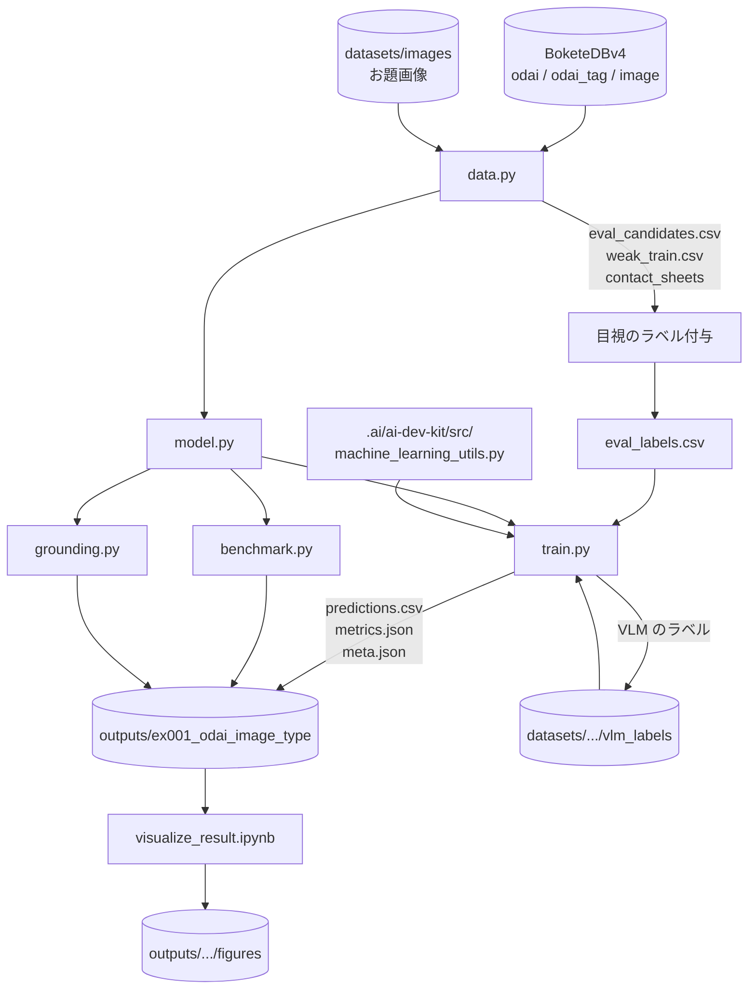
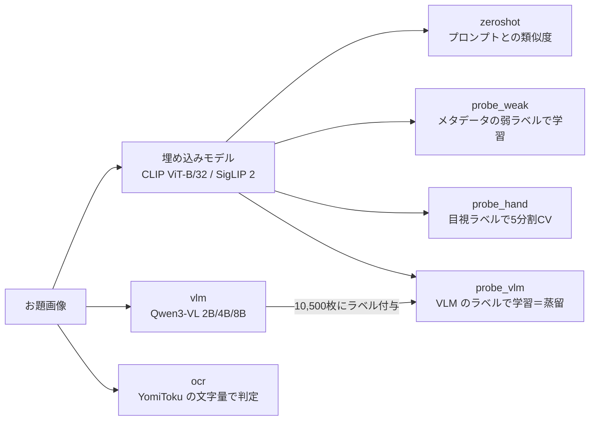
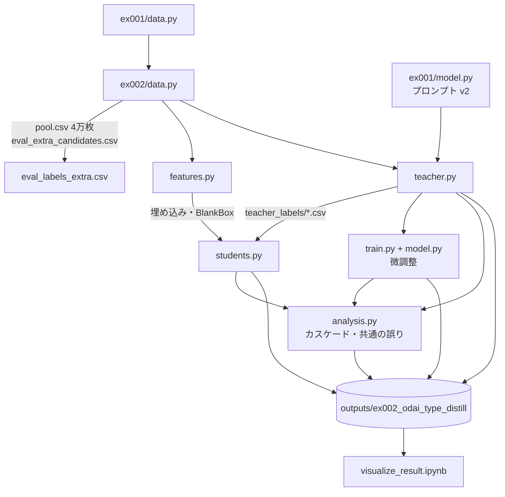
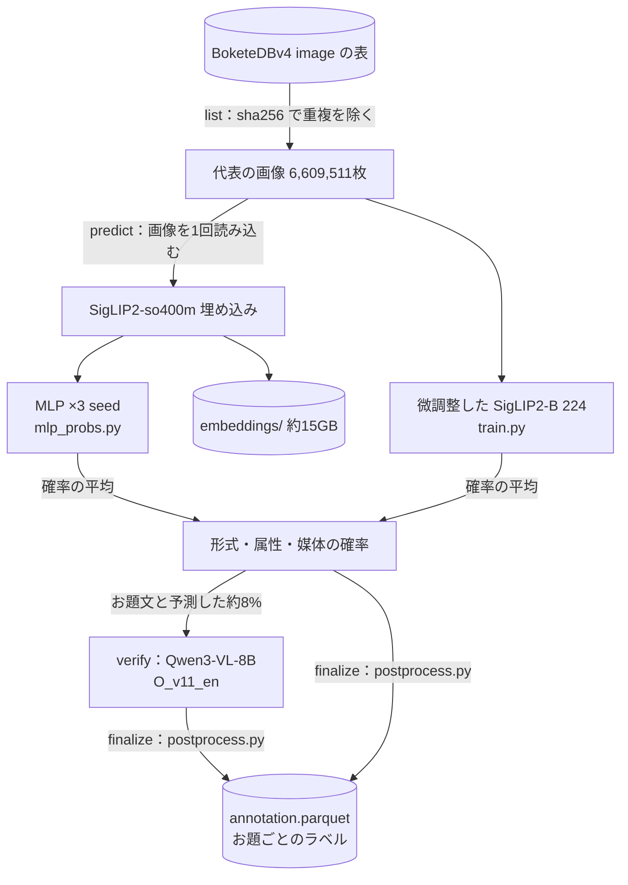

# Bokete_Annotation_v5

## 1. 概要

本リポジトリは，大喜利投稿サイト「ボケて」の1次データベース BoketeDBv4 に注釈を付与し，AIの学習やデータ分析に用いるデータベース BoketeDBv5 を構築するためのプログラムと実験の記録を管理する．現時点では，お題画像の種別（現実画像，アニメ，漫画，文章のお題，穴埋め，カルタ）を有料APIを用いずに単一GPUのローカル環境で判定する方法を比較する実験として，手法の系統を比較した ex001 と，ex001 の最良の方法（VLM から埋め込みモデルへの蒸留）の各要素（教師の VLM，教師ラベルの画像と枚数，生徒の分類器，カスケード）を入れ替えて比較した ex002 を収める．その後，ラベルの定義（programs/label_guideline/，最新は定義書 v4）を改訂しながら蒸留の方法を改良し（ex003〜ex008），ex009 で最終版のアノテーションの方法を決めた．

最終版（programs/ex009_final/annotate_all.py，構成は outputs/ex009_final/final_config.json）は，全てのお題画像に形式（カルタ，穴埋め，お題文，通常），属性（空欄あり，カルタ記号あり，文字あり），媒体（写真，アニメ，ゲーム，マンガ，テキストグラフィック，絵画，イラスト）を付ける．生徒の確率（SigLIP2-so400m の埋め込みに対する MLP の3 seed と，微調整した SigLIP2-B の平均）で予測し，お題文と予測した画像にのみ Qwen3-VL-8B の確認の質問（O_v11_en）を行う．方法と根拠は .reports/report_013.md にまとめた．

全データのアノテーションは，研究用のプログラムに依存しない独立したパッケージ `Bokete_Annotation_programs_v5.0/` で行う（GitHub で独立したリポジトリとして公開する予定）．使い方，前提データと出力の形式は，そのディレクトリの README.md と docs/ にある．結果は `Bokete_Annotation_programs_v5.0/outputs/BoketeDBv5_annotation/` に保存する．ex009 の `annotate_all.py` と同じ結果になることを，無作為の2万枚で確かめた（全てのラベルと確率が一致）．全データ（6,823,270件）のアノテーションは order_014 で完了した（.reports/report_014.md）．order_018 で，写真のキャプション（caption の段階，Qwen3-VL-30B-A3B）をパッケージに加え，`annotation.parquet` に列 `caption`，`caption_ok` を加えた（.reports/report_018.md，バージョン 5.1.0）．

## 2. ディレクトリとファイルの役割

```text
./
├── .ai/                          # AI開発の規約とエージェント（サブモジュール）
├── .orders/order_{n:03}.md       # 作業の指示とその解釈
├── .reports/report_{n:03}.md     # 作業ごとのレポート（PDF も同じ場所に置く）
├── Bokete_Annotation_programs_v5.0/  # 全データのアノテーションの独立したパッケージ（README.md，docs/ を参照．models/*.pth と outputs/ は Git の管理外）
│   ├── annotate.py               # 実行のエントリーポイント（list → predict → verify → finalize → caption）
│   ├── config.json               # 最終版の構成（モデル，確認の質問）
│   ├── bokete_annotation/        # labels，data，models，verify，caption，postprocess，pipeline
│   ├── models/                   # 重み（mlp_so400m_seed{0,1,2}.pth，siglip2_b224_finetune_seed0.pth）とチェックサム
│   ├── docs/                     # label_definition.md，method.md，data_format.md
│   ├── scripts/check_models.py，tests/test_postprocess.py
│   └── outputs/                  # アノテーションの結果
├── programs/
│   └── ex001_odai_image_type/    # お題画像の種別判定の比較実験
│       ├── data.py               # 評価用・弱ラベル学習用の画像の抽出，コンタクトシートの作成，ラベルの読み込み
│       ├── model.py              # 埋め込みモデル，ゼロショット分類，線形プローブ，VLM，OCR の分類器
│       ├── train.py              # 各手法の実行と評価（結果を outputs/ に保存）
│       ├── benchmark.py          # 埋め込みモデルの実運用に近い条件での処理速度の測定
│       ├── grounding.py          # VLM による穴埋めの記号とカルタのひらがなの位置の検出の試行
│       └── eval_labels.csv       # 目視で付与した評価用ラベル（440件，Git で管理する）
│   └── ex002_odai_type_distill/  # 蒸留の各要素を入れ替えた比較実験
│       ├── data.py               # 追加の評価用画像と教師ラベル用の4万枚の抽出，評価用ラベルの結合，データローダー
│       ├── features.py           # 埋め込み（CLIP-B/32，SigLIP2-B，SigLIP2-so400m）と空欄の矩形の特徴の計算
│       ├── teacher.py            # 教師の VLM の評価，4万枚へのラベル付け，多数決
│       ├── students.py           # 生徒の分類器（ロジスティック回帰，MLP，k 近傍法）の比較と学習曲線
│       ├── model.py              # 微調整する画像エンコーダ（ConvNeXt-Tiny，SigLIP2-B）
│       ├── train.py              # 画像エンコーダの微調整（loss_func，metrics_func，iteration，epoch，train）
│       ├── analysis.py           # ex001 の方法の再評価，規則，カスケード，教師の一致率，共通の誤りの分析
│       ├── common.py             # 評価と結果の保存の共通処理
│       └── eval_labels_extra.csv # 追加の評価用ラベル（無作為抽出200件，Git で管理する）
│   ├── ex011_caption_final/      # 写真のキャプションの本番前の検証と本番用のスクリプト
│   │   ├── caption_all.py        # 本番用（30B-A3B，短い指示，再現性の設定あり．5万枚ごとに保存し再開できる）
│   │   ├── postprocess_captions.py # 品質の目印（caption_ok）とお題ごとへの展開
│   │   ├── judge_eval2.py        # 評価用データ240枚での採点
│   │   ├── run_checks.sh，run_checks2.sh # 2万枚の試行，中断と再開，再現性の検証
│   │   └── reference_captions_eval2.txt # 追加の評価用データ120枚の参照キャプション（Git で管理する）
│   ├── ex010_photo_caption/      # 写真のキャプションの生成方法の比較（試作．v5.0 の結果は読み込みのみ）
│   │   ├── data.py               # 写真の抽出，評価用データ（120枚）と速度の測定用データ（2,000枚）
│   │   ├── generate.py           # VLM（Qwen3-VL 2B〜32B，解像度，指示）によるキャプションの生成と速度の測定
│   │   ├── translate.py          # 英語のキャプションの日本語への翻訳
│   │   ├── retrieval.py          # v5.0 の埋め込みを用いた近傍の検索によるキャプション
│   │   ├── judge.py              # Qwen3-VL-32B による採点
│   │   ├── manual_check.py       # 目視の採点の一覧と，採点者との一致の集計
│   │   ├── summarize.py          # 速度と精度の表と図
│   │   ├── common.py             # 一覧画像，処理速度の記録
│   │   ├── reference_captions.txt # 評価用データの参照キャプション（Git で管理する）
│   │   └── manual_scores.txt     # 目視の採点（Git で管理する）
│   ├── ex009_final/              # 最終版：生徒のモデルと後処理の比較，全データのアノテーション
│   │   ├── data.py               # ex008 のラベル（定義書 v4）に，お題文の補足による形式の見直し（format_relabel.txt）を反映
│   │   ├── train.py              # SigLIP2-B（224/384 画素）の微調整（教師 T_v10oJXk または T_v11，重みなし）
│   │   ├── mlp_probs.py          # 埋め込みの MLP の学習し直し（確率と重みの保存）
│   │   ├── postprocess.py        # 後処理（カルタの取り消し，お題文の確認の質問）．compare.py と annotate_all.py で共用
│   │   ├── compare.py            # モデル・組み合わせ・後処理の比較（dev/test，少ない区分，実データ）と図
│   │   ├── figures.py            # 最終版の項目ごとの精度と，report_013 の図
│   │   ├── annotate_all.py       # 全データのアノテーション（list → predict → verify → finalize．再開可能）
│   │   ├── common.py             # 3軸の評価と結果の保存
│   │   ├── format_relabel.txt    # お題文の補足で形式を見直した目視ラベル（Git で管理する）
│   │   └── verify_reject_labels.txt # 確認の質問がお題文ではないとした146枚の目視の形式（Git で管理する）
│   ├── ex008_label_v4/           # 定義書 v4（文字ありにロゴ等を含める），お題文の確認の質問，目視ラベルの層別追加
│   │   ├── data.py               # v4 の評価用ラベル（文字ありの見直しを反映）と実データの目視ラベルの読み込み
│   │   ├── sample.py             # 生徒の予測による層別抽出（11層×20枚）と，文字ありの見直し用の一覧の作成
│   │   ├── teacher_v4.py         # 教師の構成（形式 F_v2/F_v9a〜c，お題文の確認 O_v10_en，文字あり J/X/JXk）の評価と教師ラベルの作成
│   │   ├── students.py           # 埋め込みに対する3出力の MLP（重みなし．目視ラベルの画像の確率も保存）
│   │   ├── analyze.py            # 評価用データ・少ない区分・実データ（無作為，層別，逆確率重みの推定）での集計と図
│   │   ├── figures.py            # report_012 の実例の図
│   │   ├── common.py             # 3軸の評価と結果の保存
│   │   ├── text_relabel.txt      # 評価用データの文字ありの見直し（Git で管理する）
│   │   ├── real_random_v4.txt    # 実データの無作為抽出160枚の目視ラベル（v4，Git で管理する）
│   │   └── real_strat_v4.txt     # 実データの層別抽出220枚の目視ラベル（Git で管理する）
│   ├── ex007_label_v3/           # 定義書 v3（文字ありへの統合，CG の削除）の教師・生徒と実データでの確認
│   │   ├── data.py               # v3 の項目，評価用ラベルの変換（CG の振り分け直し），教師ラベルの読み込み
│   │   ├── teacher_v3.py         # 教師 T_v9（媒体 M_v9）と T_v8m（M_v6 の読み替え）の評価と教師ラベルの作成
│   │   ├── students.py           # 埋め込みに対する3出力の MLP（seed 0 は未使用の実データ約29.5万枚にもアノテーション）
│   │   ├── real_check.py         # 実データの無作為抽出160枚の一覧の作成と，目視のラベルに対する集計
│   │   ├── summarize.py          # 全条件の集計と図
│   │   ├── common.py             # 3軸の評価と結果の保存
│   │   ├── cg_relabel.txt        # 目視で CG とした57枚の v3 の媒体（Git で管理する）
│   │   └── real_check_v3.txt     # 実データ160枚の目視のラベル（Git で管理する）
│   ├── label_guideline/          # ラベルの定義書（label_definition_v4.md が最新）
│   ├── ex005_rare_weighted_distill/  # 定義書 v2（3軸），プロンプトの比較，少ない区分の追加と重み付き損失
│   │   ├── data.py               # 3軸の項目，評価用データの dev/test 分割，教師ラベル（基本と追加分）の読み込み
│   │   ├── prompts.py            # プロンプトの部品（F_v2，F_v6，F_v6_hr，F_v6_cot，J_v6，J_v7，A_v6，M_v6，M_v7）
│   │   ├── teacher.py            # 部品を Qwen3-VL-8B で画像の集合に適用
│   │   ├── combine.py            # 部品を組み合わせた教師の構成と評価，教師ラベルの作成
│   │   ├── mine.py               # 少ない区分（ゲーム，CG，絵画，カルタ）の候補の収集
│   │   ├── students.py           # 埋め込みに対する3出力の MLP（重み付き損失，しきい値の調整）
│   │   ├── train.py              # SigLIP2-B の3出力の微調整（重み付き損失）
│   │   ├── rare_eval.py          # 少ない区分の評価用データの作成と評価
│   │   ├── examples.py           # レポート用の実例の図
│   │   ├── annotate_real.py      # 蒸留モデルによる実データのアノテーションと，少ない区分の評価用データ第2版の層別抽出
│   │   ├── combine_v8.py         # 改善策（v8 の部品）を組み合わせた教師の構成と評価（通常と少ない区分の評価用データ）
│   │   ├── rare_eval_v8.py       # 教師 T_v8 の教師ラベルの作成と，生徒の少ない区分の評価・実データでの推定
│   │   ├── figures_v8.py         # report_009 の図
│   │   ├── common.py             # 3軸の評価と結果の保存
│   │   ├── rare_eval_labels.txt  # 少ない区分の評価用ラベル 第1版（200枚，Git で管理する）
│   │   └── rare_eval_labels_v2.txt # 少ない区分の評価用ラベル 第2版（600枚，層別抽出，Git で管理する）
│   ├── ex004_four_axis_distill/  # 確定版の4軸の定義による蒸留
│   │   ├── data.py               # 4軸の項目の定義，目視ラベル（eval_labels_v1.txt）の読み込み，データローダー
│   │   ├── teacher.py            # Qwen3-VL-8B のプロンプト v3〜v5 による教師の評価と4万枚へのラベル付け
│   │   ├── rules.py              # 定義書の規則（作品不明）とボケの書き出しによるカルタの照合
│   │   ├── make_teacher_labels.py# 4万枚の VLM の出力に規則を適用した教師ラベルの作成
│   │   ├── hybrid.py             # 形式は v2，他の軸は v5+規則とする組み合わせ教師
│   │   ├── students.py           # 埋め込みに対する4軸の生徒（ロジスティック回帰，MLP）
│   │   ├── model.py, train.py    # SigLIP2-B の4出力の微調整
│   │   ├── baseline.py           # ex002 の予測の新定義の形式での評価（参考）
│   │   ├── examples.py           # レポート用の実例の図
│   │   ├── common.py             # 4軸の評価と結果の保存
│   │   └── eval_labels_v1.txt    # 確定版の定義による目視ラベル（640枚，Git で管理する）
│   ├── ex006_label_scheme/
│   │   └── analyze_schemes.py    # クラスの統合・削除の案を既存の予測の読み替えで比較（report_010）
│   ├── ex003_user_scheme_pilot/
│   │   ├── pilot.py              # ラベル定義の草案を Qwen3-VL-8B に適用するパイロットと，ボケの統計の結合
│   │   └── analyze.py            # ボケの書き出しによるカルタの判別，論点ごとの実例の図（report_004）
│   └── label_guideline/
│       ├── label_definition_v1.md     # ラベル定義 第1版（4軸）
│       ├── label_definition_v2.md     # ラベル定義 第2版（3軸，テロップの扱いを明記）
│       └── make_edge_case_figures.py  # ラベル定義の改訂案（report_003）の境界事例の図の作成
├── datasets/ex00{1,2}_*/         # 抽出したID，埋め込みと特徴量，VLM のラベル（Git 管理外）
├── outputs/ex00{1,2}_*/          # 実験結果と図（Git 管理外）
├── visualize_result.ipynb        # outputs/ を走査して結果を可視化するノートブック
├── requirements_annotate.txt     # 仮想環境 .venv_annotate のライブラリ
└── document.md                   # 本文書
```

## 3. プログラムの依存関係



`train.py` の手法は以下の関係にある．



ex002 のプログラムの関係を以下に示す．ex002 の `data.py` は ex001 の `data.py` を別名 `ex001_data` として読み込み，`teacher.py` は ex001 の `model.py` からプロンプト v2 を読み込む．



ex009（最終版）のアノテーションの処理の流れを以下に示す．生徒は ex008 の教師 T_v10oJXk の教師ラベルで学習した．



外部モジュールとして，`.ai/ai-dev-kit/src/machine_learning_utils.py` の `set_seed` と `ResultLogger` を用いる．

## 4. 環境構築

Python 3.10 と CUDA 対応の GPU を前提とする．仮想環境は `uv` で作成する．

```bash
uv venv .venv_annotate --python 3.10
uv pip install --python .venv_annotate/bin/python -r requirements_annotate.txt
.venv_annotate/bin/python -m ipykernel install --user --name venv_annotate --display-name "Python (.venv_annotate)"
```

動作を確認した環境は，NVIDIA RTX PRO 6000 Blackwell（VRAM 96GB），CUDA 13.0，torch 2.11.0，transformers 5.12.1，vLLM 0.23.0 である．vLLM は JIT コンパイルに `ninja` を用いるため，`model.py` は仮想環境の `bin` を `PATH` に加えてから vLLM を読み込む．

## 5. 実行方法

```bash
# 1. 評価用画像（440枚）と弱ラベル学習用画像（10,500枚）の抽出，コンタクトシートの作成
.venv_annotate/bin/python programs/ex001_odai_image_type/data.py
# 2. 埋め込みモデルの手法
.venv_annotate/bin/python programs/ex001_odai_image_type/train.py --methods zeroshot probe_weak probe_hand
# 3. VLM の手法（プロンプトの版と入力画素数を指定できる）
.venv_annotate/bin/python programs/ex001_odai_image_type/train.py --methods vlm --prompts v1 v2
# 4. VLM のラベルで弱ラベル学習用画像に注釈を付け，線形プローブへ蒸留する
.venv_annotate/bin/python programs/ex001_odai_image_type/train.py --methods vlm --vlm_models Qwen/Qwen3-VL-8B-Instruct --label_weak
.venv_annotate/bin/python programs/ex001_odai_image_type/train.py --methods probe_vlm
# 5. OCR，速度の測定，位置の検出
.venv_annotate/bin/python programs/ex001_odai_image_type/train.py --methods ocr
.venv_annotate/bin/python programs/ex001_odai_image_type/benchmark.py
.venv_annotate/bin/python programs/ex001_odai_image_type/grounding.py
# 6. 可視化
.venv_annotate/bin/jupyter nbconvert --to notebook --execute --inplace visualize_result.ipynb
```

ex002 の実行方法は以下のとおりである．

```bash
# 1. 追加の評価用画像200枚と教師ラベル用の画像4万枚の抽出（評価用画像は目視で eval_labels_extra.csv にラベルを付ける）
.venv_annotate/bin/python programs/ex002_odai_type_distill/data.py
# 2. 埋め込みと空欄の矩形の特徴
.venv_annotate/bin/python programs/ex002_odai_type_distill/features.py
# 3. 教師の VLM の評価とラベル付け，多数決
.venv_annotate/bin/python programs/ex002_odai_type_distill/teacher.py --models Qwen/Qwen3-VL-8B-Instruct Qwen/Qwen3-VL-30B-A3B-Instruct-FP8 --label_pool
.venv_annotate/bin/python programs/ex002_odai_type_distill/teacher.py --models Qwen/Qwen3-VL-32B-Instruct-FP8 OpenGVLab/InternVL3_5-8B openbmb/MiniCPM-V-4_5
.venv_annotate/bin/python programs/ex002_odai_type_distill/teacher.py --vote Qwen3-VL-8B-Instruct Qwen3-VL-32B-Instruct-FP8 Qwen3-VL-30B-A3B-Instruct-FP8
# 4. 生徒の分類器
.venv_annotate/bin/python programs/ex002_odai_type_distill/students.py --suite classifier features size
.venv_annotate/bin/python programs/ex002_odai_type_distill/students.py --suite teacher --teachers Qwen3-VL-30B-A3B-Instruct-FP8
# 5. 画像エンコーダの微調整（処理速度は他の GPU の処理を止めて --speed_only で測り直す）
.venv_annotate/bin/python programs/ex002_odai_type_distill/train.py
.venv_annotate/bin/python programs/ex002_odai_type_distill/train.py --speed_only
# 6. 分析（ex001 の方法の再評価，規則，教師の一致率，カスケード，共通の誤り）
.venv_annotate/bin/python programs/ex002_odai_type_distill/analysis.py --tasks baseline rule agreement common_errors teacher_disagreement \
    --cascade_students student_logreg/Qwen3-VL-8B-Instruct__siglip2-so400m-patch14-384__nall finetune_siglip2_base/Qwen3-VL-8B-Instruct_lr3e-05_ep5
```

ex004 の実行方法は以下のとおりである．

```bash
.venv_annotate/bin/python programs/ex004_four_axis_distill/teacher.py --prompt v5 --label_pool   # 教師（4万枚に約1.7時間）
.venv_annotate/bin/python programs/ex004_four_axis_distill/teacher.py --prompt v5 --rules_only   # 規則の評価
.venv_annotate/bin/python programs/ex004_four_axis_distill/make_teacher_labels.py
.venv_annotate/bin/python programs/ex004_four_axis_distill/hybrid.py
.venv_annotate/bin/python programs/ex004_four_axis_distill/students.py --teachers hybrid_v2format_v5rules Qwen3-VL-8B-Instruct_v5_rules
.venv_annotate/bin/python programs/ex004_four_axis_distill/train.py --teacher hybrid_v2format_v5rules
.venv_annotate/bin/python programs/ex004_four_axis_distill/examples.py
```

ex005 の実行方法は以下のとおりである．

```bash
D=programs/ex005_rare_weighted_distill
.venv_annotate/bin/python $D/teacher.py --sets eval                          # 全部品を評価用データに適用
.venv_annotate/bin/python $D/combine.py                                      # 教師の構成の比較
.venv_annotate/bin/python $D/teacher.py --components M_v7 J_v6 --sets pool   # 4万枚（F_v2 は ex002 のものを複製）
.venv_annotate/bin/python $D/combine.py --teachers T_v2_J6M7 --label_sets pool
.venv_annotate/bin/python $D/mine.py --teacher T_v2_J6M7                     # 少ない区分の収集
.venv_annotate/bin/python $D/students.py --teacher T_v2_J6M7 --tune
.venv_annotate/bin/python $D/train.py --teacher T_v2_J6M7
.venv_annotate/bin/python $D/rare_eval.py --make      # 抽出後，目視で rare_eval_labels.txt を作る
.venv_annotate/bin/python $D/rare_eval.py --evaluate --teachers T_v2_J6M7 T_v2_JM
.venv_annotate/bin/python $D/examples.py
# order_009：改善策の検証と評価用データの拡充
.venv_annotate/bin/python $D/annotate_real.py --annotate --sample   # 抽出後，目視で rare_eval_labels_v2.txt を作る
.venv_annotate/bin/python $D/teacher.py --components F_v8_en F_v8b_en F_v8c_en J_v8_en M_v8_en C_v8_en C_v8_ja P_v8_en P_v8_ja T_v8_en T_v8_ja --sets eval
.venv_annotate/bin/python $D/teacher.py --components F_v2 J_v6 M_v6 M_v8_en P_v8_en P_v8_ja --sets rare_eval rare_eval_v2
.venv_annotate/bin/python $D/combine_v8.py
.venv_annotate/bin/python $D/teacher.py --components M_v6 P_v8_en --sets pool rare_r00 rare_r01 rare_r02 rare_r03 rare_r04
.venv_annotate/bin/python $D/rare_eval_v8.py --make_labels
.venv_annotate/bin/python $D/train.py --teacher T_v8 --only_rare --weight_modes weighted weighted_sel
.venv_annotate/bin/python $D/students.py --teacher T_v8 --weight_modes weighted weighted_sel
.venv_annotate/bin/python $D/rare_eval_v8.py --evaluate
.venv_annotate/bin/python $D/figures_v8.py
# order_011：定義書 v3（M_v9 の部品を4万枚と追加分に適用した後に実行する）
E=programs/ex007_label_v3
.venv_annotate/bin/python $D/teacher.py --components M_v9 --sets eval rare_eval rare_eval_v2 pool rare_r00 rare_r01 rare_r02 rare_r03 rare_r04
.venv_annotate/bin/python $E/teacher_v3.py
.venv_annotate/bin/python $E/students.py --teacher T_v8m
.venv_annotate/bin/python $E/students.py --teacher T_v9
.venv_annotate/bin/python $E/summarize.py
.venv_annotate/bin/python $E/real_check.py --runs student_mlp/T_v8m__base+rare__weighted --make   # 抽出後，目視で real_check_v3.txt を作る
.venv_annotate/bin/python $E/real_check.py --runs $(ls outputs/ex007_label_v3/student_mlp | sed 's#^#student_mlp/#') --analyze
# order_012：定義書 v4，お題文の確認の質問，目視ラベルの層別追加
G=programs/ex008_label_v4
.venv_annotate/bin/python $G/sample.py --strat --text_recheck   # 抽出後，目視で real_strat_v4.txt と text_relabel.txt を作る
.venv_annotate/bin/python $D/teacher.py --components F_v9a F_v9b F_v9c O_v10_en X_v10_en F_v2 J_v6 M_v6 P_v8_en --sets eval rare_eval rare_eval_v2 real_check_v4
.venv_annotate/bin/python $D/teacher.py --components O_v10_en X_v10_en --sets pool rare_r00 rare_r01 rare_r02 rare_r03 rare_r04
.venv_annotate/bin/python $G/teacher_v4.py --labels T_v10o T_v10oJXk
.venv_annotate/bin/python $G/students.py --teacher T_v10o
.venv_annotate/bin/python $G/students.py --teacher T_v10oJXk
.venv_annotate/bin/python $G/analyze.py
.venv_annotate/bin/python $G/figures.py
# order_013：最終版（生徒の比較，後処理の比較，全データのアノテーション）
F=programs/ex009_final
.venv_annotate/bin/python $F/train.py --models b224 b384
.venv_annotate/bin/python $F/mlp_probs.py
.venv_annotate/bin/python $D/teacher.py --components O_v11_en --sets eval rare_eval rare_eval_v2 real_check_v4 pool rare_r00 rare_r01 rare_r02 rare_r03 rare_r04
.venv_annotate/bin/python $G/teacher_v4.py --teachers T_v11 --labels T_v11          # 比較用の教師（採用しない）
.venv_annotate/bin/python $F/mlp_probs.py --teacher T_v11
.venv_annotate/bin/python $F/train.py --models b224 --teacher T_v11 --seeds 0
.venv_annotate/bin/python $F/compare.py
.venv_annotate/bin/python $F/annotate_all.py --sample 20000 --out_dir outputs/ex009_final/annotation_test   # 少量での動作確認
.venv_annotate/bin/python $F/figures.py
# 全データ（約19時間．構成は outputs/ex009_final/final_config.json）
.venv_annotate/bin/python $F/annotate_all.py --out_dir datasets/ex009_final/BoketeDBv5_annotation
# order_015：写真のキャプションの生成方法の比較（試作）
C=programs/ex010_photo_caption
for m in q8_448_ja q8_256_ja q8_448_short q8_448_en q4_448_ja q2_448_ja q30a3_448_ja q32_448_ja q4_448_short q2_448_short q30a3_448_short q8_256_short; do
    .venv_annotate/bin/python $C/generate.py --method $m
done
.venv_annotate/bin/python $C/translate.py
.venv_annotate/bin/python $C/retrieval.py --make_pool
.venv_annotate/bin/python $C/generate.py --method q8_448_ja --no_speed --extra_set pool20k
.venv_annotate/bin/python $C/retrieval.py --predict
.venv_annotate/bin/python $C/judge.py
.venv_annotate/bin/python $C/manual_check.py --make     # 一覧を見て manual_scores.txt を作る
.venv_annotate/bin/python $C/manual_check.py --analyze
.venv_annotate/bin/python $C/summarize.py
# order_016：写真のキャプションの本番前の検証
bash programs/ex011_caption_final/run_checks.sh
bash programs/ex011_caption_final/run_checks2.sh
# 本番（約19.4時間．中断しても同じコマンドで再開できる）
.venv_annotate/bin/python programs/ex011_caption_final/caption_all.py --out_dir outputs/ex011_caption_final/photo_captions
.venv_annotate/bin/python programs/ex011_caption_final/postprocess_captions.py   # order_017：実施済み（report_017）
```

各スクリプトは `metrics.json` が既にある条件を省略するため，中断後に同じコマンドで再開できる．

### 論文（paper/）

これまでの経緯と分析をまとめた和文論文は `paper/` にある（`main.tex` から `sections/*.tex` を読み込む．図は `paper/figures/`）．
全データのラベルの分布と投稿年ごとの推移の図は，`Bokete_Annotation_programs_v5.0/outputs/BoketeDBv5_annotation/` の predict 段階の出力から作る．

```bash
.venv_annotate/bin/python programs/ex010_paper/full_distribution.py   # outputs/ex010_paper/full_distribution.json と paper/figures/fig_full_year_*.pdf
cd paper && latexmk -pdfdvi -synctex=1 main.tex && latexmk -c
```

## 6. 結果の保存場所

- 実験結果：`outputs/ex001_odai_image_type/{手法}/{設定}/{seed}/` に `predictions.csv`（画像ごとの予測），`metrics.json`（評価用データと学習用データの指標），`meta.json`（条件と処理速度）を保存する．
- ex005（3軸，少ない区分の追加と重み付き損失）：`outputs/ex005_rare_weighted_distill/`．部品の出力，教師ラベル，候補の埋め込みは `datasets/ex005_rare_weighted_distill/`．
- ex011（写真のキャプションの本番前の検証）：`outputs/ex011_caption_final/`（`test_20k_bi/`，`determinism*/`，`bi*/`，`resume/`，候補の方法の採点）．本番の出力は `outputs/ex011_caption_final/photo_captions/`（`captions.parquet`：画像ごと，`photo_captions_by_odai.parquet`：お題ごと，`summary.json`，`postprocess.json`）．order_017 で全写真に実施済み．
- ex010（写真のキャプション，試作）：`outputs/ex010_photo_caption/{方法}/`（`captions_{eval,speed}.csv`，`judge_eval.csv`，`meta.json`），`figures/summary.csv`，`fig_speed_quality.png`，`manual_check.json`．評価用データの分割と近傍の検索の候補は `datasets/ex010_photo_caption/`．
- ex009（最終版）：`outputs/ex009_final/`（微調整 `finetune/{b224,b384}/{教師}__base+rare/{seed}/`（重み，`probs_{eval,rare,check}.npz`），MLP `mlp/{教師}__base+rare/{seed}/`（`best_model.pth`，確率），比較 `compare/summary.csv`・図，`figures/final_metrics.json`，最終の構成 `final_config.json`，少量での動作確認 `annotation_test/`）．全データのアノテーションの出力先は `datasets/ex009_final/BoketeDBv5_annotation/`（`annotation.parquet`，`summary.json`，`embeddings/`）．
- ex008（定義書 v4）：`outputs/ex008_label_v4/`（教師 `teacher_{名前}/rules/0/`（`check_predictions.csv` は実データの目視ラベルの画像への予測），生徒 `student_mlp/{教師}__{base|base+rare}__unweighted/{seed}/`（`check_probs.npz`，seed 0 の `real_annotation_v4.parquet`），`figures/summary.csv`，`real_check.json`，図）．層別抽出の一覧と抽出の表は `datasets/ex005_rare_weighted_distill/real_check_v4/`，目視ラベルの画像のお題IDは `candidates/real_check_v4.csv`．
- ex007（定義書 v3）：`outputs/ex007_label_v3/`（教師 `teacher_{T_v9,T_v8m}/`，生徒 `student_mlp/{教師}__{base|base+rare}__{unweighted|weighted}/{seed}/`，seed 0 の `real_annotation_v3.parquet` は実データ294,802枚のアノテーション，`figures/summary.csv`，`fig_summary.png`，`real_check.json`）．教師ラベルは `datasets/ex005_rare_weighted_distill/teacher_labels/{T_v9,T_v8m}_{pool,rare}.csv`，確認用の一覧は `datasets/ex005_rare_weighted_distill/real_check_v3/`．
- ex006（ラベルの設定の比較）：`outputs/ex006_label_scheme/`（scheme_summary.csv，per_item.csv，fig_schemes.png）．
- ex004（4軸の蒸留）：`outputs/ex004_four_axis_distill/`．教師ラベルとボケの統計は `datasets/ex004_four_axis_distill/`．
- ラベル定義の草案のパイロット：`outputs/ex003_user_scheme_pilot/`（`predictions_with_boke_signals.csv`，`boke_stats.json`，`analysis.json`，図）．
- ラベル定義の改訂案の境界事例：`outputs/label_guideline/`（`edge_cases.csv` と図）．定義の改訂案は `.reports/report_003.md` の第5章にある．
- 図と集計表：`outputs/ex001_odai_image_type/figures/`，`outputs/ex002_odai_type_distill/figures/`．
- ex002 の微調整：`outputs/ex002_odai_type_distill/finetune_{モデル}/{教師}_lr{学習率}_ep5/{seed}/` に `log.json`（エポックごとの学習用・検証用の誤差と正解率），`best_model.pth`，`last_model.pth`，`last_optimizer.pth` を保存する．
- ex002 の教師ラベルと特徴量：`datasets/ex002_odai_type_distill/teacher_labels/`，`datasets/ex002_odai_type_distill/features/`．
- 埋め込みのキャッシュと VLM のラベル：`datasets/ex001_odai_image_type/embeddings/`，`datasets/ex001_odai_image_type/vlm_labels/`．
- 論文：`paper/main.pdf`（ソースは `paper/main.tex`，`paper/sections/`）．全データの集計は `outputs/ex010_paper/full_distribution.json`．
- レポート：`.reports/report_{n:03}.md` と同名の PDF．

## 7. 設定ファイルと Git 管理上の注意

- `tokens.json` は API トークンを格納し，`.gitignore` で Git の管理から除外する．本実験で用いたモデルはすべて公開モデルであり，トークンは不要である．
- `datasets/`，`outputs/`，`.venv_*/` は Git の管理から除外する．目視の評価用ラベル `programs/ex001_odai_image_type/eval_labels.csv`，`programs/ex002_odai_type_distill/eval_labels_extra.csv`，`programs/ex004_four_axis_distill/eval_labels_v1.txt`，`programs/ex005_rare_weighted_distill/rare_eval_labels.txt`，`rare_eval_labels_v2.txt`，`programs/ex007_label_v3/cg_relabel.txt`，`real_check_v3.txt`，`programs/ex008_label_v4/text_relabel.txt`，`real_random_v4.txt`，`real_strat_v4.txt`，`programs/ex009_final/format_relabel.txt`，`verify_reject_labels.txt`，`programs/ex010_photo_caption/reference_captions.txt`，`manual_scores.txt`，`programs/ex011_caption_final/reference_captions_eval2.txt` は再現に必須であるため Git で管理する．
- BoketeDBv4 は `/mnt/d/Bokete_Scraping_v3.2/outputs/BoketeDBv4/`，お題画像は `/mnt/d/Bokete_Scraping_v3.2/datasets/images/` を参照する（`data.py` の `DB_DIR`，`IMAGE_DIR`）．
